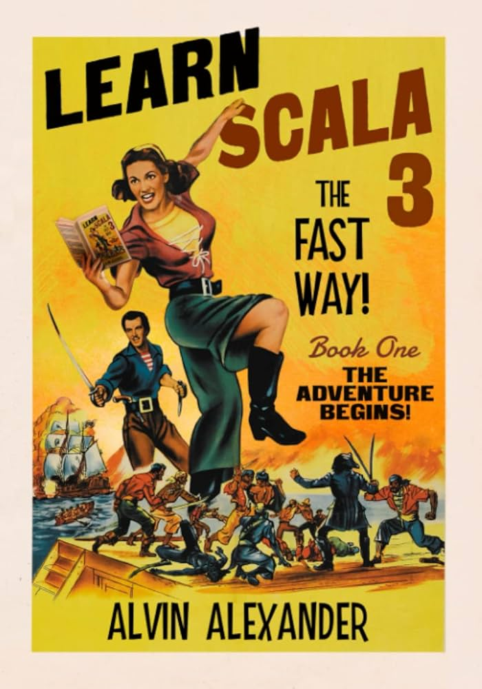

### Prof. Dr. Marko Boger, Prof. Dr. Pascal Laube
## Programmiertechnik I
# Lecture 08: Tuples, Objects, Enums and Classes

<p class="small">the type system in Scala</p>

---

<!-- _class: inhalt -->

# Goals

<div class="columns" style="grid-template-columns: 1fr 260px; align-items: start;">
<div markdown="1">

In this lecture you will learn about

- Tuples, a data structure for values of different type
- Objects, a first encapsulation of data and functions with a single instance
- Enums, an abstraction with a fixed set of instances
- Classes, an abstraction with a variable set of instances
- Case Classes, compact classes for immutable data

Supporting literature:

- Learn Scala 3 the Fast Way, chapters 20, 62–68, 71–73 and 75

</div>
<div markdown="1">



</div>
</div>

---

<!-- _class: kapitel -->

## 1
# Types: Tuples, Objects, Enums, Classes, Case Classes

From single values to structured types

---

# About Types

A **Type** is the formal description of what form a parameter to a function can be, or a function can return, or a variable can have.

In Scratch, we only have the types Number, String and Boolean.
In Scala: `Int`, `Boolean`, `String`, but also `Array`, `List` and mappings between types.

```scala
val x: Int = 42
var name: String = "Luke"
def f(x: Int): Int = x + 1
def sum(xs: List[Int]): Int = { … }
def f1(x: Int): Int => Int = x => x + 1
def f2(x: Int): Int = x + 2
def f3(x: Int) = x + 3
def isEven(x: Int): Int => Boolean = x => x % 2 == 0
def isOdd(x: Int): Boolean = x % 2 != 0
```

In this lecture, we will get to know more Types.

---

# Tuples

We have seen Array and List, which hold data of the same type.
But what if we have data of different type?
A simple solution is the **Tuple** type.

```scala
val tuple = (42, "Luke", true)  // : Tuple3[Int, String, Boolean]
tuple._1  // : 42
tuple._2  // : "Luke"
tuple._3  // : true
```

- Scala has `Tuple2`, `Tuple3`, `Tuple4`, … , `Tuple22`, …
- Tuples are **immutable**
- Their fields can be accessed with `_1`, `_2`, …

---

<style scoped>
section pre {
  position: relative;
}
section pre::after {
  content: "C";
  position: absolute;
  top: 0.35em;
  right: 0.65em;
  font-family: system-ui, sans-serif;
  font-size: 0.72em;
  font-weight: 700;
  letter-spacing: 0.02em;
  opacity: 0.85;
  line-height: 1;
  pointer-events: none;
}
</style>

# Tuples compared to Struct

Other languages have similar data types, especially procedural languages, like C.

```c
struct Person {
  char name[50];
  int age;
};
struct Person p = {"Luke", 42};
p.age = 67; // Mutable
```

- In C, Structs are **mutable**, and fields are **named**
- In Scala, Tuples are **immutable**, and fields are **anonymous**

---

# Usage of Tuple

Tuples are usually not used to model important data structures.
They are used in a light-weight fashion, for example to return two results from a function.

```scala
def div(x: Int, y: Int): (Int, Int) = (x / y, x % y)

val divResult = div(10, 3)  // : Tuple2[Int, Int] = (3, 1)
divResult._1  // : Int = 3
divResult._2  // : Int = 1
```

---

# Assignment to Tuple

A Tuple can be assigned to another Tuple.
In this step, the anonymous fields can be assigned to named fields.

```scala
val (quotient, remainder) = div(10, 3)
quotient   // : Int = 3
remainder  // : Int = 1
```

This is also referred to as **pattern matching**.

However, do not over-use Tuples – for important data structures we have more tools.

---

# Object

Objects are much like the sprites from Scratch.
They can have data and functions. But there is only **one instance** of them.
This is sometimes called a **singleton**.

```scala
object Earth {
  // Data
  val radius: Double = 6371.0 // Average Earth radius in km
  val pi: Double = 3.14159
  var population: Int = 8_000_000_000

  // Function: Returns surface area and equatorial circumference
  def surfaceArea(): Double = 4 * pi * radius * radius
  def circumference(): Double = 2 * pi * radius
}

val area = Earth.surfaceArea()
val circumference = Earth.circumference()
println(s"Earth: Surface Area = $area km², Equatorial Circumference = $circumference km")
```

---

# Addressing Objects

Objects can be accessed directly by their name. We do not have to pass a reference.
This has some advantages – for example for constants, utilities, or factories.
Objects are often used as the starting point of an application.

```scala
object MyFirstApplication {
  def main(args: Array[String]): Unit = {
    println("Hello, World!")
  }
}

// instead of an object we can use @main
@main def hello(): Unit = println("Hello, World!")
```

But it can also lead to messy code. So use them carefully, and sparsely.

---

# Enums

Enums can model data structures of which there is a **small and fixed** amount, like Weekdays or CardTypes.
The instances can just be separated by a comma or by a `case` keyword.

```scala
enum Weekday {
  case Monday, Tuesday, Wednesday, Thursday, Friday,
    Saturday, Sunday
}

enum CardType {
  case Heart, Diamond
  case Club, Spade
}
```

---

# Console Colors

A nice example for an Enum is **Colors**.
Each `case` can **extend** the enum’s constructor and pass its own arguments — here an ANSI escape code for the console:

```scala
enum ConsoleColors(val code: String) {
  case CLEAR  extends ConsoleColors("\u001B[0m")
  case RED    extends ConsoleColors("\u001B[31m")
  case GREEN  extends ConsoleColors("\u001B[32m")
  case YELLOW extends ConsoleColors("\u001B[33m")
  case BLUE   extends ConsoleColors("\u001B[34m")
  case PURPLE extends ConsoleColors("\u001B[35m")
  case CYAN   extends ConsoleColors("\u001B[36m")
  case WHITE  extends ConsoleColors("\u001B[37m")

  def apply(text: String): String = s"$code$text${CLEAR.code}"
}
```

---

# Importing Enums

Enums, like Objects, can be addressed by their full name:

```scala
ConsoleColors.RED("Error!")
```

But if you import the Enum, you can use the cases directly:

```scala
import ConsoleColors._
RED("Error!")
YELLOW("Warning!")
GREEN("Success!")
```

Then it can very nicely be used for colored output to the console:

```scala
println(RED("Error!"))
```

---

# Classes

Classes are similar to Objects or Enums.
But while Objects and Enums are directly accessible, classes are only **templates** to create an object.
They can not be accessed directly – we need to **instantiate** them.

We use them for data structures of which we have a varying number and potentially a lot of them.
Classes usually are named after subjects of a domain, like `Person` or `Planet`.

```scala
class Person(name: String, age: Int)
class Planet(name: String, radius: Double)
```

---

# Instantiating Objects from Classes

The Class is a template from which objects are instantiated.

```scala
class Person(name: String, age: Int)
class Planet(name: String, radius: Double)
```

To create a new instance, the `new` keyword can be used:

```scala
val luke = new Person("Luke", 42)
val earth = new Planet("Earth", 6371.0)
```

In many situations, the `new` keyword can be omitted:

```scala
val lea = Person("Lea", 25)
val mars = Planet("Mars", 3390.0)
```

Note: Classes are written with a capital first letter, so are objects.
But instances of classes are assigned to variables/values and they are written with a small first letter.

---

# Classes can have Data and Functions

Classes can have their internal data and their own functions.
Functions of a class are called **Methods**. Methods can be called on the instance.

```scala
class Planet(name: String, radius: Double) {
  val pi: Double = 3.14159
  def surfaceArea(): Double = 4 * pi * radius * radius
  def circumference(): Double = 2 * pi * radius
}

val earth = new Planet("Earth", 6371.0)
earth.surfaceArea()
earth.circumference()
```

---

# Parameters of Classes

The Parameters of a Class are part of their internal data.
They are initiated at the creation of the instance.
They can be passed in the order of their appearance or they can be called by their name.

```scala
val luke = new Person("Luke", 42)
val lea = new Person(name = "Lea", age = 25)
val anakin = new Person(age = 69, name = "Anakin")
```

---

# Default Values for Parameters

Parameters can be assigned a default value.
Then it is optional to provide this parameter at instantiation.

Rocky planets have a similar density, but gas planets have a very different density.
So we can provide a default density and only provide a density for gas planets.

```scala
class Planet(name: String, radius: Double, density: Double = 5.514) {
  val pi: Double = 3.14159
  def surfaceArea(): Double = 4 * pi * radius * radius
  def circumference(): Double = 2 * pi * radius
  def mass(): Double = density * radius * radius * radius
}

val earth = new Planet("Earth", 6371.0)
val jupiter = new Planet("Jupiter", radius = 71492.0, density = 1.326)
```

---

# Evaluation at Construction

Values are calculated at the creation time of an instance.
So, in case of the Planet, circumference, mass and volume can be calculated just once at construction.

```scala
class Planet(name: String, radius: Double, density: Double = 5.514) {
  val pi: Double = 3.14159
  val surfaceArea: Double = 4 * pi * radius * radius
  val circumference: Double = 2 * pi * radius
  val mass: Double = density * radius * radius * radius
}
```

Methods are calculated every time they are called.

---

# Lazy Evaluation

So, methods are evaluated at every call. Values are evaluated at creation time.
There is one more option. With a **lazy** evaluation, the value can be calculated once but at first call.

```scala
class Planet(name: String, radius: Double, density: Double = 5.514) {
  val pi: Double = 3.14159
  lazy val surfaceArea: Double = 4 * pi * radius * radius
  lazy val circumference: Double = 2 * pi * radius
  lazy val mass: Double = density * radius * radius * radius
}
```

This is rarely used in normal classes. It will become relevant when we get to Streams and Modules.

---

# Visibility

By default, methods of a class can be accessed from the outside.
But we can make these **private**. Now, `pi` and `mass` can not be accessed from outside.
Parameters are by default not visible, but if they are declared as `var` or `val`, they are.

```scala
class Planet(val name: String, val radius: Double, density: Double = 5.514) {
  private val pi: Double = 3.14159
  def surfaceArea(): Double = 4 * pi * radius * radius
  def circumference(): Double = 2 * pi * radius
  private def mass(): Double = density * radius * radius * radius
}

println(earth.name)
println(earth.radius)
// println(earth.density) // does not compile
println(earth.surfaceArea())
println(earth.circumference())
// println(earth.mass) // does not compile
```

---

# Case Classes

A **case class** is a compact form of a class for immutable data.
Scala generates useful methods for you: `equals`, `hashCode`, `toString`, and a companion `apply` so you usually omit `new`.
Parameters are `val` by default, and you get **pattern matching** for free — similar in spirit to destructuring a Tuple.

```scala
case class Person(name: String, age: Int)
case class Planet(name: String, radius: Double)

val luke = Person("Luke", 42)
val earth = Planet("Earth", 6371.0)

println(luke)                 // Person(Luke,42)
val Person(n, a) = luke       // n = "Luke", a = 42
luke == Person("Luke", 42)    // true
```

Use a normal `class` when you need mutable state, custom construction, or heavier encapsulation.
Prefer a `case class` for plain data records — the sweet spot between Tuples (anonymous fields) and full Classes.

---
<!-- _class: inhalt -->

# New Tools: Cursor and AI Coding Agents

---

# Why AI coding tools?

<style scoped>section { font-size: 24px; }</style>

Coding is no longer only typing alone in an editor.

- Large language models can **read**, **edit**, and **run** code with you
- New products wrap that into IDEs, terminals, and agent workflows
- As a student (and later at work) you will meet these tools every week

Short overview next: what **Cursor** is, then a comparison with **Codex** and **Google Antigravity**.

---

# Cursor (SpaceX SI)

<style scoped>section { font-size: 22px; }</style>

**Cursor** is an AI-first code editor from **SpaceX SI** (SpaceX Super Intelligence): a full IDE built on the **Visual Studio Code** codebase, with AI in the editing loop — not only a side chat.

- Familiar VS Code look: files, terminal, many extensions
- You open a folder / git repo; Cursor **indexes** it for context
- Ask in **Chat** or **Agent**, or accept **Tab** while typing; review diffs before you keep them
- Runs on macOS, Windows, and Linux

Think: “VS Code where the AI can see your project and change files with you.”

---

# Cursor: main features (compact)

<style scoped>section { font-size: 21px; }</style>

- **Tab** — next-edit completions (ghost text); strong for boilerplate and the obvious next line
- **Chat** — side panel with `@` files / folders / symbols; good for “where is X?” and explanations
- **Inline edits** — select code, ask for a change (Cmd/Ctrl+K style), accept a **diff**
- **Agent** — multi-step, multi-file tasks; can run terminal commands under your control
- **Codebase awareness** — repo search + open files guide the model (no secrets / exam content in prompts)

**Do:** clear goals, review every diff, small commits, run tests yourself.
**Don’t:** blind-accept large refactors; paste secrets or exam solutions into the model.

---

# Comparison: Cursor vs Codex vs Antigravity

<style scoped>section { font-size: 17px; }</style>

| | **Cursor** | **Codex** | **Google Antigravity** |
|---|---|---|---|
| **Strengths** | Full AI IDE; Tab + Chat + Agent in one app; deep codebase UX | Strong OpenAI agent in your current editor; cloud delegation | Gemini agents; multi-surface / mission-control style |
| **IDE integration** | *Is* the IDE (VS Code fork) | Extension in VS Code / forks | Own IDE / platform + extensions |
| **Agent** | Built-in Agent (multi-file, terminal) | Chat / Agent / Full Access; optional cloud | Editor agent + Manager; browser control |
| **Pricing model** | Cursor plans (Hobby / Pro — check site) | Often via ChatGPT plans or API usage | Free tier with rate limits; Google AI Pro/Ultra raise quotas |
| **Best if…** | You want to switch editor to an AI-first IDE | You keep VS Code (or Cursor) and add OpenAI’s agent | You want Google’s Gemini-centric agent workflow |

Pricing and model names change often — verify on the vendor site before recommending a plan.

---

<!-- _class: inhalt -->

# Summary

Tuples, Objects, Enums and Classes all define **Types** – like `Int`, `String`, `Boolean`, or `Array` and `List`.

- `Int`, `String`, and `Boolean` are used for just one datum
- Arrays are used for a fixed number of data of the same type
- Lists are used for a variable number of data of the same type
- **Tuples** are used for spontaneous data types of mixed data types
- **Objects** are used for a single instance of a data structure of mixed data types
- **Enums** are used for a small and fixed number of data structures
- **Classes** are used for a variable number of data structures
- **Case Classes** are compact classes for immutable data records (with equals, toString, and pattern matching)

Objects, Enums and Classes can have functions, then called **methods**.

---

<!-- _class: aufgabe -->

# Task

<style scoped>section { font-size: 22px; }</style>

**1. CodeTask** — keep working on the exercises for this lecture.

- Reading: Learn Scala 3 the Fast Way, Chapters 20, 62–68, 71–73 and 75
- CodeTask: Chapters 20, 62–68, 71–73 and 75

**2. Model a small Hochschule** (Mill) — data modeling only.

No inheritance, no generic types, and **no logic yet** — just the types:

- `Professor`, `Student`, `Course`, `Room` as classes or case classes
- an `enum` (e.g. `DegreeProgram`, `RoomType`, or `Weekday`)
- an `object` as registry / companion (e.g. hold a few instances)
- a **tuple** where a lightweight pair fits (e.g. `(Course, Room)` for a booking)

Create a few instances and print them; no methods beyond that for now.

---

<!-- _class: abschluss -->

# Questions?

## Thank you!

marko.boger@htwg-konstanz.de
