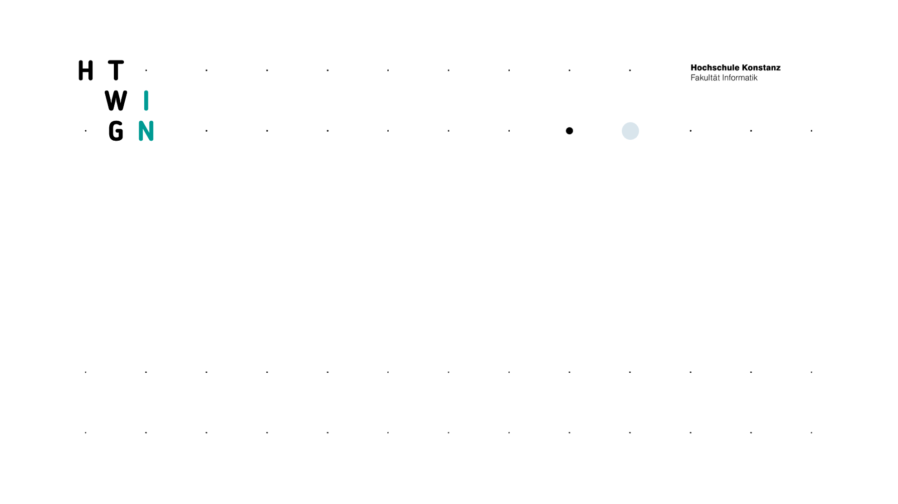
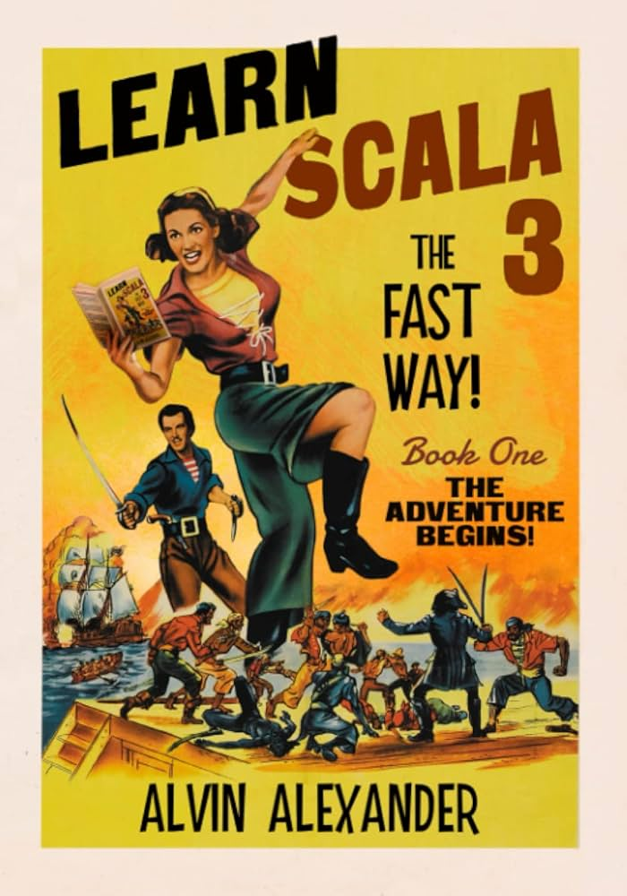
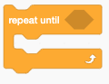

### Prof. Dr. Marko Boger, Prof. Dr. Pascal Laube
## Programmiertechnik I
# Lecture 09: Generic Types, Pattern Matching

<p class="small">Generic lists, list methods, <code>foreach</code> and <code>map</code>, <code>while</code>, the <code>match</code> expression, and pattern matching on lists and case classes.</p>

---

<!-- _class: inhalt -->

# Goals

<div class="columns" style="grid-template-columns: 1fr 260px; align-items: start;">
<div markdown="1">

In this lecture you will learn about

- Lists that contain other types than Int or String
- more control structures, `while` and `foreach`
- the control structure `match`
- pattern matching
- classes that can be used for pattern matching

Supporting literature:

- Learn Scala 3 the Fast Way, chapters 29–31 and 75–79

New Tools:

</div>
<div markdown="1">



</div>
</div>

---

<!-- _class: kapitel -->

## 1
# Generics and Pattern Matching

Lists, match, and extracting structure

---

# Review of Lecture 08

Tuples, Objects, Enums and Classes all define **Types** – like `Int`, `String`, `Boolean`, or `Array` and `List`.

- `Int`, `String`, and `Boolean` are used for just one datum
- Arrays are used for a fixed number of data of the same type
- Lists are used for a variable number of data of the same type
- **Tuples** are used for spontaneous data types of mixed data types
- **Objects** are used for a single instance of a data structure of mixed data types
- **Enums** are used for a small and fixed number of data structures
- **Classes** are used for a variable number of data structures
- Objects, Enums and Classes can have functions, then called **methods**

---

# More on Lists

So far, we have seen Lists of Int or List of String.
Now that we know more types, we can extend our idea of Lists.
Lists can be formed over **any type** in Scala. Here are examples:

```scala
val list1: List[Int] = List(1, 2, 3, 4, 5)
val list2: List[String] = List("a", "b", "c", "d", "e")
val list3: List[(Int, String)] = List((1, "a"), (2, "b"), (3, "c"), (4, "d"), (5, "e"))
val list4: List[Weekday] = List(Monday, Tuesday, Wednesday, Thursday, Friday, Saturday, Sunday)
val list5: List[Person] = List(Person("Anakin", 30), Person("Padme", 25))
val list6: List[List[Int]] = List(List(1, 2, 3), List(4, 5, 6), List(7, 8, 9))
```

---

# Generic Type

This ability to hold data of a type that is only specified when it is used, is called a **generic type**.
The class `List` is specified over a generic type referenced as `T`.
`T` now is a variable over the type.
This is written as `List[T]`.

We can build our own class with a generic type:

```scala
class Box[T](value: T)
val box1: Box[Int] = Box(1)
val box2: Box[String] = Box("Hello")
val box3: Box[Person] = Box(Person("Anakin", 30))
```

---

# Methods on List

Here are the most commonly used methods of `List`:

```scala
val list = List(5, 2, 3, 2)

list.head                        // 5
list.tail                        // List(2, 3, 2)
list.length                      // 4
list.reverse                     // List(2, 3, 2, 5)
list.sorted                      // List(2, 2, 3, 5)
list.distinct                    // List(5, 2, 3)
list.toString                    // List(5, 2, 3, 2)
list.mkString("|", " - ", "|")   // |5 - 2 - 3 - 2|
list.sum                         // 12
list.product                     // 60
list.max                         // 5
list.min                         // 2
list.contains(2)                 // true
```

---

# Methods on List II

Here are some less known methods:

```scala
val list = List(5, 2, 3, 2)
val list2 = List("a", "b", "c", "d", "e")

list.take(2)                 // List(5, 2)
list.drop(2)                 // List(3, 2)
list.takeRight(2)            // List(3, 2)
list.dropRight(2)            // List(5, 2)
list.slice(1, 3)             // List(2, 3)
list.patch(1, List(6, 7), 2) // List(5, 6, 7, 2)
list.zipWithIndex            // List((5, 0), (2, 1), (3, 2), (2, 3))
list.zip(list2)              // List((5, "a"), (2, "b"), (3, "c"), (2, "d"))
```

---

# Methods on List III

Some methods return an **iterator**.

```scala
val list = List(5, 2, 3, 2)

val iterator1 = list.sliding(2)
iterator1.next // List(5, 2)
iterator1.next // List(2, 3)
val iterator2 = list.grouped(2)
iterator2.next // List(5, 2)
iterator2.next // List(3, 2)
```

---

# The method foreach

Then there is also a method called `foreach`.
This method is somewhat different: its parameter is a statement with an element of the list as argument.
It is a function with return type `Unit`. That statement is executed on each element of the list.

```scala
list.foreach(elem => println(elem))
```

It can be written a little shorter:

```scala
list.foreach(println)
```

It is very similar to the for loop:

```scala
for (elem <- list) println(elem)
```

---

# The method map

The method `map` also takes an argument, but this time the argument is a function that returns a value.

```scala
list.map(elem => elem * 2)
```

Also this can be shortened:

```scala
val list8 = list.map(_ * 2)
```

This is equivalent to a for loop with `yield`:

```scala
val list9 = for (elem <- list) yield elem * 2
```

Thus `foreach` and `map` are like control structures in FP.
Functions that take a function as parameter are called **higher-order functions** and we will see them again a little later.

---

# While loop

<div class="columns" style="grid-template-columns: 1.2fr 0.8fr; align-items: start;">
<div markdown="1">

Another control structure is the `while` loop.
It has a boolean condition and loops while it is true.
Scratch has a similar construct, that loops until a condition is not true.

```scala
var i = 0
while (i < list.length) {
  println(list(i))
  i += 1
}
```

In the FP style, the while loop is avoided. It is common in the procedural style.

</div>
<div markdown="1">



</div>
</div>

---

# match Statement

A very powerful control statement in Scala is `match`.

```scala
val character = "Luke"
character match {
  case "Luke"   => println("The power of the Force is strong with you.")
  case "Anakin" => println("I am your father.")
  case "Padme"  => println("I am your mother.")
  case _        => println("Do or do not. There is no try.")
}
```

The character is matched against a matching case.
If the case matches, the following statement is executed.
It is like an if on steroids.
In Java a similar construct is called `switch`.

---

# match on a List

Match and for loops are often combined.

```scala
val characterList = List("Luke", "Anakin", "Padme")
for (character <- characterList) character match {
  case "Luke"   => println("The power of the Force is strong with you.")
  case "Anakin" => println("I am your father.")
  case "Padme"  => println("I am your mother.")
  case _        => println("Do or do not. There is no try.")
}
```

- Only one case is executed
- The underscore (`_`) is called a **catch all**. If no other case matches, this is executed

---

# match as Expression

`match` can also be used as an Expression. In FP it usually is.
Instead of printing, each case returns a **String** — the list of things that are said.

```scala
val characterList = List("Luke", "Anakin", "Padme")
val messages = for (character <- characterList) yield character match {
  case "Luke"   => "The power of the Force is strong with you."
  case "Anakin" => "I am your father."
  case "Padme"  => "I am your mother."
  case _        => "Do or do not. There is no try."
}
```

The result of the expression is a `List[String]`:

```scala
messages // List("The power of the Force is strong with you.", "I am your father.", "I am your mother.")
```

---

# match on Value

The match can be on the value of a variable.

```scala
val y: Int = 42
y match {
  case 42 => println("The answer to life, the universe, and everything")
  case _  => println("Unknown value")
}
```

Or a value in a list as expression:

```scala
val list10 = List(13, 21, 42, 63)
val shoutout = for (x <- list10) yield x match {
  case 21 => "Blackjack!"
  case 42 => "The answer to life, the universe, and everything"
  case _  => "Unknown value"
}
```

---

# match with Guards

Each case can have a **guard** expression, similar to an if:

```scala
val number: Int = 42
number match {
  case positiveNumber if positiveNumber > 0 => println("Positive")
  case negativeNumber if negativeNumber < 0 => println("Negative")
  case zero if zero == 0                    => println("Zero")
}
```

---

# match on Enum

`match` can be executed on Enums:

```scala
enum Status {
  case Jedi, SithLord, Senator
}
import Status._
val status = Jedi
val theForceIsStrong = status match {
  case Jedi     => true
  case SithLord => true
  case Senator  => false
  case _        => false
}
```

---

# match on Types

`match` can be used to differentiate on the type of a variable:

```scala
val x: Any = 42
x match {
  case i: Int    => println("Integer: " + i)
  case s: String => println("String: " + s)
  case _         => println("Unknown type")
}
```

During this process, the value of `x` is matched against the type `Int` or `String`
and if it matches then renamed to `i` or `s` with a tighter type.

---

# Roman Numbers

```scala
def romanCharToNumber(romanChar: Char): Int = {
  romanChar match {
    case 'I' => 1
    case 'V' => 5
    case 'X' => 10
    case 'L' => 50
    case 'C' => 100
    case 'D' => 500
    case 'M' => 1000
    case _   => 0
  }
}
romanCharToNumber('X') // 10
```

---

# Pattern Matching

We had seen how Tuples were matched to a structure:

```scala
def div(x: Int, y: Int): (Int, Int) = (x / y, x % y)
val (quotient, remainder) = div(10, 3)
```

This is also possible with Lists.
The structure of a List of Int is `head :: tail`, where `head` is an Int and `tail` is a List of Int:

```scala
List(1, 2, 3) match {
  case head :: tail => println("Head: " + head + " Tail: " + tail)
  case Nil          => println("Empty list")
}
```

This is called **pattern matching**.

<div style="margin-top: 0.6rem; padding: 0.35rem 0.7rem; border: 1px solid #9aa8b8; border-radius: 8px; background: #f4f7fb; font-family: ui-monospace, SFMono-Regular, Menlo, monospace; font-size: 18px; width: fit-content;">
Head: 1 Tail: List(2, 3)
</div>

---

# Match on a List of Chars

A Roman numeral is a `List[Char]`. Pattern matching can take that list apart —
still **without recursion**:

```scala
"IV".toList match {
  case 'I' :: 'V' :: Nil => 4
  case 'I' :: 'X' :: Nil => 9
  case 'X' :: Nil        => 10
  case _                 => 0
} // 4

"XVI".toList match {
  case 'X' :: 'V' :: 'I' :: Nil => 16
  case _                        => 0
} // 16
```

The patterns read characters from the front of the list.
Longer numbers need a recursive definition — next slide.

---

<style scoped>
section { font-size: 20px; }
pre { font-size: 17px; }
</style>

# Roman Numbers with Recursion

```scala
def romanToNumber(roman: List[Char]): Int = {
  roman match {
    case 'I' :: 'V' :: tail => 4 + romanToNumber(tail)
    case 'I' :: 'X' :: tail => 9 + romanToNumber(tail)
    case 'X' :: 'L' :: tail => 40 + romanToNumber(tail)
    case 'X' :: 'C' :: tail => 90 + romanToNumber(tail)
    case 'C' :: 'D' :: tail => 400 + romanToNumber(tail)
    case 'C' :: 'M' :: tail => 900 + romanToNumber(tail)
    case 'I' :: tail => 1 + romanToNumber(tail)
    case 'V' :: tail => 5 + romanToNumber(tail)
    case 'X' :: tail => 10 + romanToNumber(tail)
    case 'L' :: tail => 50 + romanToNumber(tail)
    case 'C' :: tail => 100 + romanToNumber(tail)
    case 'D' :: tail => 500 + romanToNumber(tail)
    case 'M' :: tail => 1000 + romanToNumber(tail)
    case Nil => 0
  }
}
romanToNumber("XVI".toList)     // 16
romanToNumber("MCMXCIV".toList) // 1994
```

---

# Pattern Matching on Classes

In Scala 3 you can `match` on any **Matchable** value (`AnyVal` and `AnyRef` are Matchable).

A **case class** is an immutable data structure that Scala equips automatically with
`equals`, `hashCode`, `toString`, `copy`, and an **extractor** for pattern matching:

```scala
case class Person(name: String, age: Int)
```

That is why case classes can be used as types in the case clause — thus the name.
Enums and types with a custom `unapply` can also be matched this way.

```scala
val person = Person("Anakin", 30)
person match {
  case Person(name, age) => println("Name: " + name + " Age: " + age)
}
```

---

# Pattern Matching with templates

In the case statement we can use place holders.
In this case we are looking for any person that matches the template.

```scala
val jedis = List(Person("Anakin", 30), Person("Luke", 19), Person("Yoda", 900))
for (jedi <- jedis) jedi match {
  case Person("Luke", _) | Person("Anakin", _) => println("The Force is strong with you.")
  case _                                       => println("Do or do not. There is no try.")
}
```

---

# LeetCode 2011: Final Value After Operations

Easy · [leetcode.com/problems/final-value-of-variable-after-performing-operations](https://leetcode.com/problems/final-value-of-variable-after-performing-operations/)

There is one variable `X`, starting at `0`, and four operations:

- `"++X"` and `"X++"` increment `X` by 1
- `"--X"` and `"X--"` decrement `X` by 1

Given a list of these operations, return the final value of `X`.

**Example:** `List("--X", "X++", "X++")` → `1`

No recursion needed: walk the list once and `match` on each operation.

---

# LeetCode 2011: Solution with `match`

```scala
def delta(op: String): Int = op match {
  case "++X" | "X++" => 1
  case "--X" | "X--" => -1
}

def finalValueAfterOperations(operations: List[String]): Int =
  operations.map(delta).sum

finalValueAfterOperations(List("--X", "X++", "X++"))           // 1
finalValueAfterOperations(List("++X", "++X", "X++"))            // 3
finalValueAfterOperations(List("X++", "++X", "--X", "X--"))     // 0
```

`"|"` in a case means **or**: both increment forms share one branch.
`map` and `sum` you already know — no recursion. On LeetCode the type is `Array[String]`.

---

# LeetCode 682: Baseball Game

Easy · [leetcode.com/problems/baseball-game](https://leetcode.com/problems/baseball-game/)

You keep a record of scores. Start with an empty record. Each operation is one of:

- an integer `x` — record a new score of `x`
- `"+"` — record the sum of the previous two scores
- `"D"` — record double the previous score
- `"C"` — invalidate (remove) the previous score

Return the sum of all scores left on the record.

**Example:** `List("5", "2", "C", "D", "+")` → `30`  
(`[5]` → `[5, 2]` → `[5]` → `[5, 10]` → `[5, 10, 15]` → sum `30`)

No recursion: keep a list of scores and `match` on each operation.

---

# LeetCode 682: Solution with `match`

```scala
def calPoints(operations: List[String]): Int =
  val scores = scala.collection.mutable.ListBuffer[Int]()
  for (op <- operations) {
    op match {
      case "+" => scores += scores(scores.length - 1) + scores(scores.length - 2)
      case "D" => scores += scores.last * 2
      case "C" => scores.remove(scores.length - 1)
      case _   => scores += op.toInt
    }
  }
  scores.sum

calPoints(List("5", "2", "C", "D", "+"))                 // 30
calPoints(List("5", "-2", "4", "C", "D", "9", "+", "+")) // 27
calPoints(List("1", "C"))                                // 0
```

A mutable list acts as a stack. `match` chooses the branch; `_` catches integer scores.
Same idea as a Python `match` solution — no recursion. On LeetCode the type is `Array[String]`.

---

<!-- _class: inhalt -->

# Summary

- Lists are **generic** and have powerful methods available
- `foreach` and `map` are **higher-order functions** – they take a function as parameter
- `foreach` is equivalent to a for statement
- `map` is equivalent to a for expression
- `while` is also a control structure but rarely used in FP
- `match` is a powerful control statement or expression
- Pattern matching works on Tuple and Lists
- Pattern matching works on **Matchable** values; a **case class** is an immutable data type with `equals`/`hashCode`/`toString`/`copy` and an extractor
- Pattern matching even works with templates

---

<!-- _class: aufgabe -->

# Task

<style scoped>section { font-size: 20px; }</style>

**1. CodeTask** — keep working on the exercises for this lecture.

- Reading: Learn Scala 3 the Fast Way, Chapters 29–31 and 75–79
- CodeTask: Chapters 29 to 31 and 75 to 79

**2. Event invitation** (Mill) — a generic type plus pattern matching.

Write a serial letter that **is** the invitation to an event.

- Recipients are a generic `List[T]`, where each `T` is either a `Student` or a `Professor`
- `match` on the element: is it a professor or a student?
- Phrase the invitation with **Sie** for a professor and **du** for a student
- Print one invitation per recipient

---

<!-- _class: abschluss -->

# Questions?

## Thank you!

marko.boger@htwg-konstanz.de
