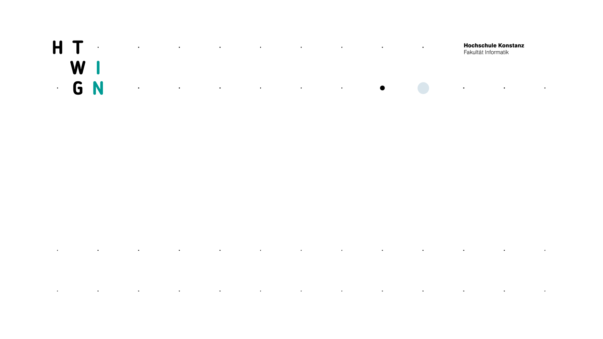

### Prof. Dr. Marko Boger, Prof. Dr. Pascal Laube
## Programmiertechnik I
# Lecture 10: Recursion

Functions that call themselves: recurrence equations, the call stack, tail recursion and recursion on lists.

---


<!-- _class: inhalt -->

# Goals

<style scoped>section { font-size: 23px; }</style>

- Read and write recurrence equations: base case and recursive step
- Examples from mathematics – first as equation, then in Scala
- Examples from computer science: Hanoi, binary search, lists, Roman numbers, merge sort
- Understand what recursion does to memory: stack, heap, `StackOverflowError`
- Write tail recursive functions with `@tailrec` and an accumulator – and recognise the same pattern in `foldLeft`

---

# Definition

<style scoped>section { font-size: 26px; }</style>

> A function is **recursive** if it calls itself – directly or indirectly.

Every correct recursion has two parts:

1. **Base case** – a simple input that is answered directly, without recursion
2. **Recursive step** – reduce the problem to a *smaller* instance of the same problem and combine the result

If the input gets smaller in every step and always reaches the base case, the recursion **terminates**.

---

<!-- _class: kapitel -->

## 1
# Recursion in Mathematics

Recurrence equations – mathematics is the type system of computer science

---

# Recurrence Equations

<style scoped>section { font-size: 23px; }</style>

A **recurrence equation** defines a function in terms of itself – by cases:

$$
f(n) = \begin{cases} \text{simple value} & \text{base case} \\ \dots f(\text{smaller } n) \dots & \text{recursive step} \end{cases}
$$

- The *type* $f : \mathbb{N} \to \mathbb{N}$ becomes the Scala signature `def f(n: Int): Int`
- The cases become `if … then … else` or a `match`
- Proof by **induction** and programming by **recursion** are the same idea
- Recipe: *1. write the equation, 2. translate it, 3. check that the input gets smaller*

---

# Factorial

<style scoped>
section { font-size: 21px; }
pre { font-size: 16px; line-height: 1.3; margin: 0.2em 0; }
.cols { display: flex; gap: 30px; align-items: flex-start; } .cols > div { flex: 1; }
.eq { background: #f3f7f8; border-radius: 8px; padding: 4px 16px; }
</style>

The number of ways to arrange $n$ objects in a row.

<div class="cols">
<div class="eq">

$$
n! = \begin{cases} 1 & n = 0 \\ n \cdot (n-1)! & n > 0 \end{cases}
$$

</div>
<div>

```scala
def factorial(n: Int): BigInt =
  if n == 0 then 1
  else n * factorial(n - 1)

factorial(5)   // 120
```

</div>
</div>

`BigInt`, because $21!$ no longer fits into a `Long`.

---

# Fibonacci

<style scoped>
section { font-size: 21px; }
pre { font-size: 16px; line-height: 1.3; margin: 0.2em 0; }
.cols { display: flex; gap: 30px; align-items: flex-start; } .cols > div { flex: 1; }
.eq { background: #f3f7f8; border-radius: 8px; padding: 4px 16px; }
</style>

Rabbits, sunflower spirals, the golden ratio: $\frac{fib(n+1)}{fib(n)} \to \varphi \approx 1.618$

<div class="cols">
<div class="eq">

$$
fib(n) = \begin{cases} 0 & n = 0 \\ 1 & n = 1 \\ fib(n-1) + fib(n-2) & n \ge 2 \end{cases}
$$

</div>
<div>

```scala
def fib(n: Int): Long =
  if n <= 1 then n
  else fib(n - 1) + fib(n - 2)

fib(10)   // 55
```

</div>
</div>

Two base cases, two recursive calls – beautiful, but slow (see tail recursion).

---

# Greatest Common Divisor: Euclid

<style scoped>
section { font-size: 21px; }
pre { font-size: 16px; line-height: 1.3; margin: 0.2em 0; }
.cols { display: flex; gap: 30px; align-items: flex-start; } .cols > div { flex: 1; }
.eq { background: #f3f7f8; border-radius: 8px; padding: 4px 16px; }
</style>

One of the oldest algorithms (Euclid, ~300 BC):

<div class="cols">
<div class="eq">

$$
\gcd(a, b) = \begin{cases} a & b = 0 \\ \gcd(b,\ a \bmod b) & b > 0 \end{cases}
$$

</div>
<div>

```scala
def gcd(a: Int, b: Int): Int =
  if b == 0 then a
  else gcd(b, a % b)

gcd(48, 18)
// gcd(18,12) → gcd(12,6) → gcd(6,0) → 6
```

</div>
</div>

$b$ gets smaller in every step – so it terminates.

---

<!-- _class: kapitel -->

## 2
# Beautiful Computer Science

Divide, conquer and follow the structure

---

# Towers of Hanoi

<style scoped>
section { font-size: 21px; }
pre { font-size: 16px; line-height: 1.3; margin: 0.2em 0; }
.cols { display: flex; gap: 30px; align-items: flex-start; } .cols > div { flex: 1; }
.eq { background: #f3f7f8; border-radius: 8px; padding: 4px 16px; }
</style>

Move $n$ discs from A to C, never a larger disc on a smaller one.

<div class="cols">
<div class="eq">

$$
\text{moves}(n) = \begin{cases} 0 & n = 0 \\ 2 \cdot \text{moves}(n-1) + 1 & n > 0 \end{cases} = 2^n - 1
$$

</div>
<div>

```scala
def hanoi(n: Int, from: Char, to: Char,
          via: Char): Unit =
  if n > 0 then
    hanoi(n - 1, from, via, to)
    println(s"disc $n: $from -> $to")
    hanoi(n - 1, via, to, from)
```

</div>
</div>

Hard with loops – three lines with recursion. 64 discs: $2^{64}-1$ moves.

---

# Binary Search

<style scoped>
section { font-size: 21px; }
pre { font-size: 16px; line-height: 1.3; margin: 0.2em 0; }
.cols { display: flex; gap: 30px; align-items: flex-start; } .cols > div { flex: 1; }
.eq { background: #f3f7f8; border-radius: 8px; padding: 4px 16px; }
</style>

Search a **sorted** array by halving the range in every step.

<div class="cols">
<div class="eq">

$$
\text{search}(lo, hi) = \begin{cases} -1 & lo > hi \\ mid & a_{mid} = x \\ \text{search}(lo, mid-1) & a_{mid} > x \\ \text{search}(mid+1, hi) & a_{mid} < x \end{cases}
$$

</div>
<div>

```scala
def search(a: Array[Int], x: Int,
           lo: Int, hi: Int): Int =
  if lo > hi then -1
  else
    val mid = (lo + hi) / 2
    if a(mid) == x then mid
    else if a(mid) > x then search(a, x, lo, mid - 1)
    else search(a, x, mid + 1, hi)
```

</div>
</div>

At most $\log_2 n$ steps: one million elements → 20 comparisons.

---

# Lists Are Recursive

<style scoped>
section { font-size: 22px; }
pre { font-size: 17px; line-height: 1.35; }
</style>

A list is either **empty** or a **head** followed by a **tail** that is again a list:

$$
\text{List}[A] \;=\; \text{Nil} \;\mid\; A \;::\; \text{List}[A]
$$

```scala
List(1, 2, 3) == 1 :: (2 :: (3 :: Nil))
```

**Structural recursion**: the function follows the structure of the data –
one case for `Nil` (base case), one case for `head :: tail` (recursive call on `tail`).
The tail is always shorter, so termination is guaranteed.

---

# Structural Recursion on Lists

<style scoped>
section { font-size: 21px; }
pre { font-size: 16px; line-height: 1.3; margin: 0.2em 0; }
.cols { display: flex; gap: 30px; align-items: flex-start; } .cols > div { flex: 1; }
.eq { background: #f3f7f8; border-radius: 8px; padding: 4px 16px; }
</style>

The data type dictates the shape of the function:

<div class="cols">
<div class="eq">

$$
\begin{aligned} \text{sum}(\text{Nil}) &= 0 \\ \text{sum}(h :: t) &= h + \text{sum}(t) \\[6pt] \text{len}(\text{Nil}) &= 0 \\ \text{len}(h :: t) &= 1 + \text{len}(t) \end{aligned}
$$

</div>
<div>

```scala
def sum(xs: List[Int]): Int = xs match
  case Nil    => 0
  case h :: t => h + sum(t)

def length[A](xs: List[A]): Int = xs match
  case Nil    => 0
  case _ :: t => 1 + length(t)

def contains[A](xs: List[A], x: A): Boolean =
  xs match
    case Nil    => false
    case h :: t => h == x || contains(t, x)
```

</div>
</div>

Pattern matching (Lecture 09) and recursion belong together.

---

# Roman Numbers with Recursion

A simple structural recursion: `match` on the list of chars, recurse on the `tail`.

```scala
def romanToNumber(roman: List[Char]): Int = roman match
  case 'I' :: 'V' :: tail => 4 + romanToNumber(tail)
  case 'I' :: 'X' :: tail => 9 + romanToNumber(tail)
  case 'X' :: 'L' :: tail => 40 + romanToNumber(tail)
  case 'X' :: 'C' :: tail => 90 + romanToNumber(tail)
  case 'C' :: 'D' :: tail => 400 + romanToNumber(tail)
  case 'C' :: 'M' :: tail => 900 + romanToNumber(tail)
  case 'I' :: tail => 1 + romanToNumber(tail)
  case 'V' :: tail => 5 + romanToNumber(tail)
  case 'X' :: tail => 10 + romanToNumber(tail)
  case 'L' :: tail => 50 + romanToNumber(tail)
  case 'C' :: tail => 100 + romanToNumber(tail)
  case 'D' :: tail => 500 + romanToNumber(tail)
  case 'M' :: tail => 1000 + romanToNumber(tail)
  case Nil => 0

romanToNumber("XVI".toList)     // 16
romanToNumber("MCMXCIV".toList) // 1994
```

---

# Merge Sort with Match and Recursion

Split the list in halves, sort both halves recursively, then `merge` them.

```scala
def merge(xs: List[Int], ys: List[Int]): List[Int] = (xs, ys) match
  case (Nil, _) => ys
  case (_, Nil) => xs
  case (x :: xt, y :: yt) =>
    if x <= y then x :: merge(xt, ys)
    else y :: merge(xs, yt)

def mergeSort(xs: List[Int]): List[Int] = xs match
  case Nil | _ :: Nil => xs
  case _ =>
    val (left, right) = xs.splitAt(xs.length / 2)
    merge(mergeSort(left), mergeSort(right))

mergeSort(List(5, 2, 8, 1, 9, 3)) // List(1, 2, 3, 5, 8, 9)
```

---

# LeetCode 21: Merge Two Sorted Lists

<style scoped>
section { font-size: 20px; }
pre { font-size: 15px; line-height: 1.3; margin: 0.2em 0; }
.cols { display: flex; gap: 30px; } .cols > div { flex: 1; }
.cand { position: absolute; top: 30px; right: 60px; background: #ffab19; color: white; padding: 2px 10px; border-radius: 6px; font-size: 16px; }
</style>
<span class="cand">Candidate</span>

<div class="cols">
<div>

Merge two sorted lists into one sorted list.

- Base cases: one list is empty → take the other
- Recursive step: the smaller head goes first, merge the rest

</div>
<div>

```scala
def merge(a: List[Int], b: List[Int]): List[Int] =
  (a, b) match
    case (Nil, _) => b
    case (_, Nil) => a
    case (x :: xs, y :: ys) =>
      if x <= y then x :: merge(xs, b)
      else y :: merge(a, ys)

merge(List(1, 2, 4), List(1, 3, 4))
// List(1, 1, 2, 3, 4, 4)
```

</div>
</div>

Structural recursion on **two** lists – and the heart of merge sort. (LeetCode uses its own `ListNode` class; same idea.)

---

<!-- _class: kapitel -->

## 3
# Recursion and Memory

Stack and heap

---

# Tracing `factorial(3)`

<style scoped>
section { font-size: 21px; }
.stack { display: flex; flex-direction: column-reverse; width: 420px; gap: 6px; }
.frame { border: 2px solid #0f6e85; border-radius: 6px; padding: 6px 12px; background: #e8f3f6; font-family: monospace; font-size: 18px; }
.frame.top { background: #0f6e85; color: white; }
.cols { display: flex; gap: 50px; align-items: flex-end; }
</style>

<div class="cols">
<div class="stack">
<div class="frame">main: factorial(3)</div>
<div class="frame">factorial(3) = 3 * factorial(2)</div>
<div class="frame">factorial(2) = 2 * factorial(1)</div>
<div class="frame">factorial(1) = 1 * factorial(0)</div>
<div class="frame top">factorial(0) = 1 &nbsp;← base case</div>
</div>
<div>

- Every call gets its own **stack frame** with its own `n`
- Frames pile up until the base case is reached
- Then the results flow back down:
  `1 → 1 → 2 → 6`
- The multiplication happens **after** the recursive call returns

</div>
</div>

---

# Stack and Heap

<style scoped>
section { font-size: 20px; }
.mem { display: flex; gap: 40px; margin-top: 0.4em; }
.box { flex: 1; border: 2px solid #0f6e85; border-radius: 8px; padding: 8px 14px; }
.frame { border: 1px solid #0f6e85; background: #e8f3f6; border-radius: 4px; padding: 3px 8px; margin: 4px 0; font-family: monospace; font-size: 16px; }
.obj { display: inline-block; border: 1px solid #b5651d; background: #fdf0e3; border-radius: 4px; padding: 3px 8px; margin: 4px; font-family: monospace; font-size: 16px; }
h3 { margin: 0 0 0.3em; }
</style>

`sum(List(1, 2, 3))` while it is inside the deepest call:

<div class="mem">
<div class="box">

### Stack – one frame per call

<div class="frame">sum(xs = Nil) → 0</div>
<div class="frame">sum(xs = ●3::Nil) waits: 3 + _</div>
<div class="frame">sum(xs = ●2::…) waits: 2 + _</div>
<div class="frame">sum(xs = ●1::…) waits: 1 + _</div>
<div class="frame">main</div>

Small, fast, limited size; freed automatically on return.

</div>
<div class="box">

### Heap – objects

<span class="obj">1 ::</span>→<span class="obj">2 ::</span>→<span class="obj">3 ::</span>→<span class="obj">Nil</span>

Large; objects live as long as they are referenced; cleaned up by the **garbage collector**.

Frames only hold **references** (●) to the list cells – the list is not copied.

</div>
</div>

---

# Termination and StackOverflow

<style scoped>
section { font-size: 22px; }
pre { font-size: 17px; line-height: 1.35; }
</style>

```scala
def countDown(n: Int): Unit =
  println(n)
  countDown(n - 1)        // no base case!
```

```text
java.lang.StackOverflowError
```

- Missing base case, or a step that does not get *smaller* → infinite recursion
- The stack has limited size (a few thousand to tens of thousands of frames)
- Even correct recursion can overflow: `factorial(100000)`
- Always ask: **what gets smaller, and where does it stop?**

---

<!-- _class: kapitel -->

## 4
# Tail Recursion

Recursion without a growing stack

---

# Tail Calls and the Accumulator

<style scoped>
section { font-size: 21px; }
pre { font-size: 17px; line-height: 1.35; }
</style>

A call is a **tail call** if it is the very last action – nothing is left to do afterwards.

```scala
import scala.annotation.tailrec

def factTail(n: Int): BigInt =
  @tailrec
  def loop(i: Int, acc: BigInt): BigInt =
    if i == 0 then acc
    else loop(i - 1, acc * i)    // tail call
  loop(n, 1)
```

- The **accumulator** `acc` carries the intermediate result forward
- The compiler turns the tail call into a jump – **one** stack frame
- `@tailrec` makes the compiler *check* it: error if it is not a tail call

---

# Compiled to a Loop

<style scoped>
section { font-size: 21px; }
pre { font-size: 16px; line-height: 1.3; }
.cols { display: flex; gap: 30px; } .cols > div { flex: 1; }
</style>

<div class="cols">
<div>

**What you write**

```scala
@tailrec
def loop(i: Int, acc: BigInt): BigInt =
  if i == 0 then acc
  else loop(i - 1, acc * i)
```

</div>
<div>

**What the compiler makes of it** (roughly)

```scala
def loop(i0: Int, acc0: BigInt): BigInt =
  var i = i0
  var acc = acc0
  while i != 0 do
    acc = acc * i
    i = i - 1
  acc
```

</div>
</div>

- Parameters are overwritten, the frame is reused → constant stack space
- `@tailrec` does not optimise by itself – it **guarantees** that the compiler can, or fails with an error

---

# Tail Recursion on Lists

<style scoped>
section { font-size: 22px; }
pre { font-size: 17px; line-height: 1.35; }
.cols { display: flex; gap: 30px; } .cols > div { flex: 1; }
</style>

<div class="cols">
<div>

**Not** tail recursive

```scala
def sum(xs: List[Int]): Int =
  xs match
    case Nil    => 0
    case h :: t => h + sum(t)
```

`+` happens after the call

</div>
<div>

Tail recursive

```scala
def sumTail(xs: List[Int]): Int =
  @tailrec
  def loop(rest: List[Int],
           acc: Int): Int =
    rest match
      case Nil    => acc
      case h :: t => loop(t, acc + h)
  loop(xs, 0)
```

</div>
</div>

`sumTail((1 to 100000).toList)` works – `sum` overflows the stack.

---

# Fibonacci: Exponential vs. Linear

<style scoped>
section { font-size: 20px; }
pre { font-size: 15px; line-height: 1.3; }
.cols { display: flex; gap: 30px; } .cols > div { flex: 1; }
</style>

<div class="cols">
<div>

**Naive** – two calls, *not* tail recursive

```scala
def fib(n: Int): Long =
  if n <= 1 then n
  else fib(n - 1) + fib(n - 2)
```

`fib(5)` computes `fib(3)` twice, `fib(2)` three times …
$\approx 1.6^n$ calls – `fib(50)` takes minutes.

</div>
<div>

**Accumulators** – tail recursive

```scala
def fibTail(n: Int): Long =
  @tailrec
  def loop(i: Int, a: Long, b: Long): Long =
    if i == 0 then a
    else loop(i - 1, b, a + b)
  loop(n, 0, 1)
```

$n$ calls, one frame – `fibTail(90)` instantly.

</div>
</div>

---

# Which Recursions Can Be Tail Recursive?

<style scoped>
section { font-size: 21px; }
table { font-size: 19px; }
</style>

| Example | As written | Tail recursive version? |
|---|---|---|
| `gcd` | ✅ already tail recursive | – |
| `binary search` | ✅ already tail recursive | – |
| `factorial`, `sumTo`, `sum`, `length` | ❌ work after the call | ✅ with one accumulator |
| `fib` | ❌ two calls | ✅ with two accumulators |
| `power` (halving) | ❌ | ✅ possible, but less readable |
| `hanoi`, `binom`, `perms` | ❌ several calls | ❌ not naturally – depth is small anyway |

Rule of thumb: **linear** recursion → accumulator; **tree** recursion → keep it, but watch the cost.

---

# Fold: Accumulator as a Library Method

<style scoped>
section { font-size: 22px; }
pre { font-size: 17px; line-height: 1.35; }
</style>

`foldLeft` is the **same pattern** as tail recursion on a list: start with an accumulator, walk the list, update the accumulator, return it at the end.

```scala
xs.foldLeft(z)(f)
```

- `z` – the initial accumulator (base case)
- `f(acc, elem)` – combine accumulator and next element (recursive step)
- Result: one value built left-to-right, like `loop(rest, acc)`

So: if you can write a tail-recursive list walk, you can usually write a `foldLeft`.

---

# Fold Examples

<style scoped>
section { font-size: 21px; }
pre { font-size: 16px; line-height: 1.3; }
.cols { display: flex; gap: 28px; } .cols > div { flex: 1; }
</style>

<div class="cols">
<div>

```scala
def sum(xs: List[Int]) =
  xs.foldLeft(0)(_ + _)

def product(xs: List[Int]) =
  xs.foldLeft(1)(_ * _)

def length(xs: List[Int]) =
  xs.foldLeft(0)((n, _) => n + 1)
```

</div>
<div>

```scala
def reverse[A](xs: List[A]) =
  xs.foldLeft(List.empty[A])((acc, x) => x :: acc)

sum(List(1, 2, 3, 4))      // 10
product(List(2, 3, 4))     // 24
length(List(1, 2, 3))      // 3
reverse(List(1, 2, 3))     // List(3, 2, 1)
```

</div>
</div>

Same accumulator idea as `sumTail` – only the boilerplate is gone.

---

# Loop, Recursion, Fold

<style scoped>
section { font-size: 21px; }
pre { font-size: 16px; line-height: 1.3; }
.cols { display: flex; gap: 22px; } .cols > div { flex: 1; }
</style>

<div class="cols">
<div>

**Loop** (imperative)

```scala
def sumLoop(xs: List[Int]) =
  var acc = 0
  for x <- xs do acc += x
  acc
```

</div>
<div>

**Recursion**

```scala
def sum(xs: List[Int]): Int =
  xs match
    case Nil    => 0
    case h :: t => h + sum(t)
```

</div>
<div>

**Fold**

```scala
def sumFold(xs: List[Int]) =
  xs.foldLeft(0)(_ + _)
```

</div>
</div>

- Every loop can be written as recursion – and vice versa
- Tail recursion ≈ loop; `foldLeft` packages the pattern "accumulator + recursion"

---

<!-- _class: inhalt -->

<style scoped>
section { font-size: 23px; }
</style>

# Summary

- Recursion: a function that calls itself on a smaller problem
- Every recursion needs a **base case** and a **recursive step** – write the recurrence first
- Mathematics: factorial, Fibonacci, Euclid
- Computer science: Hanoi, binary search, structural recursion on lists, Roman numbers, merge sort, LeetCode 21
- Each call gets a stack frame; objects live on the heap; too deep → `StackOverflowError`
- Tail recursion with accumulators runs in constant stack space; check with `@tailrec`
- `foldLeft` is that accumulator pattern as a library method
- Linear recursion can be made tail recursive; tree recursion usually not

---

# Further Reading

<style scoped>section { font-size: 20px; }</style>

- **Mark C. Lewis, Lisa Lacher:** *Introduction to Programming and Problem-Solving Using Scala* (2nd ed.)
  - Ch. 6 *Recursion for Iteration* – base case, recursive step, matching on lists
  - Ch. 15 *Recursion* (skim): stack, Fibonacci, Hanoi, merge sort
  - Videos: programmingusingscala.net
- **Alvin Alexander:** *Learning Recursion* (free booklet) – and *Learn Scala 3 The Fast Way!* on `match` / `List`

**Reading task:** After Ch. 6 (and a short look at *Learning Recursion*), implement `product(xs: List[Int]): Int` in **three** ways: (1) recursion with `match`, (2) `@tailrec` with an accumulator, (3) `foldLeft`. Compare which version is easiest to read.

---

<!-- _class: aufgabe -->

# Tasks

<style scoped>section { font-size: 20px; }</style>

For each coding task: **first write the recurrence equation**, then the Scala code.

1. `digitSum(n: Int): Int` – `digitSum(1234) == 10`
2. `max(xs: List[Int]): Int` with pattern matching
3. `power(x: Double, n: Int): Double` and `sumTo(n: Int): Int` (little Gauss)
4. Make `sumTo` and `length` tail recursive with `@tailrec`
5. `isPalindrome(s: String): Boolean`; `flatten(xs: List[List[Int]]): List[Int]`
6. LeetCode: *Pow(x, n)* (50), *Climbing Stairs* (70), *Binary Search* (704), *Permutations* (46); optional: *Generate Parentheses* (22), *K-th Symbol in Grammar* (779), *Jump Game* (55)
7. **Further Reading** — Lewis/Lacher Ch. 6 (and skim Ch. 15 / Alexander *Learning Recursion*). Then write `product(xs: List[Int]): Int` three ways: recursive `match`, `@tailrec` accumulator, and `foldLeft`. Which is clearest?

---

<!-- _class: abschluss -->

# Questions?

## Thank you!

marko.boger@htwg-konstanz.de
