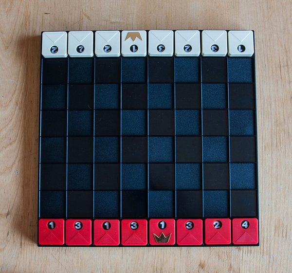
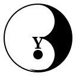

### Prof. Dr. Marko Boger, Prof. Dr. Pascal Laube
## Programmiertechnik I
# Lecture 10: Recursion

Functions that call themselves: recurrence equations, the call stack, tail recursion and recursion on lists.

---


<!-- _class: inhalt -->

# Goals

<style scoped>section { font-size: 23px; }</style>

- Read and write recurrence equations: base case and recursive step
- Beautiful examples from mathematics – first as equation, then in Scala
- Beautiful examples from computer science: Hanoi, binary search, lists, permutations
- Understand what recursion does to memory: stack, heap, `StackOverflowError`
- Write tail recursive functions with `@tailrec` and an accumulator

---

<!-- _class: kapitel -->

## 1
# Motivation

Things that contain themselves

---

# Recursion Everywhere

<style scoped>
section { font-size: 24px; }
.row { display: flex; gap: 28px; margin-top: 0.6em; }
.card { flex: 1; border: 2px solid #0f6e85; border-radius: 10px; padding: 14px 18px; }
.card h3 { margin: 0 0 0.3em; color: #0f6e85; }
</style>

<div class="row">
<div class="card">

### Nature
A tree: a trunk with branches – and every branch is again a small tree. Ferns, Romanesco, river deltas.

</div>
<div class="card">

### Art
The **Droste effect**: a picture that contains itself, which contains itself, which …

</div>
<div class="card">

### Language
"A sentence may contain a sub-sentence that contains a sub-sentence …"

</div>
</div>

A structure is **recursive** if it is defined in terms of a smaller version of itself.

---

# Recursion in Scratch: a Fractal Tree

<style scoped>
section { font-size: 22px; }
.blk { display: inline-block; padding: 6px 14px; border-radius: 8px; color: white; font-family: sans-serif; margin: 3px 0; }
.def { background: #ff6680; } .ctl { background: #ffab19; } .mot { background: #4c97ff; } .call { background: #ff6680; }
.cols { display: flex; gap: 40px; align-items: flex-start; }
</style>

<div class="cols">
<div>

<div class="blk def">define <b>tree</b> (length)</div><br>
<div class="blk ctl">if length &gt; 5 then</div><br>
&nbsp;&nbsp;&nbsp;<div class="blk mot">move (length) steps</div><br>
&nbsp;&nbsp;&nbsp;<div class="blk mot">turn ↺ 25 degrees</div><br>
&nbsp;&nbsp;&nbsp;<div class="blk call"><b>tree</b> (length × 0.7)</div><br>
&nbsp;&nbsp;&nbsp;<div class="blk mot">turn ↻ 50 degrees</div><br>
&nbsp;&nbsp;&nbsp;<div class="blk call"><b>tree</b> (length × 0.7)</div><br>
&nbsp;&nbsp;&nbsp;<div class="blk mot">turn ↺ 25 degrees</div><br>
&nbsp;&nbsp;&nbsp;<div class="blk mot">move (−length) steps</div>

</div>
<div>

- The custom block **calls itself**
- Each call draws a *smaller* tree
- `length > 5` stops the recursion
- Two calls per level → a branching tree

</div>
</div>

---

# Definition

<style scoped>section { font-size: 26px; }</style>

> A function is **recursive** if it calls itself – directly or indirectly.

Every correct recursion has two parts:

1. **Base case** – a simple input that is answered directly, without recursion
2. **Recursive step** – reduce the problem to a *smaller* instance of the same problem and combine the result

If the input gets smaller in every step and always reaches the base case, the recursion **terminates**.

---

<!-- _class: kapitel -->

## 2
# Beautiful Mathematics

Recurrence equations – mathematics is the type system of computer science

---

# Recurrence Equations

<style scoped>section { font-size: 23px; }</style>

A **recurrence equation** defines a function in terms of itself – by cases:

$$
f(n) = \begin{cases} \text{simple value} & \text{base case} \\ \dots f(\text{smaller } n) \dots & \text{recursive step} \end{cases}
$$

- The *type* $f : \mathbb{N} \to \mathbb{N}$ becomes the Scala signature `def f(n: Int): Int`
- The cases become `if … then … else` or a `match`
- Proof by **induction** and programming by **recursion** are the same idea
- Recipe: *1. write the equation, 2. translate it, 3. check that the input gets smaller*

---

# Factorial

<style scoped>
section { font-size: 21px; }
pre { font-size: 16px; line-height: 1.3; margin: 0.2em 0; }
.cols { display: flex; gap: 30px; align-items: flex-start; } .cols > div { flex: 1; }
.eq { background: #f3f7f8; border-radius: 8px; padding: 4px 16px; }
</style>

The number of ways to arrange $n$ objects in a row.

<div class="cols">
<div class="eq">

$$
n! = \begin{cases} 1 & n = 0 \\ n \cdot (n-1)! & n > 0 \end{cases}
$$

</div>
<div>

```scala
def factorial(n: Int): BigInt =
  if n == 0 then 1
  else n * factorial(n - 1)

factorial(5)   // 120
```

</div>
</div>

`BigInt`, because $21!$ no longer fits into a `Long`.

---

# Sum: Little Gauss

<style scoped>
section { font-size: 21px; }
pre { font-size: 16px; line-height: 1.3; margin: 0.2em 0; }
.cols { display: flex; gap: 30px; align-items: flex-start; } .cols > div { flex: 1; }
.eq { background: #f3f7f8; border-radius: 8px; padding: 4px 16px; }
</style>

Gauss (aged 9) found $1 + 2 + \dots + n = \frac{n(n+1)}{2}$. Recursively:

<div class="cols">
<div class="eq">

$$
\text{sum}(n) = \begin{cases} 0 & n = 0 \\ n + \text{sum}(n-1) & n > 0 \end{cases}
$$

</div>
<div>

```scala
def sumTo(n: Int): Int =
  if n == 0 then 0
  else n + sumTo(n - 1)

sumTo(100)   // 5050
```

</div>
</div>

Exercise: prove by induction that both definitions agree.

---

# Fibonacci

<style scoped>
section { font-size: 21px; }
pre { font-size: 16px; line-height: 1.3; margin: 0.2em 0; }
.cols { display: flex; gap: 30px; align-items: flex-start; } .cols > div { flex: 1; }
.eq { background: #f3f7f8; border-radius: 8px; padding: 4px 16px; }
</style>

Rabbits, sunflower spirals, the golden ratio: $\frac{fib(n+1)}{fib(n)} \to \varphi \approx 1.618$

<div class="cols">
<div class="eq">

$$
fib(n) = \begin{cases} 0 & n = 0 \\ 1 & n = 1 \\ fib(n-1) + fib(n-2) & n \ge 2 \end{cases}
$$

</div>
<div>

```scala
def fib(n: Int): Long =
  if n <= 1 then n
  else fib(n - 1) + fib(n - 2)

fib(10)   // 55
```

</div>
</div>

Two base cases, two recursive calls – beautiful, but slow (see tail recursion).

---

# Power

<style scoped>
section { font-size: 21px; }
pre { font-size: 16px; line-height: 1.3; margin: 0.2em 0; }
.cols { display: flex; gap: 30px; align-items: flex-start; } .cols > div { flex: 1; }
.eq { background: #f3f7f8; border-radius: 8px; padding: 4px 16px; }
</style>

Exponentiation is repeated multiplication – and it can be done much faster:

<div class="cols">
<div class="eq">

$$
x^n = \begin{cases} 1 & n = 0 \\ (x^{n/2})^2 & n \text{ even} \\ x \cdot x^{n-1} & n \text{ odd} \end{cases}
$$

</div>
<div>

```scala
def power(x: Double, n: Int): Double =
  if n == 0 then 1.0
  else if n % 2 == 0 then
    val h = power(x, n / 2)
    h * h
  else x * power(x, n - 1)

power(2, 10)   // 1024.0
```

</div>
</div>

Halving $n$: only about $2 \log_2 n$ calls instead of $n$.

---

# Greatest Common Divisor: Euclid

<style scoped>
section { font-size: 21px; }
pre { font-size: 16px; line-height: 1.3; margin: 0.2em 0; }
.cols { display: flex; gap: 30px; align-items: flex-start; } .cols > div { flex: 1; }
.eq { background: #f3f7f8; border-radius: 8px; padding: 4px 16px; }
</style>

One of the oldest algorithms (Euclid, ~300 BC):

<div class="cols">
<div class="eq">

$$
\gcd(a, b) = \begin{cases} a & b = 0 \\ \gcd(b,\ a \bmod b) & b > 0 \end{cases}
$$

</div>
<div>

```scala
def gcd(a: Int, b: Int): Int =
  if b == 0 then a
  else gcd(b, a % b)

gcd(48, 18)
// gcd(18,12) → gcd(12,6) → gcd(6,0) → 6
```

</div>
</div>

$b$ gets smaller in every step – so it terminates.

---

# Pascal's Triangle

<style scoped>
section { font-size: 21px; }
pre { font-size: 16px; line-height: 1.3; margin: 0.2em 0; }
.cols { display: flex; gap: 30px; align-items: flex-start; } .cols > div { flex: 1; }
.eq { background: #f3f7f8; border-radius: 8px; padding: 4px 16px; }
</style>

Binomial coefficients $\binom{n}{k}$: each number is the sum of the two above it.

<div class="cols">
<div class="eq">

$$
\binom{n}{k} = \begin{cases} 1 & k = 0 \text{ or } k = n \\ \binom{n-1}{k-1} + \binom{n-1}{k} & \text{otherwise} \end{cases}
$$

</div>
<div>

```scala
def binom(n: Int, k: Int): Long =
  if k == 0 || k == n then 1
  else binom(n - 1, k - 1) + binom(n - 1, k)

binom(4, 2)   // 6
```

</div>
</div>

`(0 to 4).map(k => binom(4, k))` gives row 4: `1 4 6 4 1`.

---

<!-- _class: kapitel -->

## 3
# Beautiful Computer Science

Divide, conquer and follow the structure

---

# Towers of Hanoi

<style scoped>
section { font-size: 21px; }
pre { font-size: 16px; line-height: 1.3; margin: 0.2em 0; }
.cols { display: flex; gap: 30px; align-items: flex-start; } .cols > div { flex: 1; }
.eq { background: #f3f7f8; border-radius: 8px; padding: 4px 16px; }
</style>

Move $n$ discs from A to C, never a larger disc on a smaller one.

<div class="cols">
<div class="eq">

$$
\text{moves}(n) = \begin{cases} 0 & n = 0 \\ 2 \cdot \text{moves}(n-1) + 1 & n > 0 \end{cases} = 2^n - 1
$$

</div>
<div>

```scala
def hanoi(n: Int, from: Char, to: Char,
          via: Char): Unit =
  if n > 0 then
    hanoi(n - 1, from, via, to)
    println(s"disc $n: $from -> $to")
    hanoi(n - 1, via, to, from)
```

</div>
</div>

Hard with loops – three lines with recursion. 64 discs: $2^{64}-1$ moves.

---

# Binary Search

<style scoped>
section { font-size: 21px; }
pre { font-size: 16px; line-height: 1.3; margin: 0.2em 0; }
.cols { display: flex; gap: 30px; align-items: flex-start; } .cols > div { flex: 1; }
.eq { background: #f3f7f8; border-radius: 8px; padding: 4px 16px; }
</style>

Search a **sorted** array by halving the range in every step.

<div class="cols">
<div class="eq">

$$
\text{search}(lo, hi) = \begin{cases} -1 & lo > hi \\ mid & a_{mid} = x \\ \text{search}(lo, mid-1) & a_{mid} > x \\ \text{search}(mid+1, hi) & a_{mid} < x \end{cases}
$$

</div>
<div>

```scala
def search(a: Array[Int], x: Int,
           lo: Int, hi: Int): Int =
  if lo > hi then -1
  else
    val mid = (lo + hi) / 2
    if a(mid) == x then mid
    else if a(mid) > x then search(a, x, lo, mid - 1)
    else search(a, x, mid + 1, hi)
```

</div>
</div>

At most $\log_2 n$ steps: one million elements → 20 comparisons.

---

# Lists Are Recursive

<style scoped>
section { font-size: 22px; }
pre { font-size: 17px; line-height: 1.35; }
</style>

A list is either **empty** or a **head** followed by a **tail** that is again a list:

$$
\text{List}[A] \;=\; \text{Nil} \;\mid\; A \;::\; \text{List}[A]
$$

```scala
List(1, 2, 3) == 1 :: (2 :: (3 :: Nil))
```

**Structural recursion**: the function follows the structure of the data –
one case for `Nil` (base case), one case for `head :: tail` (recursive call on `tail`).
The tail is always shorter, so termination is guaranteed.

---

# Structural Recursion on Lists

<style scoped>
section { font-size: 21px; }
pre { font-size: 16px; line-height: 1.3; margin: 0.2em 0; }
.cols { display: flex; gap: 30px; align-items: flex-start; } .cols > div { flex: 1; }
.eq { background: #f3f7f8; border-radius: 8px; padding: 4px 16px; }
</style>

The data type dictates the shape of the function:

<div class="cols">
<div class="eq">

$$
\begin{aligned} \text{sum}(\text{Nil}) &= 0 \\ \text{sum}(h :: t) &= h + \text{sum}(t) \\[6pt] \text{len}(\text{Nil}) &= 0 \\ \text{len}(h :: t) &= 1 + \text{len}(t) \end{aligned}
$$

</div>
<div>

```scala
def sum(xs: List[Int]): Int = xs match
  case Nil    => 0
  case h :: t => h + sum(t)

def length[A](xs: List[A]): Int = xs match
  case Nil    => 0
  case _ :: t => 1 + length(t)

def contains[A](xs: List[A], x: A): Boolean =
  xs match
    case Nil    => false
    case h :: t => h == x || contains(t, x)
```

</div>
</div>

Pattern matching (Lecture 09) and recursion belong together.

---

# LeetCode 21: Merge Two Sorted Lists

<style scoped>
section { font-size: 20px; }
pre { font-size: 15px; line-height: 1.3; margin: 0.2em 0; }
.cols { display: flex; gap: 30px; } .cols > div { flex: 1; }
.cand { position: absolute; top: 30px; right: 60px; background: #ffab19; color: white; padding: 2px 10px; border-radius: 6px; font-size: 16px; }
</style>
<span class="cand">Candidate</span>

<div class="cols">
<div>

Merge two sorted lists into one sorted list.

- Base cases: one list is empty → take the other
- Recursive step: the smaller head goes first, merge the rest

</div>
<div>

```scala
def merge(a: List[Int], b: List[Int]): List[Int] =
  (a, b) match
    case (Nil, _) => b
    case (_, Nil) => a
    case (x :: xs, y :: ys) =>
      if x <= y then x :: merge(xs, b)
      else y :: merge(a, ys)

merge(List(1, 2, 4), List(1, 3, 4))
// List(1, 1, 2, 3, 4, 4)
```

</div>
</div>

Structural recursion on **two** lists – and the heart of merge sort. (LeetCode uses its own `ListNode` class; same idea.)

---

# LeetCode 22: Generate Parentheses

<style scoped>
section { font-size: 20px; }
pre { font-size: 15px; line-height: 1.3; margin: 0.2em 0; }
.cols { display: flex; gap: 30px; } .cols > div { flex: 1; }
.cand { position: absolute; top: 30px; right: 60px; background: #ffab19; color: white; padding: 2px 10px; border-radius: 6px; font-size: 16px; }
</style>
<span class="cand">Candidate</span>

<div class="cols">
<div>

All well-formed strings with $n$ pairs of parentheses.

- Add `(` while fewer than $n$ are open
- Add `)` while it closes an open one
- Base case: length $2n$ reached

</div>
<div>

```scala
def generateParenthesis(n: Int): List[String] =
  def go(s: String, open: Int,
         close: Int): List[String] =
    if s.length == 2 * n then List(s)
    else
      (if open < n then
         go(s + "(", open + 1, close) else Nil) ++
      (if close < open then
         go(s + ")", open, close + 1) else Nil)
  go("", 0, 0)
```

</div>
</div>

`generateParenthesis(3)` → `((())) (()()) (())() ()(()) ()()()` – a recursion **tree** that explores choices (backtracking).

---

# LeetCode 779: K-th Symbol in Grammar

<style scoped>
section { font-size: 20px; }
pre { font-size: 15px; line-height: 1.3; margin: 0.2em 0; }
.cols { display: flex; gap: 30px; } .cols > div { flex: 1; }
.cand { position: absolute; top: 30px; right: 60px; background: #ffab19; color: white; padding: 2px 10px; border-radius: 6px; font-size: 16px; }
</style>
<span class="cand">Candidate</span>

<div class="cols">
<div>

Row 1 is `0`; each row replaces `0 → 01`, `1 → 10`.

$$
sym(n,k) = \begin{cases} 0 & n = 1 \\ sym(n{-}1, \lceil k/2 \rceil) & k \text{ odd} \\ 1 - sym(n{-}1, \lceil k/2 \rceil) & k \text{ even} \end{cases}
$$

</div>
<div>

```scala
def kthGrammar(n: Int, k: Int): Int =
  if n == 1 then 0
  else
    val parent = kthGrammar(n - 1, (k + 1) / 2)
    if k % 2 == 1 then parent
    else 1 - parent

(1 to 8).map(kthGrammar(4, _))
// 0 1 1 0 1 0 0 1
```

</div>
</div>

Never build the row ($2^{n-1}$ symbols) – just ask the parent. A recurrence equation in disguise.

---

# Permutations

<style scoped>
section { font-size: 21px; }
pre { font-size: 16px; line-height: 1.3; margin: 0.2em 0; }
.cols { display: flex; gap: 30px; align-items: flex-start; } .cols > div { flex: 1; }
.eq { background: #f3f7f8; border-radius: 8px; padding: 4px 16px; }
</style>

All orderings of a list: pick each element as the first, permute the rest.

<div class="cols">
<div class="eq">

$$
\begin{aligned} \text{perms}(\text{Nil}) &= [\,\text{Nil}\,] \\ \text{perms}(xs) &= [\, x :: p \mid x \in xs,\ p \in \text{perms}(xs \setminus x) \,] \end{aligned}
$$

</div>
<div>

```scala
def perms[A](xs: List[A]): List[List[A]] =
  if xs.isEmpty then List(Nil)
  else
    for
      x <- xs
      p <- perms(xs.filterNot(_ == x))
    yield x :: p

perms(List(1, 2, 3)).size   // 6 = 3!
```

</div>
</div>

The number of permutations is $n!$ – our first example again.

---

<!-- _class: kapitel -->

## 4
# Recursion and Memory

Stack and heap

---

# Tracing `factorial(3)`

<style scoped>
section { font-size: 21px; }
.stack { display: flex; flex-direction: column-reverse; width: 420px; gap: 6px; }
.frame { border: 2px solid #0f6e85; border-radius: 6px; padding: 6px 12px; background: #e8f3f6; font-family: monospace; font-size: 18px; }
.frame.top { background: #0f6e85; color: white; }
.cols { display: flex; gap: 50px; align-items: flex-end; }
</style>

<div class="cols">
<div class="stack">
<div class="frame">main: factorial(3)</div>
<div class="frame">factorial(3) = 3 * factorial(2)</div>
<div class="frame">factorial(2) = 2 * factorial(1)</div>
<div class="frame">factorial(1) = 1 * factorial(0)</div>
<div class="frame top">factorial(0) = 1 &nbsp;← base case</div>
</div>
<div>

- Every call gets its own **stack frame** with its own `n`
- Frames pile up until the base case is reached
- Then the results flow back down:
  `1 → 1 → 2 → 6`
- The multiplication happens **after** the recursive call returns

</div>
</div>

---

# Stack and Heap

<style scoped>
section { font-size: 20px; }
.mem { display: flex; gap: 40px; margin-top: 0.4em; }
.box { flex: 1; border: 2px solid #0f6e85; border-radius: 8px; padding: 8px 14px; }
.frame { border: 1px solid #0f6e85; background: #e8f3f6; border-radius: 4px; padding: 3px 8px; margin: 4px 0; font-family: monospace; font-size: 16px; }
.obj { display: inline-block; border: 1px solid #b5651d; background: #fdf0e3; border-radius: 4px; padding: 3px 8px; margin: 4px; font-family: monospace; font-size: 16px; }
h3 { margin: 0 0 0.3em; }
</style>

`sum(List(1, 2, 3))` while it is inside the deepest call:

<div class="mem">
<div class="box">

### Stack – one frame per call

<div class="frame">sum(xs = Nil) → 0</div>
<div class="frame">sum(xs = ●3::Nil) waits: 3 + _</div>
<div class="frame">sum(xs = ●2::…) waits: 2 + _</div>
<div class="frame">sum(xs = ●1::…) waits: 1 + _</div>
<div class="frame">main</div>

Small, fast, limited size; freed automatically on return.

</div>
<div class="box">

### Heap – objects

<span class="obj">1 ::</span>→<span class="obj">2 ::</span>→<span class="obj">3 ::</span>→<span class="obj">Nil</span>

Large; objects live as long as they are referenced; cleaned up by the **garbage collector**.

Frames only hold **references** (●) to the list cells – the list is not copied.

</div>
</div>

---

# Termination and StackOverflow

<style scoped>
section { font-size: 22px; }
pre { font-size: 17px; line-height: 1.35; }
</style>

```scala
def countDown(n: Int): Unit =
  println(n)
  countDown(n - 1)        // no base case!
```

```text
java.lang.StackOverflowError
```

- Missing base case, or a step that does not get *smaller* → infinite recursion
- The stack has limited size (a few thousand to tens of thousands of frames)
- Even correct recursion can overflow: `factorial(100000)`
- Always ask: **what gets smaller, and where does it stop?**

---

<!-- _class: kapitel -->

## 5
# Tail Recursion

Recursion without a growing stack

---

# Tail Calls and the Accumulator

<style scoped>
section { font-size: 21px; }
pre { font-size: 17px; line-height: 1.35; }
</style>

A call is a **tail call** if it is the very last action – nothing is left to do afterwards.

```scala
import scala.annotation.tailrec

def factTail(n: Int): BigInt =
  @tailrec
  def loop(i: Int, acc: BigInt): BigInt =
    if i == 0 then acc
    else loop(i - 1, acc * i)    // tail call
  loop(n, 1)
```

- The **accumulator** `acc` carries the intermediate result forward
- The compiler turns the tail call into a jump – **one** stack frame
- `@tailrec` makes the compiler *check* it: error if it is not a tail call

---

# Compiled to a Loop

<style scoped>
section { font-size: 21px; }
pre { font-size: 16px; line-height: 1.3; }
.cols { display: flex; gap: 30px; } .cols > div { flex: 1; }
</style>

<div class="cols">
<div>

**What you write**

```scala
@tailrec
def loop(i: Int, acc: BigInt): BigInt =
  if i == 0 then acc
  else loop(i - 1, acc * i)
```

</div>
<div>

**What the compiler makes of it** (roughly)

```scala
def loop(i0: Int, acc0: BigInt): BigInt =
  var i = i0
  var acc = acc0
  while i != 0 do
    acc = acc * i
    i = i - 1
  acc
```

</div>
</div>

- Parameters are overwritten, the frame is reused → constant stack space
- `@tailrec` does not optimise by itself – it **guarantees** that the compiler can, or fails with an error

---

# Tail Recursion on Lists

<style scoped>
section { font-size: 22px; }
pre { font-size: 17px; line-height: 1.35; }
.cols { display: flex; gap: 30px; } .cols > div { flex: 1; }
</style>

<div class="cols">
<div>

**Not** tail recursive

```scala
def sum(xs: List[Int]): Int =
  xs match
    case Nil    => 0
    case h :: t => h + sum(t)
```

`+` happens after the call

</div>
<div>

Tail recursive

```scala
def sumTail(xs: List[Int]): Int =
  @tailrec
  def loop(rest: List[Int],
           acc: Int): Int =
    rest match
      case Nil    => acc
      case h :: t => loop(t, acc + h)
  loop(xs, 0)
```

</div>
</div>

`sumTail((1 to 100000).toList)` works – `sum` overflows the stack.

---

# Fibonacci: Exponential vs. Linear

<style scoped>
section { font-size: 20px; }
pre { font-size: 15px; line-height: 1.3; }
.cols { display: flex; gap: 30px; } .cols > div { flex: 1; }
</style>

<div class="cols">
<div>

**Naive** – two calls, *not* tail recursive

```scala
def fib(n: Int): Long =
  if n <= 1 then n
  else fib(n - 1) + fib(n - 2)
```

`fib(5)` computes `fib(3)` twice, `fib(2)` three times …
$\approx 1.6^n$ calls – `fib(50)` takes minutes.

</div>
<div>

**Accumulators** – tail recursive

```scala
def fibTail(n: Int): Long =
  @tailrec
  def loop(i: Int, a: Long, b: Long): Long =
    if i == 0 then a
    else loop(i - 1, b, a + b)
  loop(n, 0, 1)
```

$n$ calls, one frame – `fibTail(90)` instantly.

</div>
</div>

---

# Which Recursions Can Be Tail Recursive?

<style scoped>
section { font-size: 21px; }
table { font-size: 19px; }
</style>

| Example | As written | Tail recursive version? |
|---|---|---|
| `gcd` | ✅ already tail recursive | – |
| `binary search` | ✅ already tail recursive | – |
| `factorial`, `sumTo`, `sum`, `length` | ❌ work after the call | ✅ with one accumulator |
| `fib` | ❌ two calls | ✅ with two accumulators |
| `power` (halving) | ❌ | ✅ possible, but less readable |
| `hanoi`, `binom`, `perms` | ❌ several calls | ❌ not naturally – depth is small anyway |

Rule of thumb: **linear** recursion → accumulator; **tree** recursion → keep it, but watch the cost.

---

# Remember the Jump Game?

<style scoped>
section { font-size: 21px; }
pre { font-size: 15px; line-height: 1.35; margin: 0.2em 0; }
.shot { position: absolute; top: 40px; right: 70px; height: 110px; border-radius: 6px; }
</style>



Lecture 03, LeetCode 55: each number is the maximum jump length – can you reach the last index?
`[2, 3, 1, 1, 4]` → `true`, `[3, 2, 1, 0, 4]` → `false`

```scala
object Solution {
  def canJump(nums: Array[Int]): Boolean = {
    @annotation.tailrec
    def isPossible(max: Int = 0, idx: Int = 0): Boolean =
      if (idx == nums.size - 1) true
      else if (nums(idx) == 0 && max == idx) false
      else isPossible(math.max(max, idx + nums(idx)), idx + 1)

    isPossible()
  }
}
```

Now we can read it with the vocabulary of this lecture.

---

# Jump Game: Analysis

<style scoped>
section { font-size: 21px; }
table { font-size: 18px; }
</style>

| Concept | In `isPossible(max, idx)` |
|---|---|
| **Base case 1** | `idx == nums.size - 1` → `true` (arrived) |
| **Base case 2** | `nums(idx) == 0 && max == idx` → `false` (stuck) |
| **Recursive step** | `isPossible(math.max(max, idx + nums(idx)), idx + 1)` |
| **What gets smaller?** | the remaining distance `nums.size - 1 - idx` |
| **Accumulator** | `max` – the furthest reachable index so far |
| **Tail recursive?** | ✅ yes – the call is the last action, `@tailrec` confirms it |
| **Call stack** | one frame, reused; even 10⁵ elements are fine |

Compare *Scala with For* and *Scala with Fold* in Lecture 03: the same accumulator, written as a loop and as `foldLeft`.

---

# Lisp: Recursion from the Start

<style scoped>
section { font-size: 22px; }
pre { font-size: 17px; line-height: 1.35; }
.cols { display: flex; gap: 30px; } .cols > div { flex: 1; }
.cicon { position: absolute; top: 40px; right: 70px; height: 90px; }
</style>



<div class="cols">
<div>

**Scheme (Lisp family, 1975)**

```scheme
(define (factorial n)
  (if (= n 0)
      1
      (* n (factorial (- n 1)))))
```

</div>
<div>

**Scala 3**

```scala
def factorial(n: Int): BigInt =
  if n == 0 then 1
  else n * factorial(n - 1)
```

</div>
</div>

- Lisp (1958) has no loops in its core – recursion and **lambda** are everything
- Based on Church's lambda calculus; Scheme *requires* tail-call optimisation
- Scala inherits these ideas: functions as values, recursion, pattern matching

---

# Loop, Recursion, Fold

<style scoped>
section { font-size: 21px; }
pre { font-size: 16px; line-height: 1.3; }
.cols { display: flex; gap: 22px; } .cols > div { flex: 1; }
</style>

<div class="cols">
<div>

**Loop** (imperative)

```scala
def sumLoop(xs: List[Int]) =
  var acc = 0
  for x <- xs do acc += x
  acc
```

</div>
<div>

**Recursion**

```scala
def sum(xs: List[Int]): Int =
  xs match
    case Nil    => 0
    case h :: t => h + sum(t)
```

</div>
<div>

**Fold**

```scala
def sumFold(xs: List[Int]) =
  xs.foldLeft(0)(_ + _)
```

</div>
</div>

- Every loop can be written as recursion – and vice versa
- Tail recursion ≈ loop; `foldLeft` packages the pattern "accumulator + recursion"
- Recall Lecture 03, Jump Game: *Scala with Recursion* and *Scala with Fold*

---

<!-- _class: inhalt -->

<style scoped>
section { font-size: 23px; }
</style>

# Summary

- Recursion: a function that calls itself on a smaller problem
- Every recursion needs a **base case** and a **recursive step** – write the recurrence first
- Mathematics: factorial, Gauss sum, Fibonacci, power, Euclid, Pascal's triangle
- Computer science: Hanoi, binary search, structural recursion on lists, permutations
- Each call gets a stack frame; objects live on the heap; too deep → `StackOverflowError`
- Tail recursion with accumulators runs in constant stack space; check with `@tailrec`
- Linear recursion can be made tail recursive; tree recursion usually not

---

# Further Reading

<style scoped>section { font-size: 22px; }</style>

- **Mark C. Lewis, Lisa Lacher:** *Introduction to Programming and Problem-Solving Using Scala* (2nd ed., CRC Press; 1st ed.: *Introduction to the Art of Programming Using Scala*)
  - Ch. 6 *Recursion for Iteration*: basics of recursion, writing recursive functions, matching
  - Ch. 15 *Recursion*: memory layout, power of recursion, Fibonacci, Towers of Hanoi, permutations, mazes, merge sort / quicksort
  - Videos: programmingusingscala.net
- **Alvin Alexander:** *Learn Scala 3 The Fast Way!* – `match` expressions, `List`; recursion in depth in his free booklet *Learning Recursion* (from *Functional Programming, Simplified*)

---

<!-- _class: aufgabe -->

# Tasks

<style scoped>section { font-size: 21px; }</style>

For each task: **first write the recurrence equation**, then the Scala code.

1. `digitSum(n: Int): Int` – `digitSum(1234) == 10`
2. `max(xs: List[Int]): Int` with pattern matching
3. `pascalRow(n: Int): List[Long]` using `binom`
4. Make `sumTo` and `length` tail recursive with `@tailrec`
5. `isPalindrome(s: String): Boolean`; `flatten(xs: List[List[Int]]): List[Int]`
6. LeetCode: *Pow(x, n)* (50), *Climbing Stairs* (70), *Binary Search* (704), *Permutations* (46)

---

<!-- _class: abschluss -->

# Questions?

## Thank you!

marko.boger@htwg-konstanz.de
