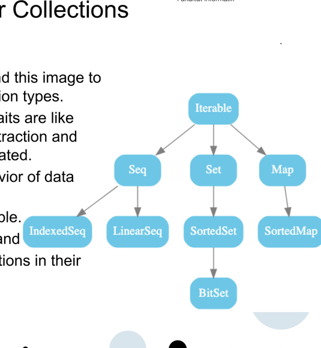
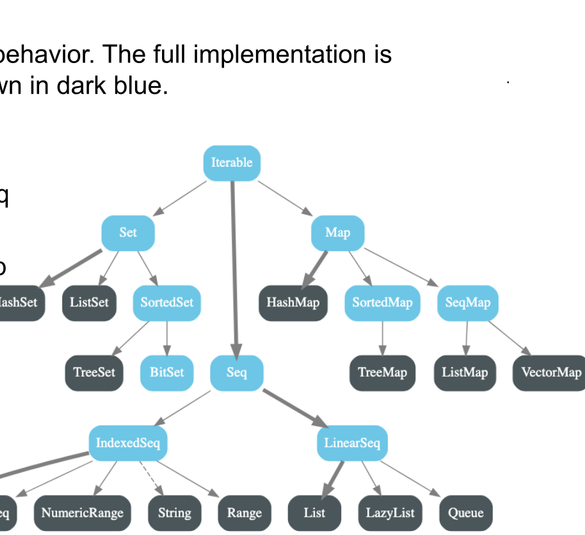
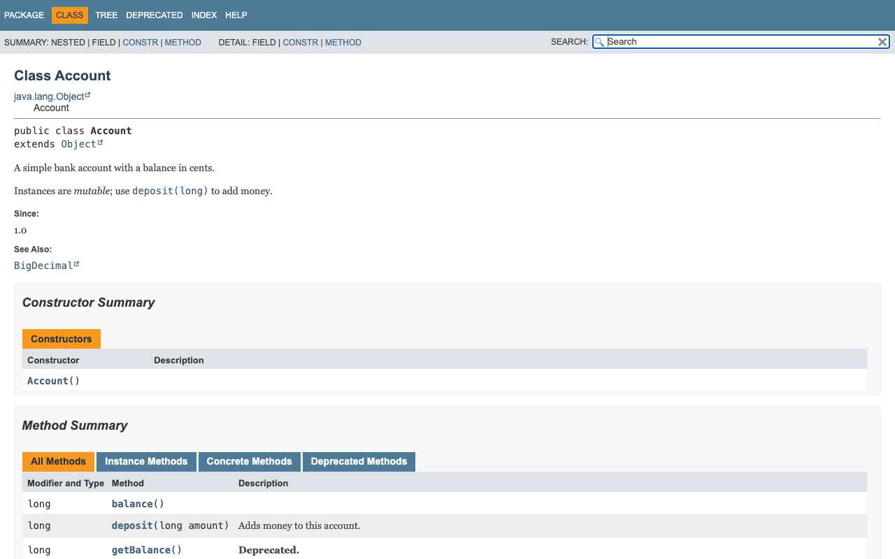
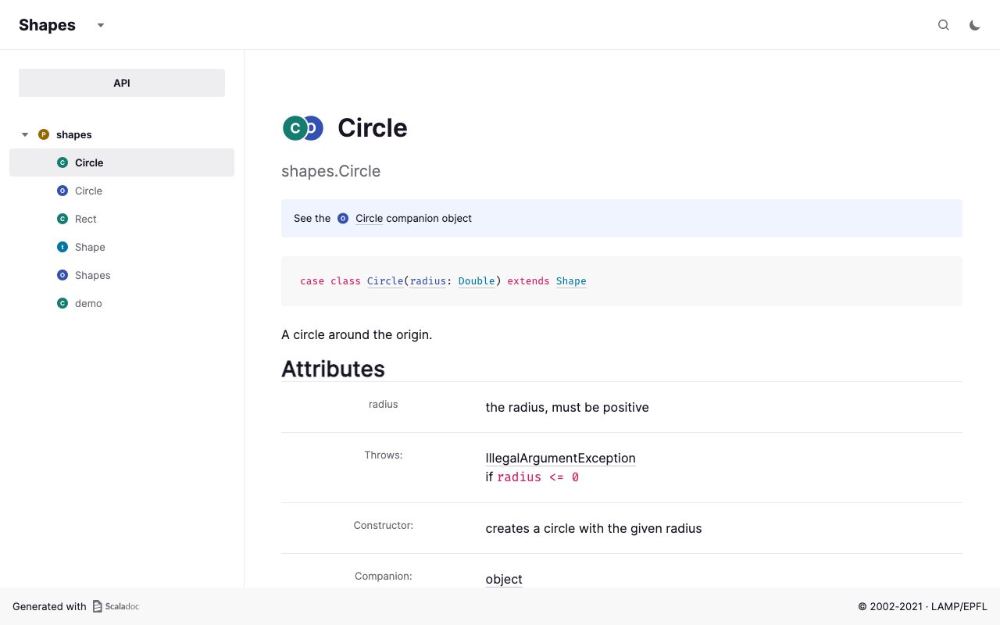

### Prof. Dr. Marko Boger, Prof. Dr. Pascal Laube
## Programmiertechnik I
# Lecture 12: Collections

<p class="small">Migrated from the Google Slides deck "PR-12-Collections" ("12 - Collections").</p>

---

<!-- _class: inhalt -->

# Goals

<div class="columns" style="grid-template-columns: 1fr 260px; align-items: start;">
<div markdown="1">

In this lecture you will learn about

- other generic types
- a type inheritance hierarchy
- traits

Supporting literature:

- Learn Scala 3 the Fast Way, chapter (to fill)

New Tools:

- ScalaDoc

</div>
<div markdown="1">


</div>
</div>

---

<!-- _class: kapitel -->

## 1
# Collections

Seq, Set, Map, and higher-order functions

---

# Review of Collections

We have seen List and Array.

- **Array** is mutable and allows random access at an index
- **List** is immutable and optimized for `head :: tail` operations
- We have also briefly touched **Range**, which is used in for loops
- **Vector** also had a mention – Vector is the immutable variant of Array

All these are **Collections**.

We have seen a number of methods on List, including two higher-order functions, `foreach` and `map`.
Now we will look at a few more Collections and their methods.

---

# Seq, Set, and Map

There are three fundamental types of Collections:

- **Seq**, a sequence of elements. List, Array, Vector and Range are Seqs.
  - Seqs can be **linear** or **indexed**. List is linear; Array, Vector and Range are indexed.
- **Set**, similar to Seq but elements are always unique.
  - Sets can be sorted or not sorted.
- **Map**, a data structure that allows the lookup of some data by a key, like a telephone book.
  - Also Maps can be sorted or not sorted.

---

<style scoped>
section { font-size: 20px; }
</style>

# A Hierarchy for Collections

<div class="columns" style="grid-template-columns: 1fr 1fr; align-items: start;">
<div markdown="1">

In the Scala documentation we find this image to represent the fundamental collection types.

- This hierarchy is built up of **traits**
- Traits are like classes that only describe an abstraction and cannot by themselves be instantiated
- Traits describe the common behavior of data types
- All collections share the trait **Iterable**
- **Seq**, **Set** and **Map** are also traits and describe the behavior of all collections in their branch

</div>
<div markdown="1">



</div>
</div>

---

<style scoped>
section { font-size: 18px; }
ul { margin: 0.15em 0; }
li { margin: 0.05em 0; }
</style>

# Traits and Classes

Traits only describe common behavior. The full implementation is provided in **classes** (dark blue).

- Default Set → `HashSet` · Default Iterable → `Seq` · Default Seq → `LinearSeq` → `List` · Default Map → `HashMap`
- We can create any of these – focus on **Set**, **Seq** and **Map**



---

# Trait Iterable

`Iterable` provides fundamental properties of all Collections.
`Iterable` implements:

- `foreach` and `for`
- iterator operations like `group` and `slide`
- `map` and `flatMap`
- `filter` and `filterNot`
- `take` and `drop`
- `zip`
- `partition`
- `fold` and `reduce`
- `exists` and `forall`
- `isEmpty` and `nonEmpty`

Many of these are **higher-order functions** – they take a function as parameter. So let’s take a look at that.

---

<style scoped>
pre { font-size: 15px; }
</style>

# Higher Order Functions – filterOdds

Let’s take a look at a filter algorithm. First, let’s filter all odds from a list:

```scala
def filterOdds(numbers: List[Int]): List[Int] = {
  numbers match {
    case Nil => Nil
    case head :: tail =>
      if (head % 2 != 0) head :: filterOdds(tail)
      else filterOdds(tail)
  }
}

filterOdds(List(5, 2, 3, 5, 3))
```

---

<style scoped>
pre { font-size: 15px; }
</style>

# Higher Order Functions – filterEvens

Now let’s filter all even numbers from a list:

```scala
def filterEvens(numbers: List[Int]): List[Int] = {
  numbers match {
    case Nil => Nil
    case head :: tail =>
      if (head % 2 == 0) head :: filterEvens(tail)
      else filterEvens(tail)
  }
}

filterEvens(List(5, 2, 3, 5, 3))
```

Note: the algorithm is identical except for the conditions `head % 2 != 0` and `head % 2 == 0`.

---

<style scoped>
pre { font-size: 15px; }
</style>

# Higher Order Functions – filterWith

So, let’s make the condition a parameter of the function:

```scala
def filterWith(numbers: List[Int], condition: (Int) => Boolean): List[Int] = {
  numbers match {
    case Nil => Nil
    case head :: tail =>
      if (condition(head)) head :: filterWith(tail, condition)
      else filterWith(tail, condition)
  }
}

filterWith(List(5, 2, 3, 5, 3), _ % 2 == 0)
```

---

# Higher Order Functions – filter

Now we can pass different functions as parameter:

```scala
filterWith(List(5, 2, 3, 5, 3), _ % 2 == 0)
filterWith(List(5, 2, 3, 5, 3), _ % 2 != 0)
filterWith(List(5, 2, 3, 5, 3), _ > 3)
filterWith(List(5, 2, 3, 5, 3), _ < 5)
filterWith(List(5, 2, 3, 5, 3), _ == 2)
```

Of course List already has a function `filter` and it looks like this:

```scala
List(5, 2, 3, 5, 3).filter(_ % 2 == 0)
List(5, 2, 3, 5, 3).filter(_ % 2 != 0)
List(5, 2, 3, 5, 3).filter(_ > 3)
List(5, 2, 3, 5, 3).filter(_ < 5)
List(5, 2, 3, 5, 3).filter(_ == 2)
```

Note: the first approach is procedural, the second object-oriented. Both are functional.

---

# Higher Order Function – partition

In a similar way, `partition` filters by a condition, but it returns **both** lists – those that do fulfill and don’t fulfill the condition – as a tuple:

```scala
case class Person(name: String, age: Int)
val people = List(
  Person("Anakin", 35), Person("Padme", 25),
  Person("Luke", 12), Person("Lea", 14)
)
val (minors, majors) = people.partition(_.age < 18)
```

---

<style scoped>
pre { font-size: 15px; }
</style>

# Higher Order Function – sum, product

Let’s implement a function `sum` over a list of Int:

```scala
def sum(numbers: List[Int], f: Int => Int): Int = {
  numbers match {
    case Nil          => 0
    case head :: tail => head + sum(tail, f)
  }
}
```

And a function for the product over a list of Int:

```scala
def product(numbers: List[Int], f: Int => Int): Int = {
  numbers match {
    case Nil          => 1
    case head :: tail => head * product(tail, f)
  }
}
```

Note: the difference is the `(0, 1)` and `(+, *)`.

---

<style scoped>
pre { font-size: 14px; }
</style>

# Higher Order Function – fold, reduce

If we pass these two differences in as parameter, we have an abstraction over sum and product:

```scala
def fold(numbers: List[Int], f: (Int, Int) => Int, initial: Int): Int = {
  numbers match {
    case Nil          => initial
    case head :: tail => f(head, fold(tail, f, initial))
  }
}
fold(List(1, 2, 3, 4, 5), _ + _, 0)
fold(List(1, 2, 3, 4, 5), _ * _, 1)
```

Of course, this already exists. Without initial value, it is called `reduce`:

```scala
List(1, 2, 3, 4, 5).reduce(_ + _)
List(1, 2, 3, 4, 5).reduce(_ * _)
```

With initial value, it is called `fold`; fold can operate from the left or right:

```scala
List(1, 2, 3, 4, 5).foldLeft(0)(_ + _)
List(1, 2, 3, 4, 5).foldLeft(1)(_ * _)
```

---

<style scoped>
pre { font-size: 15px; }
</style>

# Higher Order Functions – map

`map` is the mother of all higher-order functions. It just calls a function on every member of a collection.

```scala
def map(numbers: List[Int], f: Int => Int): List[Int] = {
  numbers match {
    case Nil          => Nil
    case head :: tail => f(head) :: map(tail, f)
  }
}

map(List(1, 2, 3, 4, 5), _ * 2)
```

It exists for all Collections and is implemented in the trait `Iterable`:

```scala
List(1, 2, 3, 4, 5).map(_ * 2)
```

---

<!-- _class: tools -->

## New Tools
# ScalaDoc

API documentation for the Scala standard library

---

<!-- _class: kapitel -->

## 2
# Documentation Comments

From JavaDoc to ScalaDoc

---

# Why Documentation Comments?

Code tells the compiler **how** something works. Users of your code need to know **what** it does.

- A *documentation comment* sits directly before a class, method or field
- It starts with `/**` (two stars!) and ends with `*/`
- A tool extracts these comments and generates **HTML API documentation**
- The Java and Scala standard library docs you use every day are generated exactly this way

Rule of thumb: document every **public** class, method and field — the *contract*, not the implementation.

---

# Structure of a Doc Comment

```java
/**
 * Adds money to this account.            <- summary sentence
 *
 * <p>The amount is given in cents. A      <- description
 * negative amount is rejected.
 *
 * @param amount the amount in cents      <- block tags
 * @return the new balance
 */
public long deposit(long amount) { ... }
```

- The **first sentence** is the summary — it appears in the overview tables
- Then an optional longer description (in JavaDoc: HTML, e.g. `<p>`, `<em>`)
- At the end: **block tags**, each on its own line starting with `@`

---

<style scoped>
table { font-size: 20px; }
</style>

# JavaDoc Block Tags

| Tag | Used on | Meaning |
|---|---|---|
| `@param name text` | method, constructor | one per parameter |
| `@return text` | method | the result (not for `void`) |
| `@throws Type text` | method, constructor | exception and when it is thrown (`@exception` is an old synonym) |
| `@author name` | class | who wrote it |
| `@version text` | class | current version |
| `@since text` | any | version in which it first appeared |
| `@see reference` | any | "See Also" link to a class, method or URL |
| `@deprecated text` | any | do not use anymore — say what to use instead |

---

# JavaDoc Inline Tags

Inline tags appear **inside** text, in curly braces:

- `{@code x <= 0}` — source code in monospace font, no HTML interpretation
- `{@link Account#deposit(long)}` — link to another element, shown in code font
- `{@linkplain Account the account}` — same link, shown in plain font
- `{@inheritDoc}` — copy the documentation from the overridden method

```java
/**
 * Returns the balance. Use {@link #deposit(long)} to add money.
 *
 * @throws IllegalStateException if {@code closed} is true
 */
```

---

# Conventions

**Classes:** what the class represents, how to use it, `@author`, `@version`, `@since`

**Methods:** start with a verb in third person — *"Returns …"*, *"Adds …"* (not *"This method returns …"*). Document every parameter, the result and every exception.

**Fields:** a single sentence: what the value means and its constraints (*"Balance in cents, never negative."*)

General:
- Be concise — the summary sentence must stand on its own
- Do not repeat the method name or the type signature
- Document **pre- and postconditions**, not the algorithm

---

<style scoped>
pre { font-size: 14px; }
</style>

# A Complete Java Example

<div class="columns" style="grid-template-columns: 1fr 1fr; align-items: start;">
<div markdown="1">

```java
/**
 * A simple bank account with a balance in cents.
 *
 * <p>Instances are <em>mutable</em>; use
 * {@link #deposit(long)} to add money.
 *
 * @author  Marko Boger
 * @version 1.2
 * @since   1.0
 * @see     java.math.BigDecimal
 */
public class Account {

  /** Current balance in cents, never negative. */
  private long balance;
```

</div>
<div markdown="1">

```java
  /**
   * Adds money to this account.
   *
   * @param amount the amount in cents, must be positive
   * @return the new balance
   * @throws IllegalArgumentException if {@code amount <= 0}
   */
  public long deposit(long amount) {
    if (amount <= 0)
      throw new IllegalArgumentException("amount <= 0");
    balance += amount;
    return balance;
  }

  /**
   * Returns the balance.
   *
   * @return the balance in cents
   * @deprecated use {@link #balance()} instead
   */
  @Deprecated
  public long getBalance() { return balance; }
}
```

</div>
</div>

---

# Generating JavaDoc

```bash
javadoc -d docs Account.java
```

<div class="columns" style="grid-template-columns: 1fr 1.6fr; align-items: start;">
<div markdown="1">

- `-d docs` — output directory
- `-author -version` — include those tags
- `-private` — also document private members
- Result: `docs/index.html`, one page per class, plus index, tree, search and a *Deprecated* list

</div>
<div markdown="1">



</div>
</div>

---

# ScalaDoc: JavaDoc for Scala

ScalaDoc uses the same `/** ... */` comments and most of the same tags. Differences:

- Text is written in **Markdown** (default in Scala 3), not HTML
- The old Scala 2 **wiki syntax** (`''italic''`, `'''bold'''`) still works with `@syntax wiki`, but is not recommended
- Links to API elements: `[[scala.collection.immutable.List]]` or `[[Circle]]`
- External links as Markdown: `[Scala](https://scala-lang.org)`
- Code blocks with Markdown backticks or `{{{ ... }}}`
- Convention: the `*` on each line is aligned with the **second** `*` of `/**`

```scala
/** Calculate the square of the given number.
  *
  * @param d the Double to square
  * @return the result of squaring `d`
  */
def square(d: Double): Double = d * d
```

---

<style scoped>
table { font-size: 19px; }
</style>

# Additional ScalaDoc Tags

| Tag | Meaning |
|---|---|
| `@tparam T text` | a type parameter (one per type parameter) |
| `@constructor text` | in the class comment: describes the primary constructor |
| `@note text` | pre-/postconditions or other notable restrictions |
| `@example text` | example code |
| `@group name` | puts a member into a group |
| `@groupname name Title` | display title of a group |
| `@groupdesc name text` | description shown under the group title |
| `@groupprio name n` | order of the groups (low first, ungrouped = 1000) |
| `@define name text` | macro: `$name` is replaced in comments of the same file |
| `@inheritdoc` | explicitly inherit the doc of the overridden member |

`@param`, `@return`, `@throws`, `@see`, `@author`, `@version`, `@since`, `@deprecated` work as in JavaDoc.

---

<style scoped>
pre { font-size: 15px; }
</style>

# Documenting a Trait

```scala
/** A geometric shape in the plane.
  *
  * Every shape knows its [[area]] and can be compared by size.
  * See also [[Circle]] and [[Rect]].
  *
  * @groupname Measure Measurements
  * @groupprio Measure 10
  * @groupname Compare Comparisons
  * @groupprio Compare 20
  */
trait Shape:
  /** The area of this shape.
    * @group Measure
    */
  def area: Double

  /** `true` if this shape is larger than `that`.
    *
    * @param that the shape to compare with
    * @return whether `area > that.area`
    * @group Compare
    */
  def largerThan(that: Shape): Boolean = area > that.area
```

Groups are only shown if scaladoc is called with **`-groups`**.

---

<style scoped>
pre { font-size: 15px; }
</style>

# Documenting Case Classes

The class parameters **are** the constructor parameters — and the fields. Document them with `@param` in the class comment; `@constructor` describes the primary constructor.

```scala
/** A circle around the origin.
  *
  * @constructor creates a circle with the given radius
  * @param radius the radius, must be positive
  * @throws IllegalArgumentException if `radius <= 0`
  */
case class Circle(radius: Double) extends Shape:
  require(radius > 0, "radius must be positive")
  def area: Double = math.Pi * radius * radius

/** An axis-parallel rectangle.
  *
  * @param width  the width
  * @param height the height
  * @note width and height are not checked
  */
case class Rect(width: Double, height: Double) extends Shape:
  def area: Double = width * height
```

---

<style scoped>
pre { font-size: 15px; }
</style>

# Documenting Objects and Companions

A companion object gets its **own** comment. ScalaDoc links class and companion on both pages.

```scala
/** Factory methods for [[Circle]]. */
object Circle:
  /** Creates a circle from its diameter.
    *
    * @param d the diameter
    * @return a new [[Circle]] with radius `d / 2`
    * @example {{{
    * Circle.fromDiameter(4.0).radius  // 2.0
    * }}}
    */
  def fromDiameter(d: Double): Circle = Circle(d / 2)
```

A standalone `object` (a singleton) is documented exactly like a class.

---

<style scoped>
pre { font-size: 15px; }
</style>

# @throws, @deprecated and Macros

In Scala, `@throws` and `@deprecated` exist **twice**: as doc tag *and* as annotation.

```scala
/** Utility functions on shapes.
  *
  * @define shapes a non-empty list of shapes
  */
object Shapes:
  /** Returns the largest of $shapes.
    *
    * @param xs $shapes
    * @tparam S the concrete shape type
    * @return the shape with the largest area
    */
  @throws[NoSuchElementException]("if xs is empty")
  def largest[S <: Shape](xs: List[S]): S = xs.maxBy(_.area)

  /** Old name of [[largest]]. */
  @deprecated("use largest instead", "1.1")
  def biggest(xs: List[Shape]): Shape = largest(xs)
```

- The **annotation** `@throws[E]` is seen by the compiler (and by Java callers); `@deprecated(...)` makes the compiler **warn** on every use
- The **doc tags** `@throws E text` / `@deprecated text` only go into the documentation

---

# Generating ScalaDoc

<div class="columns" style="grid-template-columns: 1fr 1.4fr; align-items: start;">
<div markdown="1">

With **scala-cli**:

```bash
scala-cli doc Shapes.scala -o docs \
  --scalac-option -groups
```

With **sbt**:

```bash
sbt doc
```

Output: `target/scala-3.x.y/api/index.html`

</div>
<div markdown="1">



</div>
</div>

---

<style scoped>
pre { font-size: 17px; }
</style>

# ScalaDoc Settings in sbt

Options are passed to the `doc` task in `build.sbt`:

```scala
Compile / doc / scalacOptions ++= Seq(
  "-groups",                          // enable @group tags
  "-project", "Shapes",               // project name in the header
  "-project-version", version.value,
  "-siteroot", "docs",                // static pages (guides, blog)
  "-source-links:github://markoboger/shapes"  // link to sources
)
```

- `-siteroot` adds hand-written Markdown pages next to the API
- `-source-links` puts a *source* link on every member
- `-comment-syntax wiki` switches all comments to the Scala 2 wiki syntax
- Scala 3 scaladoc can even **type-check code snippets** in comments (`-snippet-compiler:compile`)

---

# Summary: JavaDoc vs. ScalaDoc

| | JavaDoc | ScalaDoc (Scala 3) |
|---|---|---|
| Comment | `/** ... */` | `/** ... */`, `*` aligned under 2nd `*` |
| Markup | HTML | Markdown (wiki syntax optional) |
| Links | `{@link Type#member}` | `[[Type.member]]` |
| Code | `{@code ...}` | `` `...` `` or `{{{ ... }}}` |
| Extra tags | — | `@tparam`¹, `@constructor`, `@note`, `@example`, `@group…`, `@define` |
| Tool | `javadoc -d docs` | `scaladoc`, `scala-cli doc`, `sbt doc` |

<p class="small">¹ JavaDoc documents type parameters as <code>@param &lt;T&gt;</code>.</p>

---

<!-- _class: inhalt -->

<style scoped>
section { font-size: 23px; }
</style>

# Summary

- Review: Array (mutable, random access) vs List (immutable, `head`/`tail`)
- Core collection kinds: `Seq`, `Set`, and `Map` (linear vs indexed sequences)
- Hierarchy built from traits; classes provide the default implementations
- `Iterable` shares `foreach`/`for`, iterators, and common HOFs
- Higher-order functions: `filter`, `partition`, `sum`/`product`, `fold`/`reduce`, `map`
- Tool mentioned: ScalaDoc for the standard library API

---

<!-- _class: aufgabe -->

# Task

(Task to fill)

---

<!-- _class: abschluss -->

# Questions?

## Thank you!

marko.boger@htwg-konstanz.de
