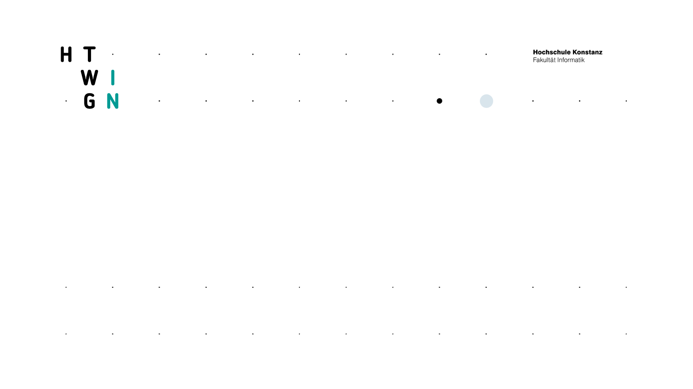

### Prof. Dr. Marko Boger, Prof. Dr. Pascal Laube
## Programmiertechnik I
# Lecture 13: Namespaces, Packages and Visibility

<p class="small">How packages and imports prevent name clashes in Java and Scala, how visibility modifiers, objects, opaque types and export clauses control what other code can see, and how the library Squants applies these ideas.</p>

---

<!-- _class: inhalt -->

<style scoped>
section { font-size: 22px; }
</style>

# Goals

<div class="columns" style="grid-template-columns: 1fr 260px; align-items: start;">
<div markdown="1">

In this lecture you will learn about

- namespaces and packages in Java and Scala
- imports: single, wildcard, static, renaming, hiding
- visibility: public, protected, package-private, private
- objects as modules, opaque types and export clauses
- an example library: Squants (quantities, units and money)

Supporting literature:

- Lewis, Art of Programming Using Scala, ch. 16, 17, 19
- Scala 3 Book: Packaging and Imports, Opaque Types

</div>
<div markdown="1">


</div>
</div>

---

<!-- _class: kapitel -->

## 1
# Namespaces

Why names need a home

---

# The Problem: Name Clashes

Programs grow, and names collide.

- `List` – is it `scala.List` or `java.util.List`?
- `Date` – `java.util.Date` or `java.sql.Date`?
- Two libraries both define a class `Parser`

A **namespace** is a named scope that makes names unique:

- the **simple name** `List` is short, but ambiguous
- the **fully qualified name** `java.util.List` is unique

In Java and Scala, namespaces are created by **packages**.

---

# Packages Organize Code

Packages serve three purposes:

- **Uniqueness:** names only need to be unique *within* a package
- **Structure:** related classes live together (`bank.model`, `bank.ui`)
- **Access control:** a package is a boundary for visibility

Naming convention: reverse internet domain, all lower case

```
de.htwg.ain.bank.model
```

<p class="small">Lewis: "Bigger Programs" – packages become essential once a program spans many files.</p>

---

<!-- _class: kapitel -->

## 2
# Packages and Imports in Java

---

# Java Packages and Directories

The `package` clause must be the first statement in the file:

```java
package de.htwg.bank;

public class Account { ... }
```

In Java, the **directory structure must match** the package:

```
src/de/htwg/bank/Account.java
```

- At most **one public top-level class** per file, named like the file
- Without a `package` clause, a class lands in the *unnamed* package (only for tiny experiments)

---

# Java Imports

```java
import de.htwg.bank.Account;      // single-type import
import java.util.*;               // on-demand (wildcard) import
import static java.lang.Math.max; // static import of a member

public class Main {
    public static void main(String[] args) {
        Account a = new Account("Ada");
        java.util.List<Integer> xs = new ArrayList<>(List.of(1, 2));
        System.out.println(max(a.getBalance(), 1) + " " + xs);
    }
}
```

- `import` only saves typing – the fully qualified name always works
- `java.lang.*` is imported automatically (`String`, `Math`, ...)
- Imports must be at the top of the file, after `package`

---

# Java Visibility Modifiers

| Modifier | Class | Package | Subclass | Everywhere |
|---|:-:|:-:|:-:|:-:|
| `public` | ✓ | ✓ | ✓ | ✓ |
| `protected` | ✓ | ✓ | ✓ | |
| *(none)* package-private | ✓ | ✓ | | |
| `private` | ✓ | | | |

- The **default** in Java is *package-private*
- `protected` includes the whole package – often surprising

<p class="small">Source: Oracle Java Tutorials, "Controlling Access to Members of a Class".</p>

---

# Java Visibility in Code

```java
package de.htwg.bank;

public class Account {
    private int balance;          // only inside Account
    int branch;                   // package-private
    protected String owner;       // package + subclasses
    public Account(String owner) { this.owner = owner; }
    public int getBalance() { return balance; }
    public void deposit(int amount) {
        if (amount <= 0) throw new IllegalArgumentException("amount must be positive");
        balance += amount;
    }
}
```

- Fields `private`, access via `public` methods: **encapsulation**
- `deposit` can enforce an invariant – a public field could not

---

<!-- _class: kapitel -->

## 3
# Packages and Imports in Scala

---

# Scala Package Clauses

Same style as Java:

```scala
package de.htwg.bank

class Account(val owner: String)
```

Differences to Java:

- The directory structure **should** match, but the compiler does not enforce it
- Several public classes per file are allowed
- `java.lang.*`, `scala.*` and `Predef` are imported automatically

<p class="small">Scala 3 Book, "Packaging and Imports".</p>

---

# Nested Packages

Package clauses can enclose definitions – also several in one file:

```scala
package de.htwg.bank:

  class Account(val owner: String)

  package util:                       // de.htwg.bank.util
    def describe(a: Account): String = a.owner

package app:
  import de.htwg.bank.Account
  @main def run(): Unit = println(Account("Ada").owner)
```

- Inner packages see the members of outer packages

---

# Top-Level Definitions

Scala 3: `def`, `val`, `var`, ... can live **directly in a package**:

```scala
package de.htwg.bank

def fee(amount: Int): Int = amount / 100

val MaxBalance = 1_000_000
```

- In Scala 2 this needed a **package object**:<br>`package object bank { def fee(...) = ... }`
- Package objects are deprecated in Scala 3
- In Java, everything must be inside a class (`static` helper methods)

---

# Scala Imports: Selectors

```scala
import de.htwg.bank.Account              // one member
import de.htwg.bank.{Account, fee}       // several members
import de.htwg.bank.*                    // everything (Java: .*)
import scala.math.max                    // a method from an object
```

- `*` is the Scala 3 wildcard (Scala 2: `_`)
- Importing members of an object = Java's **static import**
- Same package: no import needed

---

# Renaming and Hiding

```scala
import java.util.{List as JList}          // rename
import de.htwg.bank.{fee as bankFee}      // rename a method
import java.util.{Random as _, *}         // hide Random, import the rest

val jl: JList[Int] = new ArrayList[Int]()
val xs: List[Int] = List(1, 2)            // still scala.List
```

- Renaming solves **name clashes** without fully qualified names
- `X as _` excludes a member from a wildcard import
- Scala 2 syntax: `{List => JList}`, `{Random => _, _}`

---

# Imports Anywhere

Unlike Java, a Scala `import` can appear in **any block**:

```scala
class Report:
  import scala.math.{max, min}     // only visible inside Report
  def clamp(x: Int): Int = max(0, min(100, x))

def area(r: Double): Double =
  import scala.math.Pi             // only inside this method
  Pi * r * r
```

- Keep imports close to where they are used
- Scope of an import = the enclosing block
- Still good practice: declare imports used by the whole file **at the top**, right after the `package` clause

<p class="small">Lewis, ch. 17 / 2nd ed. 3.8 "import Options".</p>

---

<!-- _class: kapitel -->

## 4
# Objects as Modules

Singleton objects as namespaces

---

# An object Is a Namespace

A Scala `object` groups related functions and constants – a **module**:

```scala
object StringUtils:
  val Separator = ", "
  def capitalizeWords(s: String): String =
    s.split(" ").map(cap).mkString(" ")
  private def cap(w: String): String =        // hidden helper
    if w.isEmpty then w else s"${w.head.toUpper}${w.tail}"

import StringUtils.*
capitalizeWords("hello scala world")   // "Hello Scala World"
```

- Access via `StringUtils.capitalizeWords` or after `import StringUtils.*`
- `private` helpers are invisible to users of the module

---

# Java: Static Utility Classes

```java
public final class StringUtils {
    private StringUtils() {}                       // no instances
    public static final String SEPARATOR = ", ";
    public static String capitalizeWords(String s) {
        StringBuilder b = new StringBuilder();
        for (String w : s.split(" ")) b.append(cap(w)).append(' ');
        return b.toString().trim();
    }
    private static String cap(String w) {
        return w.isEmpty() ? w : Character.toUpperCase(w.charAt(0)) + w.substring(1);
    }
}
```

- Java needs `final`, a `private` constructor and `static` everywhere
- Scala: an `object` is exactly one instance – and a real value (can extend traits, be passed around)

---

<!-- _class: kapitel -->

## 5
# Visibility in Scala

---

# Public by Default

| Java | Scala |
|---|---|
| `public` | *(default – no keyword)* |
| *(none)* package-private | `private[pkg]` |
| `protected` (package + subclasses) | `protected` (subclasses only) |
| `private` | `private` |

- Scala has no `public` keyword – everything is public unless restricted
- Scala's `protected` is **stricter** than Java's

<p class="small">Lewis, 16.1.1.2 "Visibility", 19.2.2 "Protected Visibility".</p>

---

# private and protected

```scala
class Account(val owner: String):
  private var balance = 0
  protected def audit(): String = s"$owner: $balance"
  def deposit(amount: Int): Unit =
    require(amount > 0, "amount must be positive")
    balance += amount
  def sameBalance(other: Account): Boolean =
    balance == other.balance       // OK: private is per class

class Savings(o: String) extends Account(o):
  def report: String = audit()     // OK: protected in subclass
  // def peek = balance            // error: private
```

- `private` members are **not** visible in subclasses (Lewis 19.2.1)
- Access to `other.balance` is allowed: same class

---

# Qualified Access: private[X]

```scala
package de.htwg.bank:
  class Account(val owner: String):
    private[bank] var branch = 0   // visible in package bank

  package util:
    def describe(a: Account) = s"${a.owner} at ${a.branch}"  // OK
```

- `private[bank]` ≈ Java's package-private, but **you choose** the boundary
- `private[Account]` – visible in the class and its nested definitions
- `protected[pkg]` exists as well

---

# Companion Objects

A class and an `object` with the same name in the same file are **companions**:

```scala
class Account(val owner: String):
  private var balance = 0

object Account:
  def apply(owner: String, initialBalance: Int = 0): Account =
    val a = new Account(owner)
    a.balance = initialBalance  // companion may access private members
    a

val acc = Account("Ada", 100)   // calls Account.apply
```

- Companions see each other's `private` members
- The object holds what Java would declare `static`
- Typical use: factory methods

<p class="small">Lewis, 16.1.5.2 "Introduction to Companion Objects".</p>

---

<!-- _class: kapitel -->

## 6
# Opaque Types

Hiding a type's representation

---

# Opaque Type Aliases

```scala
object Money:
  opaque type Euro = BigDecimal          // inside: Euro == BigDecimal
  object Euro:
    def apply(d: BigDecimal): Euro = d
    def cents(c: Long): Euro = BigDecimal(c) / 100
  extension (e: Euro)
    def +(o: Euro): Euro = (e: BigDecimal) + o
    def amount: BigDecimal = e

import Money.*
val total: Euro = Euro(BigDecimal("1.50")) + Euro.cents(250)   // 4.00
```

- **Inside** `Money` the compiler knows `Euro = BigDecimal`
- **Outside** `Euro` is a distinct type – only the public API is usable

---

# Opaque Types: Visibility for Types

```scala
val bad: Money.Euro = BigDecimal(3)
// error: Found: BigDecimal  Required: Money.Euro
```

- `private` hides **members**; `opaque` hides a **type's representation**
- Clients cannot mix up `Euro`, `Dollar` and plain `BigDecimal`
- **Zero runtime cost:** at runtime a `Euro` *is* a `BigDecimal` – no wrapper object
- Compare: a `case class Euro(value: BigDecimal)` allocates an object per value
- Java has no equivalent (only wrapper classes)

<p class="small">Scala 3 Book, "Opaque Types".</p>

---

<!-- _class: kapitel -->

## 7
# Export Clauses

Delegation made easy (Scala 3)

---

# export: Forward Selected Members

```scala
class Printer:
  def print(s: String): Unit = println(s"[print] $s")
  def status: String = "ready"
  def reset(): Unit = ()

class Scanner:
  def scan(): String = "page"

class Copier:
  private val printer = Printer()
  private val scanner = Scanner()
  export printer.{print, status as printerStatus, reset as _}
  export scanner.scan
  def copy(): Unit = print(scan())
```

- `export` creates **forwarder methods**: `Copier().print("x")` calls `printer.print("x")`
- Same selector syntax as `import`: rename with `as`, exclude with `as _`, `*` for all

---

<!-- _class: kapitel -->

## 8
# Example Library: Squants

Namespaces in a real library

---

# What Is Squants?

A Scala library for **quantities with units** (Typelevel project):

```scala
//> using dep org.typelevel::squants:1.8.3

import squants.energy.{Energy, KilowattHours, Kilowatts}
import squants.market.{EUR, Money, Price}
```

- `Energy` in `KilowattHours`, `Power` in `Kilowatts`, `Time` in `Hours`
- `Money` in `EUR`, `CHF`, ... and `Price[A]` = money per quantity
- The compiler rejects nonsense like *kWh + EUR*
- Version 1.8.3 is built for Scala 2.12, 2.13 and 3 – its source is **Scala 2 style**

<p class="small">Outputs in this chapter were produced with Scala 3.9.0 and an English locale; on a German system Squants prints <code>3500,0 kWh</code>.</p>

---

<style scoped>
pre { font-size: 19px; }
</style>

# The Electricity Bill in a Few Lines

```scala
import squants.energy.{Energy, KilowattHours}
import squants.market.{EUR, Money, Price}

val consumption: Energy      = KilowattHours(3500)     // 3500.0 kWh
val workPrice: Price[Energy] = EUR(0.32) / KilowattHours(1)
                                                       // 0.32 EUR/1.0 kWh
val baseFee: Money           = EUR(12) * 12            // 144 EUR
val total: Money             = workPrice * consumption + baseFee
total.toFormattedString                                // €1264.00
```

- `Money / Energy` gives a `Price[Energy]`
- `Price * Energy` gives `Money`, and `Money + Money` gives `Money`
- Units and currencies are checked by the compiler

---

<style scoped>
pre { font-size: 19px; }
</style>

# Squants' Packages and Imports

One package per physical domain, the directories match the packages:

```
squants/energy/   Energy.scala, Power.scala, ..., package.scala
squants/market/   Money.scala, Price.scala, MoneyContext.scala, package.scala
squants/time/     Time.scala, TimeDerivative.scala, ...
squants/          electro, mass, motion, space, thermal, ...
```

The head of `squants/energy/Energy.scala`:

```scala
package squants.energy

import squants._
import squants.electro.{Coulombs, ElectricCharge, ElectricPotential, Volts}
import squants.time.{Time, _}
```

- Fully qualified name: `squants.energy.KilowattHours`
- `_` is the **Scala 2 wildcard** – in Scala 3 we write `*`

---

<style scoped>
pre { font-size: 19px; }
</style>

# Units Are Singleton Objects

From `squants/energy/Energy.scala`:

```scala
object KilowattHours extends EnergyUnit {
  val conversionFactor = Watts.conversionFactor * MetricSystem.Kilo
  val symbol = "kWh"
}
```

```scala
KilowattHours.symbol                     // kWh
KilowattHours(3500)                      // 3500.0 kWh
KilowattHours(3500).in(WattHours)        // 3500000.0 Wh
```

- Exactly **one** `KilowattHours` exists – a unit needs no instances
- The object is a **namespace** for the unit's symbol and conversion factor

<p class="small"><b>Not covered yet:</b> <code>extends EnergyUnit</code> (traits and inheritance). <code>KilowattHours(3500)</code> calls an <code>apply</code> inherited from the trait <code>EnergyUnit</code>.</p>

---

<style scoped>
pre { font-size: 17px; }
li { font-size: 21px; }
</style>

# Private Constructors and Companion Factories

```scala
// squants/market/Money.scala (excerpt)
final class Money private (val amount: BigDecimal)(val currency: Currency) ...
object Money extends Dimension[Money] {
  def apply(value: BigDecimal, currency: Currency) = new Money(value)(currency)
// squants/energy/Energy.scala (excerpt)
final class Energy private (val value: Double, val unit: EnergyUnit) ...
  def apply(load: Power, time: Time): Energy = load * time    // in object Energy
```

```scala
new Energy(3500, KilowattHours)
// error: private constructor Energy can only be accessed
//        from class Energy in package squants.energy.
Money(BigDecimal("12.00"), EUR)                     // 12 EUR
Energy(Kilowatts(2), Hours(3)).in(KilowattHours)    // 6.0 kWh
```

- `private` before the parameter list makes the **constructor** private
- Only the **companion object** may call `new Money(...)` – clients use `apply`
- The library decides how objects are created – encapsulation

---

<style scoped>
pre { font-size: 19px; }
</style>

# Opaque Type: Meter Readings

Squants has no opaque types – so we add one for **meter readings**:

```scala
import squants.energy.{Energy, KilowattHours}

object Metering:
  opaque type Reading = Energy         // inside Metering: Reading == Energy
  object Reading:
    def apply(kWh: Double): Reading =
      require(kWh >= 0, "a meter reading is never negative")
      KilowattHours(kWh)
  extension (r: Reading)
    def since(earlier: Reading): Energy = r - earlier

import Metering.*
val jan = Reading(12_400)
val dec = Reading(15_900)
dec.since(jan)                         // 3500.0 kWh
```

---

# Opaque Types: What the Compiler Prevents

```scala
val r: Reading = KilowattHours(5)
// error: Found: squants.energy.Energy  Required: Metering.Reading

val s = jan + dec
// error: value + is not a member of Metering.Reading
```

- Adding two meter readings makes no sense – and now it does not compile
- Outside `Metering` only `Reading(...)` and `since` are available
- At runtime a `Reading` **is** an `Energy` – no extra wrapper object
- Why does Squants use `final class ... private` instead? It also compiles for **Scala 2**, which has no opaque types

---

<style scoped>
pre { font-size: 16px; }
li { font-size: 21px; }
</style>

# Preview: How Does 3500.kWh Work?

`Int` has no method `kWh` or `kW`. From `Energy.scala` and `Power.scala`:

```scala
object EnergyConversions {
  implicit class EnergyConversions[A](n: A)(implicit num: Numeric[A]) {
    def kWh = KilowattHours(n)
    ...
object PowerConversions {
  implicit class PowerConversions[A](n: A)(implicit num: Numeric[A]) {
    def kW = Kilowatts(n)
    ...
```

```scala
import squants.energy.EnergyConversions.*
import squants.energy.PowerConversions.*

3500.kWh                         // 3500.0 kWh
EnergyConversions(3500).kWh      // 3500.0 kWh – what the compiler inserts
5.kW                             // 5.0 kW
PowerConversions(5).kW           // 5.0 kW
```

- No `kWh` on `Int`: the compiler **wraps** the number automatically – only after the import

<p class="small"><b>Not covered yet:</b> implicit classes and implicit parameters (<code>Numeric[A]</code>). Scala 3 uses <code>extension</code> methods instead.</p>

---

<style scoped>
pre { font-size: 19px; }
</style>

# Our Own Unit Syntax: Extension Methods

The same effect in Scala 3 style – an `object` as namespace for our extensions:

```scala
import squants.energy.{Energy, KilowattHours, Kilowatts, Power}
import squants.market.{EUR, Money, USD}
import squants.time.{Hours, Time}

object Units:
  extension (n: Int)
    def kWh: Energy = KilowattHours(n)
    def kW: Power   = Kilowatts(n)
    def hours: Time = Hours(n)
    def eur: Money  = EUR(n)
  extension (d: Double)
    def eur: Money = EUR(d)
    def usd: Money = USD(d)
```

- Only Squants **types and units** are imported – no `*Conversions` objects
- Extension methods are the **Scala 3 way**; Squants uses Scala 2 implicit classes for the same effect

---

<style scoped>
pre { font-size: 20px; }
</style>

# Using the Extensions

```scala
import Units.*

3500.kWh                               // 3500.0 kWh
5.kW                                   // 5.0 kW
5.kW * 3.hours                         // 15000.0 Wh
(5.kW * 3.hours).in(KilowattHours)     // 15.0 kWh

kWh(3500)                              // 3500.0 kWh – what 3500.kWh calls
Units.kWh(3500)                        // 3500.0 kWh
```

- `3500.kWh` is just a call of the method `kWh` with `3500` as argument
- No explicit `KilowattHours(...)` or `Kilowatts(...)` needed
- Power × time = energy: 5 kW for 3 hours are 15 kWh

---

<style scoped>
pre { font-size: 18px; }
</style>

# Without import Units.*

```scala
object Units:
  extension (n: Int)
    def kWh: Energy = KilowattHours(n)
    ...

val e: Energy = 3500.kWh               // no import Units.*
```

```
value kWh is not a member of Int, but could be made available as an extension method.

The following import might fix the problem:

  import squants.energy.EnergyConversions.EnergyConversions
```

- Extensions are only visible where they are **defined or imported** – like any name
- The compiler suggests Squants' implicit class – the fix for our code is `import Units.*`

<p class="small"><b>Not covered yet:</b> extension methods in detail.</p>

---

<style scoped>
pre { font-size: 18px; }
</style>

# Worked Example: A Bill in EUR and USD

```scala
import squants.market.*
import Units.*

given MoneyContext =                         // example rate: 1 EUR = 1.10 USD
  MoneyContext(EUR, defaultCurrencySet, List(CurrencyExchangeRate(EUR(1), USD(1.10))))

val usage: Energy = 2.kW * 1750.hours                // heat pump, 2 kW for 1750 h
usage.in(KilowattHours)                              // 3500.0 kWh
val priceUsd: Price[Energy] = 0.35.usd / 1.kWh       // 0.35 USD/1.0 kWh
val baseFee: Money = 12.eur * 12                     // 144 EUR
```

- `Money / Energy` gives a `Price[Energy]`
- The `MoneyContext` holds the default currency and the exchange rates

<p class="small"><b>Not covered yet:</b> <code>given</code> and implicit parameters – <code>Money</code> methods find the <code>MoneyContext</code> automatically.</p>

---

<style scoped>
pre { font-size: 18px; }
</style>

# Worked Example: Converting and Totals

```scala
val priceEur = priceUsd in EUR                      // 0.31818... EUR/1.0 kWh
val total: Money = priceEur * usage + baseFee
total.toFormattedString                             // €1257.64
(total in USD).toFormattedString                    // $1383.40
total to USD                                        // 1383.4000... (a BigDecimal)

(priceUsd * usage + baseFee).toFormattedString      // $1383.40
```

- `in` converts to a `Money` in another currency, `to` returns only the amount
- `Price[Energy] * Energy` gives `Money` – units and currencies fit together
- Mixing currencies in `+` uses the exchange rate: the EUR base fee is converted to USD

<p class="small">Real signature: <code>def in(unit: Currency)(implicit context: MoneyContext)</code>. <b>Not covered yet:</b> implicit parameters.</p>

---

<style scoped>
table, th, td { font-size: 17px !important; padding: 2px 10px !important; }
</style>

# Summary: Java vs. Scala

| | Java | Scala 3 |
|---|---|---|
| Package & directory | must match | convention only |
| Package blocks | – | `package p:` nested |
| Top-level functions | – | yes |
| Static import | `import static` | import object members |
| Rename / hide | – | `as`, `as _` |
| Import position | top of file | anywhere |
| Default visibility | package-private | public |
| `protected` | package + subclasses | subclasses |
| Utility module | `final` class + `static` | `object` |
| Hide representation | wrapper class | `opaque type` |
| Delegation | hand-written | `export` |

---

<!-- _class: inhalt -->

<style scoped>
section { font-size: 23px; }
</style>

# Summary

- Namespaces avoid name clashes; in Java and Scala they are packages
- Java: package = directory, imports at the top, `import static`
- Scala: package blocks, top-level definitions, imports anywhere with renaming and hiding
- Visibility: Java defaults to package-private, Scala to public
- `private[pkg]` qualifies access; companions share private members
- `object` as module; `opaque type` hides representations at zero cost; `export` delegates
- Squants: packages, unit objects, private constructors and companion factories in a real library

---

<!-- _class: aufgabe -->

<style scoped>
section { font-size: 18px; }
ul { margin: 0.1em 0; }
li { margin: 0; }
p { margin: 0.35em 0; }
</style>

# Task

**1. CodeTask:** keep working on the exercises for this lecture.
- Reading: Learn Scala 3, Chapter 36

**2. Units and namespaces** (in your Mill project, with `org.typelevel::squants:1.8.3`)
- Create a package `de.htwg.energy` and put the `Units` object from the slides into it
- Add your own extensions, e.g. `def MWh: Energy`, `def minutes: Time` and `def chf: Money`
- Use them from a `@main` in **another** package: once with `import Units.*`, once with a renamed import

**3. An energy bill from meter readings**
- Use the opaque type `Metering.Reading` and build `Reading`s for January and December
- Compute the consumption with `since`, then price it with `0.35.usd / 1.kWh` and add the base fee `12.eur * 12`
- With the example rate 1 EUR = 1.10 USD, print the total in EUR and in USD
- Check: for the heat pump (`2.kW * 1750.hours`) you should get €1257.64 and $1383.40

---

<!-- _class: abschluss -->

# Questions?

## Thank you!

marko.boger@htwg-konstanz.de
