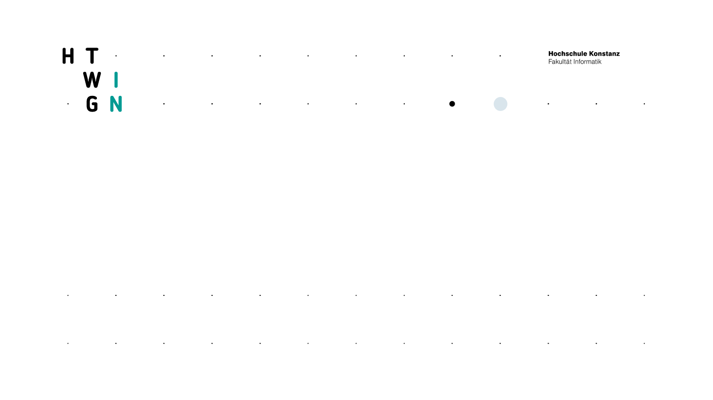

### Prof. Dr. Marko Boger, Prof. Dr. Pascal Laube
## Programmiertechnik I
# Lecture 14: Lazy Lists and Streams

---

<!-- _class: inhalt -->

<style scoped>
section { font-size: 19px; }
</style>

# Goals

<div class="columns" style="grid-template-columns: 1fr 260px; align-items: start;">
<div markdown="1">

In this lecture you will learn about

- sequences and series: the mathematics behind lazy lists
- strict vs. lazy evaluation: by-value, by-name, `lazy val`
- Scala's `LazyList` and memoization
- infinite data structures: naturals, Fibonacci, primes
- lazy vs. forcing operations, views and iterators
- Java Streams in comparison
- practice: computing limits of sequences and series to a given precision

Supporting literature:

- Lewis, Art of Programming Using Scala
- Scala docs: Collections – `LazyList`, Views

</div>
<div markdown="1">


</div>
</div>

---

<!-- _class: kapitel -->

## 1
# Sequences and Series

The mathematics behind lazy lists

---

<style scoped>
section { font-size: 21px; }
</style>

# Sequences (Folgen)

A **sequence** assigns a value $a_n$ to every natural number $n$ – it is **infinite** by definition.

$$
a_n = 2n: \ 2, 4, 6, 8, \dots \qquad\qquad b_n = \frac{1}{n}: \ 1, \tfrac12, \tfrac13, \tfrac14, \dots
$$

Nobody writes down *all* elements – we write down the **rule** and look at as many as we need.

```scala
val a = LazyList.from(1).map(n => 2 * n)
val b = LazyList.from(1).map(n => 1.0 / n)

a.take(6).toList   // List(2, 4, 6, 8, 10, 12)
b.take(4).toList   // List(1.0, 0.5, 0.3333333333333333, 0.25)
```

A `LazyList` is the programmer's version of a sequence: an infinite rule, evaluated on demand.

---

<style scoped>
section { font-size: 21px; }
</style>

# Recursively Defined Sequences

Many sequences are defined by a start value and a **recurrence** (Lecture 10):

$$
c_0 = 100, \quad c_{n+1} = \frac{c_n}{2} + 1 \qquad\qquad F_0 = 0,\ F_1 = 1,\ F_{n+2} = F_{n+1} + F_n
$$

`LazyList.iterate(start)(f)` is exactly $x_0,\ f(x_0),\ f(f(x_0)), \dots$

```scala
val c = LazyList.iterate(100.0)(x => x / 2 + 1)
c.take(6).toList   // List(100.0, 51.0, 26.5, 14.25, 8.125, 5.0625)
```

The sequence converges to 2 – we can watch it without ever computing "all" elements.
Fibonacci needs two predecessors – we will build it with `zip` in chapter 4.

---

<style scoped>
section { font-size: 20px; }
</style>

# Series (Reihen) and Partial Sums

A **series** is the sequence of **partial sums** $s_n = \sum_{k=0}^{n} a_k$ of a sequence.

$$
\sum_{k=0}^{\infty} \left(\tfrac12\right)^k = 1 + \tfrac12 + \tfrac14 + \dots = 2
\qquad\qquad
\sum_{k=1}^{\infty} \tfrac1k = 1 + \tfrac12 + \tfrac13 + \dots = \infty
$$

`scanLeft` turns a sequence into its partial sums – lazily:

```scala
val geo = LazyList.from(0).map(k => math.pow(0.5, k)).scanLeft(0.0)(_ + _)
geo.take(6).toList   // List(0.0, 1.0, 1.5, 1.75, 1.875, 1.9375)
geo(30)              // 1.9999999981373549

val harm = LazyList.from(1).map(1.0 / _).scanLeft(0.0)(_ + _)
harm.indexWhere(_ > 5)    // 83
harm.indexWhere(_ > 10)   // 12367
```

The geometric series converges to 2; the harmonic series diverges – but very slowly.

---

<style scoped>
section { font-size: 20px; }
</style>

# Approximating $e$ and $\pi$

$$
e = \sum_{k=0}^{\infty} \frac{1}{k!}
\qquad\qquad
\pi = 4 \sum_{k=0}^{\infty} \frac{(-1)^k}{2k+1} \quad \text{(Leibniz)}
$$

```scala
val facts = LazyList.iterate((0, BigInt(1))) { case (n, f) => (n + 1, f * (n + 1)) }.map(_._2)
val e = facts.map(f => 1.0 / f.toDouble).scanLeft(0.0)(_ + _)
e.take(6).toList   // List(0.0, 1.0, 2.0, 2.5, 2.6666666666666665, 2.708333333333333)
e.zip(e.tail).find((x, y) => (y - x).abs < 1e-12).map(_._2)
                   // Some(2.718281828458995)   math.E = 2.718281828459045

val pi = LazyList.from(0).map(k => (if k % 2 == 0 then 4.0 else -4.0) / (2 * k + 1))
                         .scanLeft(0.0)(_ + _)
pi(10)     // 3.0418396189294032
pi(1000)   // 3.140592653839794
```

**Generation** (the infinite series) is separated from **consumption** (when do we stop?).

---

<!-- _class: kapitel -->

## 2
# Strict and Lazy Evaluation

When is an expression computed?

---

<style scoped>
section { font-size: 21px; }
</style>

# Call-by-Value vs. Call-by-Name

Scala, like Java, is **strict** by default. A parameter of type `=> A` is passed **by name**: it is evaluated each time it is used.

<div class="columns" style="grid-template-columns: 1fr 1fr; align-items: start;">
<div markdown="1">

```scala
def compute(): Int =
  println("computing"); 21

def twiceV(x: Int): Int = x + x
def twiceN(x: => Int): Int = x + x

twiceV(compute())
twiceN(compute())
```

</div>
<div markdown="1">

Output:

```text
computing
42
computing
computing
42
```

- by value: evaluated **once**, before the call
- by name: evaluated **at every use** – or never

</div>
</div>

---

<style scoped>
section { font-size: 21px; }
</style>

# `lazy val`

A `lazy val` is computed on **first access** and then **cached**.

<div class="columns" style="grid-template-columns: 1fr 1fr; align-items: start;">
<div markdown="1">

```scala
lazy val config =
  println("loading config")
  "ok"

println("before")
println(config)
println(config)
```

</div>
<div markdown="1">

Output:

```text
before
loading config
ok
ok
```

</div>
</div>

| | evaluated | how often |
|---|---|---|
| `val` | at definition | once |
| `lazy val` | at first access | once (cached) |
| `def` / `=> A` | at every access | every time |

---

# Why Laziness?

- **Performance:** never compute what nobody uses
  - "find the first match" stops after the first match
- **Infinite structures:** describe *all* natural numbers, *all* primes – and take only what you need
- **Separation of concerns:** split **generation** of data from its **consumption**
  - the producer describes *what* the values are
  - the consumer decides *how many* it needs
- **Expensive initialization:** load a resource only if needed (`lazy val`)

Laziness is a core idea of functional programming (Haskell is lazy by default).

---

<!-- _class: kapitel -->

## 3
# LazyList

A list that computes its elements on demand

---

# `LazyList` in Scala

A `LazyList` is an immutable linked list – like `List` – but its elements are **computed only when needed**.

- head **and** tail are lazy
- once computed, elements are **memoized** (stored)
- it is a `Seq`: it has `map`, `filter`, `take`, `zip`, … (see Lecture 12)

```scala
val ll = 1 #:: 2 #:: 3 #:: LazyList.empty
println(ll)
```

```text
LazyList(<not computed>)
```

Even the first element has not been computed yet.

> Scala 2.12 had `Stream` (lazy tail only). It is **deprecated since 2.13** – use `LazyList`.

---

<style scoped>
section { font-size: 20px; }
</style>

# Creating LazyLists

```scala
1 #:: 2 #:: 3 #:: LazyList.empty                // like :: for List
LazyList.from(1).take(5).toList                 // List(1, 2, 3, 4, 5)
LazyList.iterate(1)(_ * 2).take(8).toList       // List(1, 2, 4, 8, 16, 32, 64, 128)
LazyList.continually("ha").take(3).mkString     // hahaha
```

Recursive construction with `LazyList.cons` / `LazyList.empty` (compare Lecture 10):

```scala
def countdown(n: Int): LazyList[Int] =
  if n < 0 then LazyList.empty
  else LazyList.cons(n, countdown(n - 1))

countdown(3).toList                             // List(3, 2, 1, 0)
```

The recursive call `countdown(n - 1)` is **not** executed immediately – the tail is passed by name.

---

<style scoped>
.cells { display: flex; gap: 8px; align-items: center; margin: 0.4em 0 0.8em 0; font-family: monospace; font-size: 22px; }
.cell { border: 2px solid #00384f; border-radius: 6px; padding: 6px 14px; background: #d8eef3; }
.todo { border: 2px dashed #999; color: #888; background: #f4f4f4; }
.arrow { color: #00384f; }
section { font-size: 21px; }
</style>

# Evaluated vs. Unevaluated

`val squares = LazyList.from(1).map(n => n * n)` – after creation:

<div class="cells"><span class="cell todo">? (thunk)</span></div>

After `squares.take(3).toList`:

<div class="cells"><span class="cell">1</span><span class="arrow">→</span><span class="cell">4</span><span class="arrow">→</span><span class="cell">9</span><span class="arrow">→</span><span class="cell todo">? (thunk)</span></div>

After `squares.take(4).toList`:

<div class="cells"><span class="cell">1</span><span class="arrow">→</span><span class="cell">4</span><span class="arrow">→</span><span class="cell">9</span><span class="arrow">→</span><span class="cell">16</span><span class="arrow">→</span><span class="cell todo">? (thunk)</span></div>

A **thunk** is a not yet evaluated computation. Evaluated cells stay in memory.

---

<style scoped>
section { font-size: 20px; }
</style>

# Memoization

<div class="columns" style="grid-template-columns: 1fr 1fr; align-items: start;">
<div markdown="1">

```scala
val squares = LazyList.from(1).map { n =>
  println(s"eval $n"); n * n
}
println(squares)
println(squares.take(3).toList)
println(squares)
println(squares.take(4).toList)
```

</div>
<div markdown="1">

Output:

```text
LazyList(<not computed>)
eval 1
eval 2
eval 3
List(1, 4, 9)
LazyList(1, 4, 9, <not computed>)
eval 4
List(1, 4, 9, 16)
```

</div>
</div>

- Each element is computed **at most once**
- The second `take(4)` only evaluates the new element `16`

---

<!-- _class: kapitel -->

## 4
# Infinite Data Structures

Describe everything, take what you need

---

<style scoped>
section { font-size: 21px; }
</style>

# Fibonacci Numbers with `zip`

Mathematically (Lecture 10): $F_0 = 0,\ F_1 = 1,\ F_n = F_{n-1} + F_{n-2}$

```text
fibs          0  1  1  2  3  5  8 ...
fibs.tail     1  1  2  3  5  8 ...
sum           1  2  3  5  8 13 ...   → the rest of fibs
```

```scala
val fibs: LazyList[BigInt] =
  BigInt(0) #:: BigInt(1) #:: fibs.zip(fibs.tail).map((a, b) => a + b)

fibs.take(12).toList   // List(0, 1, 1, 2, 3, 5, 8, 13, 21, 34, 55, 89)
fibs(100)              // 354224848179261915075
```

The list is defined **in terms of itself**. Thanks to memoization, `fibs(100)` takes linear time – unlike the naive recursive `fib`.

---

<style scoped>
section { font-size: 21px; }
</style>

# Prime Numbers: Sieve of Eratosthenes

Idea: take the first number $p$, then remove all multiples of $p$ from the rest – repeat.

```scala
def sieve(s: LazyList[Int]): LazyList[Int] =
  s.head #:: sieve(s.tail.filter(_ % s.head != 0))

val primes = sieve(LazyList.from(2))

primes.take(10).toList   // List(2, 3, 5, 7, 11, 13, 17, 19, 23, 29)
```

- A recursive function without a base case – and still no infinite loop
- `#::` takes its right side **by name**: the recursion only proceeds when the next prime is demanded
- (Didactically beautiful, but not the fastest prime algorithm)

---

<!-- _class: kapitel -->

## 5
# Operations

Lazy or forcing? Views and iterators

---

<style scoped>
section { font-size: 21px; }
</style>

# Lazy Operations

These operations return a new `LazyList` **without computing anything**:

```scala
val m = LazyList.from(1).map(_ * 10)
println(m)                 // LazyList(<not computed>)
println(m.take(3))         // LazyList(<not computed>)
println(m.take(3).toList)  // List(10, 20, 30)
```

| Operation | Example | Result (after `toList`) |
|---|---|---|
| `map`, `filter` | `from(1).map(_ * 10)` | 10, 20, 30, … |
| `take(n)` | `from(1).take(3)` | 1, 2, 3 |
| `drop(n)` | `from(1).drop(3).take(3)` | 4, 5, 6 |
| `takeWhile(p)` | `from(1).takeWhile(n => n * n < 50)` | 1 … 7 |
| `dropWhile(p)` | `from(1).dropWhile(_ < 5).head` | 5 |
| `zip` | `from(1).zip(LazyList("a","b","c"))` | (1,a), (2,b), (3,c) |

---

# Forcing Operations

These operations **evaluate** elements – some or all:

| Operation | Evaluates |
|---|---|
| `head`, `tail` | the first cell |
| `apply(n)`, `find`, `exists` | until the answer is known |
| `toList`, `length`, `sum`, `max` | **everything** |
| `foldLeft`, `foreach`, `mkString` | **everything** |

```scala
val nats = LazyList.from(0)
nats.head                    // 0
nats.tail.head               // 1
nats.find(n => n * n > 1000) // Some(32)
```

Rule of thumb: first **limit** (`take`, `takeWhile`), then **force**.

---

<style scoped>
section { font-size: 21px; }
</style>

# Pitfall 1: Forcing an Infinite List

```scala
LazyList.from(1).length          // never terminates
LazyList.from(1).toList          // OutOfMemoryError
LazyList.from(1).foldLeft(0)(_ + _)   // never terminates
LazyList.from(1).filter(_ < 0).head   // searches forever
```

- Forcing operations need **all** elements – there is no "all" for an infinite list
- `filter` can make a list **effectively empty**: `head` keeps searching

Fix: limit first.

```scala
LazyList.from(1).take(100).sum   // 5050
```

---

# Pitfall 2: Holding the Head

Memoization means: **evaluated cells stay in memory** as long as someone references the head.

```scala
val nats = LazyList.from(1)        // nats references the head
nats.drop(100_000_000).head        // all 100 million cells are kept!
```

```scala
LazyList.from(1).drop(100_000_000).head   // no reference: cells can be garbage collected
```

- A `val` holding a large `LazyList` keeps everything that was evaluated
- Prefer `def` or local expressions for big or infinite lists
- If you only need one pass, use an `Iterator` or a view

---

<style scoped>
section { font-size: 21px; }
</style>

# Views

`.view` turns any collection into a **lazy** one – without memoization.

```scala
val v = (1 to 1_000_000).view
  .map(_ * 2)
  .filter(_ % 3 == 0)

v.take(3).toList     // List(6, 12, 18)
```

- No intermediate collections of a million elements are created
- Each element flows through the whole pipeline, one at a time
- Only 9 elements are touched to get the first 3 results
- Results are **not** cached: forcing the view twice computes twice

Use views for **chains of transformations** on large strict collections.

---

# Iterators

An `Iterator` produces elements one by one – and can be traversed **only once**.

```scala
val it = Iterator.from(1).map(_ * 2)
it.take(3).toList         // List(2, 4, 6)

val it2 = Iterator(1, 2, 3)
println(it2.sum)          // 6
println(it2.sum)          // 0  – already consumed!
```

| | lazy | memoized | reusable |
|---|---|---|---|
| `List` | no | – | yes |
| `LazyList` | yes | yes | yes |
| view | yes | no | yes |
| `Iterator` | yes | no | **no** |

---

<!-- _class: kapitel -->

## 6
# Java Streams

`java.util.stream`

---

# Java Streams: Concepts

Java 8 introduced **Streams**: lazy pipelines over data.

- **Source:** `list.stream()`, `Stream.of(...)`, `Stream.iterate(seed, f)`, `Stream.generate(supplier)`, `IntStream.range`
- **Intermediate operations** (lazy): `map`, `filter`, `limit`, `skip`, `sorted`, `peek`
- **Terminal operations** (force): `collect`, `forEach`, `count`, `sum`, `findFirst`, `reduce`

Nothing happens until a terminal operation is called.

Important difference to `LazyList`: a Java Stream is **single-use** – like a Scala `Iterator`, not like a list.

---

<style scoped>
section { font-size: 20px; }
</style>

# Java Streams: Infinite Sources

```java
List<Integer> evens = Stream.iterate(1, n -> n + 1)
    .filter(n -> n % 2 == 0)
    .map(n -> n * n)
    .limit(5)
    .collect(Collectors.toList());
System.out.println(evens);

System.out.println(Stream.generate(() -> "ha").limit(3)
    .collect(Collectors.joining()));

System.out.println(IntStream.rangeClosed(1, 100).sum());
```

Output:

```text
[4, 16, 36, 64, 100]
hahaha
5050
```

Scala equivalent: `LazyList.from(1).filter(_ % 2 == 0).map(n => n * n).take(5).toList`

---

<style scoped>
section { font-size: 19px; }
</style>

# Java Streams: Lazy and Single-Use

<div class="columns" style="grid-template-columns: 1.3fr 1fr; align-items: start;">
<div markdown="1">

```java
Stream.of("a", "b", "c")
    .peek(s -> System.out.println("peek " + s))
    .map(String::toUpperCase);  // no terminal op

Stream.of("a", "b", "c")
    .peek(s -> System.out.println("peek " + s))
    .map(String::toUpperCase)
    .findFirst()
    .ifPresent(System.out::println);

Stream<Integer> s = Stream.of(1, 2, 3);
System.out.println(s.count());
try {
    s.count();
} catch (IllegalStateException e) {
    System.out.println(e.getMessage());
}
```

</div>
<div markdown="1">

Output:

```text
peek a
A
3
stream has already been
operated upon or closed
```

- first pipeline: **nothing** printed
- `findFirst` only pulls `"a"`
- a second terminal operation throws

</div>
</div>

---

<style scoped>
table, th, td { font-size: 18px !important; padding: 2px 10px !important; }
</style>

# Scala LazyList vs. Java Stream

| | Scala `LazyList` | Java `Stream` |
|---|---|---|
| Kind | immutable collection (`Seq`) | pipeline over a source |
| Laziness | head and tail lazy | intermediate ops lazy |
| Memoization | yes | no |
| Reusable | yes | no, single-use |
| Infinite | `LazyList.from`, `iterate`, `continually` | `Stream.iterate`, `generate` |
| Limit | `take`, `takeWhile` | `limit`, `takeWhile` (Java 9) |
| Force | `toList`, `sum`, `foreach`, … | `collect`, `sum`, `forEach`, … |
| Parallel | – | `parallel()` |
| Closest Scala relative | – | `Iterator` / view |

---

<!-- _class: kapitel -->

## 7
# Practice

Making infinite sequences and series executable

---

<style scoped>
section { font-size: 21px; }
</style>

# Back to Chapter 1: When Do We Stop?

A converging sequence has a **limit** – but we can only compute finitely many elements.
Stop rule: stop as soon as two successive elements differ by less than $\varepsilon$:

$$
|x_{n+1} - x_n| < \varepsilon
$$

Three examples from mathematics:

- **Heron's method** for $\sqrt{a}$ – a recursive sequence: $\ x_0 = a,\ \ x_{n+1} = \frac{1}{2}\left(x_n + \frac{a}{x_n}\right)$
- **Two series for $\pi$** – Leibniz (slide 7) and Nilakantha: $\ \pi = 3 + \frac{4}{2\cdot3\cdot4} - \frac{4}{4\cdot5\cdot6} + \frac{4}{6\cdot7\cdot8} - \dots$
- **Golden ratio** from Fibonacci numbers (chapter 4): $\ \varphi = \lim \frac{F_{n+1}}{F_n} = \frac{1 + \sqrt5}{2}$

The **generator** describes the infinite sequence, the **consumer** decides when the precision is reached.

---

<style scoped>
section { font-size: 21px; }
</style>

# Heron's Method: A Converging Sequence

```scala
def heron(a: Double): LazyList[Double] =
  LazyList.iterate(a)(x => (x + a / x) / 2)

def converged(xs: LazyList[Double], eps: Double): (Int, Double) =
  val i = xs.zip(xs.tail).indexWhere((x, y) => (y - x).abs < eps)
  (i + 1, xs(i + 1))

heron(2).take(6).toList
// List(2.0, 1.5, 1.4166666666666665, 1.4142156862745097,
//      1.4142135623746899, 1.414213562373095)
converged(heron(2), 1e-12)           // (6,1.414213562373095)
math.sqrt(2)                         // 1.4142135623730951
converged(heron(1_000_000), 1e-9)    // (15,1000.0)
```

- `converged` works for **any** sequence of `Double` – it is reused on the next slides
- `zip(xs.tail)` pairs each element with its successor, `indexWhere` stops at the first match
- Memoization: `xs(i + 1)` is not computed twice

---

<style scoped>
section { font-size: 21px; }
</style>

# Two Series for π: Who Converges Faster?

```scala
def leibniz: LazyList[Double] =
  LazyList.from(0).map(k => (if k % 2 == 0 then 4.0 else -4.0) / (2 * k + 1))
    .scanLeft(0.0)(_ + _)

def nilakantha: LazyList[Double] =
  LazyList.from(1).map { k =>
    val n = 2.0 * k
    (if k % 2 == 1 then 4.0 else -4.0) / (n * (n + 1) * (n + 2))
  }.scanLeft(3.0)(_ + _)

def termsUntil(xs: LazyList[Double], eps: Double): Int =
  xs.indexWhere(s => (s - math.Pi).abs < eps)
```

| Precision | Leibniz | Nilakantha |
|---|---:|---:|
| `termsUntil(_, 1e-3)` | 1000 | 6 |
| `termsUntil(_, 1e-6)` | 1000001 | 62 |

- Same generator pattern, **very** different speed – the code only consumes what it needs
- `def`, not `val`: the million partial sums are not kept in memory (Pitfall 2)

---

<style scoped>
section { font-size: 21px; }
</style>

# The Golden Ratio from Fibonacci Numbers

With `fibs` from chapter 4, the ratios of successive Fibonacci numbers form a new sequence:

```scala
val fibs: LazyList[BigInt] =
  BigInt(0) #:: BigInt(1) #:: fibs.zip(fibs.tail).map((a, b) => a + b)

val ratios = fibs.tail.zip(fibs.tail.tail).map((a, b) => b.toDouble / a.toDouble)

ratios.take(8).toList
// List(1.0, 2.0, 1.5, 1.6666666666666667, 1.6, 1.625, 1.6153846153846154, 1.619047619047619)
converged(ratios, 1e-12)      // (30,1.6180339887496482)
(1 + math.sqrt(5)) / 2        // 1.618033988749895
```

- One lazy list built from another – nothing is computed until `converged` asks
- The ratios jump above and below $\varphi$ and get closer with every step
- After 30 steps the difference to the exact value is in the last decimal place

---

<!-- _class: inhalt -->

<style scoped>
section { font-size: 22px; }
</style>

# Summary

- Sequences and series are infinite rules – `LazyList`, `iterate` and `scanLeft` model them
- Strict: evaluate now. Lazy: evaluate when needed
- By-name parameters `=> A` and `lazy val` are Scala's building blocks for laziness
- `LazyList` is a lazy, memoized, immutable list; `Stream` is deprecated
- Infinite structures: naturals, Fibonacci via `zip`, prime sieve
- `map`, `filter`, `take`, `drop`, `zip` are lazy; `toList`, `length`, `foldLeft` force
- Limit first, then force – and do not hold on to the head
- Views and iterators: lazy, but not memoized
- Java Streams: lazy pipelines, intermediate vs. terminal, single-use
- Practice: stop an infinite sequence at a precision – Heron, π series, golden ratio

---

<!-- _class: aufgabe -->

# Task

(Task to fill)

---

<!-- _class: abschluss -->

# Questions?

## Thank you!

marko.boger@htwg-konstanz.de
