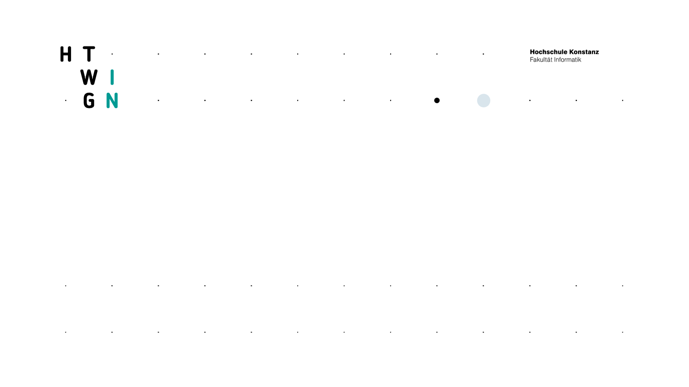
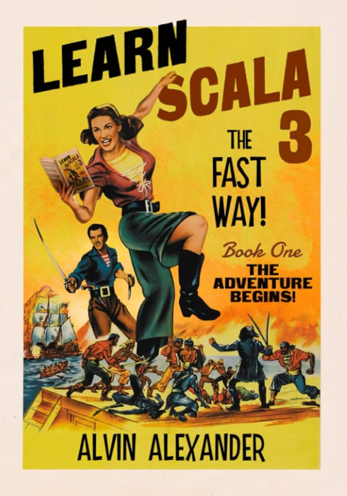

### Prof. Dr. Marko Boger, Prof. Dr. Pascal Laube
## Programmiertechnik I
# Lecture 15: Option and Try

<p class="small">How Option models a value that may be missing instead of null, how Try models a computation that may fail instead of throwing, and how map, flatMap, getOrElse and for-comprehensions chain them safely.</p>

---

<!-- _class: inhalt -->

<style scoped>
section { font-size: 19px; }
</style>

# Goals

<div class="columns" style="grid-template-columns: 1fr 260px; align-items: start;">
<div markdown="1">

In this lecture you will learn about

- where `null` comes from and why it is a problem
- `Option`: modelling a value that may be missing – instead of `null`
- `Try`: modelling a computation that may fail – instead of throwing
- `map`, `flatMap`, `getOrElse`, `fold`, `recover` and `for`-comprehensions
- use cases: user input, map lookup, division, files, chains of steps
- when to use `Option` and when `Try`

Supporting literature:

- Lewis, Introduction to the Art of Programming Using Scala, 7.5.1, 22.3
- Alexander, Learn Scala 3 the Fast Way, "Options and Functional Error Handling", chapters 58 and 60

</div>
<div markdown="1">



</div>
</div>

---

<!-- _class: kapitel -->

## 1
# Option

A value that may or may not be there

---

<style scoped>
section { font-size: 21px; }
</style>

# Where `null` Comes From

| Year | Language | "no object here" |
|---|---|---|
| 1965 | ALGOL W | Tony Hoare introduces the **null reference** |
| 1972 | C | the `NULL` pointer – address 0 |
| 1995 | Java | `null` for every reference type |
| 2004 | Scala | inherits `null` from the JVM, but supports to avoid it |
| 2021 | Scala 3 | avoids `null` by default |

In C, `NULL` is just a pointer that points nowhere. Reading through it crashes:

```c
int *p = NULL;
printf("%d\n", *p);      /* Segmentation fault */
```


---

<style scoped>
section { font-size: 20px; }
</style>

# C: A Function Returns `NULL`

```c
const char *names[]  = {"Ada", "Bob"};
const char *emails[] = {"ada@htwg.de", "bob@htwg.de"};

const char *findEmail(const char *name) {
    for (int i = 0; i < 2; i++)
        if (strcmp(names[i], name) == 0) return emails[i];
    return NULL;                                  /* not found */
}

int main(void) {
    printf("%zu\n", strlen(findEmail("Ada")));    /* 11 */
    printf("%zu\n", strlen(findEmail("Eve")));    /* Segmentation fault */
}
```

- The return type `const char *` does not say "may be `NULL`"
- The caller **forgets to check** – the compiler does not complain
- Same pattern in the C library: `malloc`, `strchr`, `fopen`, `getenv` all return `NULL` on failure


---

<style scoped>
section { font-size: 21px; }
</style>

# Java and Scala Inherit `null`

**Java** – every reference may be `null`:

```java
String name = null;
System.out.println(name.length());
// Exception in thread "main" java.lang.NullPointerException:
//   Cannot invoke "String.length()" because "<local1>" is null
```

**Scala 2** runs on the JVM and keeps `null` for Java compatibility:

```scala
val s: String = null     // compiles
s.length                 // java.lang.NullPointerException
```

- Safer than C: a defined exception instead of a crash – but still a runtime error
- The type `String` still lies: it does not say "maybe missing"

**Scala 3** – requires inheritance from nullable


---

<style scoped>
section { font-size: 21px; }
</style>

# Tony Hoare: "My Billion-Dollar Mistake"

> I call it my billion-dollar mistake. It was the invention of the null reference in 1965. At that time, I was designing the first comprehensive type system for references in an object oriented language (ALGOL W). My goal was to ensure that all use of references should be absolutely safe, with checking performed automatically by the compiler. But I couldn't resist the temptation to put in a null reference, simply because it was so easy to implement. This has led to innumerable errors, vulnerabilities, and system crashes, which have probably caused a billion dollars of pain and damage in the last forty years.

- Hoare is also the inventor of Quicksort and Hoare logic, Turing Award 1980
- The abstract names declarations for non-null references (Spec#) as "the solution, which I rejected in 1965" – i.e. make "may be missing" part of the **type**

<p class="small">Source: Tony Hoare, "Null References: The Billion Dollar Mistake", talk abstract, QCon London 2009, qconlondon.com/london-2009 (archived at web.archive.org); video: infoq.com/presentations/Null-References-The-Billion-Dollar-Mistake-Tony-Hoare</p>


---

<style scoped>
section { font-size: 22px; }
</style>

# The Cleaner Solution: `Option`

The same lookup in Scala – the type says that the result may be missing:

```scala
val emails = Map("Ada" -> "ada@htwg.de", "Bob" -> "bob@htwg.de")

def findEmail(name: String): Option[String] = emails.get(name)

findEmail("Ada").map(_.length)                 // Some(11)
findEmail("Eve").map(_.length)                 // None – no crash
findEmail("Eve").map(_.length).getOrElse(0)    // 0
```

- Calling `.length` directly on an `Option[String]` does not compile – `map` applies it to the value inside
- The caller has to decide what "missing" means
- In Scala code: never use `null`, use `Option`

---

<style scoped>
section { font-size: 22px; }
</style>

# `Option`: `Some` and `None`

`Option[A]` has exactly two cases:

| Case | Meaning | Example |
|---|---|---|
| `Some(value)` | a value is present | `Some("ada@htwg.de")` |
| `None` | no value | `None` |

```scala
case class User(name: String, email: Option[String])

val ada = User("Ada", Some("ada@htwg.de"))
val bob = User("Bob", None)          // Bob has no email – and the type says so
```

Think of `Option` as a **box with zero or one element**.

---

<style scoped>
section { font-size: 22px; }
</style>

# Creating Options

```scala
Option(null)                  // None   – wraps values from Java APIs safely
Option("x")                   // Some(x)
"42".toIntOption              // Some(42)
"4x2".toIntOption             // None
List(3, 1, 4).headOption      // Some(3)
List(3, 1, 4).find(_ > 5)     // None
Map(1 -> "Ada").get(1)        // Some(Ada)
Map(1 -> "Ada").get(2)        // None
```

Many library methods already return `Option` – there is rarely a reason for `null` in Scala.

---

<style scoped>
section { font-size: 22px; }
</style>

# Pattern Matching on `Option`

```scala
def describe(o: Option[Int]): String = o match
  case Some(n) if n > 0 => s"positive $n"
  case Some(n)          => s"non-positive $n"
  case None             => "nothing"

describe(Some(3))   // "positive 3"
describe(None)      // "nothing"
```

- The compiler warns if a case is missing (`Option` is a sealed type)
- Explicit, but verbose – the methods on the next slides are usually shorter

---

<style scoped>
section { font-size: 22px; }
</style>

# Getting the Value Out: `getOrElse`, `orElse`, `fold`

```scala
val some: Option[Int] = Some(3)
val none: Option[Int] = None

some.get                               // 3
none.get                               // NoSuchElementException: None.get

some.getOrElse(0)                      // 3
none.getOrElse(0)                      // 0       default value
some.orElse(Some(7))                   // Some(3)
none.orElse(Some(7))                   // Some(7) alternative Option
some.fold("none")(x => s"value $x")    // "value 3"
none.fold("none")(x => s"value $x")    // "none"
```

- Avoid `.get` – it throws on `None` and brings the problem back
- `fold(ifEmpty)(f)` handles both cases in one expression

---

<style scoped>
section { font-size: 22px; }
</style>

# Transforming: `map` and `filter`

Work **inside** the box without opening it:

```scala
Some(3).map(_ * 2)          // Some(6)
none.map(_ * 2)             // None   – nothing to transform
Some(3).filter(_ > 5)       // None
```

- `map` applies a function to the value, if there is one
- `None` simply passes through – no `if`, no `null` check
- Same idea as `map` on `List` (Lecture 12): an `Option` is a collection of size 0 or 1

---

<style scoped>
section { font-size: 21px; }
</style>

# Chaining: `flatMap`

What if the function itself returns an `Option`?

```scala
case class User(name: String, email: Option[String])

class Users(users: Map[Int, User]):
  def findUser(id: Int): Option[User] = users.get(id)

val users = Users(Map(
  1 -> User("Ada", Some("ada@htwg.de")),
  2 -> User("Bob", None)))

users.findUser(1).map(_.email)        // Some(Some(ada@htwg.de))   nested!
users.findUser(1).flatMap(_.email)    // Some(ada@htwg.de)
users.findUser(2).flatMap(_.email)    // None   – no such email
users.findUser(3)                     // None   – no such user
```

- `flatMap` = `map` + flatten
- Chains several steps that may each fail; the first `None` stops the chain

---

<style scoped>
section { font-size: 22px; }
</style>

# Safe Access: `lift`

`parts(i)` throws if index `i` does not exist. `parts.lift(i)` returns an `Option` instead:

```scala
val parts = "ada@htwg.de".split("@")   // Array(ada, htwg.de)

parts(1)                         // htwg.de
parts(2)                         // ArrayIndexOutOfBoundsException
parts.lift(1)                    // Some(htwg.de)
parts.lift(2)                    // None

"no-at-sign".split("@").lift(1)  // None – no domain, no crash
Map(1 -> "Ada").lift(2)          // None – same as get(2)
```

- A `Seq` or `Map` is a function that is defined only for some keys
- `lift` turns it into a function that is defined for all keys: `Int => Option[A]`
- That is why `email.split("@").lift(1)` fits into the `for` on the next slide

---

<style scoped>
section { font-size: 22px; }
</style>

# `for`-Comprehensions with `Option`

Several `flatMap`s read better as a `for` – here with `users` from the `flatMap` slide:

```scala
def emailDomain(id: Int): Option[String] =
  for
    user   <- users.findUser(id)        // Option[User]
    email  <- user.email                // Option[String]
    domain <- email.split("@").lift(1)  // Option[String]
  yield domain

emailDomain(1)    // Some(htwg.de)
emailDomain(3)    // None – no such user

// the same without for:
users.findUser(1).flatMap(u => u.email.flatMap(e => e.split("@").lift(1)))
```

- The first step that yields `None` stops the chain – the result is `None`
- The compiler translates this to `flatMap` and `map`, exactly as for `List`


---

<style scoped>
section { font-size: 22px; }
</style>

# `Option` as a Collection

```scala
Some(5).foreach(println)                  // prints 5
Some(5).toList                            // List(5)
List(Some(1), None, Some(3)).flatten      // List(1, 3)
List("1", "x", "3").flatMap(_.toIntOption) // List(1, 3)
```

- `Option` supports `foreach`, `exists`, `forall`, `contains`, `isEmpty`, …
- `flatMap` with `toIntOption` parses a list and silently drops the invalid entries

---

<!-- _class: kapitel -->

## 2
# Try

A computation that may succeed or fail

---

<style scoped>
section { font-size: 22px; }
</style>

# Things Can Go Wrong

Not every computation can always deliver a result:

- the user types `4x2` where a number is expected
- a program divides by a value that happens to be `0`
- a file does not exist, a server does not answer

```scala
"4x2".toInt     // ?
100 / 0         // ?
```

- With `null`, a **value is missing** – a design decision from 1965 that we still pay for
- Here, the **computation itself breaks** – and the type `Int` does not warn you either

---

<style scoped>
section { font-size: 22px; }
</style>

# What Happens: An Exception Is Thrown

```scala
"4x2".toInt     // java.lang.NumberFormatException: For input string: "4x2"
100 / 0         // java.lang.ArithmeticException: / by zero
```

- The JVM creates an **exception object** and **throws** it
- The exception **jumps** out of the expression – it is not a value
- The rest of the code is skipped, the exception travels up the call stack
- If nobody catches it, the program stops with a stack trace

---

<style scoped>
section { font-size: 21px; }
</style>

# The Class `Exception`

```scala
val e = Exception("not a number")
e.getMessage                     // "not a number"        – what went wrong
e.getClass.getName               // "java.lang.Exception" – which kind of error
e.isInstanceOf[Throwable]        // true

val nfe = NumberFormatException("For input string: \"4x2\"")
nfe.isInstanceOf[RuntimeException]   // true
```

```text
Throwable
├── Error                  serious JVM problems – do not catch
└── Exception
    ├── IOException
    └── RuntimeException
        ├── NumberFormatException
        └── ArithmeticException
```

- An exception is an ordinary object: message, class and stack trace
- Everything that can be thrown is a **`Throwable`**

---

<style scoped>
section { font-size: 21px; }
</style>

# Java: `try` … `catch`

```java
try {
    int n = Integer.parseInt("4x2");
    System.out.println(n);                      // never reached
} catch (NumberFormatException e) {
    System.out.println("not a number: " + e.getMessage());
}
// not a number: For input string: "4x2"
```

- `parseInt` **throws** an object – the rest of the `try` block is skipped
- `catch (T e)` catches it if it is of type `T` or a subclass

---

<style scoped>
section { font-size: 22px; }
</style>

# What Is Wrong with `try` … `catch`?

```scala
def parse(s: String): Int =
  try s.toInt
  catch case e: NumberFormatException => -1     // magic value

parse("42")      // 42
parse("4x2")     // -1   – or was it really -1?
```

- The type `Int` does not say that `parse` may fail – the caller can forget to catch
- The `catch` must return something: a magic value, `null`, or throw again
- An exception is not a value: you cannot store it, pass it on or `map` over it
- Error handling moves away from the place where the result is used

`Option` would lose the reason. We want the result **or the exception** – as a value.

---

<style scoped>
section { font-size: 21px; }
</style>

# Even Worse: `throws` without `catch`

```scala
@throws[NumberFormatException]                 // Java: int parse(String s) throws NumberFormatException
def parse(s: String): Int = s.toInt            // no try, no catch

def total(xs: List[String]): Int = xs.map(parse).sum          // passes it on

def report(xs: List[String]): String =                     // somewhere else: the catch
  try s"total: ${total(xs)}"
  catch case e: NumberFormatException => s"bad input: ${e.getMessage}"

report(List("1", "2", "3"))      // "total: 6"
report(List("1", "4x2", "3"))    // "bad input: For input string: "4x2""
```

- `throws` only **documents** the exception – `parse` leaves the problem to its callers
- The exception passes silently through `total` – the `catch` ends up in another method
- Whoever calls `total` must know what may be thrown deep inside – forget it and the program stops
- The error is handled far away from its cause

---

<style scoped>
section { font-size: 22px; }
</style>

# `Try`: `Success` and `Failure`

```scala
import scala.util.{Try, Success, Failure}

val ok:  Try[Int] = Success(42)
val bad: Try[Int] = Failure(Exception("not a number"))

ok.getOrElse(0)                                // 42
bad.getOrElse(0)                               // 0
ok.fold(e => e.getMessage, n => s"got $n")     // "got 42"
bad.fold(e => e.getMessage, n => s"got $n")    // "not a number"
```

- `Try[A]` is either `Success(value)` or `Failure(exception)`
- A `Failure` holds an exception – `getMessage` returns its message as a `String`
- Like `Option`, but a `Failure` keeps the **reason**

---

<style scoped>
section { font-size: 22px; }
</style>

# `Try { … }`: Catching Exceptions

```scala
import scala.util.{Try, Success, Failure}

Try("42".toInt)     // Success(42)
Try("4x2".toInt)    // Failure(java.lang.NumberFormatException: For input string: "4x2")

def parse(s: String): Try[Int] = Try(s.trim.toInt)
```

| Case | Contains |
|---|---|
| `Success(value)` | the result |
| `Failure(exception)` | the exception that was thrown |

`Try { … }` evaluates its block (by-name, Lecture 14) and catches non-fatal exceptions.

---

<style scoped>
section { font-size: 22px; }
</style>

# Pattern Matching on `Try`

```scala
def report(t: Try[Int]): String = t match
  case Success(n)  => s"got $n"
  case Failure(ex) => s"failed: ${ex.getMessage}"

report(parse("7"))     // "got 7"
report(parse("x"))     // "failed: For input string: "x""
```

| | Result is there | No result |
|---|---|---|
| `Option[A]` | `Some(value)` | `None` – holds **nothing** |
| `Try[A]` | `Success(value)` – same as `Some` | `Failure(ex)` – holds a **`Throwable`** |

`Success` and `Some` are identical. The difference is the other case: `None` is empty, a `Failure` tells you **what** went wrong.

---

<style scoped>
section { font-size: 22px; }
</style>

# `map` and `flatMap` on `Try`

```scala
def divTry(a: Int, b: Int): Try[Int] = Try(a / b)

parse("21").map(_ * 2)                    // Success(42)
parse("x").map(_ * 2)                     // Failure(NumberFormatException …)

parse("10").flatMap(x => divTry(100, x))  // Success(10)
parse("0").flatMap(x => divTry(100, x))   // Failure(ArithmeticException: / by zero)
```

- Same methods as `Option` – a `Failure` passes through unchanged
- `flatMap` chains steps that may each throw

---

<style scoped>
section { font-size: 22px; }
</style>

# Handling Failure: `recover`, `recoverWith`, `getOrElse`

```scala
parse("x").getOrElse(-1)                                   // -1
parse("x").recover { case _: NumberFormatException => 0 }  // Success(0)
parse("x").recoverWith {
  case _: NumberFormatException => parse("1")              // Success(1)
}
```

- `recover` turns selected exceptions into a value (like `map` for failures)
- `recoverWith` returns another `Try` (like `flatMap` for failures)
- Exceptions not matched by the partial function stay a `Failure`

---

<style scoped>
section { font-size: 22px; }
</style>

# `for` and `toOption`

```scala
val r = for
  x <- parse("10")
  y <- parse("2")
  q <- divTry(x, y)
yield q                                   // Success(5)

parse("5").toOption                       // Some(5)
parse("x").toOption                       // None  – reason is dropped
```

`Try` fits into `for`-comprehensions just like `Option` and `List`.

---

<style scoped>
section { font-size: 21px; }
</style>

# A Common Pattern: `map` + `flatMap`

`List`, `LazyList`, `Option` and `Try` share the same shape:

| Type | "box" | `flatMap` stops at |
|---|---|---|
| `List[A]` | 0 … n values | – (combines all) |
| `Option[A]` | 0 or 1 value | `None` |
| `Try[A]` | value or exception | `Failure` |

- A way to **wrap** a value: `Some(x)`, `Success(x)`, `List(x)`
- A way to **chain**: `flatMap`
- Types with these two operations (plus some laws) are called **monads**
- That is why all of them work in `for`-comprehensions

---

<style scoped>
section { font-size: 20px; }
</style>

# What the Books Say

**Alexander, Learn Scala 3 the Fast Way** – lesson "Functions: Options and Functional Error Handling"
- `makeInt(s: String): Option[Int]`: `Some` for success, `None` for failure
- `None` gives no details – for those use `Try`/`Success`/`Failure`
- the lesson was left out of the printed book by mistake and is published on alvinalexander.com
- the word "monad" is not used; that topic is in his functional programming material

**Scala 3 Book** (docs.scala-lang.org, co-written by Alexander), "Functional Error Handling"
- functional methods do not throw; they return `Option` or `Try`
- consume them with `match` or `for` expressions

**Lewis, Introduction to the Art of Programming Using Scala**
- 7.5.1 "The Option Type" (chapter "Arrays and Lists in Scala")
- 22.3 "Exceptions" (chapter "Stream I/O")

---

<!-- _class: kapitel -->

## 3
# Use Cases

Option and Try in practice

---

<style scoped>
section { font-size: 22px; }
</style>

# Parsing User Input

```scala
val input = "17"
val age = input.toIntOption
  .filter(a => a >= 0 && a < 150)
  .getOrElse(0)
```

- `toIntOption`, `toDoubleOption`, `toBooleanOption` exist on every `String`
- Validation with `filter`, default with `getOrElse`
- Use `Try(input.toInt)` if you want to show the user the error message

---

<style scoped>
section { font-size: 22px; }
</style>

# Map Lookup

```scala
val prices = Map("apple" -> 0.5, "pear" -> 0.8)

prices("kiwi")                 // NoSuchElementException!
prices.get("kiwi")             // None
prices.getOrElse("kiwi", 0.0)  // 0.0

val total = for
  p <- prices.get("apple")
  q <- prices.get("pear")
yield p + q                    // Some(1.3)
```

A missing key is **normal**, not exceptional – `Option` is the right type.

---

<style scoped>
section { font-size: 22px; }
</style>

# Safe Division

Two ways to say "this may fail":

```scala
def safeDiv(a: Int, b: Int): Option[Int] =
  if b == 0 then None else Some(a / b)

def divTry(a: Int, b: Int): Try[Int] = Try(a / b)

safeDiv(1, 0)   // None
divTry(1, 0)    // Failure(java.lang.ArithmeticException: / by zero)
```

---

<style scoped>
section { font-size: 22px; }
</style>

# Reading a File

File I/O throws (`FileNotFoundException`, `IOException`) – a typical case for `Try`:

```scala
import scala.util.Try
import scala.io.Source

def readLines(path: String): Try[List[String]] =
  Try(Source.fromFile(path).getLines().toList)

readLines("numbers.txt").map(_.size) // Success(12) – number of lines
readLines("missing.txt")              // Failure(java.io.FileNotFoundException: …)
```

The exception becomes a `Failure` – the type `Try[List[String]]` tells the caller that reading may fail.

---

<style scoped>
section { font-size: 21px; }
</style>

# Chaining Several Fallible Steps

Read a file, parse numbers, compute the average:

```scala
val result: Try[Double] = for
  lines <- readLines("numbers.txt")
  nums  <- Try(lines.map(_.trim.toInt))
  avg   <- Try(
             if nums.isEmpty then throw IllegalArgumentException("no numbers")
             else nums.sum.toDouble / nums.size)
yield avg

result match
  case Success(a)  => println(f"average: $a%.2f")
  case Failure(ex) => println(s"error: ${ex.getMessage}")
```

Each step may fail; the first `Failure` short-circuits the rest. Error handling happens **once**, at the end.

---

<style scoped>
section { font-size: 22px; }
</style>

# `Option` vs. `Try`

| Use | when | example |
|---|---|---|
| `Option[A]` | a value may be absent; the reason does not matter | `Map.get`, `headOption`, optional field |
| `Try[A]` | code may throw an exception (often Java APIs, I/O) | parsing, files, network |

- Convert a `Try` to an `Option` with `toOption` – the exception is dropped
- Do not throw exceptions for normal, expected situations

---

<!-- _class: inhalt -->

<style scoped>
section { font-size: 23px; }
</style>

# Summary

- `null` hides missing values; `Option` makes them visible: `Some` or `None`
- `Try` wraps a computation: `Success(value)` or `Failure(exception)`
- `map`, `flatMap`, `filter`, `getOrElse`, `fold`, `recover` – no need to unpack
- `for`-comprehensions chain fallible steps; the first failure stops the chain
- `Option`, `Try` and `List` share `map`/`flatMap` – they are monads
- `Option` for absence, `Try` for exceptions

---

<!-- _class: aufgabe -->

<style scoped>
section { font-size: 18px; }
</style>

# Task

**Student input for a university system** – `Option` for what may be missing, `Try` for what may fail

```scala
case class StudentInput(matrikel: String, email: String, enrolled: String)
case class Student(matrikel: Int, email: String, enrolled: java.time.LocalDate)
```

1. `validMatrikel`, `validEmail`, `validDate` return an `Option`: only digits, contains `@`, `LocalDate.parse` works
2. `toStudent(in: StudentInput): Option[Student]` combines them with a `for`-comprehension
3. `readConfig(path: String): Try[List[String]]` reads all lines of `students.csv`
4. `parseLine(line: String): Try[StudentInput]` fails unless a line has three comma-separated fields
5. Print the valid students, the invalid inputs (`None`) and the message of every failed line (`Failure`)

- Reading: Learn Scala 3, Chapters 58 and 60

---

<!-- _class: abschluss -->

# Questions?

## Thank you!

marko.boger@htwg-konstanz.de
