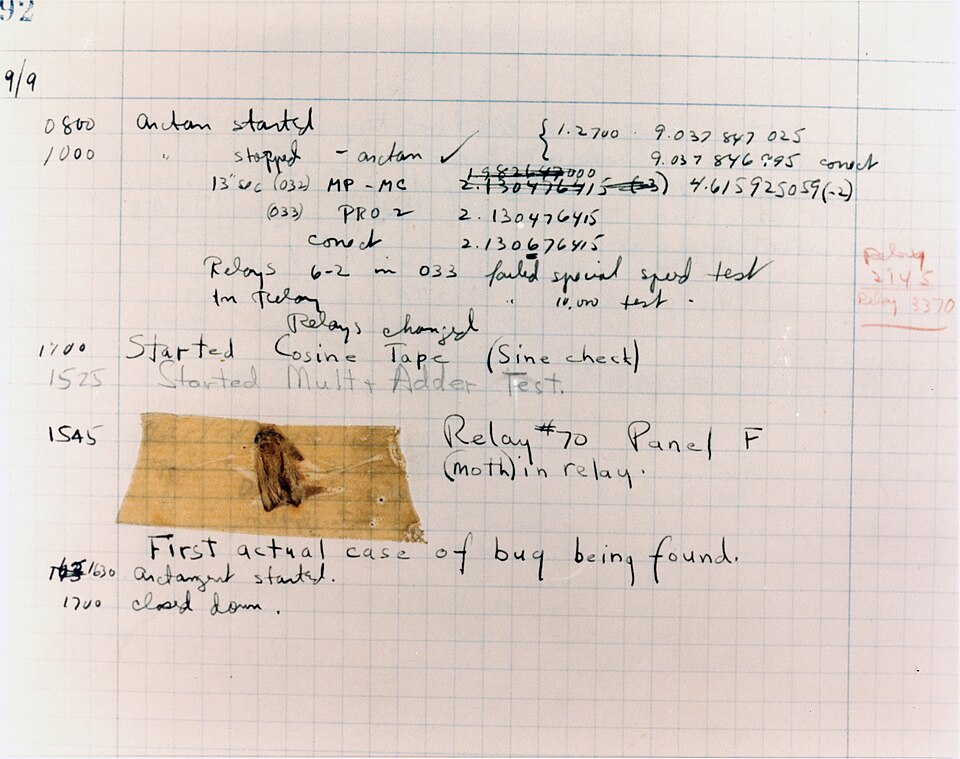
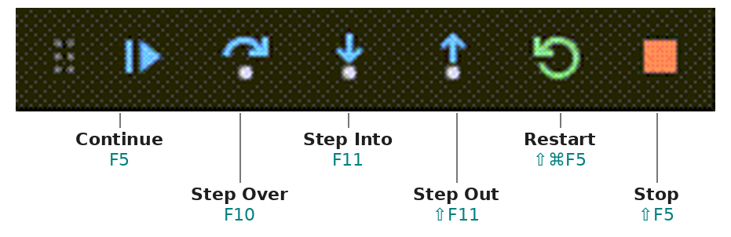
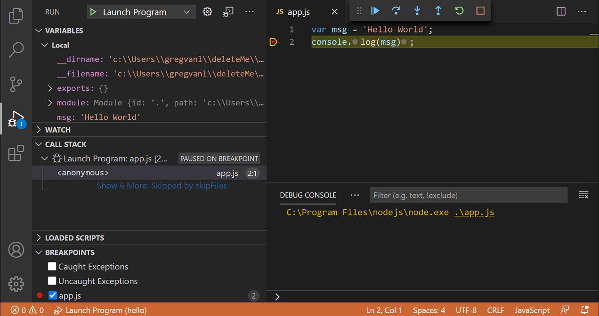

### Prof. Dr. Marko Boger, Prof. Dr. Pascal Laube
## Programmiertechnik I
# Lecture 16: Debugging and Logging

<p class="small">How to find bugs systematically with the VS Code debugger – breakpoints, logpoints, stepping and the call stack – how to replace println with structured logging via scala-logging and Logback, and how MUnit tests pin bugs down before they come back.</p>

---

<!-- _class: inhalt -->

<style scoped>
section { font-size: 21px; }
</style>

# Goals

In this lecture you will learn about

- what a bug really is – and why the computer is never to blame
- running the debugger in Visual Studio Code with Metals
- breakpoints, logpoints, stepping, call stack, watches and the debug console
- writing debug messages – and why `println` is not enough
- using a logger: SLF4J, Logback and scala-logging
- log levels, context (MDC), configuration and JSON logs
- writing tests with MUnit: assertions, running tests, and pinning down a bug
- in which order to approach a bug

New tools: VS Code Debugger (Metals), SLF4J, Logback, scala-logging, MUnit

---

<!-- _class: kapitel -->

## 1
# What Is a Bug?

---

# What Is a Bug?

<div class="columns">
<div markdown="1">



<p class="small" style="text-align: center;">The logbook: a moth found in <b>relay #70, panel F</b> of the Harvard Mark II – "First actual case of bug being found."</p>

</div>
<div markdown="1">


<p class="small" style="text-align: center;">Relays like these switched every bit in the Mark I and Mark II – the moth was stuck between the contacts of one of them.</p>

</div>
</div>

<p class="small" style="text-align: center; margin-top: 4px;">▶ <a href="https://www.youtube.com/watch?v=UPuTO9vg5gk">9th September 1947: First computer ‘bug’ found in the Harvard Mark II</a> – HistoryPod, YouTube · Photos: Naval History and Heritage Command (public domain); Arnold Reinhold, <a href="https://commons.wikimedia.org/wiki/File:Harvard_Mark_I_rear.JPG">Wikimedia Commons</a>, CC BY-SA 4.0</p>

---

<style scoped>
section { font-size: 23px; }
</style>

# Tools to Find Bugs

Bugs are no longer insects in hardware but errors in our software.

The computer executes the given code **correctly**, so there is no error in the code or execution of our code, but **in our thinking** and how we express our thoughts in code.

To debug a program is to find the **mismatch between our thoughts and the code** we wrote to express these.

To find a bug, we need to increase our understanding of what the code actually does. Historically, we used

1. **debug messages** with `println`, printing out states of the program while it runs
2. a **debugger**, a tool that executes code line by line

---

<style scoped>
section { font-size: 22px; }
</style>

# Disadvantages of `println`

```scala
println(s"average called with $xs")
```

- **Clutters production code**: debug output is mixed into the real code – and has to be cleaned up again afterwards
- **No conditions**: it always prints – you cannot filter by level or category or switch it off
- **No external output**: everything goes to standard out – not to a file, a server or a monitoring system

<br>

> From these shortcomings, **logging** mechanisms were developed.

---

<style scoped>
section { font-size: 22px; }
</style>

# A Debugger Is a Last Resort

- A debugger does not find bugs – **you** do. It only shows you what the code does.
- Stepping through code line by line is slow and does not scale to large programs.
- A debugging session leaves nothing behind: no test, no log, no insight for the next person.
- If you need a debugger to understand your own code, the code is often **too complicated**.
- Better first: think, read the code, write a test, make functions small and pure.

<br>

> When the debugger is the right tool, use it **well** – that is what the next chapter is about.

---

<!-- _class: kapitel -->

## 2
# The Debugger in VS Code

---

<style scoped>
section { font-size: 21px; }
</style>

# How a Debugger Works

<div class="columns">
<div markdown="1">

- VS Code talks to a **debug adapter** via the *Debug Adapter Protocol* (DAP)
- For Scala, **Metals** is the debug adapter
- Metals starts your program in a JVM with debugging enabled (JDWP)
- The JVM can **pause** at any line and report all variables and the call stack

</div>
<div markdown="1">

```text
VS Code  ⇄  DAP  ⇄  Metals
                      ⇅ JDWP
                    JVM running
                    your program
```

</div>
</div>

You see: the current line, the variables, the call stack – while the program is paused.

---

<style scoped>
section { font-size: 20px; }
</style>

# Starting a Debug Session

<div class="columns">
<div markdown="1">

**Quick way:** Metals adds code lenses above every `@main` and test:

```scala
run | debug
@main def run(): Unit = ...
```

Click **debug**, or press **F5**.

</div>
<div markdown="1">

**Launch configuration** `.vscode/launch.json`:

```json
{
  "version": "0.2.0",
  "configurations": [
    {
      "type": "scala",
      "request": "launch",
      "name": "Debug run",
      "mainClass": "run",
      "args": []
    }
  ]
}
```

`.vscode/launch.json` is created by VS Code (wizard on first **F5**, type provided by Metals) or by hand. It stores **how to start** a debug session: main class or test, arguments, JVM options. Needed when the debug code lens is not enough.

</div>
</div>

---

<style scoped>
section { font-size: 21px; }
</style>

# Our Buggy Program

```scala
def average(xs: List[Int]): Double =
  var sum = 0
  for i <- 1 until xs.length do
    sum += xs(i)
  sum / xs.length

@main def run(): Unit =
  val grades = List(2, 3, 1, 4)
  println(s"Average: ${average(grades)}")   // expected 2.5
```

Output:

```text
Average: 2.0
```

The computer is right. Where is the mismatch with our thinking?

---

<style scoped>
section { font-size: 21px; }
</style>

# Breakpoints

- Click left of a line number – a **red dot** appears (or press **F9**)
- When execution reaches the line, the program **pauses before** executing it
- The line is highlighted; the *Run and Debug* view shows the state

```scala
def average(xs: List[Int]): Double =
  var sum = 0                            // ● breakpoint here
  for i <- 1 until xs.length do
    sum += xs(i)
  sum / xs.length
```

Breakpoints can be disabled, removed, or listed in the **Breakpoints** panel.

---

<style scoped>
section { font-size: 19px; }
</style>

# Stepping

<div class="columns" style="grid-template-columns: 1fr 1fr; align-items: start;">
<div markdown="1">

| Action | Key | What it does |
|---|---|---|
| Continue | F5 | run until the next breakpoint |
| Step Over | F10 | execute the current line, do not enter calls |
| Step Into | F11 | enter the function called on this line |
| Step Out | ⇧F11 | finish the current function, return to the caller |
| Restart | ⇧⌘F5 | start the session again |
| Stop | ⇧F5 | end the session |

Rule of thumb: **Step Over** by default, **Step Into** only where you suspect the bug.

</div>
<div markdown="1">





<p class="small" style="text-align: center;">The debug toolbar appears at the top of the editor while a session runs. Screenshots: <a href="https://code.visualstudio.com/docs/debugtest/debugging">VS Code docs</a></p>

</div>
</div>

---

<style scoped>
section { font-size: 21px; }
</style>

# Variables and Watch

<div class="columns">
<div markdown="1">

**Variables** panel: all locals and parameters of the current frame

```text
▾ Local
    xs   = List(2, 3, 1, 4)
    sum  = 3
    i    = 1
```

Values that changed in the last step are **highlighted**.

</div>
<div markdown="1">

**Watch** panel: expressions you want to see after every step

```text
▾ Watch
    xs(i)              = 3
    xs.sum             = 10
    sum.toDouble / 4   = 0.75
```

You can also **edit** a variable's value while paused.

</div>
</div>

---

<style scoped>
section { font-size: 21px; }
</style>

# Call Stack

- Shows **how** you got to the current line: one frame per function call
- Click a frame to see **its** variables

```text
▾ CALL STACK   Paused on breakpoint
    average   Average.scala  4
    run       Average.scala 11
    run.main  Average.scala  9
```

- Very useful for recursion: each recursive call is its own frame
- And for exceptions: where was the function called from?

---

<style scoped>
section { font-size: 21px; }
</style>

# Debug Console

Paused after the loop (`sum = 8`), the **Debug Console** evaluates Scala expressions in the current frame:

```text
> xs.length
4
> xs(0)
2
> sum / xs.length
2
> sum.toDouble / xs.length
2.0
> xs.sum.toDouble / xs.length
2.5
```

Try out a fix **before** you change the code.

---

<style scoped>
section { font-size: 21px; }
</style>

# Conditional Breakpoints and Hit Counts

Right-click a breakpoint → **Edit Breakpoint**:

- **Expression:** pause only if the condition is true

```scala
for i <- 0 until 1_000_000 do
  process(data(i))        // ● condition: data(i) < 0
```

- **Hit count:** pause only after the line was reached *n* times, e.g. `500`

No need to press *Continue* a thousand times.

---

<style scoped>
section { font-size: 21px; }
</style>

# Logpoints

A **logpoint** prints a message instead of pausing – a `println` without changing the code.

Right-click the gutter → **Add Logpoint**; expressions use Scala string interpolation: `$name` or `${expression}`:

```text
◆  i = $i, xs(i) = ${xs(i)}, sum = $sum
```

Output in the Debug Console:

```text
i = 1, xs(i) = 3, sum = 0
i = 2, xs(i) = 1, sum = 3
i = 3, xs(i) = 4, sum = 4
```

Nothing to remove afterwards, nothing committed by accident.

---

<style scoped>
section { font-size: 21px; }
</style>

# Exception Breakpoints

In the **Breakpoints** panel, enable *Caught Exceptions* / *Uncaught Exceptions*:

- the debugger pauses **where an exception is thrown**, not where it ends the program
- you see the variables at the moment things went wrong

```scala
average(Nil)      // sum / 0 → ArithmeticException: / by zero
```

The debugger stops at `sum / xs.length` with `xs = List()` – the cause is obvious.

---

<style scoped>
section { font-size: 20px; }
</style>

# Walkthrough: Finding the Bugs

<div class="columns">
<div markdown="1">

1. Breakpoint on `var sum = 0`, **F5**
2. `xs = List(2, 3, 1, 4)` – input correct
3. **F10** into the loop: first `i = 1` – element `2` is skipped! **Bug 1**
4. Loop ends with `sum = 8` instead of `10`
5. Debug console: `sum / xs.length` → `2` – an **Int**! **Bug 2**: integer division

</div>
<div markdown="1">

Fixed version:

```scala
def average(xs: List[Int]): Double =
  require(xs.nonEmpty,
    "average of empty list")
  xs.sum.toDouble / xs.length
```

```text
Average: 2.5
```

Two mismatches between our thinking and our code.

</div>
</div>

---

<!-- _class: kapitel -->

## 3
# Logging

---

<style scoped>
section { font-size: 21px; }
</style>

# From `println` to a Logger

<div class="columns">
<div markdown="1">

```scala
def average(xs: List[Int]): Double =
  println(s"average called with $xs")
  ...
```

```text
average called with List(2, 3, 1, 4)
```

</div>
<div markdown="1">

```scala
def average(xs: List[Int]): Double =
  logger.debug(s"average called with $xs")
  ...
```

```text
11:56:20.239 DEBUG Average - average called with List(2, 3, 1, 4)
```

</div>
</div>

- Recap: see *Disadvantages of `println`*
- A logger adds **time stamp, source and severity** → *Log Levels*
- The message is only built if the level is **enabled** → *Lazy Messages for Free*

---

<style scoped>
section { font-size: 21px; }
</style>

# Log Levels

| Level | Use for | Example |
|---|---|---|
| `ERROR` | something failed, needs attention | payment could not be processed |
| `WARN` | unexpected, but the program continues | order rejected, invalid total |
| `INFO` | important business events | order accepted |
| `DEBUG` | details for developers | the items of an order |
| `TRACE` | very fine-grained flow | entering / leaving functions |

The configured level is a **threshold**: at `INFO`, only `INFO`, `WARN` and `ERROR` are written.

---

<style scoped>
section { font-size: 21px; }
</style>

# The Scala Logging Stack

<div class="columns">
<div markdown="1">

- **SLF4J** – *Simple Logging Facade for Java*: the API everyone uses
- **Logback** – the implementation: formats and writes the messages
- **scala-logging** – thin Scala wrapper around SLF4J, using macros

Library code depends only on the facade, the application chooses the backend.

</div>
<div markdown="1">

```text
your code
   │  logger.info(...)
scala-logging
   │
SLF4J (API)
   │
Logback  →  console, file, JSON
```

</div>
</div>

```scala
//> using dep "com.typesafe.scala-logging::scala-logging:3.9.5"
//> using dep "ch.qos.logback:logback-classic:1.5.6"
```

---

<style scoped>
section { font-size: 20px; }
</style>

# scala-logging: `LazyLogging`

```scala
import scala.util.{Try, Success, Failure}
import com.typesafe.scalalogging.LazyLogging

case class Order(id: Int, items: List[String], total: Double)

class OrderService extends LazyLogging:
  def place(order: Order): Try[Order] =
    logger.info(s"Placing order with ${order.items.size} items")
    logger.debug(s"Items: ${order.items.mkString(", ")}")
    if order.total <= 0 then
      logger.warn(s"Rejected order, total = ${order.total}")
      Failure(IllegalArgumentException("invalid total"))
    else
      logger.info(f"Order accepted, total = ${order.total}%.2f EUR")
      Success(order)
```

`LazyLogging` provides a `logger`, created on first use and named after the class.

---

<style scoped>
section { font-size: 21px; }
</style>

# `LazyLogging` vs. `StrictLogging`

```scala
import com.typesafe.scalalogging.StrictLogging

object Payment extends StrictLogging:
  def charge(amount: Double): Unit =
    logger.trace(s"charge($amount)")
    logger.info("Charging {} EUR", amount)
```

- `LazyLogging`: logger is a `lazy val` – created when first needed
- `StrictLogging`: logger is created together with the object
- `AnyLogging` / `Logger(...)`: create a logger explicitly
- `{}` placeholders are the SLF4J style; Scala string interpolation works just as well

---

<style scoped>
section { font-size: 21px; }
</style>

# Lazy Messages for Free

```scala
logger.debug(s"State: ${expensiveDump(world)}")
```

scala-logging is a **macro**: the compiler rewrites the call to

```scala
if logger.underlying.isDebugEnabled then
  logger.underlying.debug(s"State: ${expensiveDump(world)}")
```

- When `DEBUG` is off, `expensiveDump` is **never called**
- No cost for disabled log statements – you can leave them in the code
- Remember *by-name* parameters from lecture 14: same idea, done by a macro

---

<style scoped>
section { font-size: 19px; }
</style>

# Configuration: `logback.xml`

Put it in `src/main/resources` (or a resource directory):

```xml
<configuration>
  <appender name="CONSOLE" class="ch.qos.logback.core.ConsoleAppender">
    <encoder>
      <pattern>%d{HH:mm:ss.SSS} %highlight(%-5level) %cyan(%logger{15}) - %msg%n</pattern>
    </encoder>
  </appender>

  <logger name="OrderService" level="DEBUG" />
  <logger name="org.http4s" level="WARN" />

  <root level="INFO">
    <appender-ref ref="CONSOLE" />
  </root>
</configuration>
```

- **Per-package levels:** `DEBUG` for your code, `WARN` for noisy libraries
- Change levels **without recompiling**

---

<style scoped>
section { font-size: 20px; }
</style>

# Colored Console Output

With `%highlight(...)` and `%cyan(...)` in the pattern:

<pre style="font-size: 17px; line-height: 1.5;">
11:56:20.239 <span style="color:#4c7cf3">INFO </span> <span style="color:#1aa3a3">OrderService</span> - Placing order with 2 items
11:56:20.244 DEBUG <span style="color:#1aa3a3">OrderService</span> - Items: Book, Pen
11:56:20.247 <span style="color:#4c7cf3">INFO </span> <span style="color:#1aa3a3">OrderService</span> - Order accepted, total = 23.50 EUR
11:56:20.248 <span style="color:#4c7cf3">INFO </span> <span style="color:#1aa3a3">OrderService</span> - Placing order with 0 items
11:56:20.248 DEBUG <span style="color:#1aa3a3">OrderService</span> - Items:
11:56:20.248 <span style="color:#d33">WARN </span> <span style="color:#1aa3a3">OrderService</span> - Rejected order, total = 0.0
11:56:20.248 <span style="color:#4c7cf3">INFO </span> <span style="color:#1aa3a3">Payment$</span> - Charging 23.5 EUR
</pre>

- Time, level, source and message – at a glance
- `ERROR` and `WARN` stand out immediately

---

<style scoped>
section { font-size: 20px; }
</style>

# Context with MDC

The **Mapped Diagnostic Context** attaches key-value pairs to every log line of the current thread:

```scala
import org.slf4j.MDC

def place(order: Order): Try[Order] =
  MDC.put("orderId", order.id.toString)
  try
    logger.info("Placing order")
    ...
  finally MDC.remove("orderId")
```

Pattern `... [%X{orderId}] - %msg%n` gives:

```text
11:56:20.239 INFO  OrderService [1] - Placing order with 2 items
11:56:20.248 WARN  OrderService [2] - Rejected order, total = 0.0
```

All lines of one request can be found with a single search.

---

<style scoped>
section { font-size: 19px; }
</style>

# Appenders and Rolling Files

```xml
<appender name="FILE" class="ch.qos.logback.core.rolling.RollingFileAppender">
  <file>logs/shop.log</file>
  <rollingPolicy class="ch.qos.logback.core.rolling.TimeBasedRollingPolicy">
    <fileNamePattern>logs/shop.%d{yyyy-MM-dd}.log</fileNamePattern>
    <maxHistory>7</maxHistory>
  </rollingPolicy>
  <encoder>
    <pattern>%d %-5level %logger [%X{orderId}] - %msg%n</pattern>
  </encoder>
</appender>

<root level="INFO">
  <appender-ref ref="CONSOLE" />
  <appender-ref ref="FILE" />
</root>
```

- One log statement, **several destinations**: console, file, network
- A new file every day, only the last 7 days are kept

---

<style scoped>
section { font-size: 19px; }
</style>

# Structured Logging: JSON

Replace the pattern encoder with the Logstash encoder:

```xml
<encoder class="net.logstash.logback.encoder.LogstashEncoder" />
```

```scala
//> using dep "net.logstash.logback:logstash-logback-encoder:7.4"
```

Every log line becomes a JSON object – including the MDC fields:

```json
{"@timestamp":"2026-10-12T11:56:20.248+02:00","level":"WARN",
 "logger_name":"OrderService","thread_name":"main","orderId":"2",
 "message":"Rejected order, total = 0.0"}
```

Machines can search, filter and chart it: Elasticsearch/Kibana, Grafana Loki, …

---

<style scoped>
section { font-size: 21px; }
</style>

# Good Logging Practice

- Log **events**, not every line: *what happened*, with the relevant IDs
- Choose the level honestly – not everything is an `ERROR`
- Pass exceptions as the last argument: `logger.error("Payment failed", e)` → full stack trace
- Never log passwords, tokens or personal data
- Keep log statements in the code – switch them by level, not by deleting
- Alternatives in the Scala world:
  - **log4cats** – logging for Cats Effect (pure, `IO`-based)
  - **scribe** – fast, pure-Scala logger without XML configuration

---

<!-- _class: kapitel -->

## 4
# Testing

---

<style scoped>
section { font-size: 21px; }
</style>

# A Basic MUnit Test Suite

A test suite is a class that extends `munit.FunSuite`. Each `test` has a name and a body:

```scala
def average(xs: List[Int]): Double =
  require(xs.nonEmpty, "average of empty list")
  xs.sum.toDouble / xs.length

class AverageSuite extends munit.FunSuite:
  test("average of 2, 3, 1, 4 is 2.5"):
    assertEquals(average(List(2, 3, 1, 4)), 2.5)
```

- Other test frameworks exist, for example **ScalaTest** – we cover them in depth in semester 3

---

<style scoped>
section { font-size: 20px; }
</style>

# Assertions: `assertEquals`, `assert` and `intercept`

<div class="columns">
<div markdown="1">

`assertEquals` compares an obtained value with an expected one:

```scala
test("average of one element"):
  assertEquals(average(List(7)), 7.0)
```

`assert` checks a Boolean condition:

```scala
test("average stays in range"):
  val mean = average(List(2, 3, 1, 4))
  assert(mean > 0.0 && mean < 10.0)
```

</div>
<div markdown="1">

`intercept` checks that a block throws a given exception:

```scala
test("empty list is rejected"):
  intercept[IllegalArgumentException]:
    average(List.empty)
```

If the exception is missing, or has the wrong type, the test fails.

</div>
</div>

---

<style scoped>
section { font-size: 18px; }
pre { font-size: 15px; }
</style>

# Running Tests with Mill

<div class="columns">
<div markdown="1">

A Scala 3 module with MUnit, in `build.mill`:

```scala
package build
import mill.*, scalalib.*

object average extends ScalaModule {
  def scalaVersion = "3.9.0"

  object test extends ScalaTests,
      TestModule.Munit {
    def mvnDeps = Seq(
      mvn"org.scalameta::munit:1.1.1")
  }
}
```

```text
./mill average.test
```

</div>
<div markdown="1">

A failing `assertEquals` shows what the code returned and what you expected:

```text
==> X AverageSuite.average of 2, 3, 1, 4 is 2.5
values are not the same
=> Obtained
2.0
=> Diff (- expected, + obtained)
-2.5
+2.0
1 FAILED] ./mill average.test
```

The buggy `average` returned `2.0` instead of `2.5`.

</div>
</div>

---

<style scoped>
section { font-size: 22px; }
</style>

# Debugging Tests

- Metals shows **debug** code lenses on test classes and single tests
- Turn the bug into a **failing test** first, then debug the test

```scala
class AverageSuite extends munit.FunSuite:
  test("average of 2, 3, 1, 4 is 2.5"):
    assertEquals(average(List(2, 3, 1, 4)), 2.5)
```

- After the fix, the test stays – the bug can never come back unnoticed
- A debugging session is gone after you close it; a test is not

---

<!-- _class: kapitel -->

## 5
# How to Debug

---

<style scoped>
section { font-size: 18px; }
</style>

# Debugging Order

The same order helps you **avoid** a bug and **search** for one:

<div class="columns">
<div markdown="1">

**1. Clean Architecture**
- Separate layers and components
- Bugs can then be confined into single components

**2. Clean Code**
- Write clean, readable code; good metrics; low complexity; no tangles
- This reduces the risk of bugs and makes them easier to find

**3. Tests**
- Full coverage does not prevent bugs, but often catches new ones as you write them
- Isolate a new bug in a failing test – the test remains a safety net

</div>
<div markdown="1">

**4. Interact with the code early**
- Build a TUI long before you start work on a GUI
- Java makes direct interaction with objects hard; in Scala this is possible

**5. Logging**
- Write text output to the console – but `System.out.println` pollutes the code and needs manual clean-up
- Use a log mechanism instead: on/off per class, and the log code can be maintained

**6. Debugger**
- The debugger should be your **last resort**
- Debugging is tedious, time-consuming and non-repeatable

</div>
</div>

---

<!-- _class: inhalt -->

<style scoped>
section { font-size: 21px; }
</style>

# Summary

- A bug is a mismatch between our thinking and our code – the computer is right
- The debugger is a last resort, but a powerful one
- VS Code + Metals: code lens or `launch.json`, then F5
- Breakpoints, logpoints, exception breakpoints; step, variables, watch, call stack, debug console
- Prefer a logger over `println`: levels, sources, time stamps, destinations
- SLF4J + Logback + scala-logging; `logback.xml` and MDC for context
- MUnit: `FunSuite`, `assertEquals`, `assert`, `intercept`; run with `scala-cli test` or `sbt test`
- Turn a bug into a failing test before you fix it – the test stays as a safety net
- Approach a bug in this order: architecture, clean code, tests, early interaction, logging, debugger last

---

<!-- _class: aufgabe -->

<style scoped>
section { font-size: 18px; }
</style>

# Task

Take the **university example** from Lecture 15 (`StudentInput` → `Student`, `readConfig`, `parseLine`) and practise debugging, logging and tests.

1. Set a breakpoint, for example on a **bad input line**, and step through the program in the VS Code debugger. Inspect the values (`Option`, `Try`, the parsed fields).
2. Add logging with `LazyLogging` and suitable levels: `debug` per line, `warn` for `None`, `error` for `Failure`.
3. Write a few **MUnit** tests for `validMatrikel`, `validEmail` and `parseLine`, including a failing-input case.

---

<!-- _class: abschluss -->

# Questions?

## Thank you!

marko.boger@htwg-konstanz.de
