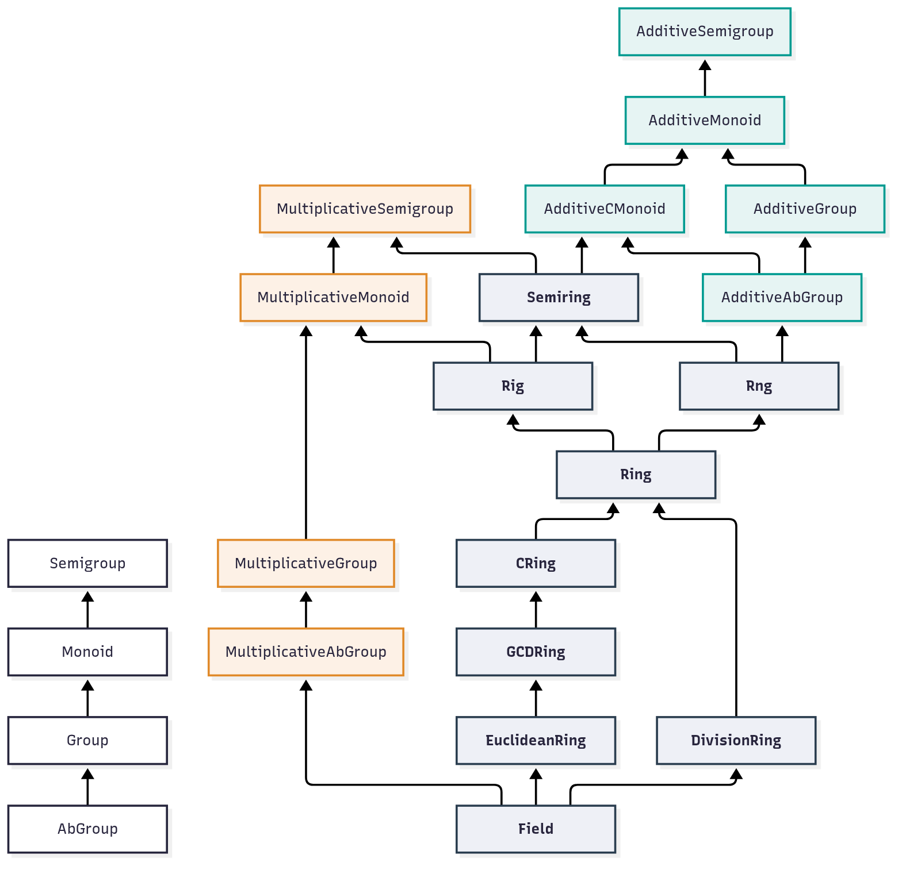

### Prof. Dr. Marko Boger, Prof. Dr. Pascal Laube
## Programmiertechnik I
# Lecture 18: Algebra

---

<!-- _class: inhalt -->

<style scoped>
section { font-size: 19px; }
</style>

# Goals

In this lecture you will learn

- how **mathematics** itself can be the domain of a program – like the library in Lecture 17
- the family tree of **algebraic structures**: semigroup, monoid, group, ring, field
- how to add a **library** to a Scala project: sbt, `%%`, scala-cli, Maven Central
- how Scala expresses algebra: **type classes**, `given` instances, syntax, **laws**
- how to write **generic code** that works for every monoid, ring or field
- three examples: **RGB colors**, **complex numbers**, **matrices**

Supporting literature:

- Spire documentation and source: github.com/typelevel/spire
- Typelevel algebra: github.com/typelevel/algebra

---

<!-- _class: kapitel -->

## 1
# Mathematics as a Domain

Structures, operations and laws

---

# Mathematics Is a Domain Too

- Lecture 17: we modelled a **library** with traits, inheritance and generics
- Today the domain is **mathematics**
  - the "domain experts" are mathematicians
  - their **ubiquitous language**: semigroup, monoid, group, ring, field
- The model already exists – mathematicians have refined it for 200 years
- An algebraic structure = a **set** + **operations** + **laws**
- We do not invent the model, we **express** it in Scala

---

# Same Pattern Everywhere

| Values | Operation | Neutral element |
|---|---|---|
| `Int` | `+` | `0` |
| `Int` | `*` | `1` |
| `String` | `++` | `""` |
| `List[A]` | `++` | `Nil` |
| `Boolean` | `&&` | `true` |
| colors | mix | black |

- Different types, **same shape**: combine two values, there is a neutral one
- Mathematics gives this shape a name: **monoid**
- Name the shape once → write code once for all of them

---

# Semigroup and Monoid

- **Semigroup**: a set with a binary operation `combine` that is **associative**

  `(a |+| b) |+| c  ==  a |+| (b |+| c)`

- **Monoid**: a semigroup with a **neutral element** `empty`

  `empty |+| a  ==  a  ==  a |+| empty`

- **Commutative** (`CMonoid`): additionally `a |+| b == b |+| a`
- Associativity is what allows us to **split** work: sum the halves in parallel, then combine

---

# Group and Abelian Group

- **Group**: a monoid where every element has an **inverse**

  `a |+| a.inverse  ==  empty`

- `Int` with `+` is a group: inverse of `a` is `-a`
- `String` with `++` is **not** a group: there is no "anti-string"
- **Abelian group** (`AbGroup`): a commutative group
  - named after Niels Henrik Abel
- Groups allow **undo**: every step can be reversed

---

# Two Operations: Rings and Fields

- Numbers have **two** operations: `+` and `*`
- **Semiring**: `+` is a commutative monoid, `*` is a semigroup, `*` distributes over `+`
- **Rig**: semiring with a `one` (ring without **n**egatives)
- **Rng**: semiring with negation (ring without **i**dentity)
- **Ring**: both – `Int`, `BigInt`, matrices
- **Commutative ring** (`CRing`): `a * b == b * a`
- **Field**: commutative ring where every non-zero element has a **reciprocal**
  - `Double`, `Rational`, `Complex` – you can divide

---

<style scoped>
section { padding-top: 30px; padding-bottom: 50px; }
h1 { margin: 0 0 6px 0; }
</style>

# The Algebraic Family Tree in Spire

<div class="columns" style="grid-template-columns: 560px 1fr; gap: 24px; align-items: center;">
<div>



</div>
<div style="font-size:17px" markdown="1">

- Arrows point to the **parent** type class
- **White**: generic operation `|+|`
- **Green**: additive (`+`, `zero`)
- **Orange**: multiplicative (`*`, `one`)
- **Dark**: rings and fields – combine both
- Checked against Spire 0.18.0 with the compiler

</div>
</div>

---

# Reading the Tree

- Every arrow is a Scala **inheritance** relation between traits (Lecture 17)

```scala
trait Rig[A] extends Semiring[A] with MultiplicativeMonoid[A]
trait Rng[A] extends Semiring[A] with AdditiveAbGroup[A]
trait Ring[A] extends Rig[A] with Rng[A]
```

- **Multiple inheritance** of traits: a ring *is a* rig and *is a* rng
- **Additive** and **multiplicative** variants: same structure, but the operation is called `+` / `*` instead of `|+|`
- A `Field` can be used everywhere a `Ring`, `Monoid` or `AdditiveGroup` is required

---

<!-- _class: kapitel -->

## 2
# Adding a Library

Using code that others have written

---

# Libraries and Maven Central

- Nobody writes everything alone – Spire already models algebra
- Libraries are published as **JAR files** with a coordinate:

  `groupId : artifactId : version` → `org.typelevel : spire : 0.18.0`

- **Maven Central** (central.sonatype.com) is the main public repository for the JVM
- Build tools download the JAR and all its **dependencies** automatically
- Spire itself depends on `algebra` and `cats-kernel` – you get them for free

---

# sbt: `libraryDependencies`

In `build.sbt`:

```scala
scalaVersion := "3.3.1"

libraryDependencies += "org.typelevel" %% "spire" % "0.18.0"
```

- Then `sbt compile` downloads Spire and its dependencies
- Several libraries at once:

```scala
libraryDependencies ++= Seq(
  "org.typelevel" %% "spire"     % "0.18.0",
  "org.scalameta" %% "munit"     % "1.0.0" % Test
)
```

- `% Test`: only available in the test code

---

# `%%` versus `%`

- Scala libraries are compiled **separately for each Scala version**
- The artifact name carries a suffix: `spire_3`, `spire_2.13`

```scala
"org.typelevel" %% "spire" % "0.18.0"
// is the same as (with Scala 3)
"org.typelevel" %  "spire_3" % "0.18.0"
```

- `%%`: sbt adds the Scala suffix for you – use it for **Scala** libraries
- `%`: name used as it is – use it for **Java** libraries

```scala
"com.google.guava" % "guava" % "33.0.0-jre"
```

---

# scala-cli: `//> using dep`

- For a single file or a small project, no `build.sbt` needed

```scala
//> using scala 3.3.1
//> using dep org.typelevel::spire:0.18.0

import spire.math.Rational

@main def hello() = println(Rational(1, 3) + Rational(1, 6))   // 1/2
```

- `::` plays the role of `%%`, a single `:` the role of `%`
- `scala-cli run Hello.scala` – downloads, compiles, runs
- Older scala-cli versions call the directive `//> using lib`

---

# Finding the Current Version

- Search on **central.sonatype.com** or **mvnrepository.com** for the artifact
- Or look at the project's GitHub **releases**
- Prefer **stable** versions: avoid `-M1` (milestone), `-RC1` (release candidate), `-SNAPSHOT`
- Spire: latest stable release is **0.18.0** – used throughout this lecture
- Keep versions up to date, but update **deliberately** and run the tests
- Spire builds on Typelevel **algebra** / **cats-kernel**; no release since 0.18.0 (2022), kept up to date mainly by bots (dependency updates)

---

<!-- _class: kapitel -->

## 3
# Algebra in Scala

Type classes, instances, syntax and laws

---

# Type Classes

- A **type class** describes an ability that a type *can have* – like `Show[A]` in Lecture 17
- In Spire every structure is a type class:

```scala
trait Monoid[A] extends Semigroup[A]:
  def empty: A
  def combine(x: A, y: A): A

trait AdditiveMonoid[A] extends AdditiveSemigroup[A]:
  def zero: A
  def plus(x: A, y: A): A
```

- `Int` knows nothing about `Monoid` – the instance is defined **outside** of `Int`
- Compare: `Magazine extends Reservable` (is-a) vs. `given Show[Book]` (has an instance) – both Lecture 17

---

# `given` Instances

- An **instance** says: *this type is a monoid, and this is how*

```scala
given Monoid[String] with
  def empty = ""
  def combine(x: String, y: String) = x + y
```

- As in Lecture 17: the compiler finds a `given` **by its type** when a `using` parameter needs one
- Spire already provides instances for `Int`, `Long`, `Double`, `BigInt`, `Rational`, `Complex`, `String`, `List`, ...
- We only write instances for **our own** types

---

# Syntax: `import spire.implicits.*`

```scala
import spire.algebra.*
import spire.math.Rational
import spire.implicits.*

3 |+| 4                            // 7
Rational(1, 3) + Rational(1, 6)    // 1/2
```

- `spire.implicits.*` brings **all** instances and all operators into scope
- More selective: `spire.syntax.ring.*`, `spire.std.int.*`, ...
- `|+|` is the generic semigroup operation, `+` and `*` come from the additive / multiplicative type classes

---

# Generic Code: Context Bounds

```scala
def sum[A: AdditiveMonoid](xs: List[A]): A =
  xs.foldLeft(AdditiveMonoid[A].zero)(_ + _)

sum(List(1, 2, 3))                        // 6
sum(List(1.5, 2.5))                       // 4.0
sum(List(Rational(1, 2), Rational(1, 3))) // 5/6
```

- `[A: AdditiveMonoid]`: context bound (Lecture 17) – *A may be any type that has an additive monoid*
- One function, every numeric type – and later colors, complex numbers, matrices
- `AdditiveMonoid[A]` fetches the instance – like `summon[AdditiveMonoid[A]]` in Lecture 17

---

# More Generic Functions

```scala
def combineAll[A: Monoid](xs: List[A]): A =
  xs.foldLeft(Monoid[A].empty)(_ |+| _)

def power[A: MultiplicativeMonoid](a: A, n: Int): A =
  (1 to n).foldLeft(MultiplicativeMonoid[A].one)((acc, _) => acc * a)
```

```scala
combineAll(List("ab", "cd"))            // abcd
combineAll(List(List(1), List(2, 3)))   // List(1, 2, 3)
power(2, 10)                            // 1024
```

- Ask for the **weakest** structure you need: `power` only needs `*` and `one`
- Weaker requirement → more types can use the function

---

# Laws

- A type class is more than its methods: instances must obey the **laws**
- The compiler checks the types – **not** the laws
- Example law for every monoid:

```scala
def associative[A: Semigroup](a: A, b: A, c: A): Boolean =
  ((a |+| b) |+| c) == (a |+| (b |+| c))
```

- Generic code **relies** on the laws (e.g. `sum` may regroup for parallelism)
- Libraries test laws with property-based testing (`discipline`, ScalaCheck)
- Breaking a law = a subtle bug that no compiler finds

---

<!-- _class: kapitel -->

## 4
# Examples

Colors, complex numbers, matrices

---

# Colors as RGB

- A color is three channels, each `0` to `255`
- Mixing light adds the channels – too much light **saturates** at 255

```scala
case class RGB(r: Int, g: Int, b: Int)

object RGB:
  private def clamp(x: Int) = math.min(255, x)
  given AdditiveCMonoid[RGB] with
    def zero = RGB(0, 0, 0)                        // black
    def plus(x: RGB, y: RGB) =
      RGB(clamp(x.r + y.r), clamp(x.g + y.g), clamp(x.b + y.b))
```

- RGB is a **value object** (Lecture 17) with an algebraic structure

---

# Mixing Colors

```scala
val red   = RGB(255, 0, 0)
val green = RGB(0, 255, 0)
val grey  = RGB(200, 200, 200)

red + green                             // RGB(255,255,0)  yellow
grey + grey                             // RGB(255,255,255)
sum(List(red, green, RGB(0, 0, 255)))   // RGB(255,255,255) white
(red + grey) + grey == red + (grey + grey)   // true
```

- Our generic `sum` works for colors **without any change**
- Clamped addition is still associative and commutative, black is neutral

---

# Why RGB Is Not a Group

- A group needs an **inverse**: `c + (-c) == zero`
- With clamping: `grey + grey == white == white + grey`
  - information is lost – there is no way back
- So we declare `AdditiveCMonoid`, **not** `AdditiveAbGroup`
- Choosing the structure is a **modelling decision**
  - claim too much → laws are broken, generic code goes wrong
  - claim too little → useful functions are not available
- Without clamping (e.g. `Double` channels, negative allowed) RGB would be an abelian group – even a **vector space** over `Double`

---

# Complex Numbers

- Spire provides `spire.math.Complex[A]` – a **field** if `A` is one

```scala
import spire.math.Complex

val z = Complex(1.0, 2.0)
val w = Complex(3.0, -1.0)

z + w              // (4.0 + 1.0i)
z * w              // (5.0 + 5.0i)
z.conjugate        // (1.0 + -2.0i)
z.abs              // 2.23606797749979
Complex.i[Double] * Complex.i[Double]   // (-1.0 + 0.0i)
```

- `i * i == -1` – the defining property of complex numbers

---

# Complex Numbers in Generic Code

```scala
sum(List(z, w))    // (4.0 + 1.0i)
z / w              // (0.1 + 0.7000000000000001i)
```

- `sum` was written for `AdditiveMonoid` – `Complex` is a `Field`, hence also an `AdditiveMonoid`
- Division works because a field has reciprocals
- Floating point: `0.7000000000000001` – `Double` is only an **approximate** field
- Exact alternative: `Complex[Rational]`

---

# Matrices: Not in Spire

- Spire has `Complex`, `Rational`, `Polynomial`, `Quaternion`, `Interval`, … but **no matrix type**
- So we model our own – a 2×2 matrix over any ring `A`

```scala
case class Matrix[A](a: A, b: A, c: A, d: A)
```

$$\begin{pmatrix} a & b \\ c & d \end{pmatrix}$$

- Generic in the element type: `Matrix[Int]`, `Matrix[Rational]`, `Matrix[Complex[Double]]`
- If `A` is a ring, then `Matrix[A]` is a ring too

---

# A Ring Instance for Matrices

```scala
object Matrix:
  given [A](using R: Ring[A]): Ring[Matrix[A]] with
    def zero = Matrix(R.zero, R.zero, R.zero, R.zero)
    def one  = Matrix(R.one, R.zero, R.zero, R.one)
    def plus(x: Matrix[A], y: Matrix[A]) =
      Matrix(x.a + y.a, x.b + y.b, x.c + y.c, x.d + y.d)
    def negate(x: Matrix[A]) = Matrix(-x.a, -x.b, -x.c, -x.d)
    def times(x: Matrix[A], y: Matrix[A]) = Matrix(
      x.a * y.a + x.b * y.c, x.a * y.b + x.b * y.d,
      x.c * y.a + x.d * y.c, x.c * y.b + x.d * y.d)
```

- A **conditional instance**: given a ring for `A`, we get a ring for `Matrix[A]`
- `(using R: Ring[A])`: a `using` parameter as in Lecture 17 – here inside a `given`

---

# Matrices Are Not Commutative

```scala
val m = Matrix(1, 2, 3, 4)
val n = Matrix(0, 1, 1, 0)

m * n          // Matrix(2,1,4,3)
n * m          // Matrix(3,4,1,2)
m * n == n * m // false
sum(List(m, n))   // Matrix(1,3,4,4)
```

- So `Matrix` is a `Ring`, but **not** a `CRing` – and not a `Field`
- The tree tells us exactly which generic functions we may use

---

# Fibonacci with Matrix Powers

$$\begin{pmatrix} 1 & 1 \\ 1 & 0 \end{pmatrix}^n = \begin{pmatrix} F_{n+1} & F_n \\ F_n & F_{n-1} \end{pmatrix}$$

```scala
val fib = Matrix(1, 1, 1, 0)
power(fib, 10)    // Matrix(89,55,55,34)
```

- Our generic `power` from chapter 3 – written for any `MultiplicativeMonoid`
- Works for `Int`, `Complex` and now matrices
- With repeated squaring, `power` needs only *log n* multiplications

---

# Matrices of Complex Numbers

```scala
val mc = Matrix(z, w, w, z)
mc * Ring[Matrix[Complex[Double]]].one == mc   // true
```

- `Complex[Double]` is a field → a ring → `Matrix[Complex[Double]]` is a ring
- Instances **compose**: the compiler builds the ring for us
- Same for `Matrix[Rational]`, `Matrix[Matrix[Int]]`, …
- Domain modelling (Lecture 17) + algebra = small, reusable, law-abiding building blocks

---

<!-- _class: inhalt -->

<style scoped>
section { font-size: 20px; }
</style>

# Summary

- Mathematics is a domain with a ready-made, precise model
- Structures: semigroup → monoid → group; semiring → rig / rng → ring → field
- Libraries: `libraryDependencies += "org.typelevel" %% "spire" % "0.18.0"`; `%%` for Scala, `%` for Java
- scala-cli: `//> using dep org.typelevel::spire:0.18.0`; artifacts come from Maven Central
- Algebra in Scala: **type classes**, `given` instances, `spire.implicits.*`
- Generic code with context bounds: `def sum[A: AdditiveMonoid]`
- Instances must obey the **laws** – the compiler does not check them
- RGB with clamping: commutative monoid, not a group
- `Complex`: a field; our `Matrix`: a ring, but not commutative

---

<!-- _class: aufgabe -->

# Task

(Task to fill)

---

<!-- _class: abschluss -->

# Questions?

## Thank you!

marko.boger@htwg-konstanz.de
