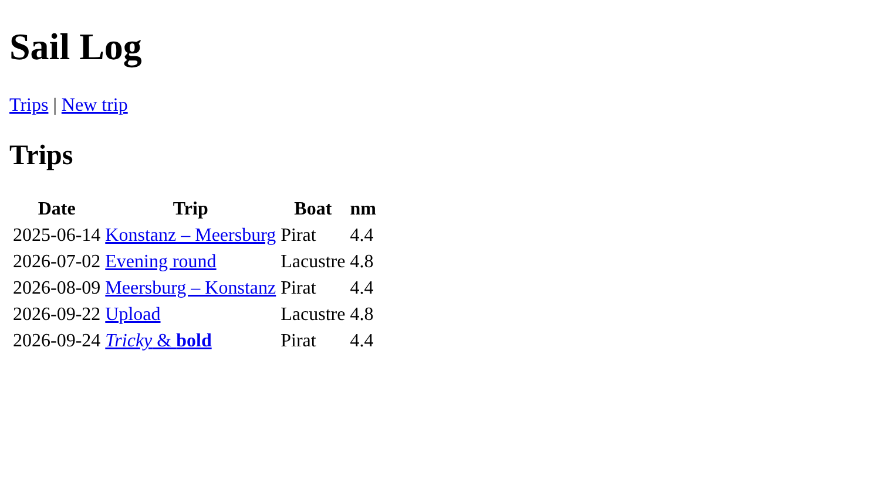
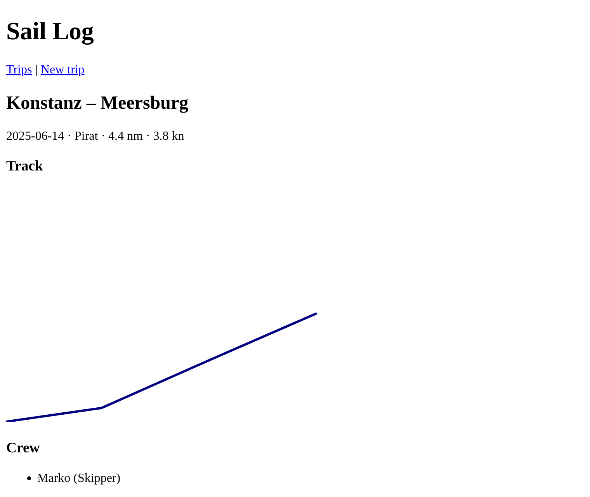
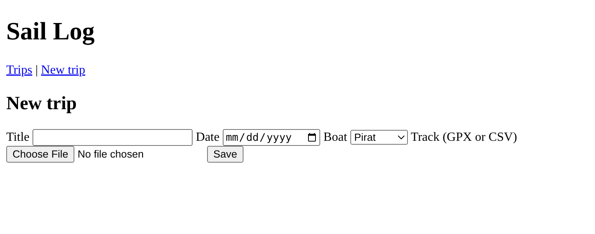

### Prof. Dr. Marko Boger, Prof. Dr. Pascal Laube
## Programmiertechnik I
# Lecture 22: HTML

<p class="small">Running example: saillog · git tag <code>v22-html</code> · branch <code>feature/22-html</code></p>

---

<!-- _class: inhalt -->

<style scoped>
section { font-size: 20px; }
</style>

# Goals

In this lecture you will learn

- what **HTML** is and how a document is structured
- **semantic** elements: `header`, `nav`, `main`, `article`, `section`
- links, lists and **tables**
- **forms**: text, date, select and **file upload**
- drawing a GPS track with inline **SVG**
- how Cask serves HTML pages and handles a form upload
- why building HTML from **strings** is a bad idea

---

<!-- _class: kapitel -->

## 1
# HTML Basics

Documents for people

---

# From JSON to Pages

- Lecture 21: the server answers with **JSON** – good for programs
- People use a **browser** – it understands **HTML**
- HTML = HyperText Markup Language
  - a tree of **elements**, written as **tags** – like XML (Lecture 19)
  - the browser turns the tree into a page
- Same server, new routes: `/` instead of `/api/trips`

---

# A Minimal Document

```html
<!doctype html>
<html lang="en">
<head>
  <meta charset="utf-8">
  <title>Trips</title>
</head>
<body>
  <h1>Sail Log</h1>
  <p>Our trips on Lake Constance.</p>
</body>
</html>
```

- `head`: information **about** the page (title, encoding, stylesheets)
- `body`: what you **see**
- `lang` and `charset`: language and encoding – important for “Törn” and “–”

---

# Elements and Attributes

```html
<a href="/trips/1">Konstanz – Meersburg</a>
<input id="title" name="title" required>

```

- An element: opening tag, content, closing tag
- **Attributes** in the opening tag: `href`, `id`, `name`
- **Void** elements have no content and no closing tag: `input`, `img`, `meta`, `br`
- Boolean attributes: `required` – present means true

---

# Text Elements

| Element | Meaning |
|---|---|
| `<h1>` … `<h6>` | headings, `h1` is the most important |
| `<p>` | paragraph |
| `<a href="…">` | link |
| `<ul>`, `<ol>`, `<li>` | unordered / ordered list, list item |
| `<strong>`, `<em>` | important, emphasised |
| `` | image with a text alternative |

- Choose elements by **meaning**, not by looks – the looks come in Lecture 23

---

# Semantic Structure

```html
<body>
<header><h1>Sail Log</h1>
  <nav><a href="/">Trips</a> | <a href="/trips/new">New trip</a></nav>
</header>
<main>
  <article>
    <h2>Konstanz – Meersburg</h2>
    <section><h3>Crew</h3> ... </section>
  </article>
</main>
</body>
```

- `header`, `nav`, `main`, `article`, `section`, `footer` describe the **role** of a part
- Screen readers, search engines and CSS all use this structure

---

<!-- _class: kapitel -->

## 2
# Pages from Scala

The overview page

---

# The Page Frame

```scala
def page(title: String, body: String): String =
  s"""<!doctype html>
     |<html lang="en">
     |<head><meta charset="utf-8"><title>$title</title></head>
     |<body>
     |<header><h1>Sail Log</h1>
     |  <nav><a href="/">Trips</a> | <a href="/trips/new">New trip</a></nav>
     |</header>
     |<main>$body</main>
     |</body>
     |</html>""".stripMargin
```

- One function for the frame of **every** page
- `s"""…"""` with `|` and `stripMargin`: multi-line string interpolation

---

# Tables

```html
<table>
  <thead><tr><th>Date</th><th>Trip</th><th>Boat</th><th>nm</th></tr></thead>
  <tbody>
    <tr><td>2025-06-14</td><td><a href="/trips/1">Konstanz – Meersburg</a></td>
        <td>Pirat</td><td>4.4</td></tr>
  </tbody>
</table>
```

- `table` → `thead` / `tbody` → `tr` (row) → `th` (header cell) / `td` (data cell)
- Tables are for **tabular data** – not for page layout

---

# The Overview in Scala

```scala
def tripRow(t: Trip, boat: String): String =
  f"""<tr><td>${t.date}</td><td><a href="/trips/${t.id}">${t.title}</a></td>
     |<td>$boat</td><td>${Geo.distanceNm(t.track)}%.1f</td></tr>""".stripMargin

def overview(rows: List[(Trip, String)]): String =
  page("Trips", s"""<h2>Trips</h2>
    |<table>
    |  <thead><tr><th>Date</th><th>Trip</th><th>Boat</th><th>nm</th></tr></thead>
    |  <tbody>${rows.map(tripRow).mkString("\n")}</tbody>
    |</table>""".stripMargin)
```

- One row per trip: `rows.map(tripRow).mkString`
- `f"…%.1f"`: format the distance with one decimal

---

# Serving HTML with Cask

```scala
def html(content: String, status: Int = 200) =
  cask.Response(content, statusCode = status,
                headers = Seq("Content-Type" -> "text/html; charset=utf-8"))

def boatName(id: Int): String = repo.boat(id).fold("?")(_.name)

@cask.get("/")
def index() = html(RawHtml.overview(repo.trips.map(t => (t, boatName(t.boatId)))))
```

- The **Content-Type** header tells the browser: this is HTML, in UTF-8
- Same server object as in Lecture 21 – JSON routes and HTML routes side by side

---

<style scoped>
section { padding-top: 30px; }
</style>

# The Result



---

<!-- _class: kapitel -->

## 3
# The Detail Page

Lists, sections and SVG

---

# Trip Detail

```scala
def detail(t: Trip, boat: String): String =
  val crew = t.crew.map(c => s"<li>${c.name} (${c.role})</li>").mkString
  // ... points: one <tr> per track point ...
  page(t.title, f"""<article>
    |<h2>${t.title}</h2>
    |<p>${t.date} · $boat · ${Geo.distanceNm(t.track)}%.1f nm · ${Stats.avgSpeedKn(t)}%.1f kn</p>
    |<section><h3>Track</h3>${trackSvg(t.track)}</section>
    |<section><h3>Crew</h3><ul>$crew</ul></section>
    |<section><h3>Track points</h3>
    |<table><thead><tr><th>Time</th><th>Lat</th><th>Lon</th></tr></thead>
    |<tbody>$points</tbody></table></section>
    |</article>""".stripMargin)
```

---

# The Route: 200 or 404

```scala
@cask.get("/trips/:id")
def tripPage(id: Int) = repo.trip(id) match
  case Some(t) => html(RawHtml.detail(t, boatName(t.boatId)))
  case None    => html(RawHtml.page("Not found", s"<p>No trip $id</p>"), 404)
```

- Exactly like the JSON route `/api/trips/:id` – only the representation differs
- A 404 page is still a full HTML page

---

# SVG: Vector Graphics in HTML

```html
<svg viewBox="0 0 400 300" width="400" height="300">
  <polyline points="0,300 122.7,282.4 269.7,217.2 400,160.5"
            fill="none" stroke="navy" stroke-width="3"/>
</svg>
```

- **SVG** (Scalable Vector Graphics): XML for drawings, can be written **inside** HTML
- `viewBox`: the coordinate system – x to the right, **y downwards**
- `polyline`: a line through a list of points – exactly what a track is
- A map without a map library

---

# From Coordinates to Pixels

```scala
def trackSvg(track: List[TrackPoint], w: Int = 400, h: Int = 300): String =
  val lats = track.map(_.lat); val lons = track.map(_.lon)
  val scale = math.min(w / (lons.max - lons.min max 1e-9),
                       h / (lats.max - lats.min max 1e-9))
  val points = track.map { p =>
    f"${(p.lon - lons.min) * scale}%.1f,${h - (p.lat - lats.min) * scale}%.1f"
  }.mkString(" ")
  s"""<svg viewBox="0 0 $w $h" width="$w" height="$h">
     |  <polyline points="$points" fill="none" stroke="navy" stroke-width="3"/>
     |</svg>""".stripMargin
```

- Longitude → x, latitude → y; `h - …` because SVG's y axis points **down**
- One `scale` for both axes keeps the shape

---

<style scoped>
section { padding-top: 30px; }
</style>

# The Detail Page



---

<!-- _class: kapitel -->

## 4
# Forms

Sending data to the server

---

# A Form with File Upload

```html
<form method="post" action="/trips" enctype="multipart/form-data">
  <label for="title">Title</label>
  <input id="title" name="title" required>
  <label for="date">Date</label>
  <input id="date" name="date" type="date" required>
  <label for="boat">Boat</label>
  <select id="boat" name="boat">$options</select>
  <label for="track">Track (GPX or CSV)</label>
  <input id="track" name="track" type="file" accept=".gpx,.csv" required>
  <button type="submit">Save</button>
</form>
```

---

# Form Elements

| Element | Purpose |
|---|---|
| `<form method action>` | where and how to send the data |
| `<label for="id">` | caption, clicking it focuses the field |
| `<input type="text\|date\|number\|file">` | input fields |
| `<select>` + `<option value>` | choice from a list |
| `<button type="submit">` | sends the form |

- `name`: the **key** under which the value is sent
- `required`, `accept`: the browser checks before sending
- `enctype="multipart/form-data"`: needed for **files**

---

# The Select Box

```scala
def form(boats: List[Boat]): String =
  val options = boats.map(b => s"""<option value="${b.id}">${b.name}</option>""").mkString
  page("New trip", s"""<h2>New trip</h2>
    |<form method="post" action="/trips" enctype="multipart/form-data">
    // ... fields as on the previous slide ...
```

```scala
@cask.get("/trips/new")
def newTrip() = html(RawHtml.form(repo.boats))
```

- The options come from the **repository**: a new boat appears automatically
- The user sees the name, the server receives the **id**

---

<style scoped>
section { padding-top: 30px; }
</style>

# The Form



---

# Receiving the Upload

```scala
@cask.postForm("/trips")
def createTrip(title: String, date: String, boat: Int, track: cask.FormFile) =
  val file = os.Path(track.filePath.get)
  val text = os.read(file)
  val points = if track.fileName.endsWith(".csv") then Csv.parse(text.linesIterator.toSeq)
               else Gpx.parse(text)
  val trip = Trip(repo.nextTripId, boat, LocalDate.parse(date), title, Nil, points)
  repo.addTrip(trip)
  cask.Redirect(s"/trips/${trip.id}")
```

- `@cask.postForm`: the parameters are the form fields, by `name`
- `cask.FormFile`: the uploaded file, saved to a temporary path
- **Redirect** to the new trip – reloading the page does not upload twice

---

# Testing the Form with curl

```text
$ curl -i -F title=Multipart -F date=2026-09-22 -F boat=1 \
       -F track=@data/konstanz-meersburg.gpx localhost:8080/trips
HTTP/1.1 301 Moved Permanently
Location: /trips/4

$ curl -s localhost:8080/trips/4 | grep "<h2"
<h2>Multipart</h2>
```

- `-F key=value`: a form field, `-F key=@file`: a file – sent as `multipart/form-data`
- Same request the browser sends when you press *Save*
- Note: Cask's `Redirect` answers `301`; strictly, *303 See Other* is the right code after a `POST`

---

<!-- _class: kapitel -->

## 5
# The Problem with Strings

Why this will not scale

---

# Let's Name a Trip …

```text
$ curl --form-string 'title=<i>Tricky</i> & <b>bold</b>' -F date=2026-09-24 \
       -F boat=1 -F track=@data/konstanz-meersburg.gpx localhost:8080/trips

$ curl -s localhost:8080/ | grep Tricky
<tr><td>2026-09-24</td><td><a href="/trips/6"><i>Tricky</i> & <b>bold</b></a></td>
```

- The title is inserted **as HTML** – the browser shows italic and bold
- With `<script>…</script>` an attacker runs code in every visitor's browser
- This is **Cross-Site Scripting (XSS)** – one of the most common security bugs

---

# More Problems

- **Escaping**: `<`, `>`, `&`, `"` must become `&lt;`, `&gt;`, `&amp;`, `&quot;` – everywhere, by hand
- **No checks**: a missing `</td>` or a typo `<tabel>` compiles fine
- **No structure**: HTML is just text – the compiler cannot help
- **Copies**: header and navigation must be the same on every page
- **Ugly**: the pages work, but look like 1995

---

<!-- _class: inhalt -->

<style scoped>
section { font-size: 20px; }
</style>

# Summary

- HTML: a tree of elements with attributes; `head` describes, `body` shows
- Semantic elements: `header`, `nav`, `main`, `article`, `section`
- Tables for tabular data: `table`, `thead`, `tbody`, `tr`, `th`, `td`
- Inline **SVG**: a `polyline` draws the GPS track
- Forms: `form`, `label`, `input`, `select`, `button`; files need `multipart/form-data`
- Cask: `Content-Type: text/html`, `@cask.postForm`, `cask.FormFile`, `cask.Redirect`
- HTML from strings works, but is unsafe (XSS) and unchecked

---

<!-- _class: aufgabe -->

# Task

- Check out `v22-html`, start the server, open `http://localhost:8080`
- Upload a track through the form in the browser
- Add a page `/boats` with a table of all boats and their total nautical miles
- Add a form *New boat* (`name`, `kind` as `select`)
- Check your pages with the W3C validator (validator.w3.org)
- Bonus: write `escape(s: String): String` and use it for the trip title

---

<!-- _class: abschluss -->

# Questions?

## Thank you!

marko.boger@htwg-konstanz.de
