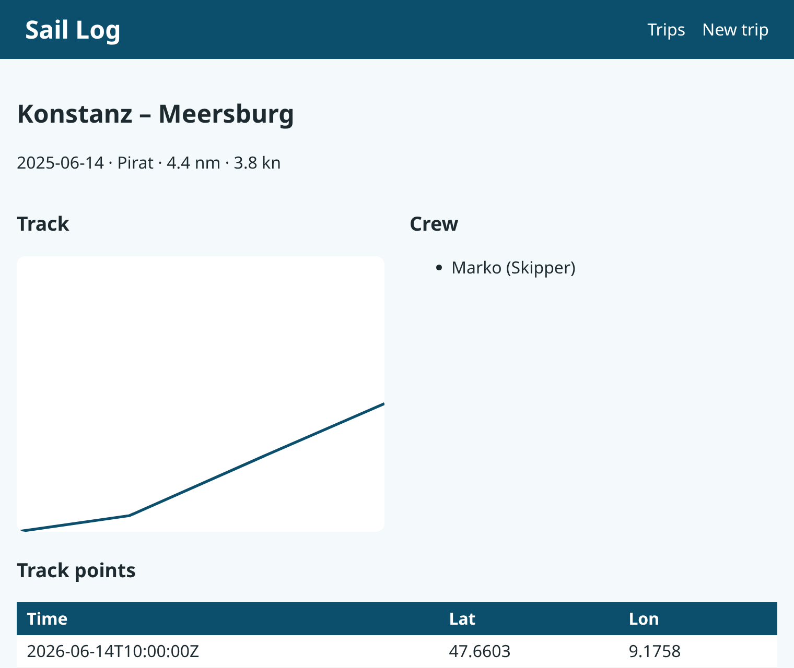
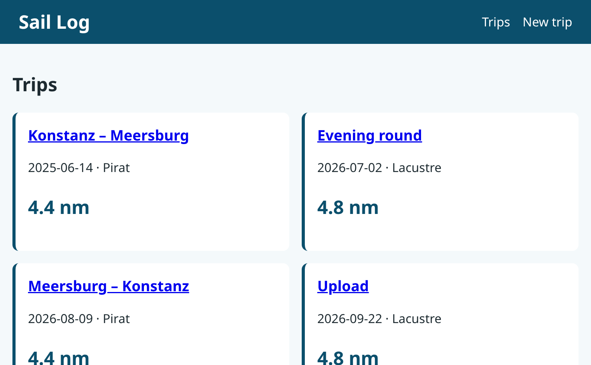
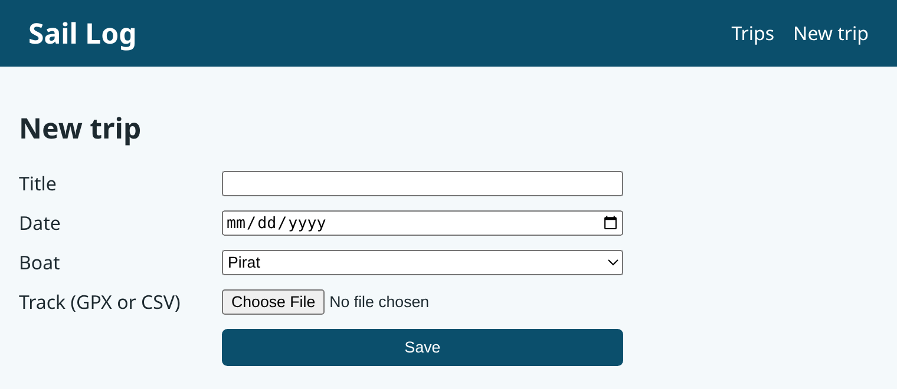
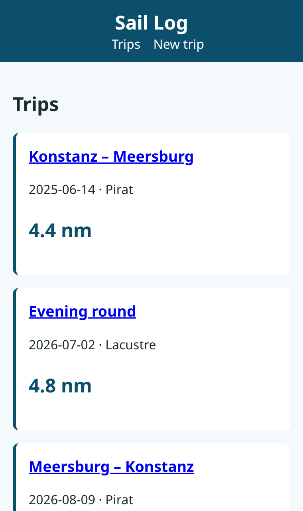
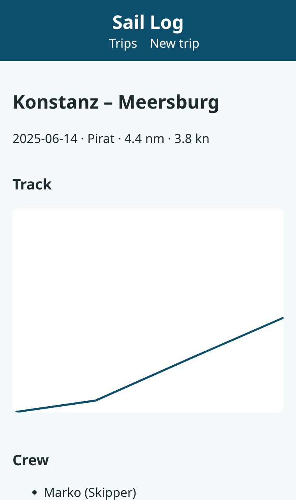

### Prof. Dr. Marko Boger, Prof. Dr. Pascal Laube
## Programmiertechnik I
# Lecture 23: CSS

<p class="small">Running example: saillog · git tag <code>v23-css</code> · branch <code>feature/23-css</code></p>

---

<!-- _class: inhalt -->

<style scoped>
section { font-size: 20px; }
</style>

# Goals

In this lecture you will learn

- why **content** (HTML) and **presentation** (CSS) are kept apart
- CSS rules: **selectors**, properties, values
- the **cascade**: which rule wins
- the **box model**: margin, border, padding, content
- layout with **Flexbox** and **Grid**
- **responsive** design with media queries
- a simple **theme** with custom properties
- serving **static files** with Cask

---

<!-- _class: kapitel -->

## 1
# CSS Basics

Rules, selectors, the cascade

---

# Before and After

<div class="columns" style="grid-template-columns: 1fr 1fr; gap: 20px;">
<div>


</div>
<div>



</div>
</div>

- Same data, same structure – only a **stylesheet** was added
- Lecture 22: *what* is on the page – Lecture 23: *how* it looks

---

# CSS: Cascading Style Sheets

```css
header {
  padding: 0.75rem 1.5rem;
  background: var(--sea);
  color: white;
}
```

- A **rule**: a **selector** and a block of **declarations**
- A declaration: `property: value;`
- Stylesheets live in their own file and are linked in the `head`:

```html
<link rel="stylesheet" href="/static/style.css">
```

---

# Selectors

| Selector | Matches |
|---|---|
| `table` | every `<table>` element |
| `.card` | every element with `class="card"` |
| `#title` | the element with `id="title"` |
| `header a` | `<a>` **inside** a `<header>` |
| `a:hover` | a link while the mouse is over it |
| `tbody tr:nth-child(even)` | every second row |
| `svg polyline` | the polyline inside an SVG |

- Classes are the main tool: HTML says *what it is*, CSS says *how it looks*

---

# Classes in the HTML

```scala
def tripCard(t: Trip, boat: String): String =
  f"""<article class="card">
     |  <h3><a href="/trips/${t.id}">${t.title}</a></h3>
     |  <p>${t.date} · $boat</p>
     |  <p class="nm">${Geo.distanceNm(t.track)}%.1f nm</p>
     |</article>""".stripMargin
```

- The overview now shows **cards** instead of a table row
- `class="card"`, `class="nm"`: hooks for the stylesheet
- An element can have several classes: `class="card card--longest"`

---

# The Cascade

- Several rules can match the same element – which one wins?
  1. **Importance**: `!important` (avoid it)
  2. **Specificity**: `#id` > `.class` > `element`
  3. **Order**: the later rule wins
- **Inheritance**: `color`, `font-family` pass down to children; `padding`, `border` do not
- `body` sets the text color for everything; `header a` is more specific and wins inside the header

```css
body {
  color: var(--text);
}
header a  { color: white; margin-left: 1rem; text-decoration: none; }
header a:hover { color: var(--sail); }
```

---

# Units and Colors

| Unit | Meaning |
|---|---|
| `px` | screen pixel |
| `rem` | multiple of the root font size (usually 16px) |
| `%` | relative to the parent |
| `fr` | fraction of the free space in a grid |

- Colors: `white`, `#0b4f6c`, `rgb(11 79 108)` – remember RGB from Lecture 18
- Prefer `rem`: the page scales when the user enlarges the font

---

<!-- _class: kapitel -->

## 2
# The Box Model

Every element is a box

---

# The Box Model

<div style="background:#fde7c4; padding:14px 22px; width:640px; font-size:18px;">margin
<div style="border:10px solid #0b4f6c; background:#cfe8d5; padding:14px 22px;">padding (inside the border)
<div style="background:#ffffff; padding:16px; text-align:center;">content</div>
</div>
</div>

- **content**: text, images; **padding**: space inside the border
- **border**: the frame; **margin**: space to the neighbours
- `box-sizing: border-box`: `width` includes padding and border – much easier

---

# The Card

```css
.card {
  background: white;
  padding: 1rem;
  border-left: 4px solid var(--sea);
  border-radius: 0.5rem;
}
.card:hover { border-left-color: var(--sail); }
.card h3 { margin-top: 0; }
.nm { font-size: 1.5rem; font-weight: bold; color: var(--sea); }
```

- Padding gives the text air, the left border is the accent
- `border-radius`: rounded corners
- Browser **DevTools** (F12) show the box of every element – debugging, Lecture 16

---

<!-- _class: kapitel -->

## 3
# Layout

Flexbox and Grid

---

# Flexbox: the Header

```css
header {
  display: flex;
  justify-content: space-between;
  align-items: center;
  padding: 0.75rem 1.5rem;
  background: var(--sea);
  color: white;
}
header h1 { margin: 0; font-size: 1.5rem; }
header a  { color: white; margin-left: 1rem; text-decoration: none; }
```

- `display: flex`: children are laid out in a **row**
- `justify-content: space-between`: title left, navigation right
- `align-items: center`: vertically centred

---

# Grid: the Cards

```css
.cards {
  display: grid;
  grid-template-columns: repeat(auto-fill, minmax(16rem, 1fr));
  gap: 1rem;
}
```

- `display: grid`: a two-dimensional layout
- `repeat(auto-fill, minmax(16rem, 1fr))`: as many columns as fit, each at least 16rem
- No media query needed: 3 columns on a laptop, 1 on a phone

---

<style scoped>
section { padding-top: 30px; }
</style>

# The Overview



---

# Grid: Two Columns

```scala
|<div class="detail">
|<section><h3>Track</h3>${trackSvg(t.track)}</section>
|<section><h3>Crew</h3><ul>$crew</ul></section>
|</div>
```

```css
.detail {
  display: grid;
  grid-template-columns: 1fr 1fr;
  gap: 1.5rem;
}
```

- Track and crew side by side, each half of the width

---

# Tables and Forms

```css
table { border-collapse: collapse; width: 100%; background: white; }
th, td { padding: 0.3rem 0.6rem; text-align: left; }
thead { background: var(--sea); color: white; }
tbody tr:nth-child(even) { background: #e8f1f5; }

form {
  display: grid;
  grid-template-columns: 10rem 1fr;
  gap: 0.75rem;
  max-width: 32rem;
}
```

- Zebra stripes with `:nth-child(even)`
- The form as a grid: labels left, fields right – no extra HTML

---

<style scoped>
section { padding-top: 30px; }
</style>

# The Form



---

<!-- _class: kapitel -->

## 4
# Responsive Design and Themes

Phones, colors, consistency

---

# Media Queries

```css
@media (max-width: 700px) {
  header  { flex-direction: column; }
  .detail { grid-template-columns: 1fr; }
  form    { grid-template-columns: 1fr; }
  button  { grid-column: 1; }
}
```

```html
<meta name="viewport" content="width=device-width, initial-scale=1">
```

- Rules that apply only on **narrow** screens – the crew uses phones on board
- The `viewport` meta tag stops phones from shrinking the desktop page

---

<style scoped>
section { padding-top: 30px; }
</style>

# On the Phone

<div class="columns" style="grid-template-columns: 1fr 1fr; gap: 30px;">
<div>



</div>
<div>



</div>
</div>

---

# A Theme with Custom Properties

```css
:root {
  --sea: #0b4f6c;
  --foam: #f4f9fb;
  --sail: #f2c14e;
  --text: #1d2a30;
}
body {
  color: var(--text);
  background: var(--foam);
}
svg polyline { stroke: var(--sea); }
```

- `--name`: a **custom property** (CSS variable), defined once on `:root`
- `var(--sea)`: use it everywhere – change the theme in **one** place
- CSS overrides the SVG attribute `stroke="navy"` from Lecture 22

---

<!-- _class: kapitel -->

## 5
# Static Files

Serving the stylesheet

---

# Static Files with Cask

```scala
@cask.staticFiles("/static")
def staticFiles() = "static"
```

- Every request `/static/…` is answered with the file from the folder `static/`
- Cask sets the **Content-Type** from the file extension

```text
$ curl -s -D - -o /dev/null localhost:8080/static/style.css
HTTP/1.1 200 OK
Content-Type: text/css
Content-Length: 1899

$ curl -s -o /dev/null -w "%{http_code}\n" localhost:8080/static/nope.css
404
```

---

# Linking the Stylesheet

```scala
s"""<!doctype html>
   |<html lang="en">
   |<head>
   |  <meta charset="utf-8">
   |  <meta name="viewport" content="width=device-width, initial-scale=1">
   |  <title>$title</title>
   |  <link rel="stylesheet" href="/static/style.css">
   |</head>
```

- One stylesheet for all pages – the browser **caches** it
- Images, fonts and JavaScript files are served the same way

---

# Project Layout at `v23-css`

```text
saillog/
  static/style.css               ← new: the theme (~90 lines)
  src/main/scala/saillog/
    web/RawHtml.scala            ← classes, cards, stylesheet link
    web/LogbookServer.scala      ← @cask.staticFiles("/static")
```

- `git diff v22-html v23-css` – the Scala code hardly changed
- But: class names are now scattered across string snippets in Scala
- A typo in `class="crad"` – nobody notices

---

<!-- _class: inhalt -->

<style scoped>
section { font-size: 20px; }
</style>

# Summary

- CSS separates presentation from content; linked with `<link rel="stylesheet">`
- Rules: selector + declarations; classes are the main hook
- The cascade: importance, specificity, order; some properties inherit
- Box model: content, padding, border, margin; use `box-sizing: border-box`
- Flexbox for rows (header), Grid for two-dimensional layouts (cards, form)
- Responsive: `auto-fill`/`minmax`, media queries, the viewport meta tag
- Themes with custom properties `--sea`, `var(--sea)`
- Cask: `@cask.staticFiles("/static")`

---

<!-- _class: aufgabe -->

# Task

- Check out `v23-css`, start the server and inspect the page with the DevTools (F12)
- Change the theme colors – only in `:root`
- Add a dark mode with `@media (prefers-color-scheme: dark)`
- Give the detail page a three-column grid on wide screens
- Bonus: highlight the longest trip with an extra class

---

<!-- _class: abschluss -->

# Questions?

## Thank you!

marko.boger@htwg-konstanz.de
