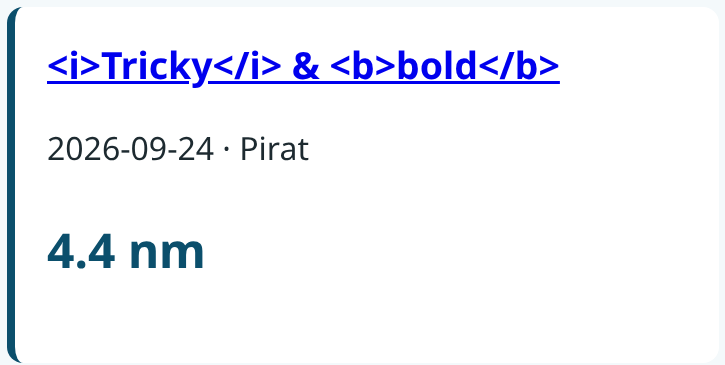
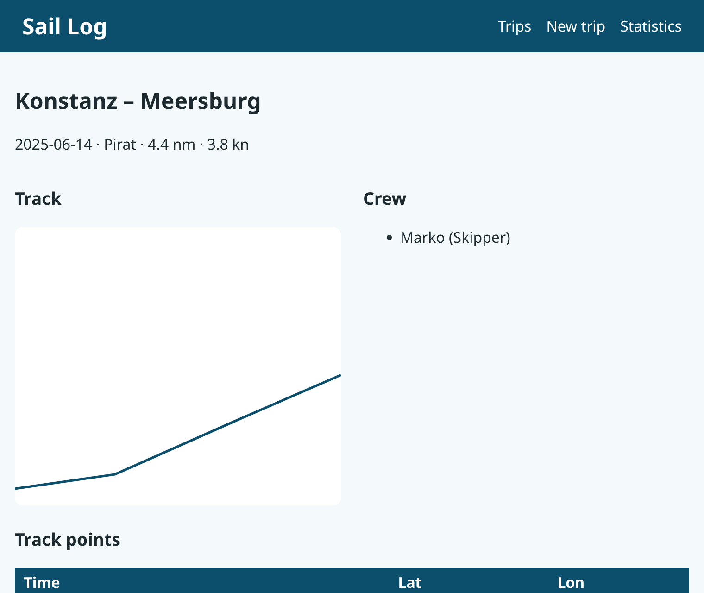
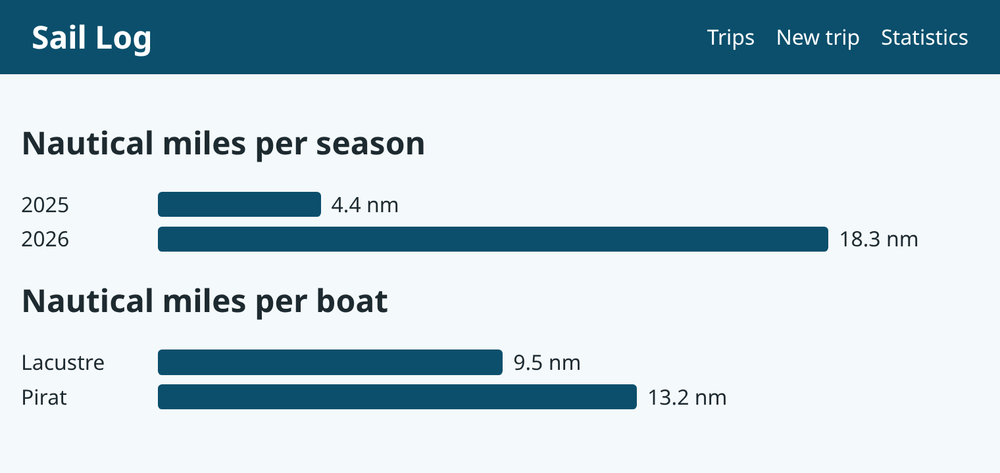

### Prof. Dr. Marko Boger, Prof. Dr. Pascal Laube
## Programmiertechnik I
# Lecture 24: HTML Templates

<p class="small">Running example: saillog · git tag <code>v24-templates</code> · branch <code>feature/24-templates</code></p>

---

<!-- _class: inhalt -->

<style scoped>
section { font-size: 20px; }
</style>

# Goals

In this lecture you will learn

- what **templates** are and which kinds exist
- how **Scalatags** writes HTML as type-checked Scala code
- why Scalatags **escapes** text automatically – no more XSS
- how to build a **layout** and reusable **components** as functions
- how to set CSS **classes** and **inline styles** from Scala
- how to draw SVG with Scalatags
- the finished saillog app – and a look back at six lectures

---

<!-- _class: kapitel -->

## 1
# Templates

From strings to structure

---

# Where We Are

- Lecture 22: HTML from **strings** – works, but
  - no escaping → XSS
  - no checks → typos and missing tags go unnoticed
  - header and navigation copied into every page
- Lecture 23: CSS class names scattered across those strings
- We want: HTML that the **compiler** understands

---

# Kinds of Templates

| Kind | Example | Idea |
|---|---|---|
| String templates | Mustache, Jinja, Twirl | HTML file with placeholders `{{title}}` |
| Internal DSL | **Scalatags**, Kotlin HTML | HTML as code in the programming language |
| Components in the browser | React, Vue | JavaScript renders the page |

- A **DSL** (domain-specific language): a small language for one job – here: HTML
- Scalatags: HTML elements are **functions**, attributes are **values**

---

# Scalatags

```scala
//> using dep com.lihaoyi::scalatags:0.13.1
```

```scala
"com.lihaoyi" %% "scalatags" % "0.13.1"     // build.sbt
```

```scala
import scalatags.Text.all.*

div(cls := "card",
  h2("Törn 1"),
  p("4.4 nm")).render
// <div class="card"><h2>Törn 1</h2><p>4.4 nm</p></div>
```

- By Li Haoyi – the last library of our toolbox
- `.render` turns the tree into a `String`

---

# Elements, Attributes, Text

```scala
a(href := "/trips/1", "Konstanz – Meersburg")
input(id := "title", name := "title", required)
ul(li("Marko"), li("Anna"))
```

- An element is a function: `a(...)`, `div(...)`, `ul(...)`
- Arguments: attributes `href := "…"` and children (elements or text)
- Typo `hraf` or `dvi` → **compile error**
- Tags are always closed – the structure is a Scala expression

---

# Escaping for Free

```text
$ curl -s localhost:8080/ | grep -o "&lt;i&gt;Tricky.*bold&lt;/b&gt;"
&lt;i&gt;Tricky&lt;/i&gt; &amp; &lt;b&gt;bold&lt;/b&gt;
```



- Every `String` child is **text**: `<` becomes `&lt;` automatically
- The XSS attack from Lecture 22 is gone – without a single line of extra code

---

<!-- _class: kapitel -->

## 2
# Layout

One frame for every page

---

# The Layout Function

```scala
object Layout:
  def page(pageTitle: String)(content: Frag*): String =
    "<!doctype html>" + html(lang := "en")(
      head(
        meta(charset := "utf-8"),
        meta(name := "viewport", attr("content") := "width=device-width, initial-scale=1"),
        tag("title")(pageTitle),
        link(rel := "stylesheet", href := "/static/style.css")),
      body(
        header(
          h1("Sail Log"),
          nav(a(href := "/", "Trips"), a(href := "/trips/new", "New trip"),
              a(href := "/stats", "Statistics"))),
        mainTag(content))
    ).render
```

---

# Details of the Layout

- `content: Frag*`: any number of fragments – **varargs** (Lecture 17)
- Two parameter lists: `Layout.page("Trips")( … )` reads like a block
- `Frag`: anything that can be rendered – element, text, list of elements
- Name clashes with Scala and HTML:
  - `title` is also an attribute → `tag("title")`
  - `main` is special in Scala → `import scalatags.Text.tags2.{main as mainTag}`
  - `nav`, `section`, `article` live in `tags2`
- Change the navigation **once** – every page follows

---

<!-- _class: kapitel -->

## 3
# Components

Small functions, reused

---

# A Component Is a Function

```scala
def tripCard(t: Trip, boat: String, longest: Boolean): Frag =
  article(cls := (if longest then "card card--longest" else "card"))(
    h3(a(href := s"/trips/${t.id}", t.title)),
    p(s"${t.date} · $boat"),
    p(cls := "nm", f"${Geo.distanceNm(t.track)}%.1f nm"))
```

- Input: domain objects – output: a `Frag`
- `cls := …`: CSS classes as ordinary Scala values – **conditionally** set
- `card--longest` highlights the longest trip (style from Lecture 23)

---

# Loops Inside Templates

```scala
def crewList(crew: List[CrewMember]): Frag =
  ul(for c <- crew yield li(s"${c.name} (${c.role})"))

def pointsTable(track: List[TrackPoint]): Frag =
  table(
    thead(tr(th("Time"), th("Lat"), th("Lon"))),
    tbody(for p <- track yield tr(td(p.time.toString), td(p.lat), td(p.lon))))
```

- `for … yield` produces a list of elements – a list is a `Frag`, too
- Numbers can be children directly: `td(p.lat)`
- No `mkString`, no forgotten `</tr>`

---

# SVG with Scalatags

```scala
def trackSvg(track: List[TrackPoint], w: Int = 400, h: Int = 300): Frag =
  val lats = track.map(_.lat); val lons = track.map(_.lon)
  val scale = math.min(w / (lons.max - lons.min max 1e-9),
                       h / (lats.max - lats.min max 1e-9))
  val pts = track.map { p =>
    f"${(p.lon - lons.min) * scale}%.1f,${h - (p.lat - lats.min) * scale}%.1f"
  }.mkString(" ")
  svg(viewBox := s"0 0 $w $h", width := w, height := h)(
    polyline(points := pts, fill := "none", strokeWidth := 3))
```

- `scalatags.Text.svgTags` and `svgAttrs`: SVG elements and attributes
- Same math as Lecture 22 – only the last two lines changed

---

# Composing a Page

```scala
def detail(t: Trip, boat: String): String =
  Layout.page(t.title)(
    article(
      h2(t.title),
      p(f"${t.date} · $boat · ${Geo.distanceNm(t.track)}%.1f nm · ${Stats.avgSpeedKn(t)}%.1f kn"),
      div(cls := "detail")(
        section(h3("Track"), trackSvg(t.track)),
        section(h3("Crew"), crewList(t.crew))),
      section(h3("Track points"), pointsTable(t.track))))
```

- A page = layout + components
- Compare with the string version in Lecture 22: same structure, but checked

---

<style scoped>
section { padding-top: 30px; }
</style>

# The Detail Page



---

# The Overview

```scala
def overview(trips: List[(Trip, String)]): String =
  val maxNm = trips.map((t, _) => Geo.distanceNm(t.track)).maxOption.getOrElse(0.0)
  Layout.page("Trips")(
    h2("Trips"),
    section(cls := "cards")(
      for (t, boat) <- trips
      yield tripCard(t, boat, Geo.distanceNm(t.track) == maxNm)))
```

- Logic (which trip is the longest?) stays in Scala
- The template only arranges components

---

# The Form

```scala
scalatags.Text.all.form(method := "post", action := "/trips",
                        enctype := "multipart/form-data")(
  label(`for` := "title", "Title"), input(id := "title", name := "title", required),
  label(`for` := "date", "Date"),
  input(id := "date", name := "date", `type` := "date", required),
  label(`for` := "boat", "Boat"),
  select(id := "boat", name := "boat")(
    for b <- boats yield option(value := b.id, b.name)),
  label(`for` := "track", "Track (GPX or CSV)"),
  input(id := "track", name := "track", `type` := "file", accept := ".gpx,.csv", required),
  button(`type` := "submit", "Save"))
```

- Backticks for Scala keywords: `` `for` ``, `` `type` ``

---

<!-- _class: kapitel -->

## 4
# CSS from Scalatags

Classes and inline styles

---

# Inline Styles

```scala
def bar(label: String, nm: Double, max: Double): Frag =
  div(cls := "bar-row")(
    span(cls := "bar-label", label),
    div(cls := "bar", width := s"${(nm / max * 70).round}%",
        backgroundColor := "var(--sea)"),
    span(f"$nm%.1f nm"))
```

```html
<div class="bar" style="width: 72%; background-color: var(--sea);">
```

- `width := …`, `backgroundColor := …`: CSS properties as typed Scala values
- Rendered into a `style="…"` attribute

---

# Class or Inline Style?

```css
.card--longest { border-left-color: var(--sail); }
.bar-row { display: flex; align-items: center; gap: 0.5rem; margin: 0.3rem 0; }
.bar-label { width: 6rem; flex-shrink: 0; }
.bar { height: 1.2rem; border-radius: 0.2rem; }
```

- **Class** + stylesheet: for everything that is the same for many elements
- **Inline style**: only for values that come from **data** – here the bar width
- Rule of thumb: the stylesheet decides the look, Scala decides the data

---

# The Statistics Page

```scala
def stats(perSeason: Map[Int, Double], perBoat: Map[String, Double]): String =
  val max = (perSeason.values ++ perBoat.values).maxOption.getOrElse(1.0)
  Layout.page("Statistics")(
    h2("Nautical miles per season"),
    for (season, nm) <- perSeason.toList.sorted yield bar(season.toString, nm, max),
    h2("Nautical miles per boat"),
    for (boat, nm) <- perBoat.toList.sorted yield bar(boat, nm, max))
```

```scala
@cask.get("/stats")
def statsPage() =
  html(Pages.stats(Stats.nmPerSeason(repo.trips), repo.nmPerBoat))
```

---

<style scoped>
section { padding-top: 30px; }
</style>

# Statistics



- A bar chart from `div`s and CSS – no chart library

---

<!-- _class: kapitel -->

## 5
# The Finished App

A look back

---

# Server at `v24-templates`

```scala
@cask.get("/")
def index() = html(Pages.overview(repo.trips.map(t => (t, boatName(t.boatId)))))

@cask.get("/trips/:id")
def tripPage(id: Int) = repo.trip(id) match
  case Some(t) => html(Pages.detail(t, boatName(t.boatId)))
  case None    => html(Pages.notFound(s"trip $id"), 404)

@cask.get("/trips/new")
def newTrip() = html(Pages.form(repo.boats))
```

- `git diff v23-css v24-templates -- src/main/scala/saillog/web` – only the calls changed
- `RawHtml.scala` is deleted, `view/` is new

---

# Six Lectures, One App

```text
saillog/src/main/scala/saillog/
  model/  Model, Geo, Stats                     19  Files and File Formats
  io/     Gpx, Csv, Json                        19
  repo/   LogbookRepository, JsonFile…, Sql…    20  Databases
  web/    LogbookServer                         21  HTTP Server, 22 HTML
  view/   Layout, Components, Pages             24  HTML Templates
static/style.css                                23  CSS
```

- Each layer has one job and uses only the layers below
- Each step reused the previous ones: parsers, repository, routes, classes

---

# What a Real App Would Add

- **Users** and login – who may change which trip?
- **Validation** and good error pages instead of exceptions
- **Tests**: repository, routes, templates
- **Logging** of requests (Lecture 16)
- **Maps** with real tiles instead of a plain SVG line
- **Live data** from the boat's instruments (NMEA)
- Deployment: running the server somewhere in the internet

---

<!-- _class: inhalt -->

<style scoped>
section { font-size: 20px; }
</style>

# Summary

- Templates separate page structure from data; Scalatags is an **internal DSL**
- Elements are functions, attributes are values `href := …`, `.render` gives a `String`
- Text is **escaped** automatically – no XSS
- Layout: one function with `content: Frag*`
- Components: functions from domain objects to `Frag`; `for … yield` for lists
- CSS: `cls := …` for classes, `width := …` for data-driven inline styles
- SVG with `svgTags` / `svgAttrs`
- saillog: files → database → HTTP → HTML → CSS → templates

---

<!-- _class: aufgabe -->

# Task

- Check out `v24-templates`, run the server and open `/stats`
- Write a component `boatBadge(kind: BoatKind)` with a different color per kind
- Add a boats page with Scalatags, reusing `bar` for the miles per boat
- Turn the `select` of the form into its own component
- Bonus: show the average speed of every trip as a bar

---

<!-- _class: abschluss -->

# Questions?

## Thank you!

marko.boger@htwg-konstanz.de
