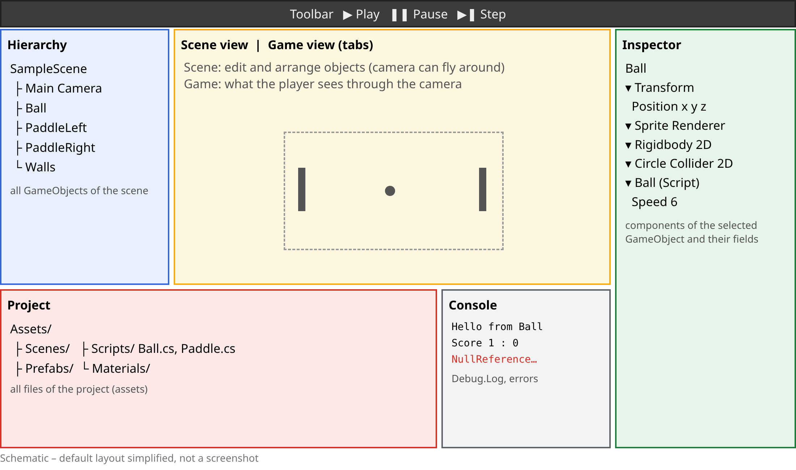
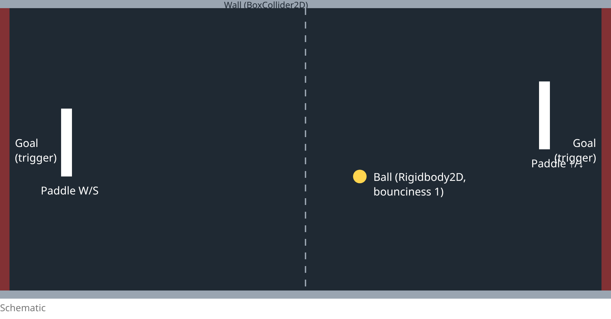

### Prof. Dr. Marko Boger, Prof. Dr. Pascal Laube
## Programmiertechnik I
# Lecture 27: Unity and C# I

<p class="small">Unity 6.3 LTS · C# · warm-up game: Pong in 2D</p>

---

<!-- _class: inhalt -->

<style scoped>
section { font-size: 20px; }
</style>

# Goals

In this lecture you will learn

- the **Unity Editor**: Scene, Game, Hierarchy, Inspector, Project, Console
- how Unity relates to **Scratch** (Lectures 1 and 2): stage → scene, sprite → GameObject, script → component
- **C#** for Scala programmers: types, classes, methods, properties, inheritance, generics, lambdas, `null`
- how **garbage collection** works – and why it matters in games
- how a Unity **script** works: `MonoBehaviour`, `Start`, `Update`, `FixedUpdate`
- 2D **physics**, **collisions** and **triggers**, **input** with the Input System
- and build **Pong** in 2D

---

<!-- _class: kapitel -->

## 1
# The Unity Editor

Where games are put together

---

# What Is Unity?

- A **game engine**: rendering, physics, audio, input, UI, animation – ready to use
- An **editor** to build scenes visually – and **C#** scripts for the behaviour
- One project → Windows, macOS, Linux, Android, iOS, web, consoles, XR
- Used for games, simulations, architecture, film, industry
- We use **Unity 6.3 LTS** (`6000.3.x`, supported until December 2027)
- Install via **Unity Hub**; free *Personal* licence for students and small revenues

> LTS = Long Term Support: no new features, but two years of fixes – the right choice for a course

---

# The Editor at a Glance



---

# Scene View and Game View

- **Scene view**: your workshop – select, move (`W`), rotate (`E`), scale (`R`) objects
- Navigate: right mouse + `WASD` to fly, scroll wheel to zoom, `F` to *frame* the selection
- 2D mode: toggle **2D** in the Scene view toolbar – the camera looks straight at the x/y plane
- **Game view**: exactly what the **camera** renders – what the player will see
- Game view settings: aspect ratio / resolution, *Stats* for frame rate

Scratch had both in one: the **stage** was editor and game at the same time.

---

# Hierarchy and Inspector

- **Hierarchy**: all **GameObjects** of the open scene as a tree
  - drag one onto another → **child**: it moves, rotates and scales with its parent
  - `+` → *2D Object* / *3D Object* / *UI* creates new objects
- **Inspector**: the **components** of the selected object
  - every object has a **Transform**: position, rotation, scale
  - *Add Component* adds abilities: renderer, rigidbody, collider, your scripts
  - public fields of your scripts appear here and can be **tuned without code**

---

# Project and Console

- **Project** window: the files in `Assets/` – scenes, scripts, sprites, materials, prefabs, sounds
  - create a script: *right click → Create → MonoBehaviour Script*
  - file name and class name must be **identical**: `Ball.cs` ↔ `class Ball`
- **Console**: output of `Debug.Log(...)`, warnings and errors
  - compile errors appear here – the game will not start until they are fixed
  - double click a message → jumps to the line in your code editor
- Code editor: **VS Code** (with the Unity extension) or **JetBrains Rider**

---

# Play Mode

- ▶ **Play** runs the game inside the editor, ❚❚ pauses, ▶❚ steps one frame
- While playing you can **inspect and change** everything in the Inspector
- ⚠ Changes made in Play Mode are **lost** when you stop
  - tip: *Preferences → Colors → Playmode tint* makes Play Mode clearly visible
- Saving: `Ctrl/Cmd + S` saves the **scene**; scripts are saved in the code editor
- Projects belong under **git** – with a Unity `.gitignore` (`Library/`, `Temp/`, `Logs/` are generated)

---

<!-- _class: kapitel -->

## 2
# From Scratch to Unity

The same ideas, a bigger toolbox

---

# Scratch → Unity

<style scoped>
table { font-size: 0.78em; }
</style>

| Scratch (Lectures 1–2) | Unity | |
|---|---|---|
| Stage | **Scene** | the world the game happens in |
| Sprite | **GameObject** | a thing in the scene |
| Costume | **Sprite Renderer** / mesh | how it looks |
| Script (blocks) | **Component** (C# class) | what it does |
| *when green flag clicked* | `Start()` | runs once at the beginning |
| *forever* | `Update()` | runs every frame |
| x, y, direction | `transform.position`, `rotation` | where it is |
| *touching …?* | `OnCollisionEnter2D`, `OnTriggerEnter2D` | collisions |
| Clones | **Prefab** + `Instantiate` | many objects from one template |
| *broadcast* message | C# **events** (Lecture 28) | loose coupling |

---

# GameObjects and Components

- A **GameObject** on its own is only a name and a **Transform**
- **Components** give it abilities – like snapping blocks together:

| GameObject | Components |
|---|---|
| Ball | Transform, Sprite Renderer, Rigidbody 2D, Circle Collider 2D, `Ball` script |
| Paddle | Transform, Sprite Renderer, Rigidbody 2D, Box Collider 2D, `Paddle` script |
| Goal | Transform, Box Collider 2D (*Is Trigger*), `Goal` script |

- **Composition over inheritance**: a paddle is not a subclass of "physics object" – it *has* physics
- Compare Lecture 17: traits mix abilities into a class; Unity mixes components into an object

---

# A Script Is a Component

```csharp
using UnityEngine;
public class HelloUnity : MonoBehaviour
{
    public float speed = 2f;          // visible in the Inspector
    void Start()
    {
        Debug.Log("Hello from " + gameObject.name);
    }
    void Update()
    {
        transform.Rotate(0, 0, speed * 90f * Time.deltaTime);
    }
}
```

- A class that **extends** `MonoBehaviour` can be attached to a GameObject
- `Start` and `Update` are called **by Unity** – you never call them yourself
- `public float speed` shows up in the Inspector; `Time.deltaTime` makes it frame-rate independent

---

<!-- _class: kapitel -->

## 3
# C# for Scala Programmers

Same concepts, different syntax

---

# C# at a Glance

- Developed by **Microsoft** (Anders Hejlsberg), first version 2000, part of **.NET**
- Statically typed, object-oriented, with many **functional** features (lambdas, LINQ, records, pattern matching)
- Compiled to an intermediate language, executed by a runtime with **garbage collection** – like Scala on the JVM
- Outside Unity: `dotnet new console`, `dotnet run` (current .NET 10)
- **Inside Unity**: C# **9** language level, Unity's own runtime – not every new C# feature is available
- Naming: `PascalCase` for classes, methods and properties, `camelCase` for fields and locals

---

# Scala vs. C# (1)

<style scoped>
table { font-size: 0.76em; }
</style>

| | Scala | C# |
|---|---|---|
| Value / variable | `val x = 1` / `var y = 2` | `readonly`, `const` / `var y = 2;` or `int y = 2;` |
| Basic types | `Int`, `Double`, `Boolean`, `String` | `int`, `double` / `float`, `bool`, `string` |
| Statements | no `;`, everything is an expression | `;` at the end, `if` is a statement (`?:` is an expression) |
| Class | `class Book(title: String)` | `class Book { public Book(string title) {...} }` |
| Singleton | `object Util` | `static class Util` |
| Inheritance | `class Circle extends Shape` | `class Circle : Shape` |
| Interface | `trait Shape` | `interface IShape` (no fields) |
| Override | `override def area` | `virtual` in the base, `override` in the subclass |
| Visibility | public by default | **private** by default |

---

# Scala vs. C# (2)

<style scoped>
table { font-size: 0.76em; }
</style>

| | Scala | C# |
|---|---|---|
| Generics | `List[Int]`, `def f[A](a: A)` | `List<int>`, `T F<T>(T a)` |
| Lambdas | `x => x * 2` | `x => x * 2` |
| Function types | `Int => Int` | `Func<int, int>`, `Action<int>` (no result) |
| Collections | `List`, `Map` (immutable) | `List<T>`, `Dictionary<K,V>` (mutable) |
| map / filter | `map`, `filter`, `foldLeft` | LINQ: `Select`, `Where`, `Aggregate` |
| Absent values | `Option[A]`: `Some` / `None` | `null`; `int?`, `string?`, `?.`, `??` |
| Pattern matching | `x match { case ... }` | `x switch { ... }`, `is` |
| String interpolation | `s"Hi $name"` | `$"Hi {name}"` |
| Entry point | `@main def run()` | `static void Main()` or top-level statements |

---

# Hello C#

```csharp
// Program.cs – top-level statements, no class needed
using System;

var book = new Book("Learn Scala 3", 2023);
Console.WriteLine($"{book} is {book.Age(2026)} years old");
```

```text
$ dotnet new console -o hello && cd hello
$ dotnet run
Learn Scala 3 (2023) is 3 years old
```

- `using System;` is like `import` – `Console` lives in the namespace `System`
- Every statement ends with `;`, blocks use `{ }`

---

# Classes and Constructors

```csharp
public class Book
{
    public string Title { get; }
    public int Year { get; }
    public Book(string title, int year)
    {
        Title = title;
        Year = year;
    }
    public int Age(int now) => now - Year;
    public override string ToString() => $"{Title} ({Year})";
}
```

- Fields and methods are **private** unless marked `public`
- The constructor has the class name and no return type
- `=>` defines a method with a single expression – like `def age(now: Int) = now - year`

---

# Methods and Parameters

```csharp
public static class Geometry
{
    public static double Area(double w, double h = 1.0) => w * h;
    public static void Swap(ref int a, ref int b)
    {
        int tmp = a;
        a = b;
        b = tmp;
    }
    public static bool TryHalf(int n, out int half)
    {
        half = n / 2;
        return n % 2 == 0;
    }
}
```

- **Default parameters** like in Scala: `Area(3)` = `Area(3, 1.0)`
- `ref`: the method may change the caller's variable · `out`: a second result
- `Geometry.TryHalf(10, out int h)` → `true`, `h == 5` – where Scala would return a tuple or `Option`

---

# Properties

```csharp
public class Player
{
    private int health = 100;
    public string Name { get; init; } = "Player";
    public int Score { get; private set; }
    public int Health
    {
        get => health;
        set => health = System.Math.Clamp(value, 0, 100);
    }
    public bool IsAlive => health > 0;
    public void AddPoints(int p) => Score += p;
}
```

- A **property** looks like a field from outside, but runs code: `p.Health = 150` → clamped to `100`
- `{ get; private set; }`: everybody can read, only the class can write
- `init`: can only be set when the object is created – `new Player { Name = "Ada" }`
- More on properties – and why Unity prefers fields – in Lecture 28

---

# Inheritance and Interfaces

```csharp
public interface IShape
{
    double Area();
}
public abstract class Shape : IShape
{
    public abstract double Area();
    public virtual string Name => "shape";
}
public class Circle : Shape
{
    private readonly double r;
    public Circle(double r) { this.r = r; }
    public override double Area() => System.Math.PI * r * r;
    public override string Name => "circle";
}
```

- `:` stands for both `extends` and `implements`; interface names start with `I` by convention
- Methods are **not** overridable by default – the base class must say `virtual` or `abstract`
- Like Scala, C# allows only **one** base class but many interfaces

---

# Generics and Lambdas

```csharp
List<int> nums = new() { 1, 2, 3, 4, 5 };
var squares = nums.Where(n => n % 2 == 1).Select(n => n * n).ToList();
Func<int, int, int> add = (a, b) => a + b;

Console.WriteLine($"{string.Join(",", squares)} {nums.Sum()} {add(2, 3)}");
// 1,9,25 15 5

var byLen = new Dictionary<string, int> { ["dock"] = 4 };
Console.WriteLine(byLen.GetValueOrDefault("x", -1));   // -1
```

- **LINQ** (`using System.Linq;`): `Where` = `filter`, `Select` = `map`, `Aggregate` = `foldLeft`
- `List<T>` is **mutable** – closer to Scala's `ArrayBuffer` than to `List`

---

# `null` Instead of `Option`

```csharp
string? name = null;
int? maybe = null;

Console.WriteLine(name?.Length);       // (empty) – ?. stops at null
Console.WriteLine(name ?? "unknown");  // unknown – ?? is getOrElse
Console.WriteLine(maybe.HasValue);     // False   – like isDefined
Console.WriteLine(maybe ?? 0);         // 0
```

- C# has `null` everywhere – the famous `NullReferenceException`
- `int?` is a **nullable value type**: close to `Option[Int]`
- `string?` only adds **compiler warnings** (nullable reference types) – Unity projects have them off by default

---

# Garbage Collection

- Objects are created with `new` on the **heap** – nobody frees them by hand
- The **garbage collector** finds objects that are no longer reachable and reclaims their memory – as on the JVM (Scala)
- Value types (`int`, `float`, `struct` like `Vector3`) live **inline** – no garbage
- In games, a GC run can cause a visible **stutter** (a dropped frame)
- Unity uses an *incremental* GC that spreads the work over several frames
- Rule of thumb: **avoid allocating** in `Update()` – no `new List<…>()` 60 times per second
- Destroyed GameObjects: `Destroy(obj)` removes them from the scene; the C# object is collected later

---

<!-- _class: kapitel -->

## 4
# Pong in 2D

Warm-up: physics, collisions, input

---

# The Plan



- Same game as in Scratch (Lecture 1) – now with real physics

---

# Setting Up the Scene

- New project from the **Universal 2D** template, scene `Pong`
- *2D Object → Sprites → Square* for paddles and walls, *Circle* for the ball
- **Rigidbody 2D** on ball and paddles, **Gravity Scale 0** (we look from above)
- Paddles: *Body Type* **Kinematic** – they move, but nothing pushes them
- **Colliders**: Box Collider 2D on paddles and walls, Circle Collider 2D on the ball
- *Create → 2D → Physics Material 2D* "Bouncy": **Friction 0, Bounciness 1** → on the ball
- Goals: Box Collider 2D with **Is Trigger** – they detect, but do not bounce
- Tag the paddles with **`Paddle`** (Inspector → Tag)

---

# The Life of a Script

<style scoped>
table { font-size: 0.85em; }
</style>

| Method | When | Use for |
|---|---|---|
| `Awake()` | when the object is created | own setup, references to own components |
| `Start()` | before the first frame | setup that needs other objects |
| `Update()` | **every frame** (e.g. 60×/s, varies) | input, timers, non-physics movement |
| `FixedUpdate()` | **fixed** physics step (default 50×/s) | forces and velocities on rigidbodies |
| `OnCollisionEnter2D(…)` | two colliders hit | bounce, damage |
| `OnTriggerEnter2D(…)` | a collider enters a trigger | goals, pick-ups |
| `OnDestroy()` | before the object is removed | clean-up |

- `Time.deltaTime` = seconds since the last frame → movement per second, not per frame

---

# Input: Old and New

| Input Manager (old) | Input System (new) |
|---|---|
| `Input.GetAxis("Vertical")` | `InputSystem.actions.FindAction("Move").ReadValue<Vector2>()` |
| `Input.GetKey(KeyCode.W)` | `Keyboard.current.wKey.isPressed` |
| `Input.GetButtonDown("Fire1")` | `attack.WasPressedThisFrame()` |
| built in, being phased out | package `com.unity.inputsystem`, recommended for new projects |

- You will find the old style in many tutorials – it only works if *Active Input Handling* allows it
- We use the **Input System** throughout: *Project Settings → Player → Active Input Handling → Input System Package (New)*
- Pong: two players on one keyboard → read the keys **directly**; Asteroids (Lecture 28) uses **actions**

---

# The Paddle

```csharp
using UnityEngine;
using UnityEngine.InputSystem;
public class Paddle : MonoBehaviour
{
    public Key up = Key.W, down = Key.S;
    public float speed = 8f;
    Rigidbody2D rb;
    void Start() => rb = GetComponent<Rigidbody2D>();
    void FixedUpdate()
    {
        float dir = 0;
        if (Keyboard.current[up].isPressed) dir += 1;
        if (Keyboard.current[down].isPressed) dir -= 1;
        rb.linearVelocity = new Vector2(0, dir * speed);
    }
}
```

- `Key` fields: one script for both paddles – set `UpArrow`/`DownArrow` in the Inspector
- `linearVelocity` (Unity 6; formerly `velocity`) moves the kinematic paddle

---

# The Ball

```csharp
using UnityEngine;
public class Ball : MonoBehaviour
{
    public float speed = 6f;
    Rigidbody2D rb;
    void Start()
    {
        rb = GetComponent<Rigidbody2D>();
        Launch();
    }
    public void Launch()
    {
        transform.position = Vector2.zero;
        float x = Random.value < 0.5f ? -1 : 1;
        rb.linearVelocity = new Vector2(x, Random.Range(-0.5f, 0.5f)).normalized * speed;
    }
```

- `Random.value < 0.5f ? -1 : 1`: serve left or right – Scratch's *pick random*
- `.normalized * speed`: always the same speed, whatever the direction

---

# Collisions

```csharp
    void OnCollisionEnter2D(Collision2D collision)
    {
        if (collision.gameObject.CompareTag("Paddle"))
        {
            rb.linearVelocity *= 1.1f;                   // a bit faster on every hit
        }
    }
}
```

- Unity calls `OnCollisionEnter2D` when the ball's collider **hits** another collider
- `Collision2D` tells us **what** we hit: `collision.gameObject`
- `CompareTag("Paddle")`: Scratch's *touching Paddle?* – but as an event, not polled every frame
- The bounce itself is done by the physics material – no code needed

---

# Goals: Triggers

```csharp
using UnityEngine;
public class Goal : MonoBehaviour
{
    public int player;                // who scores when the ball enters
    void OnTriggerEnter2D(Collider2D other)
    {
        Ball ball = other.GetComponent<Ball>();
        if (ball == null) return;
        PongScore.Add(player);
        ball.Launch();
    }
}
```

- A **trigger** collider reports overlaps but does not bounce
- `GetComponent<Ball>()`: is the thing that entered a ball? `null` if not

---

# The Score

```csharp
using UnityEngine;
public static class PongScore
{
    static readonly int[] points = new int[2];
    public static void Add(int player)
    {
        points[player]++;
        Debug.Log($"Score {points[0]} : {points[1]}");
    }
}
```

- A **static class**: one global score, no GameObject needed – like a Scala `object`
- Output in the **Console** for now; a score on screen with UI text follows in Lecture 28

---

# What Pong Taught Us

| Concept | In Pong |
|---|---|
| GameObject + components | ball = renderer + rigidbody + collider + script |
| `Start` / `FixedUpdate` | serve once, move the paddles every physics step |
| Physics | velocity, bounciness, kinematic paddles |
| Collision vs. trigger | ball hits paddle · ball enters goal |
| Input System | `Keyboard.current[key].isPressed` |
| Inspector fields | speed and keys tuned without changing code |

---

<!-- _class: inhalt -->

<style scoped>
section { font-size: 20px; }
</style>

# Summary

- Unity = engine + editor; we use **Unity 6.3 LTS**
- Editor: **Scene**, **Game**, **Hierarchy**, **Inspector**, **Project**, **Console**, Play Mode
- Scratch → Unity: stage → scene, sprite → GameObject, script → component, clones → prefabs
- C#: like Scala in concepts, like Java in syntax; `:` for inheritance, `virtual`/`override`, properties, LINQ, `null` and `T?`
- Garbage collection as on the JVM – avoid allocations in `Update`
- `MonoBehaviour` with `Start`, `Update`, `FixedUpdate`, `OnCollisionEnter2D`, `OnTriggerEnter2D`
- Input System instead of `Input.GetAxis`
- Pong in 2D: physics material, kinematic paddles, triggers as goals

---

<!-- _class: aufgabe -->

# Task

- Install **Unity Hub** and **Unity 6.3 LTS**, create a *Universal 2D* project, put it under git
- Rebuild Pong from this lecture and play it
- The ball speeds up on every hit – reset its speed after a goal
- Show the score on screen (*UI → Text – TextMeshPro*), not only in the Console
- Kinematic paddles ignore walls: keep them on the field with `Mathf.Clamp`
- Bonus: a computer player for the right paddle that follows the ball's `y` position
- In plain C#: write a class `Book` with properties and a `List<Book>` query using LINQ (`dotnet run`)

---

<!-- _class: abschluss -->

# Questions?

## Thank you!

marko.boger@htwg-konstanz.de
