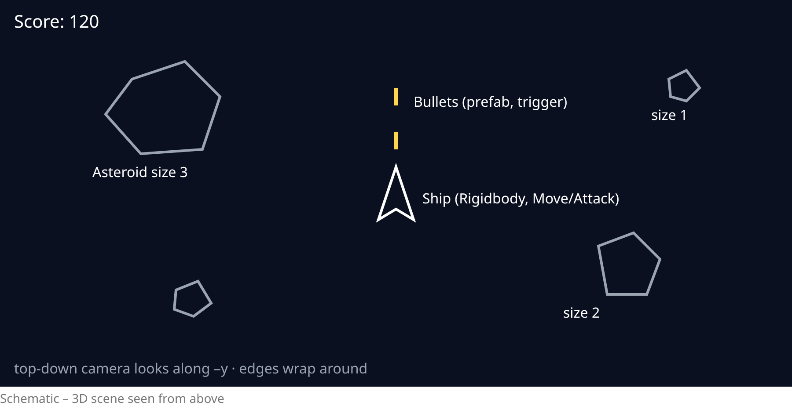

### Prof. Dr. Marko Boger, Prof. Dr. Pascal Laube
## Programmiertechnik I
# Lecture 28: Unity and C# II

<p class="small">Unity 6.3 LTS · properties, delegates, events · main game: Asteroids in 3D</p>

---

<!-- _class: inhalt -->

<style scoped>
section { font-size: 20px; }
</style>

# Goals

In this lecture you will learn

- **properties** in depth – and how they meet Unity's Inspector (`[SerializeField]`)
- **delegates** and **events**: C#'s answer to functions as values and to Scratch's *broadcast*
- the **Input System** with **actions** instead of single keys
- **3D physics**: `Rigidbody`, forces, colliders and triggers
- **prefabs** and `Instantiate` – Unity's clones
- **UI** with TextMeshPro and a game-over screen
- and build **Asteroids** in 3D

---

<!-- _class: kapitel -->

## 1
# More C#

Properties, delegates and events

---

# Properties: Field or Method?

- A **property** is a pair of methods – `get` and `set` – that you use like a field
- Scala does the same: `def x` and `def x_=(v)` – the *uniform access principle*

```csharp
public int Score { get; private set; }     // auto-property: hidden field
public bool IsAlive => Health > 0;          // computed, read-only
public string Name { get; init; } = "";    // set once at creation
```

- Outside code writes `p.Score`, not `p.GetScore()` – but the class keeps control
- Turning a public field into a property later changes the compiled interface → start with properties in plain C#

---

# Properties with Validation

```csharp
int health = 100;                 // backing field

public int Health
{
    get => health;
    set => health = Math.Clamp(value, 0, 100);
}
```

- `value` is the implicit parameter of the setter
- `p.Health = 150;` → `100` · `p.Health -= 200;` → `0` – the invariant always holds
- Typical uses: validation, change notification, lazy computation

```text
Ada 100 10 True        // dotnet run of Player.cs from Lecture 27
```

---

# Properties in Unity

```csharp
using UnityEngine;
public class Health : MonoBehaviour
{
    [SerializeField] int maxHealth = 3;   // Inspector shows it, other scripts don't
    int current;
    public int Current => current;
    public bool IsDead => current <= 0;
    void Awake() => current = maxHealth;
    public void Damage(int amount) => current = Mathf.Max(0, current - amount);
}
```

- The Inspector shows **fields**, not properties – public fields or `[SerializeField]` private ones
- `[SerializeField]` = *designers may tune it, other scripts may not touch it*
- Expose state to other scripts via **read-only properties** (`=>`)
- Common Unity style: `public float speed` for quick tuning, `[SerializeField]` + property for clean code

---

# Delegates: Functions as Values

```csharp
Func<int, int> twice = x => 2 * x;        // Scala: val twice: Int => Int
Action<string> log = s => Console.WriteLine(s);   // returns nothing (Unit)
Func<int, int, int> add = (a, b) => a + b;

log($"{twice(21)} {add(2, 3)}");           // 42 5

int Apply(Func<int, int> f, int x) => f(x);       // higher-order method
log($"{Apply(twice, 5)}");                 // 10
```

- A **delegate** type describes a method signature; `Func` and `Action` are predefined generic delegates
- Delegates can hold **several** methods: `log += other;` – all are called

---

# Events

```csharp
using System;
public class ScoreBoard
{
    public event Action<int>? ScoreChanged;
    public int Score { get; private set; }
    public void Add(int points)
    {
        Score += points;
        ScoreChanged?.Invoke(Score);
    }
}
```

- `event` = a delegate that **only the owning class can invoke**; others may only `+=` and `-=`
- `?.Invoke`: call only if somebody has subscribed – otherwise the event is `null`

---

# Using an Event

```csharp
var board = new ScoreBoard();
Action<int> show = score => Console.WriteLine($"Score: {score}");

board.ScoreChanged += show;      // subscribe
board.Add(10);                   // Score: 10
board.Add(5);                    // Score: 15
board.ScoreChanged -= show;      // unsubscribe
board.Add(1);                    // (silent)
Console.WriteLine($"final {board.Score}");   // final 16
```

- The board does not know **who** listens – the UI, the sound, an achievement system
- Forgetting `-=` keeps listeners alive (no GC) and calls them on destroyed objects

---

# Events = Scratch's Broadcast

| Scratch | C# |
|---|---|
| *broadcast* `game over` | `GameOver?.Invoke();` |
| *when I receive* `game over` | `manager.GameOver += OnGameOver;` |
| message name (a string) | event member – checked by the **compiler** |
| no data | parameters: `Action<int>` passes the score |

- The **Observer** pattern: a subject notifies its observers without knowing them
- Compare Lecture 23/24: callbacks and event handlers in the browser
- Unity also has `UnityEvent`: events wired up in the **Inspector** (e.g. the *On Click* of a button)

---

<!-- _class: kapitel -->

## 2
# Asteroids in 3D

The main game

---

# The Plan



- 3D objects, played on the **x/z plane**, camera looks straight down

---

# Setting Up the Scene

- New project from the **Universal 3D** template, scene `Asteroids`
- Camera: position `(0, 20, 0)`, rotation `(90, 0, 0)` – looking down on the x/z plane
- **Ship**: a 3D model or a stretched *Cube*; **Rigidbody** with *Use Gravity* off, *Linear Damping* ~0.5
  - *Constraints*: freeze position **y**, freeze rotation **x** and **z** – it stays on the plane
- **Asteroid**: a *Sphere*, Rigidbody without gravity, Sphere Collider
- **Bullet**: a small *Sphere* with Sphere Collider **Is Trigger** and a Rigidbody
- Scripts: `Ship`, `ScreenWrap`, `Shooter`, `Bullet`, `Asteroid`, `Spawner`, `GameManager`, `ScoreText`, `GameOverScreen`

---

# Who Does What?

<style scoped>
table { font-size: 0.82em; }
</style>

| GameObject | Components | Responsibility |
|---|---|---|
| Ship | Rigidbody, Collider, `Ship`, `Shooter`, `ScreenWrap` | fly, shoot, die |
| Bullet (prefab) | Rigidbody, trigger Collider, `Bullet` | fly, hit, disappear |
| Asteroid (prefab) | Rigidbody, Collider, `Asteroid`, `ScreenWrap` | drift, split |
| Spawner | `Spawner` | create new asteroids |
| GameManager | `GameManager` | score, game over – **events** |
| Canvas | TMP text + `ScoreText`, panel + `GameOverScreen` | show state |

- Each script does **one** thing – single responsibility, as in Lecture 16
- `ScreenWrap` is reused by ship and asteroids – composition at work

---

<!-- _class: kapitel -->

## 3
# Movement

Input actions and forces

---

# Input Actions

- The Input System package ships a project-wide asset **`InputSystem_Actions`**
- Its *Player* map contains **Move** (WASD, arrows, gamepad stick), **Look**, **Jump**, **Attack** (left mouse button, gamepad button), …
- *Edit → Project Settings → Input System Package* shows the project-wide actions
- An **action** separates *what* (Move, Attack) from *how* (key, stick, touch)

```csharp
InputAction move = InputSystem.actions.FindAction("Move");
Vector2 input = move.ReadValue<Vector2>();     // x = left/right, y = up/down
bool fire = InputSystem.actions.FindAction("Attack").WasPressedThisFrame();
```

- Look the action up **once** (`Start`), read it every frame

---

# The Ship

```csharp
using UnityEngine;
using UnityEngine.InputSystem;
public class Ship : MonoBehaviour
{
    public float thrust = 10f, turn = 180f;
    InputAction move;
    Rigidbody rb;
    void Start()
    {
        rb = GetComponent<Rigidbody>();
        move = InputSystem.actions.FindAction("Move");
    }
    void FixedUpdate()
    {
        Vector2 input = move.ReadValue<Vector2>();
        rb.AddForce(transform.forward * input.y * thrust);
        Quaternion delta = Quaternion.Euler(0, input.x * turn * Time.fixedDeltaTime, 0);
        rb.MoveRotation(rb.rotation * delta);
    }
```

---

# Forces Instead of Positions

- `AddForce`: push the rigidbody – it **accelerates** and keeps drifting (inertia!)
- `Linear Damping` slowly brings it to rest – the feel of the original game
- `MoveRotation`: turn via the physics engine, so collisions stay correct
- `Time.fixedDeltaTime`: duration of one physics step (default 0.02 s)
- `transform.forward`: the direction the ship's nose points to (local z axis)
- Pong set the velocity directly; Asteroids uses **forces** – both are fine, depending on the feel you want

---

# Screen Wrap

```csharp
using UnityEngine;
public class ScreenWrap : MonoBehaviour
{
    void Update()
    {
        Vector3 v = Camera.main.WorldToViewportPoint(transform.position);
        if (v.x < 0 || v.x > 1 || v.y < 0 || v.y > 1)
        {
            v.x = Mathf.Repeat(v.x, 1f);
            v.y = Mathf.Repeat(v.y, 1f);
            transform.position = Camera.main.ViewportToWorldPoint(v);
        }
    }
}
```

- Viewport coordinates: `(0,0)` bottom left, `(1,1)` top right – independent of resolution
- `Mathf.Repeat(1.02f, 1f)` → `0.02f`: leaving on the right means entering on the left
- Works for ship **and** asteroids – just add the component

---

<!-- _class: kapitel -->

## 4
# Shooting

Prefabs and Instantiate

---

# Prefabs

- A **prefab** is a GameObject saved as an **asset** – a template with all its components
- Create: drag a GameObject from the Hierarchy into the Project window → blue icon
- Edit the prefab once → all instances change
- `Instantiate(prefab, position, rotation)` creates a copy at runtime
- `Destroy(obj)` removes it again; `Destroy(obj, 1.5f)` after 1.5 seconds

| Scratch | Unity |
|---|---|
| *create clone of myself* | `Instantiate(prefab, …)` |
| *when I start as a clone* | `Start()` of the instance |
| *delete this clone* | `Destroy(gameObject)` |

---

# The Shooter

```csharp
using UnityEngine;
using UnityEngine.InputSystem;
public class Shooter : MonoBehaviour
{
    public Rigidbody bulletPrefab;
    public float bulletSpeed = 20f;
    InputAction attack;
    void Start() => attack = InputSystem.actions.FindAction("Attack");
    void Update()
    {
        if (!attack.WasPressedThisFrame()) return;
        Rigidbody b = Instantiate(bulletPrefab, transform.position, transform.rotation);
        b.linearVelocity = transform.forward * bulletSpeed;
    }
}
```

- `public Rigidbody bulletPrefab`: drag the bullet prefab into this slot in the Inspector
- The generic `Instantiate<T>` returns the **same type** – no cast needed
- `Update`, not `FixedUpdate`: `WasPressedThisFrame` is about **frames**

---

# The Bullet

```csharp
using UnityEngine;
public class Bullet : MonoBehaviour
{
    public float lifetime = 1.5f;
    void Start() => Destroy(gameObject, lifetime);
    void OnTriggerEnter(Collider other)
    {
        if (other.TryGetComponent(out Asteroid asteroid))
        {
            asteroid.Hit();
            Destroy(gameObject);
        }
    }
}
```

- `Destroy(gameObject, lifetime)` – no bullets flying forever (and no memory leak)
- `TryGetComponent(out Asteroid asteroid)`: like a pattern match `case a: Asteroid =>`
- A trigger needs a **Rigidbody** on at least one of the two objects

---

<!-- _class: kapitel -->

## 5
# Asteroids and Collisions

Spawning, splitting, crashing

---

# The Spawner

```csharp
using UnityEngine;
public class Spawner : MonoBehaviour
{
    public Asteroid asteroidPrefab;
    public float interval = 3f, radius = 12f;
    float timer;
    void Update()
    {
        timer += Time.deltaTime;
        if (timer < interval) return;
        timer = 0;
        Vector2 p = Random.insideUnitCircle.normalized * radius;
        Instantiate(asteroidPrefab, new Vector3(p.x, 0, p.y), Quaternion.identity);
    }
}
```

- A simple **timer** with `Time.deltaTime` – Scratch's *wait 3 seconds*, without blocking
- `insideUnitCircle.normalized * radius`: a random point on a circle around the centre
- `Quaternion.identity` = no rotation

---

# The Asteroid

```csharp
using UnityEngine;
public class Asteroid : MonoBehaviour
{
    public int size = 3;              // 3 = big, 1 = small
    public float speed = 2f;
    void Start()
    {
        Rigidbody rb = GetComponent<Rigidbody>();
        Vector2 dir = Random.insideUnitCircle.normalized;
        rb.linearVelocity = new Vector3(dir.x, 0, dir.y) * speed;
        rb.angularVelocity = Random.insideUnitSphere;
    }
```

- `insideUnitCircle` gives a 2D direction; we map it to x/z – `y` stays `0`
- `angularVelocity`: let it tumble – it's 3D after all

---

# Splitting

```csharp
    public void Hit()
    {
        GameManager.Instance.AddScore(10 * (4 - size));
        if (size > 1)
        {
            for (int i = 0; i < 2; i++)
            {
                Asteroid child = Instantiate(this, transform.position, Random.rotation);
                child.size = size - 1;
                child.transform.localScale = transform.localScale * 0.6f;
            }
        }
        Destroy(gameObject);
    }
}
```

- `Instantiate(this, …)` clones the **asteroid itself** – including the current `size`
- Big → 2 medium → 4 small: 10, 20, 30 points

---

# The Ship Crashes

```csharp
    void OnCollisionEnter(Collision collision)
    {
        if (collision.gameObject.TryGetComponent(out Asteroid _))
        {
            GameManager.Instance.ShipDestroyed();
            Destroy(gameObject);
        }
    }
}
```

- `OnCollisionEnter` (3D) receives a `Collision`, `OnTriggerEnter` a `Collider`
- The ship does not know the UI – it only reports to the `GameManager`

| | Collision | Trigger |
|---|---|---|
| physical bounce | yes | no |
| callback | `OnCollisionEnter(Collision)` | `OnTriggerEnter(Collider)` |

---

<!-- _class: kapitel -->

## 6
# Score and Game Over

Events connect the game

---

# The Game Manager

```csharp
using System;
using UnityEngine;
public class GameManager : MonoBehaviour
{
    public static GameManager Instance { get; private set; }
    public event Action<int> ScoreChanged;
    public event Action GameOver;
    public int Score { get; private set; }
    void Awake() => Instance = this;
    public void AddScore(int points)
    {
        Score += points;
        ScoreChanged?.Invoke(Score);
    }
    public void ShipDestroyed() => GameOver?.Invoke();
}
```

- `static Instance`: one reachable manager – a simple **singleton** (Scala: `object`)
- Two **events**: score changed, game over – the manager does not know who listens

---

# Score on Screen

```csharp
using TMPro;
using UnityEngine;
public class ScoreText : MonoBehaviour
{
    public TMP_Text label;
    void Start()     => GameManager.Instance.ScoreChanged += Show;
    void OnDestroy() => GameManager.Instance.ScoreChanged -= Show;
    void Show(int score) => label.text = $"Score: {score}";
}
```

- *GameObject → UI → Text – TextMeshPro* creates a Canvas with a text; TMP is part of Unity's UI package
- Subscribe in `Start` (the manager is set in `Awake`, which runs before), unsubscribe in `OnDestroy`

---

# Game Over

```csharp
using UnityEngine;
using UnityEngine.InputSystem;
using UnityEngine.SceneManagement;
public class GameOverScreen : MonoBehaviour
{
    public GameObject panel;          // hidden UI panel "Game Over"
    void Start() => GameManager.Instance.GameOver += () => panel.SetActive(true);
    void Update()
    {
        if (panel.activeSelf && Keyboard.current.rKey.wasPressedThisFrame)
            SceneManager.LoadScene(SceneManager.GetActiveScene().buildIndex);
    }
}
```

- The lambda `() => panel.SetActive(true)` is the event handler
- `SceneManager.LoadScene` restarts the scene – the scene must be in the build's scene list

---

# The Event Flow

```text
Bullet ──OnTriggerEnter──▶ Asteroid.Hit()
                              │ AddScore(10)
                              ▼
                         GameManager ──ScoreChanged(int)──▶ ScoreText
                              ▲
Ship ──OnCollisionEnter──▶ ShipDestroyed()
                              │
                              └──────────GameOver──────────▶ GameOverScreen
```

- Physics callbacks start the chain; **events** spread the news
- Add sound or achievements later: subscribe, without touching existing classes (open/closed)

---

# Debugging

- `Debug.Log($"hit {name} size {size}")` → Console; `Debug.DrawRay` draws lines in the Scene view
- **Pause** + step frame by frame, inspect values in the Inspector while playing
- Errors in the Console: `NullReferenceException` → an Inspector slot is empty (*None*)?
- Collisions do not fire? Check: both colliders, at least one **Rigidbody**, *Is Trigger* as intended, correct method name and parameter type
- Attach the debugger: VS Code or Rider → *Attach to Unity*, set breakpoints

---

# Building the Game

- *File → Build Profiles*: choose a platform (Windows, macOS, Linux, Web, …)
- Add the scenes to the **scene list** – index 0 starts first
- *Player Settings*: name, icon, resolution
- **Build** creates a stand-alone game; **Build And Run** starts it immediately
- Web builds run in the browser – ideal to share your project

---

# From Scala to C# to Unity

<style scoped>
table { font-size: 0.82em; }
</style>

| Idea | Scala (this course) | C# / Unity |
|---|---|---|
| Objects with state | classes, case classes | classes, `MonoBehaviour` components |
| Abstraction | traits | interfaces, abstract classes |
| Composition | mixins (Lecture 17) | components on GameObjects |
| Functions as values | `Int => Int` | `Func<int,int>`, delegates |
| Notification | callbacks (Lecture 23/24) | `event`, `UnityEvent` |
| Absent values | `Option` | `null`, `TryGetComponent` |
| Many from one | `copy` | prefab + `Instantiate` |

---

<!-- _class: inhalt -->

<style scoped>
section { font-size: 20px; }
</style>

# Summary

- **Properties**: field syntax, method control; Unity's Inspector shows fields – use `[SerializeField]`
- **Delegates** (`Func`, `Action`) are function values; **events** let only the owner invoke them
- Events are Scratch's *broadcast* with type checking – the Observer pattern
- **Input actions** (`Move`, `Attack`) decouple controls from keys
- 3D physics: `AddForce`, constraints, collisions vs. triggers
- **Prefabs** + `Instantiate` / `Destroy` = Scratch's clones
- A `GameManager` with events connects gameplay and UI
- Asteroids in 3D: ship, bullets, splitting asteroids, score, game over

---

<!-- _class: aufgabe -->

# Task

- Build Asteroids from this lecture in a *Universal 3D* project under git
- Give the ship three lives with the `Health` component; show them on screen
- Add a sound on every hit – subscribe to an event instead of changing `Asteroid`
- Make the spawner faster over time
- Bonus: a high score saved with `PlayerPrefs`
- Bonus: a web build, shared with your fellow students

---

<!-- _class: abschluss -->

# Questions?

## Thank you!

marko.boger@htwg-konstanz.de
