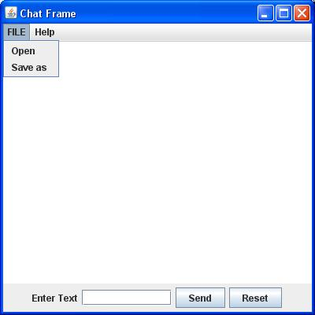
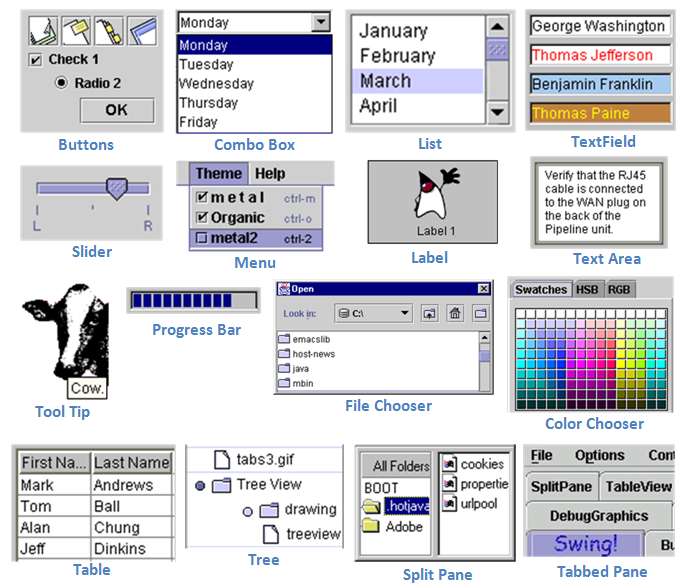
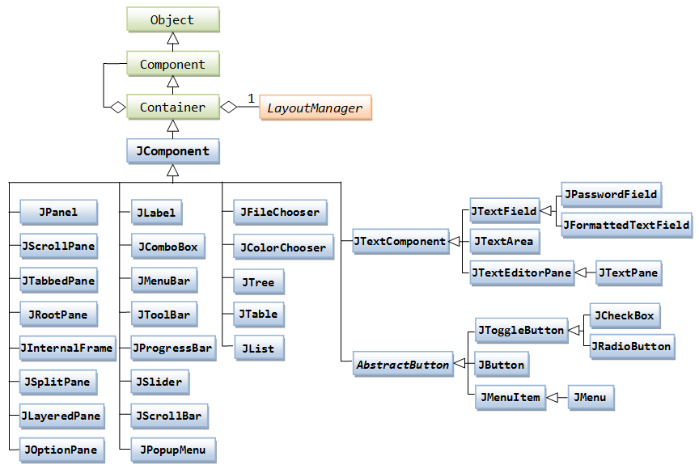
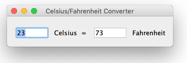
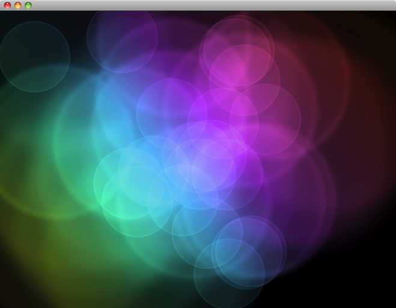
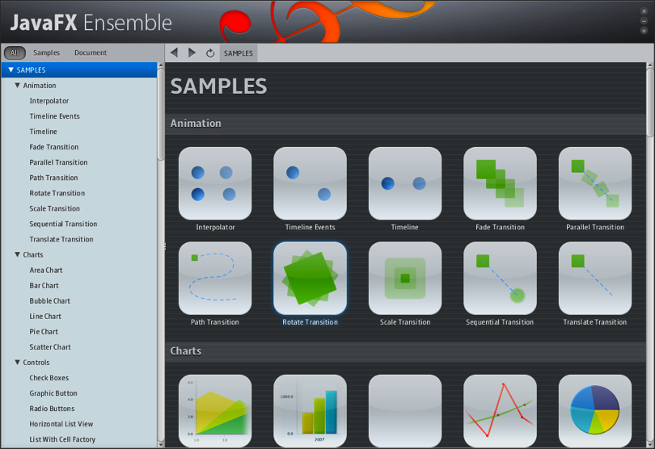
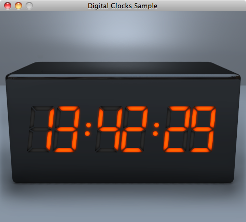
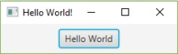
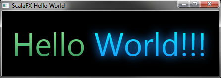
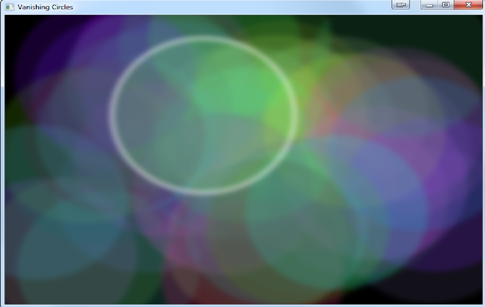

### Prof. Dr. Marko Boger
## Software Engineering
# Lecture 09: GUI Libraries

---

# Libraries

<style scoped>
section { font-size: 22px; }
</style>

- Scala has a number of mechanisms that allow to create simpler APIs compared to Java or other OO-languages.
- Sometimes such improved APIs are referred to as internal DSLs.
- We will look at
- the use of parentheses
- anonymous functions
- higher order functions
- anonymous classes
- partial functions
- partially applied functions
- currying
- closures

---

# Use of Parentheses

- Function calls can use `()` or `{}` for parameters

```scala
def f(x: Int) = x + 1               //> f: (x: Int)Int
f(5)                                //> res0: Int = 6
f{5}                                //> res1: Int = 6
```

---

# Anonymous Functions or Function Literals

- Functions can be defined without giving it a name. This is useful for example to pass the function as parameter.
```scala
(x: Int) => x + 1   //> res2: Int => Int = <function1>
```

---

# Higher Order Functions

- Higher Order Functions accept a function as parameter
```scala
def f(x: Int) = x + 1             //> f: (x: Int)Int

numbers.foreach(x: Int => f(x))
```

- foreach is such a higher order function. It is one of the simplest such functions. The disadvantage of foreach is, it returns nothing (Unit). Other higher order functions are map, reduce, fold, filter etc.

---

# Syntactic Sugar

- There are several ways to abbreviate the syntax.
```scala
val numbers = List(1, 2, 3, 4, 5)
               //> numbers  : List[Int] = List(1, 2, 3, 4, 5)
numbers.foreach((x: Int) => print(x))         //> 12345
numbers.foreach((x) => print(x))              //> 12345
numbers.foreach(x => print(x))                //> 12345
numbers.foreach(print(_))                     //> 12345
numbers.foreach(print _)                      //> 12345
numbers.foreach(print)                        //> 12345
numbers foreach print                         //> 12345
```

---

# Higher Order Functions

- Map is a stronger example of a higher order function. It maps from a collection to a collection.
```scala
numbers.map(x => x + 1)  //> res3: List[Int] = List(2, 3, 4, 5, 6)
numbers.map(_ + 1)     //> res4: List[Int] = List(2, 3, 4, 5, 6)
numbers.map(x => f(x))   //> res5: List[Int] = List(2, 3, 4, 5, 6)
numbers.map ( f(_))      //> res6: List[Int] = List(2, 3, 4, 5, 6)
numbers.map(f)        //> res7: List[Int] = List(2, 3, 4, 5, 6)
numbers map f        //> res8: List[Int] = List(2, 3, 4, 5, 6)
```

---

# Chaining Higher Order Functions

- Functions that return a collection can be chained, one after the other.
```scala
List(-10, -5, 0, 5, 10)
   .filter(_ > 0)
   .map(x => x * x)
   .sortWith(_ > _)
   .foreach(println)                           //> 100
                                                 //| 25
List(-10, -5, 0, 5, 10)
   .map(x => x * x)
   .filter(_ > 0)
   .sortWith(_ > _)
   .foreach(println)                           //> 100
                                                 //| 100
                                                 //| 25
                                                 //| 25
```

---

# Anonymous Classes

- An anonymous class seems to be implemented in place.
```scala
val f1 = Foo {
    println("hello from the `f1` instance")
    "this is the result of the block of code"
}
```

- This is achieved by allowing a function as parameter of the constructor
```scala
case class Foo[A, B](f: A => B) {
    // more code here ...
}
```

---

# Closures

- A closed term is a function without free variables

```scala
def f1(x: Int) = x + 1              //> f1: (x: Int)Int
```

- An open term is a function with free variables
```scala
var c = 1                          //> c  : Int = 1
def f2(x: Int) = x + c            //> f2: (x: Int)Int
```

- A closure is the function value of the open term, thus a closure closes the open term at runtime, by capturing the bindings of its free variables

```scala
f2(5)                                  //> res15: Int = 6
c = 10
f2(5)                                  //> res16: Int = 15
```

---

# Currying

- Currying turns a function with multiple arguments into a sequence of functions, each with a single argument.
```scala
def f3(c: Int) = (x: Int) => x + c  //> f3: (c: Int)Int => Int
f3(1)(5)                         //> res17: Int = 6
f3(10)(5)                        //> res18: Int = 15
f3(10) { 5 }                     //> res19: Int = 15
f3(10) {
   val z = 4
   f(z)
 }
```

---

# Partially Applied Functions

- Applying  a curried function to a part of its parameters returns a function with the missing parameters
```scala
def f4 = f3(10)                 //> f4: => Int => Int
f4(5)                          //> res21: Int = 15
```

---

# Putting it together

- A closure, a curried function

```scala
def f5(op:(Int, Int)=>Int) (x:Int, y:Int) = {
  op(x,y)
}      //> f5: (op: (Int, Int) => Int)(x: Int, y: Int)Int
def add(x:Int, y:Int) = x + y   //> add: (x: Int, y: Int)Int
f5(add) (5,1)                 //> res22: Int = 6
```

- A partially applied function

```scala
def f6 = f5(add) _            //> f6: => (Int, Int) => Int
f6(5,1)                       //> res23: Int = 6
```

---

# A practical Example: msort

<style scoped>
pre { font-size: 15px; }
</style>

```scala
def msort[T](less: (T, T) => Boolean)(xs: List[T]): List[T] = {
   def merge(xs: List[T], ys: List[T]): List[T] =
   (xs, ys) match {
     case (Nil, _) => ys
     case (_, Nil) => xs
     case (x :: xs1, y :: ys1) =>
       if (less(x, y)) x :: merge(xs1, ys)
       else y :: merge(xs, ys1)
   }
   val n = xs.length / 2
   if (n == 0) xs
   else {
   val (ys, zs) = xs splitAt n
   merge(msort(less)(ys), msort(less)(zs))
   }
 }       //> msort: [T](less: (T, T) => Boolean)(xs: List[T])List[T]
```

---

# A practical Example: msort

```scala
def intsort = msort((x: Int, y: Int) => x < y) _
                       //> intsort: => List[Int] => List[Int]
intsort(List(9, 2, 5, 7, 3, 8))
                       //> res24: List[Int] = List(2, 3, 5, 7, 8, 9)
def reverseintsort = msort((x: Int, y: Int) => x > y) _
                       //> reverseintsort: => List[Int] => List[Int]
reverseintsort(List(9, 2, 5, 7, 3, 8))
                       //> res25: List[Int] = List(9, 8, 7, 5, 3, 2)
def stringsort = msort((s1: String, s2: String) => s1.length < s2.length) _
                     //> stringsort: => List[String] => List[String]
stringsort(List("coffee", "tee", "beer", "orangejuice"))
      //> res26: List[String] = List(tee, beer, coffee, orangejuice)
```

---

# An even more practical Example

```scala
def sum(list:List[Int]):Int = list match {
   case Nil => 0
   case _ => list.head + sum(list.tail)
 }                         //> sum: (list: List[Int])Int


sum(List(1,2,3,4,5))      //> res27: Int = 15
```

---

# An even more practical Example

```scala
def product(list:List[Int]):Int = list match {
   case Nil => 1
   case _ => list.head * product(list.tail)
 }
                         //> product: (list: List[Int])Int
product(List(1,2,3,4,5))
                         //> res28: Int = 120
```

---

# An even more practical Example

```scala
def sum2(list:List[Int])=list.foldLeft(0)(_+_)
       //> sum2: (list: List[Int])Int
sum2(List(1,2,3,4,5))       //> res29: Int = 15

List(1,2,3,4,5).foldLeft(0)(_+_) //> res30: Int = 15

def product2(list:List[Int])=list.foldLeft(1)(_*_)
                          //> product2: (list: List[Int])Int
product2(List(1,2,3,4,5))  //> res31: Int = 120
List(1,2,3,4,5).foldLeft(1)(_*_) //> res32: Int = 120
```

---

# Conclusion for Closure

- Closures are essentially a way to pre-configure functions
- Functions like sort, fold or reduce make use of it
- Currying allows to separate parameters
- Partially Applied Functions allow to apply one parameter separately
- Together they empower Closures

---

# Partial Functions

- Partial Functions are only defined for parts of its domain.
- For example, taking the square root should only be defined for non-negative numbers.
- It uses the case notation, similar to the match-case.
```scala
val squareRoot: PartialFunction[Double, Double] = {
 case x if x >= 0 => Math.sqrt(x)
}
```

- A partial function has the method `isDefinedAt`

```scala
squareRoot.isDefinedAt(2) shouldEqual true
squareRoot.isDefinedAt(-2) shouldEqual false
```

---

# Libraries

- Libraries can make use of the above mentioned mechanisms and create very powerful and short notations.
- A good example of that is the test library, ScalaTest.
- Libraries that make even more use of these mechanisms are ScalaSwing and ScalaFx.

---

# Swing - A GUI Library

<div class="columns" style="grid-template-columns: 1.2fr 1fr; align-items: start;">
<div>

- Swing is a Java library to create desktop applications.
- It provides components to create buttons, labels, menus etc. in Java.
- It comes with a uniform Java look and feel.

</div>
<div>



</div>
</div>

---

# Swing - A GUI Library

<div style="text-align:center;">



</div>

---

# The Class Hierarchy

<div style="text-align:center;">



</div>

---

# A Swing Example in Java

<style scoped>
pre { font-size: 11px; }
</style>

<div class="columns" style="grid-template-columns: 1.2fr 1fr; align-items: start;">
<div>

```java
class gui {
    public static void main(String args[]) {
        JFrame frame = new JFrame("Chat Frame");
        frame.setDefaultCloseOperation(JFrame.EXIT_ON_CLOSE);
        frame.setSize(400, 400);
        JMenuBar mb = new JMenuBar();
        JMenu m1 = new JMenu("FILE");
        JMenu m2 = new JMenu("Help");
        mb.add(m1);
        mb.add(m2);
        JMenuItem m11 = new JMenuItem("Open");
        JMenuItem m22 = new JMenuItem("Save as");
        m1.add(m11);
        m1.add(m22);
        JPanel panel = new JPanel();
        JLabel label = new JLabel("Enter Text");
        JTextField tf = new JTextField(10);
        JButton send = new JButton("Send");
        JButton reset = new JButton("Reset");
        panel.add(label);
        panel.add(label);
        panel.add(tf);
        panel.add(send);
        panel.add(reset);
        JTextArea ta = new JTextArea();
        frame.getContentPane().add(BorderLayout.SOUTH, panel);
        frame.getContentPane().add(BorderLayout.NORTH, mb);
        frame.getContentPane().add(BorderLayout.CENTER, ta);
        frame.setVisible(true);
    }
}
```

</div>
<div>


</div>
</div>

---

# Scala Swing

- Scala Swing makes Java Swing accessible in Scala. It is a thin layer around Swing, giving full access to Swing functionality with a Scala API.
- While doing that, it simplifies the API considerably. Scala Swing is an excellent example how Scala can make an API much simpler and shorter to use.

---

# Scala Swing Intro

- Scala provides prebuilt classes to get started quickly
- Already provides a main method
- Just implement the top method
```scala
object HelloWorld extends SimpleSwingApplication {
  def top = new MainFrame {
    title = "Hello, World!"
    contents = new Button("Click Me!")
  }
}
```

- MainFrame is a Frame with standard quit action
- Here MainFrame is an anonymous class
  - Inside the curly braces, it can be initialized or implemented

---

# Container API

- Panes and Panel have
- Attributes
  - Text, Title
- Contents
```scala
contents = , contents += , contents ++=
contents.append( <a list of sub components>)
```

  - If the new content is again a Container, this creates a nice nesting
```scala
val frame = new Frame {
    contents = new FlowPanel {
      contents += new Label {
        text = " This is a label "
      }
      contents += new Button {
        text = "press me"
      }
    }
  }
```

---

# Publisher and Reactor

- Every Scala Swing Component is both automatically
- Publisher
  - A text field is publisher of the Event `EditDone`
  - A Button is publisher of the Event `ButtonClicked`
  - A Slider is publisher of the Event `ValueChanged`

- Reactor
```scala
listenTo(textField)
listenTo(button)
listenTo(slider)
reactions += {
        case ButtonClicked(`button`) => …
        case ValueChanged(`slider`) => …
        case SelectionChanged(`tabs`) => …
        case SelectionChanged(`list`) => …
      }
```

---

# Java vs Scala Events

<style scoped>
pre { font-size: 16px; }
</style>

- Java: anonymous Class
```java
new JComponent {
   addMouseListener(new MouseAdapter {
      @Override
      mouseClicked(e: MouseEvent) {
         System.out.println("Mouse clicked at " + e.getPoint)
      }
  })
}
```

- Scala: pattern matching
```scala
new Component {
   listenTo(mouse)
   reactions += {
      case e: MouseClicked =>
         println("Mouse clicked at " + e.point)
   }
}
```

---

# Menus

- Menus are added to the property menubar
```scala
menuBar = new MenuBar {
    contents += new Menu("File") {
      mnemonic = Key.F
      contents += new MenuItem(Action("New") { controller.newGrid })
      contents += new MenuItem(Action("Quit") { System.exit(0) })
    }
}
```

---

# Scala Swing Example

<style scoped>
pre { font-size: 11px; }
</style>

<div class="columns" style="grid-template-columns: 1.2fr 1fr; align-items: start;">
<div>

```scala
import swing._
import event._

object TempConverter extends SimpleSwingApplication {
 def top = new MainFrame {
   title = "Celsius/Fahrenheit Converter"
   object celsius extends TextField { columns = 5 }
   object fahrenheit extends TextField { columns = 5 }
   contents = new FlowPanel {
     contents += celsius
     contents += new Label(" Celsius  =  ")
     contents += fahrenheit
     contents += new Label(" Fahrenheit")
     border = Swing.EmptyBorder(15, 10, 10, 10)
   }
   listenTo(celsius, fahrenheit)
   reactions += {
     case EditDone(`fahrenheit`) =>
       val f = fahrenheit.text.toInt
       val c = (f - 32) * 5 / 9
       celsius.text = c.toString
     case EditDone(`celsius`) =>
       val c = celsius.text.toInt
       val f = c * 9 / 5 + 32
       fahrenheit.text = f.toString
   }
 }
}
```

</div>
<div>



</div>
</div>

---

# JavaFX

<div class="columns" style="grid-template-columns: 1.2fr 1fr; align-items: start;">
<div>

- JavaFX is a Java library to - also - create desktop applications.
- It is a more modern approach compared to Swing.
- It was intended as a replacement to Swing, providing animation, video, charts, HTML integration, hardware acceleration etc.
- The central abstractions are Stage and Scene.

</div>
<div>







</div>
</div>

---

# An example Application in JavaFX

<style scoped>
pre { font-size: 12px; }
</style>

<div class="columns" style="grid-template-columns: 1.2fr 1fr; align-items: start;">
<div>

```java
public class JavaFxTuts extends Application {
    @Override public void init(){}

    @Override
    public void start(Stage primaryStage) {
        final Button button = new Button();
        button.setText("Hello World");
        button.setOnAction((ActionEvent event) -> {
            System.out.println("Hello World!");
        });
        final StackPane root = new StackPane();
        root.getChildren().add(button);
        final Scene scene = new Scene(root, 300, 250);
        primaryStage.setTitle("Hello World!");
        primaryStage.setScene(scene);
        primaryStage.show();
    }
    @Override public void stop(){}

    public static void main(final String[] arguments) {
        launch(arguments);
    }
}
```

</div>
<div>



</div>
</div>

---

# Scala FX

- ScalaFX is a UI DSL written within the Scala Language that sits on top of JavaFX 2.
- Again, ScalaFX achieves a much simpler and shorter API, making it easier to write and to read.

---

# ScalaFX

<style scoped>
pre { font-size: 11px; }
</style>

<div class="columns" style="grid-template-columns: 1.2fr 1fr; align-items: start;">
<div>

```scala
object ScalaFXHelloWorld extends JFXApp {

 stage = new PrimaryStage {
   title = "ScalaFX Hello World"
   scene = new Scene {
     fill = Black
     content = new HBox {
       padding = Insets(20)
       children = Seq(
         new Text {
           text = "Hello "
           style = "-fx-font-size: 48pt"
           fill = new LinearGradient(
             endX = 0,
             stops = Stops(PaleGreen, SeaGreen))
         },
         new Text {
           text = "World!!!"
           style = "-fx-font-size: 48pt"
           fill = new LinearGradient(
             endX = 0,
             stops = Stops(Cyan, DodgerBlue)
           )
           effect = new DropShadow {
             color = DodgerBlue
             radius = 25
             spread = 0.25
           }
         }
       )
     }
   }
 }
}
```

</div>
<div>



</div>
</div>

---

# An Example: Vanishing Cirlcles

<div style="text-align:center;">



</div>

---

# Java vs. Scala DSL

<style scoped>
pre { font-size: 9px; }
section { padding-top: 20px; }
</style>

<div class="columns" style="grid-template-columns: 1.15fr 1fr; gap: 12px;">
<div>

```java
public class VanishingCircles extends Application {

  public static void main(String[] args) {
    Application.launch(args);
  }

  @Override
  public void start(Stage primaryStage) {
    primaryStage.setTitle("Vanishing Circles");
    Group root = new Group();
    Scene scene = new Scene(root, 800, 600, Color.BLACK);
    List<Circle> circles = new ArrayList<Circle>();
    for (int i = 0; i < 50; i++) {
      final Circle circle = new Circle(150);
      circle.setCenterX(Math.random() * 800);
      circle.setCenterY(Math.random() * 600);
      circle.setFill(new Color(Math.random(), Math.random(), Math.random(), .2));
      circle.setEffect(new BoxBlur(10, 10, 3));
      circle.addEventHandler(MouseEvent.MOUSE_CLICKED, new EventHandler<MouseEvent>() {
        public void handle(MouseEvent t) {
          KeyValue collapse = new KeyValue(circle.radiusProperty(), 0);
          new Timeline(new KeyFrame(Duration.seconds(3), collapse)).play();
        }
      });
      circle.setStroke(Color.WHITE);
      circle.strokeWidthProperty().bind(Bindings.when(circle.hoverProperty())
        .then(4)
        .otherwise(0));
      circles.add(circle);
    }
    root.getChildren().addAll(circles);
    primaryStage.setScene(scene);
    primaryStage.show();

    Timeline moveCircles = new Timeline();
    for (Circle circle : circles) {
      KeyValue moveX = new KeyValue(circle.centerXProperty(), Math.random() * 800);
      KeyValue moveY = new KeyValue(circle.centerYProperty(), Math.random() * 600);
      moveCircles.getKeyFrames().add(new KeyFrame(Duration.seconds(40), moveX, moveY));
    }
    moveCircles.play();
  }
}
```

**40 Lines, 1299 Characters**

</div>
<div>

```java
object VanishingCircles extends JFXApp {
  var circles: Seq[Circle] = null
  stage = new Stage {
    title = "Vanishing Circles"
    width = 800
    height = 600
    scene = new Scene {
      fill = BLACK
      circles = for (i <- 0 until 50) yield new Circle {
        centerX = random * 800
        centerY = random * 600
        radius = 150
        fill = color(random, random, random, .2)
        effect = new BoxBlur(10, 10, 3)
        strokeWidth <== when (hover) then 4 otherwise 0
        stroke = WHITE
        onMouseClicked = {
          Timeline(at (3 s) {radius -> 0}).play()
        }
      }
      content = circles
    }
  }

  new Timeline {
    cycleCount = INDEFINITE
    autoReverse = true
    keyFrames = for (circle <- circles) yield at (40 s) {
      Set(
        circle.centerX -> random * stage.width,
        circle.centerY -> random * stage.height
      )
    }
  }.play();
}
```

**33 Lines, 591 Characters**

</div>
</div>

---

<!-- _class: aufgabe -->

# Task 9: Build a Graphical UI

- Build a GUI for your application.
- You can use either ScalaSwing or ScalaFX.
- GUI and TUI must operate together. For this to work, the TUI has to be Event-based. Both TUI and GUI need to be Observers of the controller.

---

# Documentation

- Scala Swing
  - <https://github.com/scala/scala-swing>
  - [Scala Swing design document (PDF)](https://www.scala-lang.org/old/sites/default/files/sids/imaier/Mon,%202009-11-02,%2008:55/scala-swing-design.pdf)


- ScalaFX
  - <http://www.scalafx.org/>

---

<!-- _class: abschluss -->

# Questions?

## Thank you!

marko.boger@htwg-konstanz.de
