### Prof. Dr. Marko Boger
## Software Engineering
# Lecture 10: Components

---

# Definitions of Software Architecture

- Software Architecture is the structure of the components of a program/system, their interrelationships, and principles and guidelines governing their design and evolution over time.
  - Garlan and Perry, 1995
- The software architecture of a program or computing system is the structure or structures of the system, which comprise software components, the externally visible properties of those elements, and the relationships among them.
  - From Software Architecture in Practice (2nd ed.): Bass, Clements, Kazman; Addison-Wesley 2003
- Architecture is [..] the fundamental organization of a system, embodied in its components, their relationships to each other and the environment, and the principles governing its design and evolution.
  - From ANSI/IEEE Standard 1471-2000

---

# What are Components

- A software component is a software element, that conforms to a component model and can be composed with other components  according to a composition standard and executed without changes

---

# The Metaphor

- Components are like parts of a prefabricated house
  - Clear dependencies
  - Build them up from bottom to top
  - Connect them in a simple, fast and reliable way
  - Reuse them in different contexts
  - Reduce development cost and time
  - Reduce complexity
- Components are even better than parts of prefabricated houses
  - We want to be able to replace components with a better or adapted version at any later time

---

# The Counterpart Metaphor

- Components need to be composable and decomposable
- In construction the decomposition is not as important
  - So often there are huge interdependencies
  - In Software these would be entanglements

---

# Components in Java

- So, how do we define a component in Java?
  - Does the language provide a keyword?
  - Does the language provide a different construct or concept?

---

# Components vs Packages

- Components should be
  - Modular
  - Cohesive
  - Reusable
  - Replaceable

- Packages do not have to be
  - Modular
  - Cohesive
  - Reusable
  - Replaceable
- But they can be!

- Packages
  - Organizes Types into namespaces
  - Grouped by
    - Category or
    - Functionality

---

# Components in Java

- There is no keyword for Components in Java
- In fact it is hard to see a Component in Java
- We need a higher level of abstraction to see and argue about Components
- Let's look at UML

---

# Component Diagram

- UML 2 has a diagram type for Components
- Components can
  - have Ports
  - provide Interfaces
  - require Interfaces

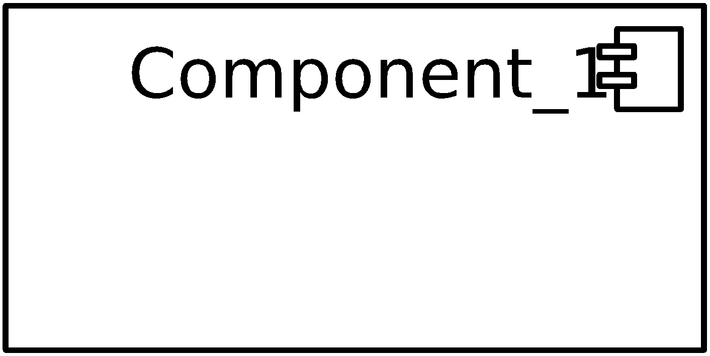

---

# Component Diagram

- Class Diagram

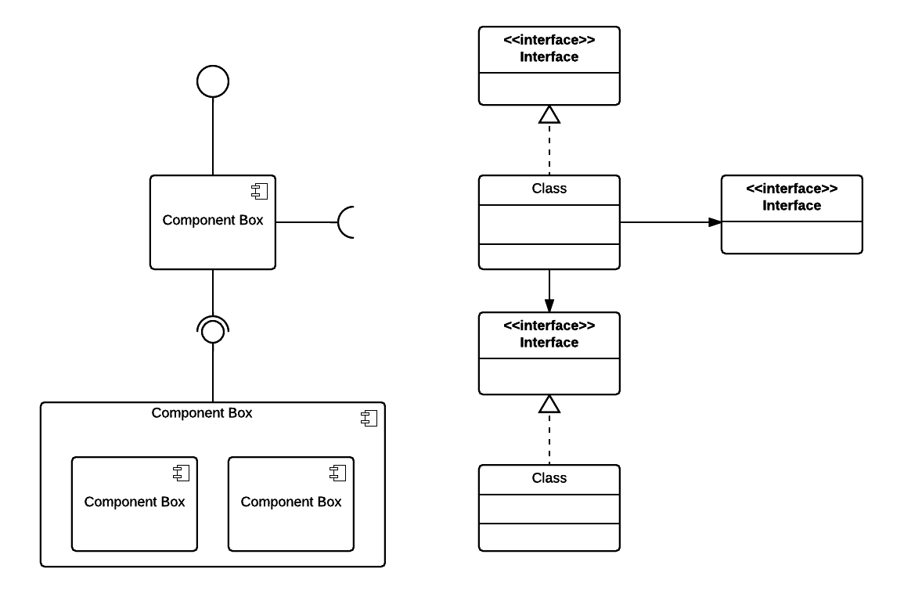

---

# Ports

- A Port is a distinct interaction point of the component
- It is implemented by a Class
  - Port classes are public, all other should be package-private
  - often using a Facade Pattern
- The Port Class
  - provides Interfaces to the outside or
  - funnels requests from within to the outside
- The Ports encapsulate the component

---

# The Current Situation

- We want to introduce Interfaces
- If we extract the Interface by refactoring „extract Interface“
  - All dependencies to Grid and Cell are through Interfaces
- This is not quite what we wanted

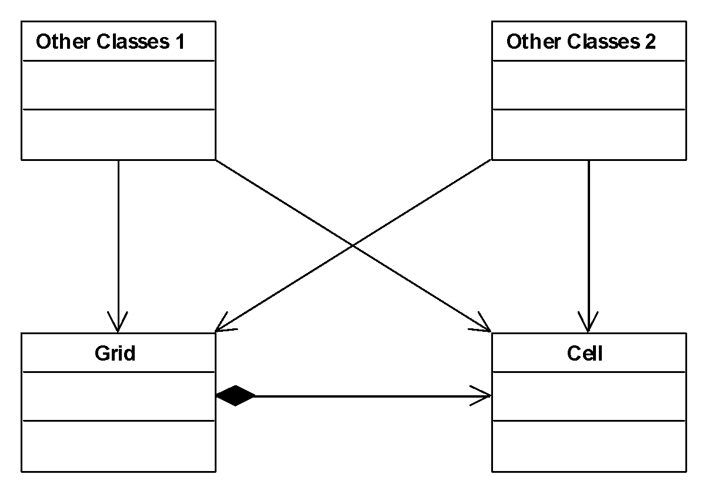

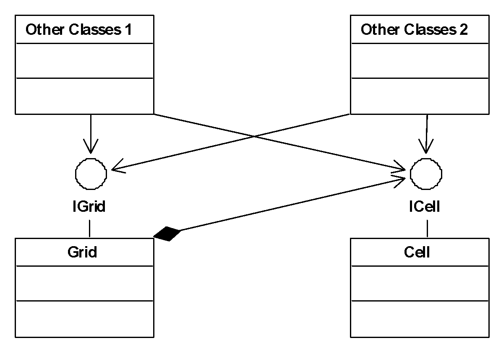

---

# What we want

- A Component
  - Stable to the outside
  - Flexible to the inside
  - With a minimal Interface

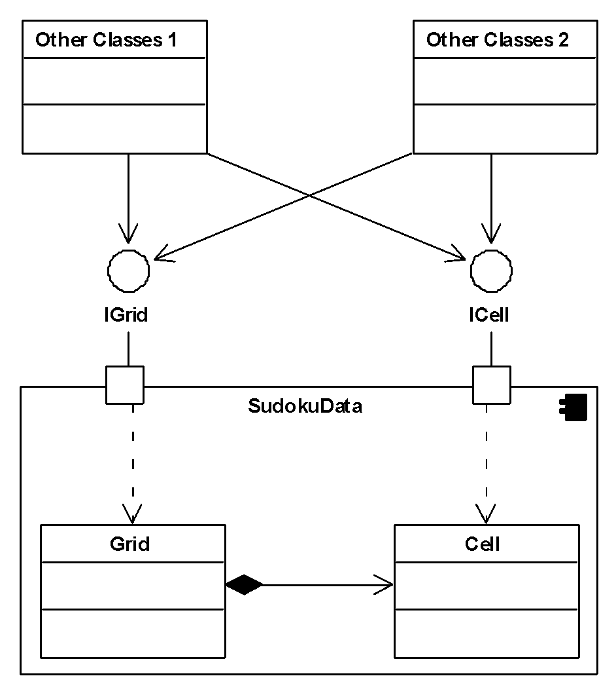

---

# Starting Point

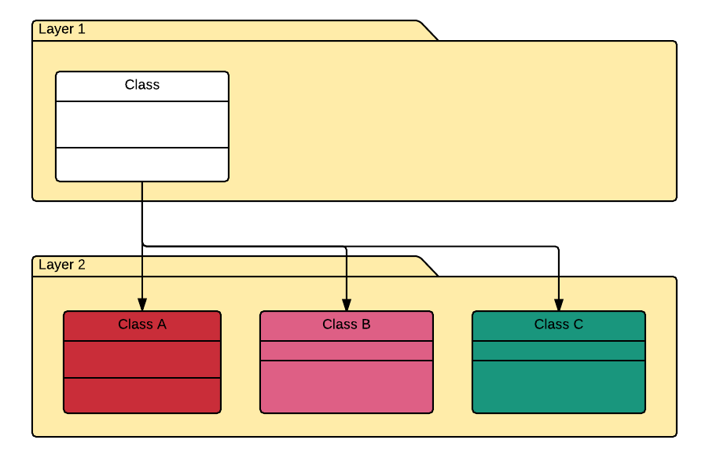

---

# Interfaces

- Interfaces provide a stable connection point to a higher layer
- Interfaces need to remain stable
- The implementation underneath may change
- Dependency Inversion Principle

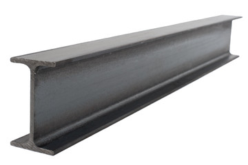

---

# Interfaces

- A key mechanism for components is to separate them with Interfaces.
  - Every access or interaction between components must be done through an interface
  - The interfaces should be small and tailored to different users
    - Interface Segregation Principle
  - The interface encapsulates units of code that could be replaced by a different version later on
  - The interface of the component will have to remain stable, so make them clean, clear  and concise
  - Interfaces should be documented very well

---

# Introducing Interfaces

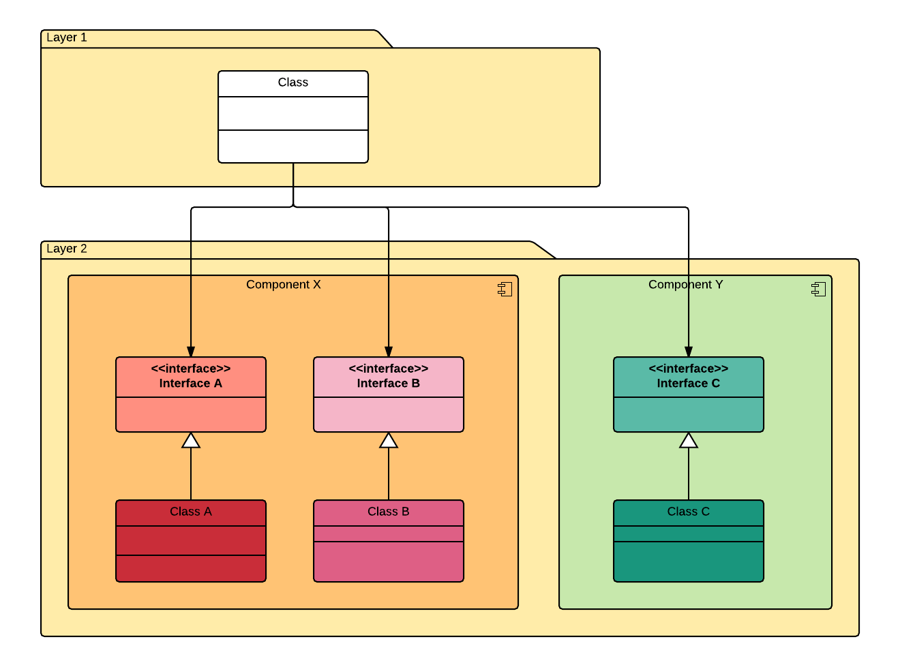

---

# Component Structure

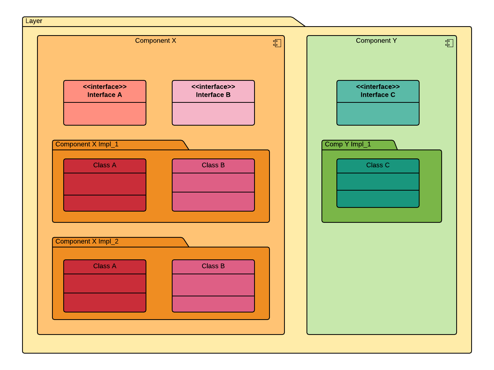

---

# Endpoint

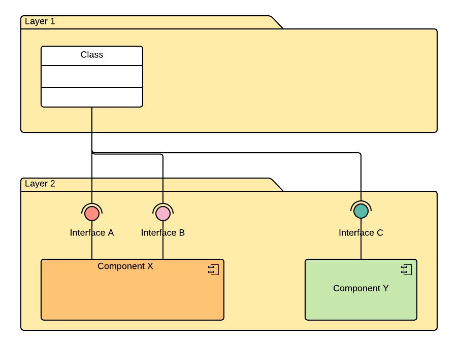

---

# From Start to End

- Direct dependency on implementation

- Dependency only to Abstractions
- Implementation can change

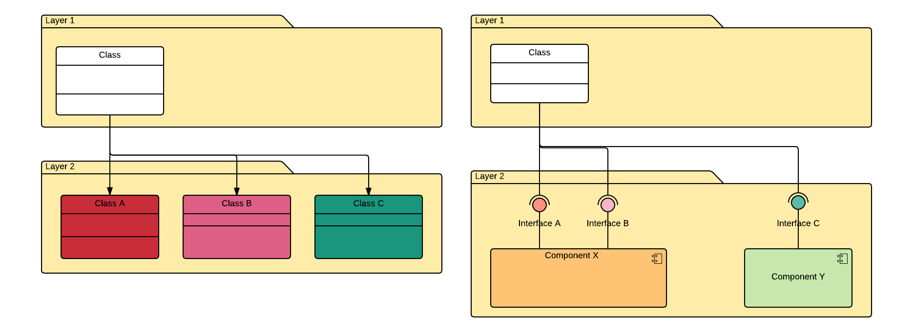

---

# How to Cut the Components

- Contain Cohesion into Components
- Allow orchestration of Components
- Minimize communication between Components
- Minimize dependencies between Components
- Layer Components
- Use Components inside Components
- Make Components testable

---

# Testing Components

- Isolate the component from its dependencies using Test Doubles

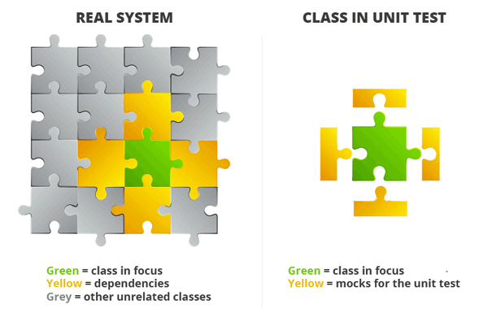

---

# Test Doubles

- Components can be simulated during testing using Test Doubles
- Dummies have no implementation, but compile
- Stubs return a hard coded response
- Spies count the number of calls
- Fakes are implementations, but
- not the real thing
- Mocks are simulations of an
- implementation

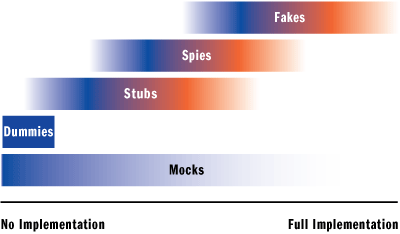

---

<!-- _class: aufgabe -->

# Task 10: Introduce Interfaces and Components

- Cut your application into Components
- Encapsulate every Component with Interfaces
- Make sure only the Interfaces are accessed
- Cut all access to the inner workings of the Component

---

<!-- _class: abschluss -->

# Questions?

## Thank you!

marko.boger@htwg-konstanz.de
