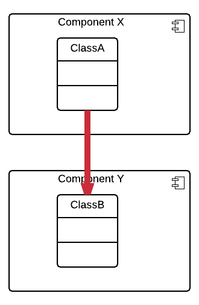
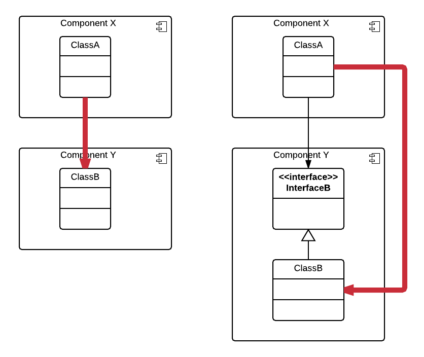
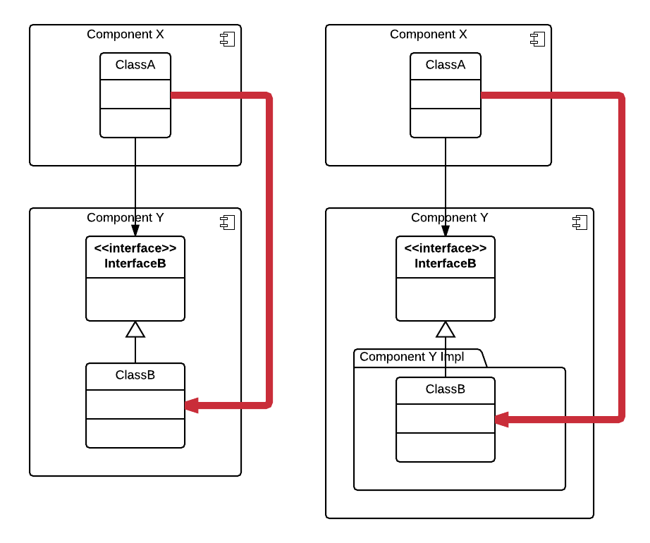
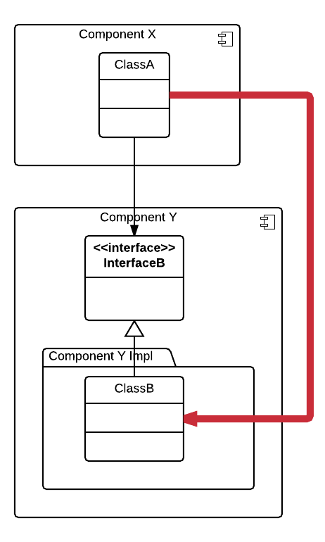
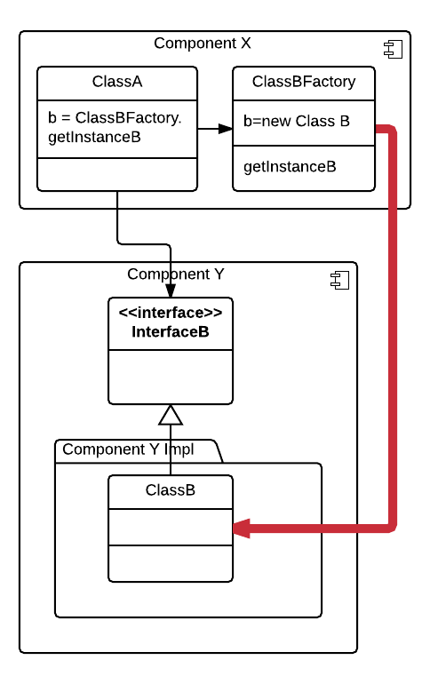
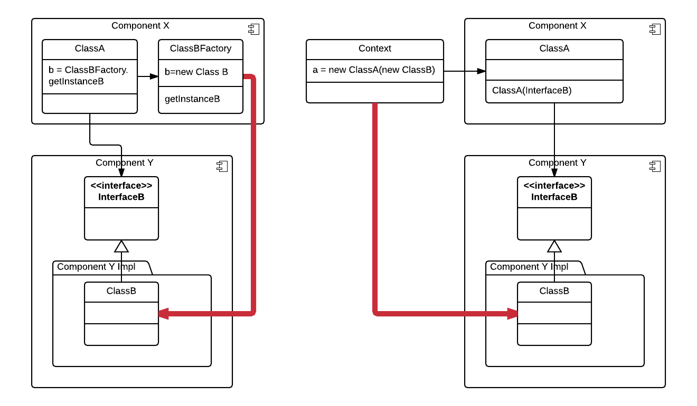
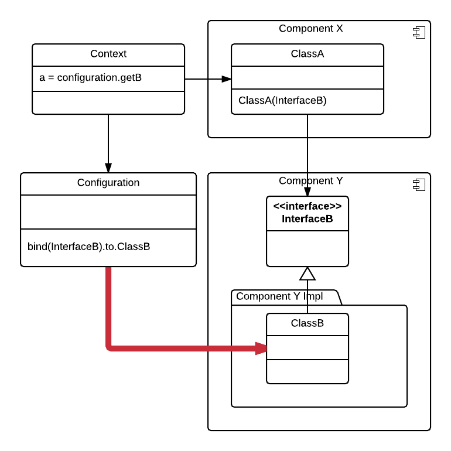

### Prof. Dr. Marko Boger
## Software Engineering
# Lecture 11: Dependency Injection

---

# Direct Dependency

<div class="columns" style="grid-template-columns: 1.2fr 1fr; align-items: start;">
<div>

- Class A directly depends on Class B. Component Y cannot be exchanged without changing Class A/Component X.

</div>
<div>



</div>
</div>

---

# Dependency on Interface

<div class="columns" style="grid-template-columns: 1.2fr 1fr; align-items: start;">
<div>

- Now Class A depends on the Interface of B. But to create an instance of B it still needs to call `new ClassB` directly.

</div>
<div>



</div>
</div>

---

# Implementation Package

<div class="columns" style="grid-template-columns: 1.2fr 1fr; align-items: start;">
<div>

- Now the implementation can be exchanged, but in Class A the import path still has to be changed.

</div>
<div>



</div>
</div>

---

# Factory

- The dependency can be delegated to a Factory. This can be placed in Component X or Y.

<div style="text-align:center;">

 

</div>

---

# Dependencies in Constructors only

<div class="columns" style="grid-template-columns: 1.2fr 1fr; align-items: start;">
<div>

- If all dependencies are parameters of the constructor and the creation is always done in a higher level Context the implementation can easily be exchanged in the Context. This is already a very clean situation.

</div>
<div>



</div>
</div>

---

# Dependency Injection

<div class="columns" style="grid-template-columns: 1.2fr 1fr; align-items: start;">
<div>

- If we can get the new instance from a high level configuration, there would only be one place in which all implementation exchanges would take place. This is a pattern called Dependency Injection. It works best if dependencies are only in the Constructors.

</div>
<div>



</div>
</div>

---

# DI Frameworks

- DI Frameworks can make use of the DI Pattern and make the introduction simple. They essentially work by providing Factories on the fly.
- They need to know the dependency hierarchy from a configuration and often work with annotations.
- Examples of DI Frameworks include
  - Google Guice
  - Spring DI
  - Pico Container

---

# Google Guice

- Google Guice is a lightweight DI Framework.
- it is written in Java
- configuration is done in Java
- Compiler can find errors in the configuration

---

# Scala Guice

- Scala Guice is a wrapper for Google Guice that keeps the nature of it but adds Scala syntax.
- Import it from sbt
```scala
libraryDependencies += "net.codingwell" %% "scala-guice" % "7.0.0"
"
```

---

# Defining the Interfaces

<style scoped>
pre { font-size: 14px; }
</style>

```scala
import com.google.inject.{AbstractModule, Guice, Inject}
import net.codingwell.scalaguice.ScalaModule

trait Payment {
 def pay
}

class PaymentInCash extends Payment {
 override def pay = println("I am paying with cash")
}

class PaymentWithCard extends Payment {
 override def pay = println("Here is my credit card")
}

class Order @Inject() (payment: Payment){
 def handleOrder: Unit = {
   payment.pay
 }
}
```

---

# Creating the Instance

<style scoped>
pre { font-size: 15px; }
</style>

```scala
class OrderModule extends AbstractModule with ScalaModule {
 def configure(): Unit = {
   bind[Payment].to[PaymentWithCard]
 }
}

import net.codingwell.scalaguice.InjectorExtensions._

object OrderServer {
 def main(args: Array[String]) {
   val injector = Guice.createInjector(new OrderModule())

   val orderService = injector.instance[Order]
   orderService.handleOrder
 }
}
```

---

# Guice in Scala 3

<style scoped>
pre { font-size: 16px; }
</style>

- For Scala 3 the syntax for Google Guice has changed a bit:
```scala
//Klasse mit Bindings
class WizardModule extends AbstractModule  {
 override def configure(): Unit = {
   bind(classOf[IController]).to(classOf[baseImplementation.Controller])
   bind(classOf[FileIO])
      .to(classOf[xmlIO.FileIOXML])
   bind(classOf[IPlayer])
     .to(classOf[Player])
 }
}

//Erstellung und verwendung des Injectors in einer Klasse
class Controller() extends IController {
  val injector = Guice.createInjector(new WizardModule)
  val fileIo = injector.getInstance(classOf[FileIO])
```

---

# Given/Using for DI in Scala 3

- A new mechanism in Scala 3 makes DI even simpler.

- The implementations for interfaces can be “given” on module level
```scala
object Default {
  given  IController = Controller()
}
```

- And then be used inside the module
```scala
import de.htwg.se.wizard.controller.modules.Default.{given}

class TUI(using controller: IController) extends UI {
```

---

<!-- _class: aufgabe -->

# Task: Use Dependency Injection

- Define a Module
- Bind your Interfaces of your Components to Instances here
- Create an Injector in your main
- Create Instances of your Components
- Inject your Component Instances into the other Components

---

<!-- _class: abschluss -->

# Questions?

## Thank you!

marko.boger@htwg-konstanz.de
