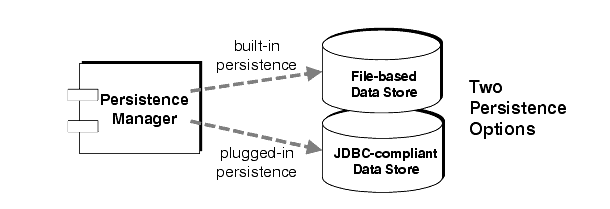
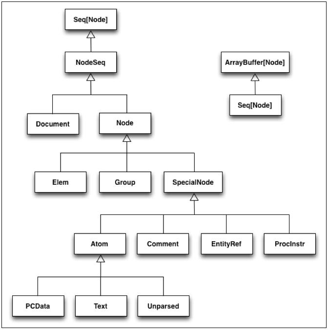

### Prof. Dr. Marko Boger
## Software Engineering
# Lecture 12: File IO

---

# Persistence

<div class="columns" style="grid-template-columns: 1.2fr 1fr; align-items: start;">
<div>

- Persistence is the characteristic of data or state that outlives the lifetime of a process or program.
- Persistence can be implemented using file-based data storage or a database.
- Databases will be introduced in the lecture Software Architecture.
- Here we will look at two file-based mechanisms, XML and JSON.

</div>
<div>



</div>
</div>

---

# XML

- XML is the Extensible Markup Language.
- It was first introduced in 1996 (same year as Java) and was a huge hype around year 2000, together with the rise of the Internet.
- It is based on SGML, a framework for markup languages.
- It is intended to be well readable by humans and machines alike.
- XML documents can be compliant to a grammar, expressed in DTD (Document Type Definition) or XSD (XML Schema Definition).
- Tags are enclosed in < and >

---

# Data in XML

- The following XML document contains data about a book: its title, authors, date of publication, and publisher.
```xml
<Book>
    <Title>Parsing Techniques</Title>
    <Authors>
        <Author>Dick Grune</Author>
        <Author>Ceriel J.H. Jacobs</Author>
    </Authors>
    <Date>2007</Date>
    <Publisher>Springer</Publisher>
</Book>
```

---

# XML in Scala

- Scala’s development started in 2003 at the height of XMLs popularity.
- XML was directly integrated into the core of the language. In order to achieve this the < and > were not used as brackets (i.e. for generic types as in Java).

- It is now separated out into a library.
- To add it, include the following into your sbt.build file:
```scala
libraryDependencies += "org.scala-lang.modules" %% "scala-xml" % "2.4.0"
```

---

# XML Literals

- In Scala an XML data structure can directly be assigned to a variable or returned as a result of a function.
```scala
val data = <people><person><name>joe</name><age>40</age></person> <person><name>mary</name><age>39</age></person></people>
```

- To insert data values, curly braces work as a template.
```scala
def toXml() = <person><name>{ name }</name><age>{ age }</age></person>
```

---

# toXML in Scala

```scala
class Person(name : String, age : Int){
def toXml() = <person><name>{ name }</name><age>{ age }</age></person>
}
object xml {
val people = List( new Person("Alice", 16), new Person("Bob", 64) )
val data = <people>{ people.map(p => p.toXml()) }</people>
def main(args : Array[String]) = println(data)
}
```

---

# NodeSeq and Elem

<div class="columns" style="grid-template-columns: 1.2fr 1fr; align-items: start;">
<div>

- The most important types used in the XML library are NodeSeq and Elem

</div>
<div>



</div>
</div>

---

# Methods of Elem

<style scoped>
section { font-size: 17px; padding-top: 20px; }
table { font-size: 13px; }
h1 { margin-bottom: 4px; }
</style>

| Method | Description |
|---|---|
| `x \ "div"` | Searches the XML literal x for elements of type `<div>`. Only searches immediate child nodes (no grandchild or “descendant” nodes). |
| `x \\ "div"` | Searches the XML literal x for elements of type `<div>`. Returns matching elements from child nodes at any depth of the XML tree. |
| `x.attribute("class")` | Returns the value of the given attribute in the current node.<br>`<a x="10" y="20">foo</a>.attribute("x")   // returns Some(10)` |
| `x.attributes` | Returns all attributes of the current node, prefixed and unprefixed, in no particular order.<br>`<a x="10" y="20">foo</a>.attributes   // x="10" y="20"` |
| `x.child` | Returns the children of the current node.<br>`<a><b>foo</b></a>.child   // returns <b>foo</b>` |
| `x.copy(...)` | Returns a copy of the element, letting you replace data during the copy process. |
| `x.label` | The name of the current element.<br>`<a><b>foo</b></a>.label   // returns a` |
| `x.text` | Returns a concatenation of text(n) for each child n. |
| `x.toString` | Emits the XML literal as a String. |

Use `scala.xml.PrettyPrinter` to format the output, if desired.

---

# Reading from XML

- Parse the XML using `\` and `\\`
```scala
scala> val x = <div class="content"><p>Hello</p><p>world</p></div>
x: scala.xml.Elem = <div class="content"><p>Hello</p><p>world</p></div>

scala> x \ "p"
res0: scala.xml.NodeSeq = NodeSeq(<p>Hello</p>, <p>world</p>)

scala> x \\ "p"
res1: scala.xml.NodeSeq = NodeSeq(<p>Hello</p>, <p>world</p>)
```

---

# An Example: Stock

- toXML
```xml
case class Stock(symbol: String, businessName: String, price: Double) {

  // convert Stock fields to XML
  def toXml = {
    <stock>
      <symbol>{symbol}</symbol>
      <businessName>{businessName}</businessName>
      <price>{price}</price>
    </stock>
  }

}
```

---

# An Example: Stock

- fromXML
```scala
object Stock {

  // convert XML to a Stock
  def fromXml(node: scala.xml.Node):Stock = {
    val symbol = (node \ "symbol").text
    val businessName = (node \ "businessName").text
    val price = (node \ "price").text.toDouble
    new Stock(symbol, businessName, price)
  }

}
```

---

# JSON

- JSON is the JavaScript Object Notation.
- It is the data-oriented subset of JavaScript and was formally described by Douglas Crockford, a pioneer in JavaScript in the early 2000s.
- JSON data can directly be assigned to a JavaScript variable. It is very common in browser-server communication but has become a very widespread data transfer format.
- JSON uses name-value-pairs to address data.
- As data types it has only Number, String, Boolean, Array and Object.

---

# Data in JSON

- An example of Data in JSON format:
```json
{
    "Book":
        {
            "Title": "Parsing Techniques",
            "Authors": [ "Dick Grune", "Ceriel J.H. Jacobs" ],
            "Date": "2007",
            "Publisher": "Springer"
        }
}
```

---

# JSON in Scala

- JSON is supported by many languages and is used as data transport format across many systems and languages.

- However, in all languages besides JavaScript, JSON needs to be mapped  to and from language-internal concepts, i.e. a map.
- For this we need a library to support the mapping.
- There are a number of libraries.
- We will use the one supported by Play: Play-Json.
- To include it include the following into your sbt.build file:
```scala
libraryDependencies += "com.typesafe.play" %% "play-json" % "3.0.4"
```

---

# Play-Json: Basic Datatypes

- Play-Json can convert data using Json.toJson for datatypes it knows.
```scala
import play.api.libs.json._

// basic types
val jsonString = Json.toJson("Fiver")
val jsonNumber = Json.toJson(4)
val jsonBoolean = Json.toJson(false)

// collections of basic types
val jsonArrayOfInts = Json.toJson(Seq(1, 2, 3, 4))
val jsonArrayOfStrings = Json.toJson(List("Fiver", "Bigwig"))
```

---

# Play-Json:Maps

<style scoped>
pre { font-size: 15px; }
</style>

- To simulate the name-value-pairs of JSON, Play-Json uses the map notation.
```scala
import play.api.libs.json.{ JsNull, Json, JsString, JsValue }
val json: JsValue = Json.obj(
  "name" -> "Watership Down",
  "location" -> Json.obj("lat" -> 51.235685, "long" -> -1.309197),
  "residents" -> Json.arr(
    Json.obj(
      "name" -> "Fiver",
      "age" -> 4,
      "role" -> JsNull
    ),
    Json.obj(
      "name" -> "Bigwig",
      "age" -> 6,
      "role" -> "Owsla"
    )
  )
)
```

---

# Play-Json: Own Datatypes

- To convert your own data type T (case classes), provide an (implicit) implementation for a Writes[T]
```scala
case class Location(lat: Double, long: Double)

import play.api.libs.json._

implicit val locationWrites = new Writes[Location] {
  def writes(location: Location) = Json.obj(
    "lat" -> location.lat,
    "long" -> location.long
  )
}
val json = Json.toJson(Location(51.235685, -1.309197))
```

---

# Play-Json: Automated Macro

- A macro allows to discover the structure automatically for case classes. A macro is translated at compile time into code similar to the above.

```scala
case class Location(lat: Double, long: Double)
object Location {
   import play.api.libs.json._
   implicit val locationWrites = Json.writes[Location]
}

val json = Json.toJson(Location(51.235685, -1.309197))
```

---

# Play-JSON: Reading from JSON

- Reading from JSON is very similar to reading from XML. Also use the methods \ and \\.
```scala
val lat = (json \ "location" \ "lat").get
// returns JsNumber(51.235685)
```

---

# Play-JSON: Converting Data Types

- Similar to the conversion to JSON for your own data type T, data can be converted automatically by providing a Reads[T]
```scala
import play.api.libs.json._
case class Location(lat: Double, long: Double)
object Location {
 //implicit def locationFormat = Json.format[Location]
 implicit def locationWrites = Json.writes[Location]
 implicit def locationReads = Json.reads[Location]
}
val locationInJson = Json.toJson(Location(51.235685, -1.309197))
val jsonStr=locationInJson.toString()
Json.parse(jsonStr).validate[Location] match {
 case JsSuccess(location, _) => println(location)
 case JsError(_) => println("parsing failed")
}
```

---

# Play-JSON: Converting Data Types using Macros

- Similar to the conversion to JSON for your own data type T, data can be converted automatically by providing a Reads[T]
```scala
case class Location(lat: Double, long: Double)
import play.api.libs.json._

implicit val locationReads = Json.reads[Location]
val locationFromJson: JsResult[Location] = Json.fromJson[Location](jsonString)

locationFromJson match {
  case JsSuccess(l: Location, path: JsPath) => println("Lat: " + l.lat)
  case e: JsError => println("Errors: " + JsError.toJson(e).toString())
}
```

---

# Writing to a File in Scala

- To write to a file, Scala reuses Java.
- Create a File with a name, then use a PrintWriter with it.
```scala
import java.io._
val pw = new PrintWriter(new File("hello.txt" ))
pw.write("Hello, world")
pw.close
```

---

# Reading from a File

- The XML library provides a method to load XML directly
```scala
val file = scala.xml.XML.loadFile("grid.xml")
```

- Scala.io has a Source class to load text files
```scala
val source: String = Source.fromFile("grid.json").getLines.mkString
val json: JsValue = Json.parse(source)
```

---

# Example Person

<style scoped>
pre { font-size: 15px; }
</style>

```scala
case class Date(year: Int = Today.year, month: Int = Today.month, day: Int = Today.day)

object Date {
 implicit val dateFormat = Json.format[Date]
}

case class Person(name:String, birthdate:Date) extends Ordered[Person]{
 override def compare(that: Person) = this.age - that.age
 def age = birthdate.fullYearsSince
 def age(date:Date) = birthdate.fullYearsSince(date)
}

object Person {
 //implicit val personFormat = Json.format[Person]
 implicit val personWrites = Json.writes[Person]
 implicit val personReads = Json.reads[Person]
```

---

# Test for Person

<style scoped>
pre { font-size: 13px; }
</style>

```scala
class PersonSpec extends WordSpec {
"A Person born on 4th of July in 1971" should {
val peter = new Person("Peter", new Date(1971, 7, 4))
"convert to JSON" in {
 val json = Json.toJson(peter)
 json.toString() should be ("{\"name\":\"Peter\",\"birthdate\":{\"year\":1971,\"month\":7,\"day\":4}}")
}
"convert from JSON " in {
 val json = Json.toJson(peter)
 json.asOpt[Person] match {
   case Some(person) => person should be (peter)
   case None => fail
 }
}
"convert from JSON String" in {
 val json = Json.toJson(peter).toString()
 Json.parse(json).validate[Person] match {
   case JsSuccess(person, _) => person should be (peter)
   case JsError(_) =>fail
 }
}
```

---

<!-- _class: aufgabe -->

# Task: Implement FileIO

- Implement FileIO using XML
- Implement FileIO using Json
- Hide both implementations behind the same Interface
- Make use of Dependency Injection to switch between these two implementations

---

<!-- _class: abschluss -->

# Questions?

## Thank you!

marko.boger@htwg-konstanz.de
