### Prof. Dr. Marko Boger
## Software Engineering
# Lecture 13: Docker

---

# Peer Review

<style scoped>
section { font-size: 22px; }
</style>

- Every Group has assigned 3 peer review groups.
- Look at the code of each of these 3 teams and evaluate their code.
- Evaluate the quality of the code by
- readability of the code
- readability of the test
- test coverage
- good naming
- documentation
- Java’isms, proper use of Scala
- Then sort the projects in an order, assign the best team 3, second best 2, third best 1 point.
- Enter that into the spreadsheet for both team members.

---

# Virtual Machines

<div style="text-align:center;">

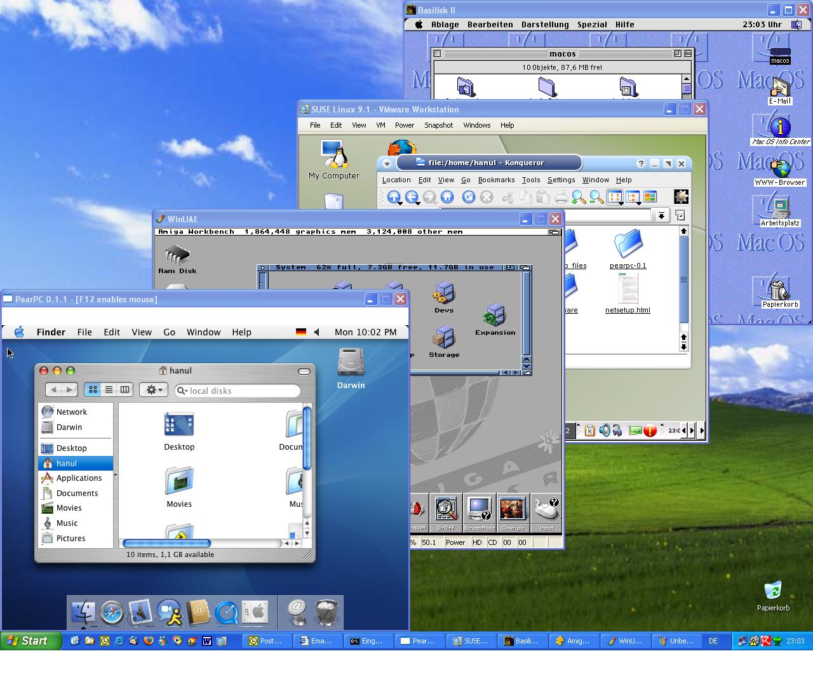

</div>

---

# Virtual Machines

<div class="columns" style="grid-template-columns: 1.2fr 1fr; align-items: start;">
<div>

```scala
A Virtual Machine emulates several computer systems on a physical host server machine. The hardware is shared. The operating system of the host can differ from the host. Popular products were Parallels or VMware.
```

</div>
<div>

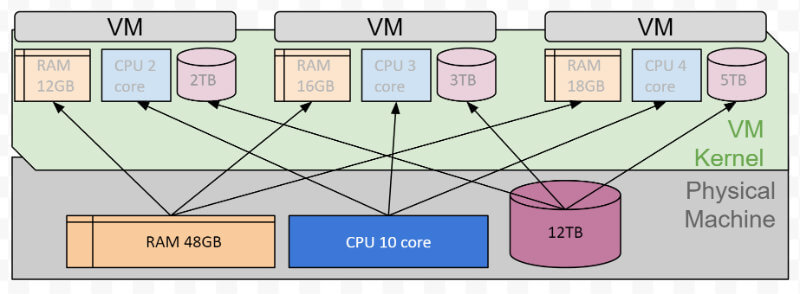

</div>
</div>

---

# Docker

<div class="columns" style="grid-template-columns: 1.2fr 1fr; align-items: start;">
<div>

- Docker is a virtualization tool.
- It was released to Open-Source in 2013.
- By 2017 it was downloaded 13 Billion times.
- It is written in Go and originally written for Linux, in 2016 ports to Windows were published.
- On Linux, it uses resource isolation features like cgroups and kernel namespaces and allows the reuse of the OS in the VM.

</div>
<div>

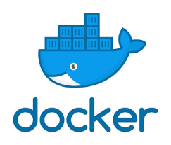

</div>
</div>

---

# An Analogy: Cargo transport

<div class="columns" style="grid-template-columns: 1.2fr 1fr; align-items: start;">
<div>

- Before 1960s various cargo had to be transported on various transportation means.

</div>
<div>

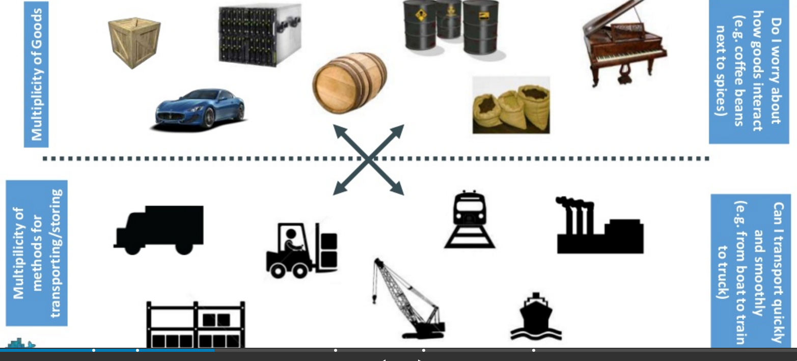

</div>
</div>

---

# Individual Solutions

<div style="text-align:center;">

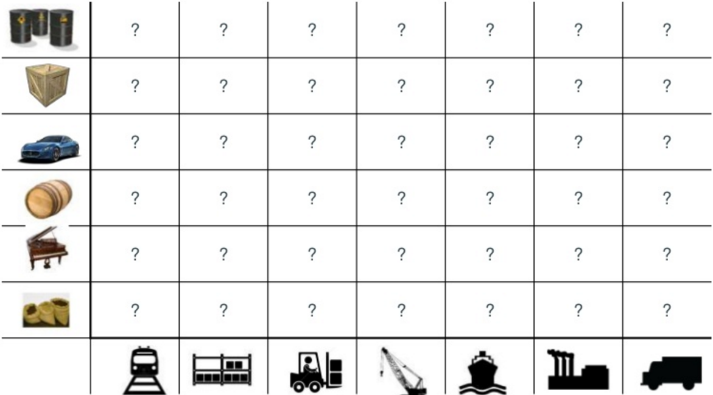

</div>

---

# Invention of the Container

<div class="columns" style="grid-template-columns: 1.2fr 1fr; align-items: start;">
<div>

- In the late 60s the Container was developed and standardized.

</div>
<div>

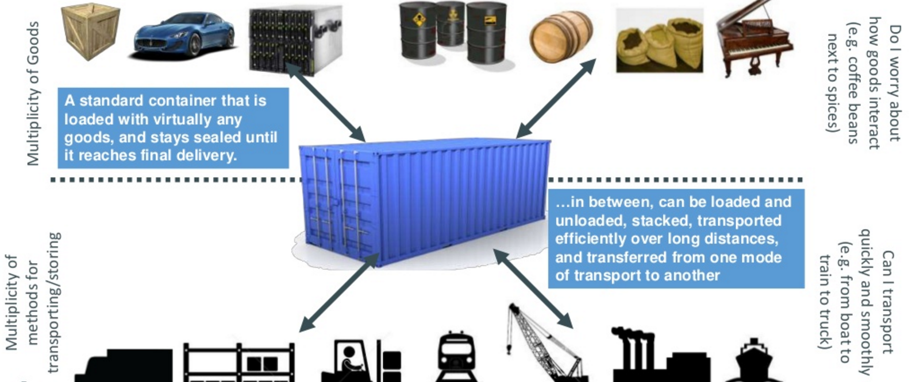

</div>
</div>

---

# Containers

<div class="columns" style="grid-template-columns: 1.2fr 1fr; align-items: start;">
<div>

- The Container allows a uniform treatment of all goods on all transportation means.

</div>
<div>

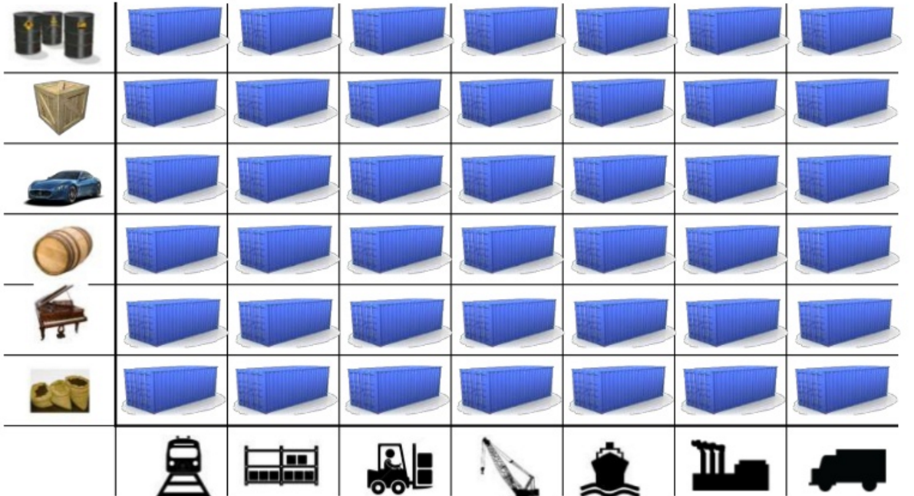

</div>
</div>

---

# How does that idea apply to IT?

<div style="text-align:center;">

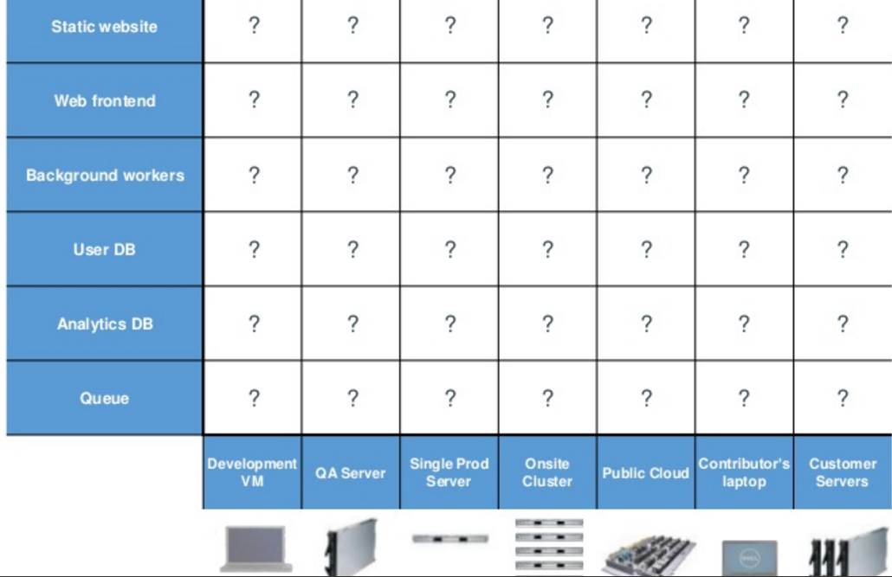

</div>

---

# Docker acts as Container for any software application

<div class="columns" style="grid-template-columns: 1.2fr 1fr; align-items: start;">
<div>

- Different software solutions can uniformly be run of different hardware.

</div>
<div>

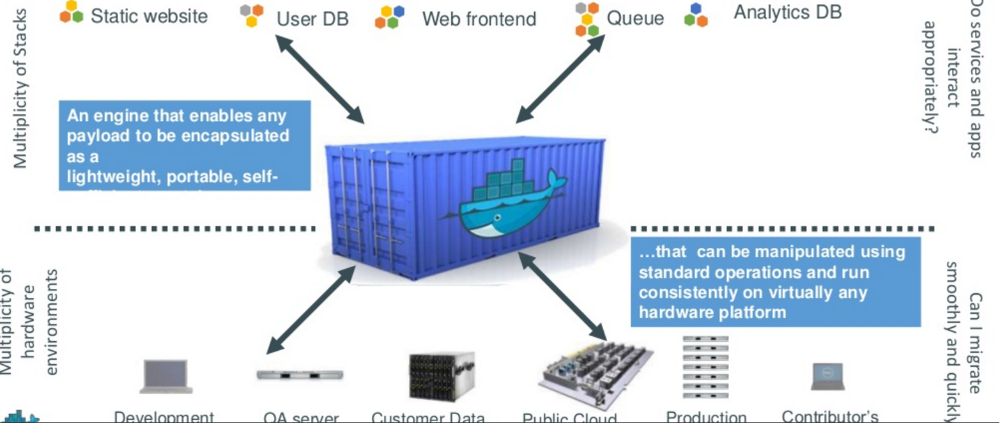

</div>
</div>

---

# Docker is more efficient that traditional VMs

<div style="text-align:center;">

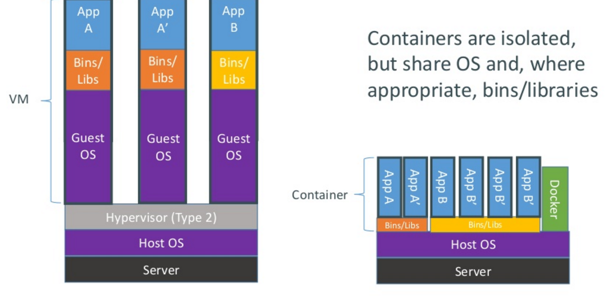

</div>

---

# Docker Containers are lightweight

<div style="text-align:center;">

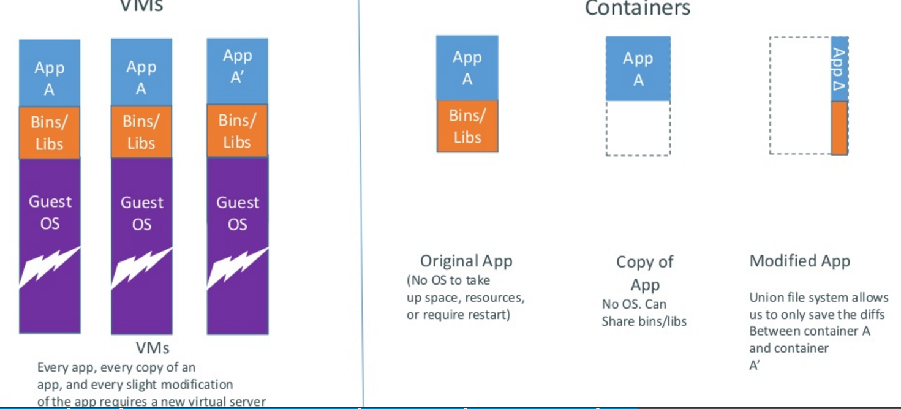

</div>

---

# Docker Engine

<div class="columns" style="grid-template-columns: 1.2fr 1fr; align-items: start;">
<div>

- Written in GO
- CLI: docker <cmd>
- Components
  - Image Builder
  - Daemon
  - Remote API via Rest

</div>
<div>

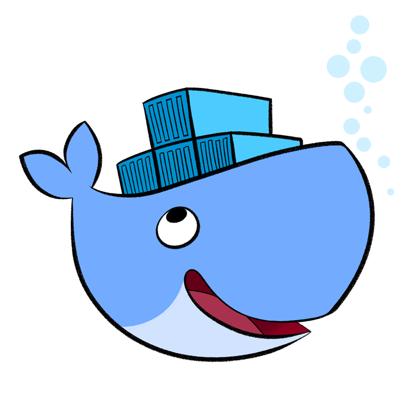

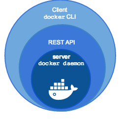

</div>
</div>

---

# Docker “Hello World”

<style scoped>
pre { font-size: 15px; }
</style>

- Docker runs as a daemon and can be called as CLI
```bash
docker run ubuntu echo Hello World
```

```text
$ docker run ubuntu echo Hello World
Unable to find image 'ubuntu:latest' locally
latest: Pulling from library/ubuntu
84ed7d2f608f: Pull complete
be2bf1c4a48d: Pull complete
a5bdc6303093: Pull complete
e9055237d68d: Pull complete
Digest: sha256:868fd30a0e47b8d8ac485df174795b5e2fe8a6c8f056cc707b232d65b8a1ab68
Status: Downloaded newer image for ubuntu:latest
Hello World
$ docker run ubuntu echo Hello World
Hello World
$
```

---

# Docker Commands

<style scoped>
pre { font-size: 15px; }
</style>

```bash
docker build -t friendlyname .  # Create image using this directory's Dockerfile
docker run -p 4000:80 friendlyname  # Run "friendlyname" mapping port 4000 to 80
docker run -d -p 4000:80 friendlyname         # Same thing, but in detached mode
docker ps                                 # See a list of all running containers
docker stop <hash>                     # Gracefully stop the specified container
docker ps -a           # See a list of all containers, even the ones not running
docker kill <hash>                   # Force shutdown of the specified container
docker rm <hash>              # Remove the specified container from this machine
docker rm $(docker ps -a -q)           # Remove all containers from this machine
docker images -a                               # Show all images on this machine
docker rmi <imagename>            # Remove the specified image from this machine
docker rmi $(docker images -q)             # Remove all images from this machine
docker login             # Log in this CLI session using your Docker credentials
docker tag <image> username/repository:tag  # Tag <image> for upload to registry
docker push username/repository:tag            # Upload tagged image to registry
docker run username/repository:tag                   # Run image from a registry
```

---

# Image

- An Image is a persisted snapshot of a container that can be run.
- Local images are created before a container is run. Downloading, running and deleting images can be managed.
- Commands for Images are:
- images: List all local images
- run: Create a container from an image and execute a command in it
- tag: Tag an image
- pull: Download image from repository
- rmi: Delete a local image
  - This will also remove intermediate images if no longer used

---

# Container

<style scoped>
section { font-size: 22px; }
</style>

- A container is an instance of an image.
- Commands for containers are:
- ps: List all running containers
- ps –a: List all containers (incl. stopped)
- top: Display processes of a container
- start: Start a stopped container
- stop: Stop a running container
- pause: Pause all processes within a container
- rm: Delete a container
- commit: Create an image from a container

---

# Docker Hub

<div class="columns" style="grid-template-columns: 1.2fr 1fr; align-items: start;">
<div>

- Docker Hub is a repository of pre-built containers.
- Here you can search and select a container.
- For working with scala and sbt, the container created by
- sbtscala or hseeberger is good.

</div>
<div>

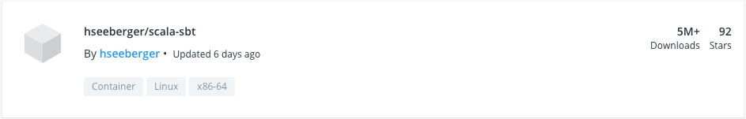

</div>
</div>

---

# Dockerfile

<div style="text-align:center;">

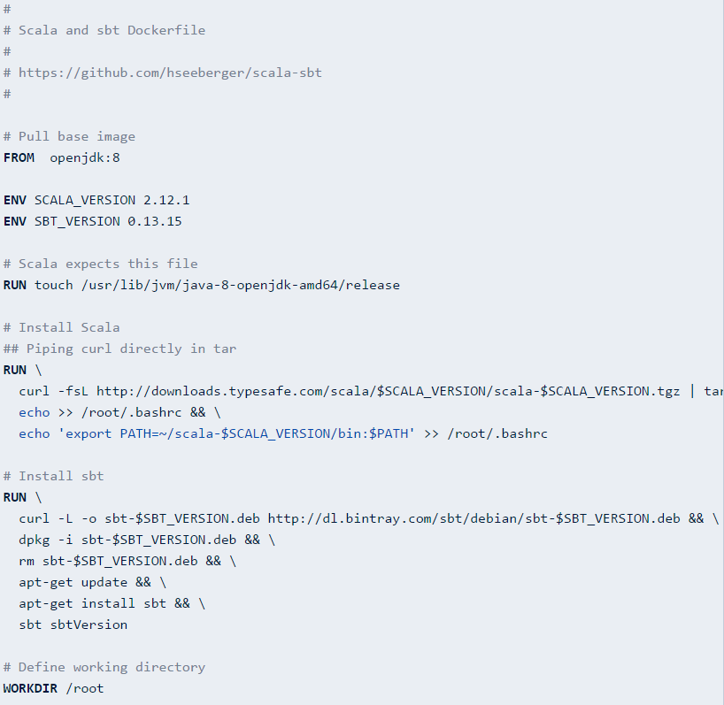

</div>

---

# Dockerizing your Application

- Define a Dockerfile in the root of your project. It should contain a base image, install further stuff as needed.
```dockerfile
FROM hseeberger/scala-sbt
WORKDIR /sudoku
ADD . /sudoku
CMD sbt run
```

- Then build the image with a tag
```bash
docker build -t sudoku:v1 .
```

- And run your app
```bash
docker run -ti sudoku:v1
```

- Log in to Dockerhub using docker login

---

# GUI under Docker

- On windows install XQuarz, Xming or XLaunch
```dockerfile
FROM hseeberger/scala-sbt:8u222_1.3.5_2.13.1
RUN apt-get update && \ apt-get install -y sbt libxrender1 libxtst6 libxi6 WORKDIR /blackjack ADD . /blackjack
CMD sbt run
```

- on the command line, execute
```scala
ip=$(ifconfig en0 | grep inet | awk '$1=="inet" {print $2}')
xhost + $ip
```

- Then start docker
```bash
docker run -e DISPLAY=$ip:0 -v /tmp/.X11-unix:/tmp/.X11-unix -ti blackjack:v1
```

---

<!-- _class: aufgabe -->

# Task: Deploy on Docker

- Select a Docker Container template that supports your software well.
- Write a Docker script to adjust it to your needs and
- deploy your game on a Docker Container.

---

# What you have learned

<div class="columns" style="grid-template-columns: 1fr 1fr;">
<div>

- Agile development
- Test driven development
- Functional Programming
- Scala
- Version Control
- Continuous Integration
- Continuous Delivery and Deployment
- Layering

</div>
<div>

- MVC-Architecture
- OO Pattern
- FP Pattern
- Components
- DI
- XML and JSON
- Virtualization (Docker)

</div>
</div>

---

<!-- _class: abschluss -->

# Questions?

## Thank you!

marko.boger@htwg-konstanz.de
