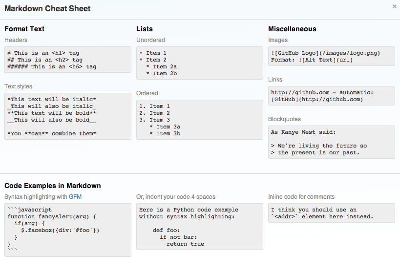
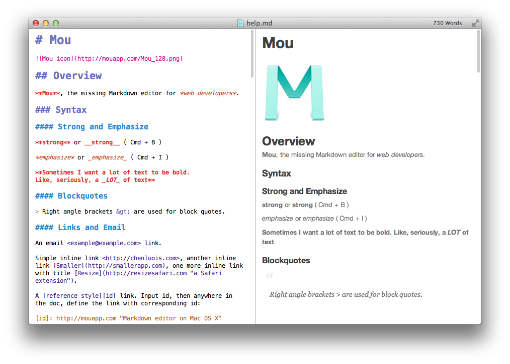

### Prof. Dr. Marko Boger
## Software Engineering
# Lecture 14: Logging

---

# In case of a bug, what should we do?

- Possible answers:
  - Run a debugger
  - Insert text output
  - Increase number of tests
  - Make the code more understandable

---

# Bug avoidance and Bug search

<style scoped>
section { font-size: 22px; }
</style>

- Prio 1: Clean Architecture
  - Separate layers and components
  - Bugs can then be confined into single components
- Prio 2: Clean Code
  - Write clean, readable code; good metrics; low complexity; no tangles...
  - This reduces the risk of bugs and makes it easier to find them
- Prio 3: Tests
  - Full code coverage does not prevent bugs, but often catches new bugs as you write them.
  - In case of new bugs, write more tests. Isolate the bug in a failing test.
  - Test code remains valuable, tightens your safety net and avoids the problem ever after.
- Prio 4: Interact with the code early
  - Build a TUI long before you start work on a GUI
  - Java makes direct interaction with objects hard. In Scala this is possible.

---

# Bug avoidance and Bug search

<style scoped>
section { font-size: 22px; }
</style>

- Prio 5: Logging
  - Write text output to the console
  - BUT:
    - System.out.println pollutes your code
    - Requires manual clean-up after the code is found
  - Instead, use a log mechanism
    - Logging can be turned on and off per class
    - Log code can be maintained
- Prio 6: Debugger
  - The debugger should be your last resort
  - Debugging is tedious, time consuming and non-repeatable

---

# Logging Methods

<style scoped>
section { font-size: 22px; }
</style>

- Logging can be done manually
  - System.out.println is very primitive
  - Developing something more useful is not your main task
  - But it has been done before
  - Logging frameworks exist -> reuse them
- Log frameworks can be configured to output to different channels and to different formats
  - Console
  - File
  - Database
  - Email/SMS Notifications
  - Log to a socket

---

# Logging Frameworks

- Log4j, Apache
- Simple Logging Facade for Java (SLF4J)
- Avlon Logkit,
- Java’s standard logging mechanism
  - Modeled after Log4j

---

# Log4j Basics

<style scoped>
section { font-size: 22px; }
</style>

- Logger
  - Logger objects accept messages to be logged
  - They are created per class
  - They can form a hierarchy
- Log Level
  - Each log message is created with a priority, the log level
  - Low level messages can be filtered out
  - The level can be configured
- Appender
  - The Appender writes the log messages to a certain channel
- Layout
  - The Layout configures the format of the log message

---

# Appender

<style scoped>
section { font-size: 22px; }
</style>

- Prebuilt Appenders
  - ConsoleAppender, DailyRollingFileAppender, FileAppender, JDBCAppender, JMSAppender, NTEventLogAppender, RollingFileAppender, SMTPAppender, SocketAppender, SyslogAppender, TelnetAppender
- Layouts: %5p [%t] %d{ISO8601} %c{2} (%F:%L) - %m%n
  - 5 letter for level (priority)
  - Thread
  - Date and time 2012-11-02 14:34:02,781
  - Logger name (package and class name)
  - File
  - Line
  - Message
  - New line

---

# Using Log4j

- Load the configuration
```java
public static void main(String[] args) {
  // Set up logging through log4j
  PropertyConfigurator.configure("log4j.properties");
```

- Create Logger per class
```java
private Logger logger = Logger.getLogger("de.htwg.sudoku.aview.tui");
```

- Create log messages
```java
public void printTUI() {
  logger.info(newLine + controller.getGridString());
  logger.info(newLine + controller.getStatus());
}
```

---

# Log4j Configuration

<style scoped>
pre { font-size: 15px; }
</style>

```scala
log4j.rootLogger=debug, stdout, R

log4j.appender.stdout=org.apache.log4j.ConsoleAppender
log4j.appender.stdout.layout=org.apache.log4j.PatternLayout

# Pattern to output the caller's file name and line number.
log4j.appender.stdout.layout.ConversionPattern=%5p [%t] (%F:%L) - %m%n

log4j.appender.R=org.apache.log4j.RollingFileAppender
log4j.appender.R.File=sudoku.log

log4j.appender.R.MaxFileSize=100KB
# Keep one backup file
log4j.appender.R.MaxBackupIndex=1

log4j.appender.R.layout=org.apache.log4j.PatternLayout
log4j.appender.R.layout.ConversionPattern=%p %t %c - %m%n
```

---

# Log4j Optimization & Best Practises

- Use logger as private static variable
- Only one instance per class
- Name logger after class name
- Use a single or very few appenders
- Prioritize messages with proper levels

---

# Logging in Scala

<style scoped>
section { font-size: 22px; }
</style>

- A wrapper for SLF4J is provided by Typesafe called scala-logging
- Four steps
  - Add dependencies to build.sbt
    - libraryDependencies += "com.typesafe.scala-logging" %% "scala-logging" % "3.5.0"
    - libraryDependencies += "ch.qos.logback" % "logback-classic" % "1.1.7"
  - Create a logback.xml in folder src/main/resources/ for config.
  - Extend all classes that need to use logging with LazyLogging
    - MyClass extends LazyLogging
  - Use logger
    - logger.debug(„debug message“)
    - logger.info(„tui output“)

---

# Use Scala Logging

- Change your TUI to output into the logger
  - The TUI should be the only area where you explicitly use a logger.
  - This turns the TUI into a meaningful, persistent mechanism instead of dead code.
  - Configure your Appenders to write to a file and the console
    - The file should be rolling
- Optionally: Write a wrapper class for your controller to log all important interaction
  - Make this configurable using DI
- Avoid logger code in other parts of your code

---

# Resources

- Log4J
  - <http://logging.apache.org/log4j/>
  - <https://logging.apache.org/log4j/2.x/manual/scala-api.html>

---

# Writing for an audience

<style scoped>
section { font-size: 22px; }
</style>

- User
  - How to download, install, deploy, setup, run
- Developer
  - On-boarding new developers, Open source
    - General structure, Context, Purpose, Restrictions
  - User of a component
    - Interface, Protocol, Contract
  - Developer of a component
    - Classes, Pattern, Data structures, Algorithms
    - Design alternatives not used

---

# Relevant Documentation

<style scoped>
section { font-size: 22px; }
</style>

- JavaDoc
  - Interfaces
  - Classes
- Tests
- Contract
  - Require, invariant, ensure
- Exceptions
- UML
- Layer/Component structure
- Text documents

---

# Technologies for Text

- Word
- Google Docs
- Wiki
- Github Markdown

---

# Markdown

- Markdown was originally a language invented by John Gruber
- There are now various flavors and it is more of a low tech approach to text
- The main goal is that the source text already is readable
  - In contrast to HTML or other markup
  - Inspired by the way you would write an email

---

# Markdown Cheat Sheet

<div style="text-align:center;">



</div>

---

# Tools

<div style="text-align:center;">



</div>

---

# Write Documentation

- Write JavaDoc documentation for all Interfaces
- Write Mark Down documentation for the overall application and architecture in md and put it on github
- Prepare Slides for your presentation
- Hand in your github repository in moodle
- Hand in your Slides and link to them in github from md

---

<!-- _class: abschluss -->

# Questions?

## Thank you!

marko.boger@htwg-konstanz.de
